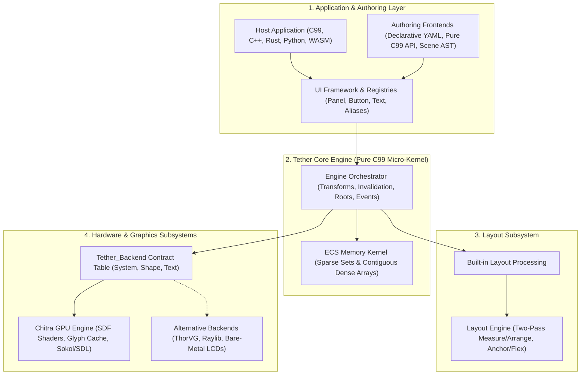

<div align="center">

# Tether UI Engine
### **TETHER** : TETHER - ECS Toolkit for High-Efficiency Runtime

*Version 0.0.3 (Developer Preview)*

[](https://github.com/Yuvi-GD/Tether/actions/workflows/ci.yml)


[](LICENSE)

[**Quick Start**](#9-building--running) &nbsp;|&nbsp;
[**Architecture**](#3-cell-block-subsystem-architecture) &nbsp;|&nbsp;
[**Widget Suite**](#5-built-in-widget-suite) &nbsp;|&nbsp;
[**Docs Hub**](docs/index.md) &nbsp;|&nbsp;
[**Contributing**](CONTRIBUTING.md) &nbsp;|&nbsp;
[**Releases**](https://github.com/Yuvi-GD/Tether/releases)

</div>

Tether is an open-source C engine for building user interface libraries. It combines entities, components, layout, input, and reusable widgets; the sandbox uses YAML and C to build interfaces rendered through Chitra. The project is a developer preview, with portability and additional backends under development.

---


---
## 1. Architectural Vision: The "PDF of Interactive User Interfaces"

Digital computing solved media portability decades ago by establishing open, vendor-neutral file specifications:
- **Audio has MP3 / FLAC**: Plays consistently on any speaker, smartphone, or dashboard, isolated from DAC hardware or audio drivers.
- **Images have PNG / JPEG**: Renders the exact same pixels across all viewers, isolated from graphics cards.
- **Documents have PDF (Portable Document Format)**: Preserves typography, spatial layout, and vector curves identically across all operating systems and printers.

**User interfaces have historically lacked this universal standard.**

For decades, graphical interfaces have remained trapped inside vendor-locked compilers (Win32, Cocoa, Qt), proprietary game engine codebases, or bloated multi-hundred-megabyte browser engines (Chromium/Electron).

Tether's long-term vision is a portable, open way to describe interactive interfaces. A future bytecode format (`.tbc`) and support for the following environments are roadmap ideas, not capabilities established by this preview:
- An automotive touchscreen or medical monitor running an RTOS,
- A bare-metal microcontroller driving an SPI or parallel LCD,
- A modern web browser executing WebAssembly via WebGPU or Canvas,
- A high-end desktop workstation running DirectX 11, Metal, or Vulkan,
- An AAA game engine viewport in Unreal, Unity, or custom engines.

---

## 2. Core Architectural Highlights

Tether abandons the traditional Document Object Model (DOM), virtual DOM diffing, and deeply nested C++ object-oriented inheritance trees in favor of six foundational systems-level properties:

### 1. Retained State and Invalidation
Tether retains UI state and uses dirty tags (`DIRTY_LAYOUT`, `DIRTY_VISUAL`, `DIRTY_HIERARCHY`) to identify changes. Volatile entities can also be updated continuously. Idle CPU and GPU usage depend on the application and backend and have not been established as zero.

### 2. Data-Oriented UI-ECS
UI components are stored in type-specific dense arrays with sparse lookup. Memory use depends on the scene, component capacities, text, and backend resources; embedded memory targets remain to be measured.

### 3. Managed Component Storage
Component pools grow as needed, and text may allocate when its contents change. Reducing runtime allocations is a goal, not a guarantee for all operations.

### 4. Separation of Layout Space from Render Space
Tether separates layout geometry (`Tether_SlotTransform`) from presentation (`Tether_RenderTransform`). Some visual updates can avoid layout; text transform changes may rebuild glyph geometry and are not GPU-only operations.

### 5. Universal 64-Bit Generational Handles (`Tether_GUID`)
Entity identifiers contain an index and generation, and `tether_ecs_is_valid()` checks their validity. Component APIs also expose pointers; callers must reacquire them after mutations that can move component storage.

### 6. YAML and C Authoring
Declarative YAML and C can use the same registered widget factories:
- Interfaces declared in YAML and interfaces declared imperatively via the fluent `tether_ui` API instantiate the same underlying ECS components.
- The Sandbox supports manual UI refresh and reloading declarative YAML scenes during development (by rebuilding the active subtree).

---

## 3. Cell-Block Subsystem Architecture

Tether is organized into autonomous functional cells that communicate through explicit, minimal C interface contracts:



---

## 4. Rendering Pipeline: Chitra

Tether isolates all hardware rasterization behind an abstract Render Hardware Interface (RHI). Default 2D GPU rendering is driven by **[Chitra](https://github.com/Yuvi-GD/Chitra)**:

* **Retained Command Table:** UI primitives are tracked in contiguous 16-byte command slots with 64-bit visual sort keys.
* **Radix Sort Z-Banding:** Coalesces draw calls by pipeline state, scissor clip regions, and texture bindings using high-speed LSD Radix Sort.
* **SDF Primitives:** Draws rounded rectangles and borders with a shape shader.
* **Dynamic Glyph Atlas:** Integrates Fontstash for high-performance glyph rasterization and texture caching.
* **Hardware Scissor Clipping:** Nested clipping regions are calculated hierarchically and submitted directly to hardware scissor registers.
* **Driver-Agnostic Abstraction:** Chitra supports multiple low-level backends (DirectX 11, Apple Metal, OpenGL Core, OpenGL ES) through Sokol.

---

## 5. Built-in Widget Suite

Tether ships with built-in widgets and semantic state components (`Tether_ValueRange`, `Tether_BoolState`, `Tether_SelectionState`). YAML exposes a subset of their C API properties:

| Category | Built-in Widgets |
| :--- | :--- |
| **Primitives & Containers** | `Container`, `Panel`, `Text`, `tether_list` |
| **Actions & Inputs** | `Button`, `Toggle`, `Checkbox`, `Radio`, `Slider`, `SegmentedBar` |
| **Navigation & Disclosure** | `Menu`, `Dropdown`, `ContextMenu`, `Collapsible`, `Switcher` |
| **Feedback & Status** | `ProgressBar`, Disabled states (`tether_widget_set_enabled`) |

Overlays (`Dropdown`, `Menu`, `ContextMenu`) use CSS-like `TETHER_POSITION_ABSOLUTE` positioning with single-pass draw-order layering (`N++`), escaping parent clip bounds cleanly without reparenting or z-index hacks. Right-click pointer events bubble natively up the hierarchy, and drag-to-select + click-outside dismissal are handled via unified input routing.

---

## 6. Documentation Hub

Comprehensive, production-grade documentation is available in the [`docs/`](docs/) directory:

> [!WARNING]
> **Developer Preview**: Tether is currently under active development (`v0.0.3-preview`). Architectural specifications, API signatures, and roadmap features reflect preview builds.

* **[Master Documentation Index](docs/index.md)**: Master navigation hub and ecosystem architecture overview.
* **[Category A: Project Presentation (10 Chapters)](docs/index.md#category-a-project-presentation)**: Vision, design philosophy, ecosystem architecture, technology comparisons, benchmark methodology, and phased roadmap.
* **[Category B: Technical & Developer Documentation (14 Chapters)](docs/index.md#category-b-technical-and-developer-documentation)**: Complete engineering manuals covering the ECS Kernel, memory layout, components, invalidation lifecycles, widget registries, layout engines, backend interfaces, GPU rendering, input hit-testing, declarative parsing, language bindings, API reference, benchmarks, and architectural decision records (ADRs).

---

## 7. Dependencies

Tether core requires zero dynamic external runtime libraries beyond the standard C library. The build vendors two submodule dependencies:

| Dependency | Location | Purpose |
| :--- | :--- | :--- |
| **[Chitra](https://github.com/Yuvi-GD/Chitra)** | `third_party/chitra` | Retained-mode 2D GPU rendering engine and windowing abstraction |
| **[libyaml](https://github.com/yaml/libyaml)** | `third_party/libyaml` | Fast C YAML parsing for declarative layout definitions |

---

## 8. Prerequisites

* **CMake:** Version 3.20 or newer across all platforms.
* **Windows:** Visual Studio 2022 (MSVC with "Desktop development with C++") or LLVM Clang.
* **Linux:** GCC or Clang, with development packages for X11 and OpenGL:
  * Ubuntu / Debian: `sudo apt install -y build-essential cmake libx11-dev libxi-dev libxcursor-dev libgl1-mesa-dev`
  * Fedora / RHEL: `sudo dnf install -y gcc gcc-c++ cmake libX11-devel libXi-devel libXcursor-devel mesa-libGL-devel`
  * Arch Linux: `sudo pacman -S --needed base-devel cmake libx11 libxi libxcursor mesa`
* **macOS:** Xcode Command Line Tools (`xcode-select --install`) and CMake (`brew install cmake`).

---

## 9. Building & Running

### 1. Clone with Submodules
```bash
git clone --recurse-submodules https://github.com/Yuvi-GD/Tether.git
cd Tether
```

If already cloned without submodules, initialize them:
```bash
git submodule update --init --recursive
```

### 2. Configure & Build

#### Multi-Configuration Generators (Visual Studio / MSVC)
```bash
# Configure
cmake -B build

# Build in Release configuration
cmake --build build --config Release
```

#### Single-Configuration Generators (Ninja / Makefiles / GCC / Clang)
```bash
# Configure with explicit build type
cmake -B build -DCMAKE_BUILD_TYPE=Release

# Build
cmake --build build
```

#### Top-Level CMake Configuration Options
Tether provides modular build options:

| CMake Option | Default | Description |
| :--- | :---: | :--- |
| `-DTETHER_BUILD_EXAMPLES=ON` | `ON` | Build the interactive sandbox showcase application (`tether_sandbox`). |
| `-DTETHER_BUILD_TESTS=ON` | `ON` | Build the complete CTest automated validation and behavioral test suite. |
| `-DTETHER_BUILD_RUNNERS=ON` | `ON` | Build standalone workload and benchmark CLI harnesses (`tether_bench`, `tether_test`). |
| `-DTETHER_BUILD_SHARED=ON` | `ON` | Build Tether as a shared library (`DLL` / `.so`). Set `OFF` for static library. |
| `-DCHITRA_BACKEND=AUTO` | `AUTO` | Graphics backend override (`AUTO`, `D3D11`, `GLCORE`, `METAL`, `GLES3`). |

### 3. Running Targets

#### Interactive Sandbox & Widget Gallery
The sandbox launches into the interactive Widget Gallery (including enabled/disabled control pairs and a right-click context menu), alongside the Lab benchmark workbench and YAML Showcase:

```bash
# Launch interactive sandbox (Widget Gallery, Lab & Showcase)
# Windows (MSVC)
.\build\Release\tether_sandbox.exe
# Linux / macOS (or Ninja)
./build/tether_sandbox

# Launch directly into the UI Showcase view
.\build\Release\tether_sandbox.exe --showcase

# Open and visualize a benchmark telemetry JSON report
.\build\Release\tether_sandbox.exe --result report.json
```

#### Running the Full Automated Test Suite (CTest)
Tether validates engine behavior through automated regression and behavior tests covering memory pools, generational handles, layout solvers, widget interactions, spatial hit-testing, and YAML AST parsing & rollback:

```bash
# Execute the full automated validation suite (27 tests when rendering tests are enabled)
ctest --test-dir build -C Release --output-on-failure

# Run headless correctness checks only
ctest --test-dir build -C Release -L correctness --output-on-failure
```

#### Standalone Benchmarking Harness
```bash
# Run ECS workloads (10,000 entities across 120 measured frames)
.\build\Release\tether_bench.exe --scenario ecs --count 10000 --frames 120

# Run layout reflow stress testing
.\build\Release\tether_bench.exe --scenario layout --count 5000

# Execute the complete automated benchmark matrix across scale boundaries
powershell -ExecutionPolicy Bypass -File tests/benchmarks/run_standard.ps1
```

---

## 10. Phased Roadmap & Priority Areas

Tether is actively progressing toward subsequent developer preview milestones:

* **Vinyasa Layout Integration**: Integrating the standalone Vinyasa constraint engine into core Tether layout pipelines for multi-reference anchoring, flex wrapping, and scratch-arena memory reuse.
* **Ahead-of-Time (AOT) Bytecode Pipeline (`.tbc`)**: A standalone compiler tool (`tether_cooker`) producing flat binary bytecode assets for instant, sub-millisecond cold boot on microcontrollers without runtime text parsers.
* **Overflow Control System**: Container overflow policies (`WRAP`, `CLIP`, `SCROLL`, `VISIBLE`) with smooth kinetic scrolling viewports.
* **Modern UI Aesthetics**: Independent asymmetrical corner radii, soft ambient drop shadows, procedural color gradients, and glassmorphism.
* **Extended Typography**: HarfBuzz and FreeType backend integration for full Unicode bidirectional text layout (Arabic, Hebrew) and complex script ligature shaping (Devanagari, Thai).
* **Official Multi-Language Bindings**: Idiomatic zero-friction bindings for Rust, Python, WebAssembly (WASM), Lua, and Zig.

---

## 11. Contributing

Contributions are welcome. Before opening a Pull Request, please read the [Contributing Guide](CONTRIBUTING.md) for Tether's layer boundaries, engineering rules, local build/test instructions (including AddressSanitizer verification), and PR workflow.

---

## 12. License

Tether is licensed under the [Apache License 2.0](LICENSE).

### Third-Party Licenses
* **[Chitra](https://github.com/Yuvi-GD/Chitra):** Apache 2.0 / MIT
* **[libyaml](https://github.com/yaml/libyaml):** MIT License (Kirill Simonov)
