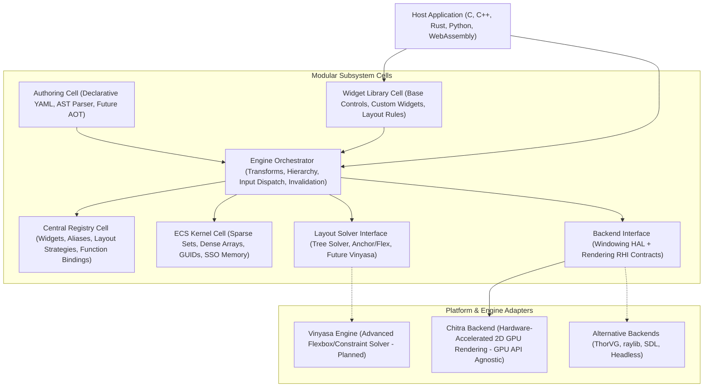

# Tether Documentation

Tether is a high-performance, modular 2D UI engine written in C. It provides the foundational runtime infrastructure needed to build modern user interface frameworks, interactive applications, and portable UI systems with zero garbage collection overhead, cache-friendly data access, and predictable frame times.

Just as compiler backends (such as LLVM) provide reusable optimization and code-generation infrastructure without forcing a specific language syntax, Tether provides the core runtime infrastructure for UI execution without dictating a specific widget library, layout engine, or graphics backend.

---

## Architectural Highlights & Core Advantages

Rather than relying on traditional object-oriented hierarchies, virtual DOM diffing, and pointer-heavy widget trees, Tether is engineered around five fundamental architectural strengths:

- **Zero-Allocation Steady-State Execution**:
  Once UI elements are initialized, runtime updates, layout passes, and rendering synchronization generate zero heap allocations or garbage collection churn. Memory remains completely stable during animation and user interaction.
- **Pure C Data-Oriented ECS Kernel**:
  UI hierarchy, spatial bounds, visual styles, and interaction states are stripped into contiguous component arrays mapped by sparse sets. When the engine traverses scenes or submits draw operations, the CPU sweeps flat arrays with linear cache prefetching rather than chasing pointers across fragmented heap objects.
- **Separation of Layout and Presentation Transforms**:
  Layout coordinates (`SlotTransform`) and visual GPU offsets (`RenderTransform`) are kept strictly separated. Running continuous visual animations, hover scale effects, rotations, and transitions updates GPU transforms directly without invalidating parent layout trees or triggering costly reflow passes.
- **Decoupled Modular Cell-Block Architecture**:
  Rather than enforcing a rigid vertical hierarchy or monolithic stack, Tether is organized into decoupled functional cell blocks (ECS Kernel, Layout Solver, Backend Interface, Authoring/AST, Widget Composition) communicating through explicit C contracts. Subsystems can be swapped, extended, or tested independently without ripple effects.
- **The "PDF of Interactive UIs" Vision**:
  A long-term objective to establish a portable, open standard for interactive interfaces. An interface described once through declarative UI definitions can preserve its structure, layout constraints, interaction rules, and semantic meaning across desktop software, game HUDs, mobile platforms, and resource-constrained embedded hardware.

---

## High-Level Ecosystem Architecture

Tether is structured as a collection of modular, decoupled cell blocks that interact through defined C interface contracts. Rather than enforcing a rigid top-down stack or monolithic inheritance hierarchy, subsystems operate as independent cells coordinated by the Tether Engine:

---

## Master Documentation Manual

The Tether documentation is organized into two primary pillars: **Category A** for conceptual architecture, project vision, and public evaluation; and **Category B** for engineering, development, integration, and technical reference.

### Category A: Project Presentation
*Public-facing overview of what Tether is, why it exists, and its architectural direction.*

| # | Chapter | Focus & Summary |
|:---:|:---|:---|
| 01 | [Project Overview and Vision](presentation/01_overview_and_vision.md) | Tether's core identity, the "LLVM of UI" philosophy, the portable interactive UI vision, and mission. |
| 02 | [Motivation and Problems Being Solved](presentation/02_motivation_and_problems.md) | Overcoming web DOM overhead, rigid C++ inheritance trees, vendor lock-in, and renderer coupling. |
| 03 | [Design Philosophy and Principles](presentation/03_design_philosophy.md) | Modularity, portability, semantic consistency, cache locality, explicit memory ownership, and developer control. |
| 04 | [Tether Ecosystem and Architecture](presentation/04_ecosystem_and_architecture.md) | The modular cell-block architecture, subsystem boundaries, Tether Core vs. Chitra vs. Vinyasa vs. UI frameworks. |
| 05 | [Capabilities and Practical Use Cases](presentation/05_capabilities_and_use_cases.md) | Desktop tools, game HUDs, embedded displays, spatial computing, and runtime visualization environments. |
| 06 | [Comparison with Existing UI Technologies](presentation/06_comparison.md) | Technical and architectural comparisons with Dear ImGui, Qt, Flutter, Slint, Yoga, Clay, and Web DOM stacks. |
| 07 | [Cross-Platform Portability and Consistency](presentation/07_portability_and_consistency.md) | Semantic and behavioral consistency vs. pixel-perfect dogma across operating systems and graphics APIs. |
| 08 | [Demonstrations and Verified Performance](presentation/08_demonstrations_and_benchmarks.md) | The Sandbox showcase, real-time metrics, reproducible benchmark methodology, and verified performance. |
| 09 | [Current Status, Limitations, and Trade-offs](presentation/09_status_limitations_tradeoffs.md) | Transparent evaluation of retained-mode discipline, pointer safety, present platform coverage, and trade-offs. |
| 10 | [Future Roadmap and Community Participation](presentation/10_roadmap_and_community.md) | Vinyasa layout integration, AOT bytecode compilation (`.tbc`), C/Wasm generation, language bridges, and open-source collaboration. |

---

### Category B: Technical and Developer Documentation
*Complete engineering guides for understanding, integrating, extending, testing, and contributing to Tether.*

| # | Chapter | Focus & Summary |
|:---:|:---|:---|
| 01 | [Getting Started and Examples](technical/01_getting_started.md) | Prerequisites, CMake build instructions, running the sandbox showcase, and building a minimal C or YAML UI. |
| 02 | [Tether Core Architecture and Execution Model](technical/02_core_architecture.md) | Engine lifecycle (`tether_run`), frame execution stages, subsystem dependencies, and thread ownership contracts. |
| 03 | [ECS, Memory Management, and Lifecycle](technical/03_ecs_and_memory.md) | 64-bit generation GUIDs, sparse sets, dense arrays, swap-and-pop deallocation, and small string optimization (SSO). |
| 04 | [Components, State, Invalidation, and Updates](technical/04_components_and_invalidation.md) | Base node components (`SlotTransform`, `Hierarchy`, `Visibility`), dirty flags (`DIRTY_VISUAL`, `DIRTY_LAYOUT`), and `VOLATILE` continuous mode. |
| 05 | [UI Framework, Widget Registry, and Extensibility](technical/05_ui_framework_and_widgets.md) | Built-in widgets (Panel, Button, Text), the fluent UI convenience layer (`tether_ui`), Central Registry (widget factories, string aliases, fonts), and custom component extensibility. |
| 06 | [Vinyasa Layout System](technical/06_vinyasa_layout.md) | The built-in 2-pass layout algorithm (Measure/Arrange), container rules, flex and canvas modes, and planned Vinyasa integration. |
| 07 | [Backend Interfaces](technical/07_backend_interfaces.md) | Universal backend contract table (System, Shape, Text), hardware abstraction, lifecycle hooks, and link-time backend swapping (Chitra, ThorVG, Raylib, Skia, SDL3). |
| 08 | [Chitra Rendering System](technical/08_chitra_rendering.md) | Tether default 2D GPU backend, internal HAL/RHI, SDF vector rasterization, glyph caching, monotonic Z-ordering, and clipping. |
| 09 | [Input and Event System](technical/09_input_and_events.md) | Normalized pointer events, reverse depth-first hit testing, spatial culling, and click/state bindings. |
| 10 | [UI Definitions, Parsing, and Compilation](technical/10_ui_definitions_and_parsing.md) | Declarative YAML syntax, AST/Scene IR, slot expansion, live ECS instantiation, and future AOT bytecode (`.tbc`). |
| 11 | [Language Bindings and Scripting](technical/11_language_bindings.md) | C API boundaries, dynamic state binding, and the planned multi-language interoperability layer (Python, JS, Rust). |
| 12 | [API Reference and Integration Guides](technical/12_api_reference.md) | Public header references, types, memory ownership rules, and integrating Tether into host CMake projects. |
| 13 | [Testing, Benchmarks, and Profiling](technical/13_testing_and_benchmarks.md) | Unit correctness tests, integration smoke tests, benchmark runners, and validation reporting. |
| 14 | [Portability Contracts, Limitations, and Architectural Decisions](technical/14_portability_and_decisions.md) | Architectural decision records (ADRs), memory safety considerations, and platform constraints. |

---

## Where to Start

- **Evaluating Tether for a New Project**:
  Start with [Project Overview and Vision](presentation/01_overview_and_vision.md), [Capabilities & Use Cases](presentation/05_capabilities_and_use_cases.md), and [Comparison with Existing UI Technologies](presentation/06_comparison.md).
- **Building Applications with Tether**:
  Follow [Getting Started](technical/01_getting_started.md) to build and run the sandbox, then explore [UI Framework & Widget Registry](technical/05_ui_framework_and_widgets.md) and [UI Definitions and Parsing](technical/10_ui_definitions_and_parsing.md).
- **Integrating Tether into an Existing Engine or Host Application**:
  Review [Core Architecture](technical/02_core_architecture.md), [ECS Memory Management](technical/03_ecs_and_memory.md), and [Backend Interfaces](technical/07_backend_interfaces.md).

---

## Implementation Status at a Glance

| Subsystem | Implemented in Source Today | On Active Roadmap |
| :--- | :--- | :--- |
| **Memory Kernel** | Data-oriented ECS with sparse sets, contiguous dense arrays, swap-and-pop, and SSO string storage. | Custom pool allocators and memory budget telemetry. |
| **Layout** | 2-pass intrinsic measure and arrangement (Flex Row/Column, Canvas, Anchor constraints). | Integration of the standalone Vinyasa layout engine. |
| **Rendering** | Retained-mode dirty-state sync, visual transforms, clipping, and Chitra GPU backend. | Headless software rasterization backend. |
| **Input** | Normalized pointer down, up, move, hover, and press hit-testing with spatial culling. | Keyboard navigation, focus management, text input buffers. |
| **Authoring** | Declarative YAML parser, AST / Scene IR, hot-reload, and direct C widget APIs. | Ahead-of-Time (AOT) bytecode compilation (`.tbc`) and C code generation. |
| **Framework** | High-level `tether_ui` widgets (panels, buttons, labels, rows, columns, cards, badges). | Expanded widget suite (sliders, tables, scroll containers, tabs). |
