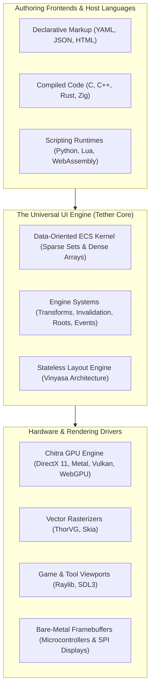
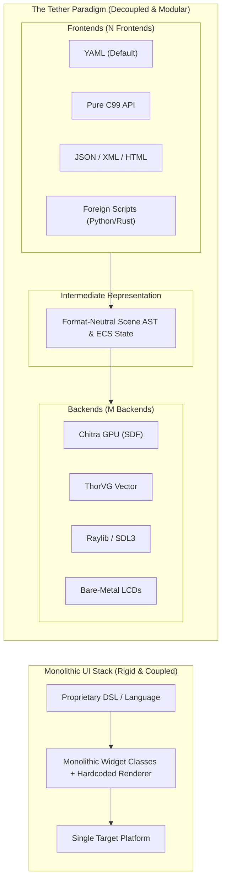

# Chapter 01: Project Overview and Vision

[Documentation Master Index](../index.md) | [Next: Chapter 02 - Motivation and Problems Being Solved ->](02_motivation_and_problems.md)

---

## 1. Executive Summary & Mission Statement

> **Tether is not a monolithic UI framework. Tether is an open, high-performance engine for building user interface libraries and portable interactive software.**

Just as the LLVM project transformed compiler construction by providing reusable, modular infrastructure instead of forcing the world into a single monolithic compiler, Tether provides a standardized, data-oriented foundation for constructing user interfaces across the entire computing spectrum: from ultra-low-power microcontrollers to desktop creative suites, game HUDs, and spatial computing viewports.

Tether fundamentally rejects the notion that a modern user interface must require multi-gigabyte browser runtimes, hundreds of megabytes of memory, complex object-oriented inheritance trees, or continuous 100% CPU polling loops.

### The Tether Mission
To establish an open, modular, pure C standard for graphical user interfaces that guarantees:
- **Absolute Predictability**: Explicit, deterministic memory management with zero steady-state heap allocation and zero garbage-collection pauses.
- **Universal Portability**: A pure ISO C99 Application Binary Interface (ABI) that embeds natively into any host language (C, C++, Rust, Python, Zig, Lua) without wrapper friction.
- **Hardware Decoupling**: Complete isolation between scene hierarchy, layout constraint solving, and pixel rasterization, allowing renderers and windowing toolkits to be hot-swapped at link time.
- **True Reactive Zero-Power Operation**: Retained-mode dirty state tracking that sleeps when static, drawing pixels only when inputs or data models change.

---

## 2. The Problem with the Status Quo

Modern user interface engineering is fractured between conflicting paradigms, each carrying severe systems-level compromises:

### 1. The Bloated Web Stack (Electron, Chromium, DOM/CSS)
Web technologies were originally designed to display hyperlinked text documents, not high-frequency interactive applications. Translating complex state into the Document Object Model (DOM) requires:
- Massive memory overhead: even trivial desktop utilities consume $200\text{ MB}$ to $500+\text{ MB}$ of RAM.
- Multi-second cold boot times and sluggish startup responsiveness.
- Multi-threaded garbage collection spikes that introduce unpredictable frame drops during real-time interaction.
- Battery drain caused by active event loops and compositor polling.

### 2. Legacy Object-Oriented Toolkits (Qt, wxWidgets, WPF)
First-generation native frameworks rely heavily on classical C++ object inheritance (`Widget -> Frame -> Container -> Button`):
- Deep inheritance hierarchies bind visual styling, layout constraints, and windowing primitives into rigid classes.
- Every widget is an isolated heap allocation connected by memory pointers, causing CPU L1/L2 cache-miss pointer chasing during layout and drawing passes.
- Heavy C++ runtimes and complex build tooling create steep integration barriers for non-C++ host languages.

### 3. Pure Immediate Mode (Dear ImGui)
Immediate-mode toolkits revolutionised game development tooling by eliminating state synchronization bugs. However, pure immediate mode has inherent architectural ceilings:
- **Continuous Polling Overhead**: The UI tree is completely reconstructed and submitted every frame, forcing 100% CPU and GPU utilization even when the interface is entirely static.
- **Layout Limitations**: Complex two-pass layout constraints (flex wrapping, proportional stretch, anchor docking) become awkward or inefficient to resolve within single-frame procedural loops.

### 4. Proprietary Engine HUDs (Unreal Slate/UMG, Unity UI)
Game engines have developed exceptional in-house UI kernels, but they remain permanently locked inside massive, multi-gigabyte proprietary ecosystems, unavailable for lightweight standalone desktop tools, mobile utilities, or embedded firmware.

---

## 3. The "LLVM of UI" Paradigm

Tether resolves this industry impasse by adopting the foundational architecture of LLVM:

In the LLVM model:
1. **$N$ Frontends**: Developers can author user interfaces in declarative YAML, pure imperative C99, JSON/XML, or high-level scripting languages (Python, Lua, Rust). All frontends lower into the exact same intermediate scene model.
2. **One Common IR & State Core**: The Tether core manages layout trees, spatial coordinates, component arrays, and interaction state machines without knowing or caring what language declared them.
3. **$M$ Backends**: The engine produces a clean, abstract stream of drawing instructions and layout bounds. The backend driver (Chitra GPU, ThorVG, Raylib, or a bare-metal microcontroller display driver) executes the pixel rendering.

Instead of building $N \times M$ custom UI toolkits, developers build $N$ frontends and $M$ backends against Tether's stable, open C99 core.

### The Universal Media Format Analogy: The PNG, MP3, and PDF of User Interfaces

To understand Tether's ultimate vision, consider how digital computing solved media portability across disparate hardware and operating systems:
- **Audio has MP3 and FLAC**: Sound data encoded in a universal specification plays consistently on any phone, automobile dashboard, or studio monitor that supports the standard, completely isolated from specific audio DAC chips or sound card drivers.
- **Images have PNG and JPEG**: Visual bitmap and vector information renders identically across browsers, mobile screens, and image viewers, completely isolated from the underlying graphics card.
- **Documents have PDF (Portable Document Format)**: Text, spatial layouts, and vector curves display and print with absolute fidelity anywhere, completely isolated from word processors or operating system type engines.

**User interfaces have historically lacked this universal standard.**
For decades, interactive user interfaces have remained trapped inside vendor-locked compilers, proprietary runtimes (Qt, Flutter), or bloated multi-hundred-megabyte browser engines (Chromium/DOM). If an engineering team needed an interface to run across embedded Linux, Windows, macOS, Web, and an RTOS microcontroller, they were forced to rewrite the UI multiple times or bundle heavy, fragile runtimes.

**Tether establishes user interfaces as a universal, open media format.**
Whether authored in human-readable declarative YAML or compiled into compact Ahead-of-Time (AOT) bytecode (`.tbc`), a Tether UI definition is an independent, self-contained interactive document. Wherever a Tether-compliant micro-kernel is embedded:
- An automotive touchscreen running an RTOS,
- A bare-metal microcontroller driving an SPI/parallel LCD,
- A modern web browser executing WebAssembly via WebGPU or Canvas,
- A high-end desktop workstation running DirectX 11 or Metal,
- An AAA game engine viewport in Unreal, Unity, or a custom engine,

...the Tether UI asset opens and executes with **absolute behavioral determinism, layout consistency, and interactive fidelity**, requiring zero platform rewrites. Tether is engineered to be the universal open format for interactive user interfaces.

---

## 4. Tether's Core Architectural Identity

Tether's identity is defined by six non-negotiable systems-level properties:

### 1. Zero-Allocation Steady State
Tether never executes heap allocations (`malloc`, `free`) during steady-state frame rendering or layout computation. Memory buffers for components grow via geometric reallocation during initialization, stabilizing into high-water mark pools. Once initialized, the engine operates completely allocation-free.

### 2. Data-Oriented Entity Component System (UI-ECS)
Tether stores all UI data in flat, type-uniform dense arrays indexed by sparse maps. Iterating over widgets during layout or visual synchronization sweeps through contiguous memory blocks, maximizing CPU L1/L2 cache line hits and eliminating vtable indirection.

### 3. Retained-Mode with Reactive Invalidation
Tether preserves the scene graph across frames. Subsystems update only what is flagged as dirty (`DIRTY_LAYOUT`, `DIRTY_VISUAL`, `DIRTY_HIERARCHY`). When no user input occurs and animations are idle, Tether consumes zero CPU cycles and issues zero GPU draw calls.

### 4. Separation of Layout Space from Render Space
Layout bounds (`SlotTransform`) and visual GPU transformations (`RenderTransform`) are mathematically decoupled. High-frequency visual animations (hover scale, rotations, translation offsets, opacity fades) execute directly on the GPU without triggering expensive layout reflow passes in parent or sibling containers.

### 5. Universal 64-Bit Scalar GUIDs
Entities are identified by simple 64-bit integer values (`Tether_GUID`) containing an index and a generational version counter. Tether never exposes raw, unsafe heap pointers to host applications or foreign bindings. Stale entity handles fail safely in $O(1)$ time without memory corruption.

### 6. Limitless Dual Authoring & Polyglot Parity
Declarative markup (YAML) and compiled code (C99) operate with complete parity:
- A button declared in YAML and a button created via `tether_ui_button()` instantiate the exact same ECS components.
- An entity declared in YAML can be queried, animated, or reparented in C via `tether_registry_find_entity()`.
- Compiled code and dynamic scripts (Python, Lua) communicate seamlessly across the C ABI without artificial restrictions.

---

## 5. Scalability: From Microcontrollers to Spatial Computing

Tether's modular cell-block architecture enables it to scale across hardware domains that traditional UI frameworks cannot touch:

| Hardware Domain | Typical Constraints | Tether Deployment Strategy |
| :--- | :--- | :--- |
| **Bare-Metal Microcontrollers** | $64\text{ KB} - 512\text{ KB}$ SRAM, no OS, SPI/Parallel LCDs | **Pipeline 1 (Pure C Imperative)**: No parser, pre-sized static ECS arrays, direct custom framebuffer driver. Sub-$64\text{ KB}$ SRAM footprint for core UI data. |
| **Embedded Touchscreens & IoT** | Automotive dashboards, medical monitors, Linux/RTOS displays | **Pipeline 3 / 4 (Pre-cooked Scene IR / AOT Bytecode)**: Sub-second cold boot, zero runtime parser overhead, hardware-accelerated vector graphics. |
| **Desktop Creative Tools & Utilities** | Windows, macOS, Linux desktop software, telemetry dashboards | **Pipeline 2 (Declarative YAML)**: Rapid iteration, live YAML hot-reloading, rich typography, zero-power idle state. Tether's core memory remains in the kilobyte range, while external memory is dictated strictly by host graphics driver allocations (swapchains and font textures) rather than runtime framework bloat. |
| **AAA Game HUDs & Editor Overlays** | 60-240 FPS frame budget, strict sub-millisecond CPU frame times | **Managed Embedded Loop (`tether_on_*`)**: Ticked directly by the game engine loop; 2D UI composited directly over 3D game viewports. |
| **Spatial Computing (VR / AR)** | High-resolution 3D world space, stereo viewports, low latency | **Spatial Texture Projection**: Tether renders UI trees onto isolated offscreen GPU textures, which the 3D engine projects onto 3D virtual geometry. |

### Memory and Binary Footprint Realities
Tether is engineered to be transparent about physical memory usage:
- **Core ECS Memory (Kilobytes)**: Tether's internal entity tables, sparse maps, and component pools represent pure C structs. Hundreds of live, interactive UI elements consume mere tens of kilobytes in contiguous dense arrays.
- **Compact Binary Footprint**: The compiled Tether C library is lightweight (a few hundred kilobytes), avoiding the tens of megabytes of bundled runtime baggage common to modern UI toolkits.
- **Bare-Metal & Microcontroller Environments**: On bare-metal microcontrollers and embedded displays with software framebuffers, the entire UI system operates comfortably within strict SRAM constraints ($< 64\text{ KB}$).
- **Hardware Acceleration and System RAM**: When running on desktop operating systems with full hardware acceleration (DirectX 11 via Chitra, Metal, or Vulkan), any additional resident memory is allocated by the underlying OS graphics subsystem and GPU drivers (such as swapchain backbuffers, OS window handles, and GPU font atlas textures). Tether itself never adds framework bloat, delivering orders-of-magnitude lower memory consumption than web-based or heavy OOP stacks.

---

[Documentation Master Index](../index.md) | [Next: Chapter 02 - Motivation and Problems Being Solved ->](02_motivation_and_problems.md)
