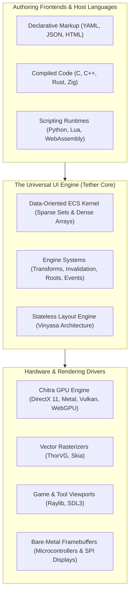
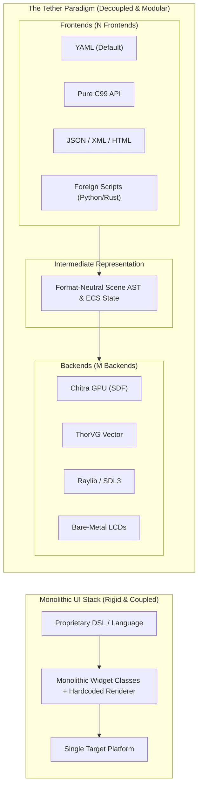

# Chapter 01: Project Overview and Vision

[Documentation Master Index](../index.md) | [Next: Chapter 02 - Motivation and Problems Being Solved ->](02_motivation_and_problems.md)

---

## 1. Executive Summary & Mission Statement

> **Tether is not a monolithic UI framework. Tether is an open, high-performance engine for building user interface libraries and portable interactive software.**

Just as the LLVM project transformed compiler construction by providing reusable, modular infrastructure instead of forcing the world into a single monolithic compiler, Tether provides a standardized, data-oriented foundation for constructing user interfaces across the entire computing spectrum: from ultra-low-power microcontrollers to desktop creative suites, game HUDs, and spatial computing viewports.

Tether fundamentally rejects the notion that a modern user interface must require multi-gigabyte browser runtimes, hundreds of megabytes of memory, complex object-oriented inheritance trees, or continuous 100% CPU polling loops.

### The Tether Mission
To establish an open, modular, pure C standard for graphical user interfaces engineered toward:
- **Absolute Predictability**: Explicit memory ownership via ECS pools, generational handles, and moving toward zero steady-state heap allocations with zero garbage-collection pauses.
- **Universal Portability**: A pure ISO C99 Application Binary Interface (ABI) structured to embed into host languages (C, C++, Rust, Python, Zig, Lua) as bindings and platform coverage expand (CI currently validates Windows).
- **Hardware Decoupling**: Clean separation between scene hierarchy, layout solving, and pixel rasterization behind `Tether_Backend`, allowing drivers to be swapped at link time.
- **Reactive Invalidation**: Retained-mode dirty state tracking (`DIRTY_LAYOUT`, `DIRTY_VISUAL`, `DIRTY_HIERARCHY`) that skips redundant work when static (`tether_did_draw() == false`), laying the foundation for low-power idle loops.

---

## 2. The Problem with the Status Quo

Modern user interface engineering is fractured between conflicting paradigms, each carrying severe systems-level compromises:

### 1. The Bloated Web Stack (Electron, Chromium, DOM/CSS)
Web technologies were originally designed to display hyperlinked text documents, not high-frequency interactive applications. Translating complex state into the Document Object Model (DOM) requires:
- Massive memory overhead: even trivial desktop utilities consume $200\text{ MB}$ to $500+\text{ MB}$ of RAM.
- Multi-second cold boot times and sluggish startup responsiveness.
- Multi-threaded garbage collection spikes that introduce unpredictable frame drops during real-time interaction.
- Battery drain caused by active event loops and compositor polling.

### 2. Legacy Object-Oriented Toolkits (Qt, wxWidgets, WPF)
First-generation native frameworks rely heavily on classical C++ object inheritance (`Widget -> Frame -> Container -> Button`):
- Deep inheritance hierarchies bind visual styling, layout constraints, and windowing primitives into rigid classes.
- Every widget is an isolated heap allocation connected by memory pointers, causing CPU L1/L2 cache-miss pointer chasing during layout and drawing passes.
- Heavy C++ runtimes and complex build tooling create steep integration barriers for non-C++ host languages.

### 3. Pure Immediate Mode (Dear ImGui)
Immediate-mode toolkits revolutionised game development tooling by eliminating state synchronization bugs. However, pure immediate mode has inherent architectural ceilings:
- **Continuous Polling Overhead**: The UI tree is completely reconstructed and submitted every frame, forcing 100% CPU and GPU utilization even when the interface is entirely static.
- **Layout Limitations**: Complex two-pass layout constraints (flex wrapping, proportional stretch, anchor docking) become awkward or inefficient to resolve within single-frame procedural loops.

### 4. Proprietary Engine HUDs (Unreal Slate/UMG, Unity UI)
Game engines have developed exceptional in-house UI kernels, but they remain permanently locked inside massive, multi-gigabyte proprietary ecosystems, unavailable for lightweight standalone desktop tools, mobile utilities, or embedded firmware.

---

## 3. The "LLVM of UI" Paradigm

Tether resolves this industry impasse by adopting the foundational architecture of LLVM:

In the LLVM model:
1. **$N$ Frontends**: Developers can author user interfaces in declarative YAML, pure imperative C99, JSON/XML, or high-level scripting languages (Python, Lua, Rust). All frontends lower into the exact same intermediate scene model.
2. **One Common IR & State Core**: The Tether core manages layout trees, spatial coordinates, component arrays, and interaction state machines without knowing or caring what language declared them.
3. **$M$ Backends**: The engine produces a clean, abstract stream of drawing instructions and layout bounds. The backend driver (Chitra GPU, ThorVG, Raylib, or a bare-metal microcontroller display driver) executes the pixel rendering.

Instead of building $N \times M$ custom UI toolkits, developers build $N$ frontends and $M$ backends against Tether's stable, open C99 core.

### The Universal Media Format Analogy: The PNG, MP3, and PDF of User Interfaces

To understand Tether's ultimate vision, consider how digital computing solved media portability across disparate hardware and operating systems:
- **Audio has MP3 and FLAC**: Sound data encoded in a universal specification plays consistently on any phone, automobile dashboard, or studio monitor that supports the standard, completely isolated from specific audio DAC chips or sound card drivers.
- **Images have PNG and JPEG**: Visual bitmap and vector information renders identically across browsers, mobile screens, and image viewers, completely isolated from the underlying graphics card.
- **Documents have PDF (Portable Document Format)**: Text, spatial layouts, and vector curves display and print with absolute fidelity anywhere, completely isolated from word processors or operating system type engines.

**User interfaces have historically lacked this universal standard.**
For decades, interactive user interfaces have remained trapped inside vendor-locked compilers, proprietary runtimes (Qt, Flutter), or bloated multi-hundred-megabyte browser engines (Chromium/DOM). If an engineering team needed an interface to run across embedded Linux, Windows, macOS, Web, and an RTOS microcontroller, they were forced to rewrite the UI multiple times or bundle heavy, fragile runtimes.

**Tether establishes user interfaces as a universal, open media format.**
Whether authored in human-readable declarative YAML or compiled into compact Ahead-of-Time (AOT) bytecode (`.tbc`), a Tether UI definition is an independent, self-contained interactive document. Wherever a Tether-compliant micro-kernel is embedded:
- An automotive touchscreen running an RTOS,
- A bare-metal microcontroller driving an SPI/parallel LCD,
- A modern web browser executing WebAssembly via WebGPU or Canvas,
- A high-end desktop workstation running DirectX 11 or Metal,
- An AAA game engine viewport in Unreal, Unity, or a custom engine,

...the Tether UI asset opens and executes with **consistent layout behavior, deterministic semantics, and native performance**, without platform rewrites. In the current `v0.0.3-preview` developer preview, scenes run via YAML and the C API on Windows with the Chitra backend, while `.tbc` AOT bytecode, Vinyasa integration, and additional platform backends remain active [roadmap](10_roadmap_and_community.md) milestones toward this open-format vision.

---

## 4. Tether's Core Architectural Identity

Tether's identity centers on six core systems-level architectural properties (noting where `v0.0.3-preview` is still progressing toward final targets):

### 1. Zero-Allocation Steady State (Target Architecture)
Tether is designed to eliminate dynamic allocation churn during steady-state frame rendering and layout computation. Component pools grow geometrically via `realloc` during structural expansion and stabilize at high-water capacity, while SSO inline tiers keep typical strings off the heap. Note that `TextDynamic` uses heap storage for strings over 512 bytes, and full steady-state zero-allocation auditing across all paths remains an ongoing [roadmap](10_roadmap_and_community.md) milestone.

### 2. Data-Oriented Entity Component System (UI-ECS)
Tether stores all UI data in flat, type-uniform dense arrays indexed by sparse maps. Iterating over widgets during layout or visual synchronization sweeps through contiguous memory blocks, maximizing CPU L1/L2 cache line hits and eliminating vtable indirection.

### 3. Retained-Mode with Reactive Invalidation
Tether preserves the scene graph across frames. Subsystems update only what is flagged as dirty (`DIRTY_LAYOUT`, `DIRTY_VISUAL`, `DIRTY_HIERARCHY`). When no changes, resizes, or `VOLATILE` redraws occur, `tether_engine_frame()` skips redundant sync work (`tether_did_draw() == false`), with total idle CPU/GPU behavior governed by the host event loop and backend.

### 4. Separation of Layout Space from Render Space
Layout bounds (`SlotTransform`) and presentation transformations (`RenderTransform`) are decoupled so visual animations (offsets, colors, shape transforms, opacity) avoid triggering layout reflow passes in parent or sibling containers. (Note: in `v0.0.3-preview`, text transforms rebuild CPU-side glyph geometry via `DIRTY_TEXT_CONTENT`.)

### 5. Universal 64-Bit Scalar GUIDs
Entities are identified by scalar 64-bit integer values (`Tether_GUID`) containing an index and a generational version counter. Safe across foreign bindings, stale entity handles fail in $O(1)$ time via `tether_ecs_is_valid()`. (Internal C component getters can still return raw array pointers that C callers should re-query after dense-array mutations.)

### 6. Dual Authoring & Polyglot Parity
Declarative markup (YAML) and compiled code (C99) share the exact same runtime representation:
- A button declared in YAML and a button created via `tether_ui_button()` instantiate the same ECS components through the widget factory registry (YAML currently exposes a subset of C API properties as coverage grows).
- An entity declared in YAML with an `id:` can be queried, updated, or reparented in C via `tether_registry_find_entity()`.
- Future foreign-language bindings (Python, Rust, Lua, Zig) can talk natively to this same scalar C99 ABI.

---

## 5. Scalability: From Microcontrollers to Spatial Computing

Tether's modular cell-block architecture enables it to scale across hardware domains that traditional UI frameworks cannot touch:

| Hardware Domain | Typical Constraints | Tether Strategy & Preview Status |
| :--- | :--- | :--- |
| **Bare-Metal Microcontrollers** | $64\text{ KB} - 512\text{ KB}$ SRAM, no OS, SPI/Parallel LCDs | **Roadmap (Pipeline 1 - Pure C)**: No parser, pre-sized static ECS arrays, custom software framebuffer driver targeting compact SRAM footprints. |
| **Embedded Touchscreens & IoT** | Automotive dashboards, medical monitors, Linux/RTOS displays | **Roadmap (Pipeline 3/4 - `.tbc` Bytecode)**: Pre-cooked IR / AOT bytecode (`tether_cooker`) for fast cold boot without runtime text parsing. |
| **Desktop Creative Tools & Utilities** | Windows (CI validated), macOS, Linux desktop software | **Active in `v0.0.3-preview` (Pipeline 2 - YAML + C)**: Rapid iteration, manual YAML reload in the Sandbox, SDF shapes + Fontstash typography via Chitra, retained invalidation without browser-runtime bloat. |
| **AAA Game HUDs & Editor Overlays** | 60-240 FPS frame budgets, custom host loops | **Supported Hooks (`tether_on_*`)**: Ticked directly by a host game engine loop (`tether_on_init`, `tether_on_input`, `tether_on_frame`, `tether_on_cleanup`), paired with custom backends. |
| **Spatial Computing (VR / AR)** | 3D world space, stereo viewports, low latency | **Roadmap (Spatial Projection)**: Custom backend rendering Tether scenes into offscreen GPU textures for 3D engines. |

### Memory and Binary Footprint Realities
Tether is engineered to be transparent about physical memory usage:
- **Core ECS Memory**: Tether's entity tables, sparse maps, and component pools are compact C structs packed in dense arrays; resident footprint depends on scene size, string tiers (`TextDynamic` uses heap storage for long strings), and pool capacities.
- **Compact Native Library**: The compiled Tether C library avoids multi-megabyte VM or browser framework runtimes.
- **Bare-Metal & Embedded Environments (Target)**: Sub-$64\text{ KB}$ static SRAM operation with custom framebuffer drivers is an architectural target to measure and validate on future embedded builds.
- **Hardware Acceleration and System RAM**: On desktop operating systems via Chitra/Sokol, swapchain backbuffers, OS window handles, and font atlas textures are managed by the OS graphics stack and GPU drivers.

---

[Documentation Master Index](../index.md) | [Next: Chapter 02 - Motivation and Problems Being Solved ->](02_motivation_and_problems.md)
