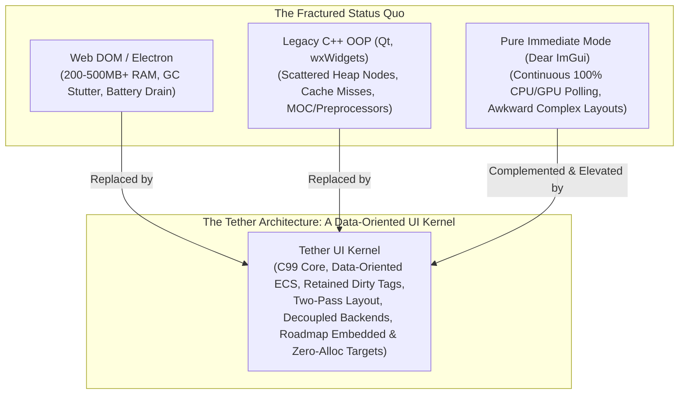

# Chapter 02: Motivation and Problems Being Solved

[<- Previous: Chapter 01 - Project Overview and Vision](01_overview_and_vision.md) | [Documentation Master Index](../index.md) | [Next: Chapter 03 - Design Philosophy and Principles ->](03_design_philosophy.md)

---

## 1. Executive Summary

Graphical user interface development is in a state of technological crisis. Despite decades of hardware advancements, including exponential increases in CPU core counts, gigabytes of RAM, and multi-teraflop GPUs, modern desktop software feels more sluggish, consumes more memory, and drains laptop batteries faster than ever before.

This degradation is not the fault of developers; it is the inevitable consequence of **fundamentally misaligned abstractions**. Modern UI development has fragmented into polarized extremes, each saddled with crippling engineering compromises:
- **The Bloated Web Stack**: Wrapping browser engines (Electron, Chromium) into desktop apps, trading hundreds of megabytes of memory and battery life for web developer convenience.
- **Legacy Object-Oriented Frameworks**: Deep C++ inheritance hierarchies (Qt, wxWidgets) plagued by fragile base classes, scattered heap allocations, and pointer-chasing cache misses.
- **Pure Immediate-Mode Toolkits**: Ergonomically elegant debug UI (Dear ImGui) that cannot enter low-power idle states due to 100% continuous CPU/GPU polling, struggling with complex multi-pass layouts.
- **Proprietary Game Engine HUDs**: Highly optimized game UI toolkits (Unreal Slate, Unity UI) permanently locked behind massive proprietary commercial engines.

Tether was created to resolve this impasse by establishing a data-oriented C99 UI micro-kernel that combines retained UI structure, two-pass layout, and optional declarative authoring without browser bloat or deep OOP class trees (`v0.0.3-preview` lays the desktop C99 foundation while `.tbc` bytecode, Vinyasa, and embedded tuning remain on the [roadmap](10_roadmap_and_community.md)).



---

## 2. The Failures of the Web Stack on Desktop and Embedded

Over the past decade, web technologies have aggressively expanded into desktop and embedded software through frameworks like Electron, Tauri, and embedded Chromium. While this allowed web developers to deploy cross-platform applications rapidly, it introduced devastating systems-level penalties.

### 1. The Document Object Model (DOM) Was Never Designed for Applications
The web stack was conceived in the 1990s as a document viewing system for hyperlinked scientific papers. It was never architected to serve as a low-latency, real-time graphical application kernel:
- **The Tree Diffing Tax**: Modern web frameworks (React, Vue) operate by maintaining a secondary "Virtual DOM" tree in JavaScript. On every state mutation, the runtime traverses and diffs the virtual tree against the actual DOM, allocating thousands of transient JavaScript objects that burden the garbage collector.
- **Non-Deterministic Garbage Collection (GC) Stutter**: JavaScript and browser engines rely on automatic garbage collection. Periodic GC sweeps cause unpredictable frame drops and micro-stutters during high-speed user interactions (e.g. scrubbing sliders, scrolling data tables, dragging canvas elements).
- **Cascading Reflow Storms**: The CSS box model intertwines layout geometry with visual appearance. Modifying a visual property (such as border radius, hover scale, or box shadow) frequently triggers full-tree reflow calculations across parent and sibling containers.

### 2. Massive Memory Footprint and Cold Boot Latency
- A trivial "Hello World" application built with Electron consumes upwards of $150\text{ MB} - 300\text{ MB}$ of RAM upon launch, quickly escalating to $500\text{ MB} - 1\text{ GB}+$ as user interfaces grow.
- Cold startup times frequently exceed several seconds while the operating system boots the Chromium multi-process architecture, initializes the V8 JavaScript engine, parses megabytes of bundled script bundles, and loads standard CSS stylesheets.

### 3. Continuous Battery Drain
Browser runtimes are notorious for background battery consumption. Internal animation timers, blinking cursor routines, IPC channels between browser and renderer processes, and event polling loops prevent modern mobile and laptop CPUs from dropping into ultra-low-power C-states.

---

## 3. The Fragility and Bloat of Legacy C++ OOP Frameworks

Before the web took over desktop tooling, native graphical interfaces were built primarily using classical object-oriented C++ frameworks, most notably Qt and wxWidgets. While significantly faster than web runtimes, they suffer from fundamental architectural flaws rooted in 1990s C++ design patterns.

### 1. The Fragile Base Class and Deep Inheritance Hierarchies
In Qt and similar frameworks, every UI element inherits from a deep chain of monolithic base classes:
$$\text{QPushButton} \to \text{QAbstractButton} \to \text{QWidget} \to \text{QObject}$$

This architectural pattern creates severe engineering liabilities:
- **Monolithic Bloat**: A simple button inherits hundreds of virtual methods, signal/slot tables, layout metadata, and windowing properties, whether it needs them or not.
- **Tight Coupling**: Layout constraints, visual painting routines, and event dispatch logic are inextricably bundled inside the same class instance. Modifying layout logic requires subclassing or overriding virtual methods.
- **Incompatible Language Bridges**: Bridging deeply nested C++ class hierarchies with complex virtual method tables (vtables) and Run-Time Type Information (RTTI) into foreign languages (Rust, Python, Zig, Go) is notoriously fragile and requires complex wrapper generators (e.g., SIP, pybind11, or extensive C shim libraries).

### 2. Scattered Heap Memory and CPU Cache Inefficiency
In traditional object-oriented UI systems, every widget is an individually allocated heap object (`new QPushButton`):
- Pointers to child and parent widgets are scattered randomly across the process address space.
- Traversing the scene tree to calculate layout or issue draw calls requires the CPU to jump across arbitrary memory addresses, causing frequent L1 and L2 cache misses.
- Modern high-performance CPUs are severely memory-bandwidth bound: waiting for main RAM on cache misses stalls the instruction pipeline far more than the actual mathematical layout calculation.

### 3. Vendor Lock-In and Non-Standard Toolchains
Frameworks like Qt require proprietary preprocessors (such as the Meta-Object Compiler, or `moc`) to support signals and slots, introducing non-standard C++ extensions, complex build toolchain requirements, and licensing hurdles that discourage widespread open-source adoption.

---

## 4. The Limits of Pure Immediate-Mode UI (Dear ImGui)

In the game development community, dissatisfaction with bloated OOP toolkits led to the rise of **Immediate-Mode Graphical User Interfaces (IMGUI)**, epitomised by the brilliant and ubiquitous **Dear ImGui**.

Immediate mode abolished state synchronization bugs by treating UI as an inline procedural function call:
```cpp
// Dear ImGui Immediate-Mode Pattern
if (ImGui::Button("Submit")) {
    submit_form();
}
```

While immediate mode is transformative for game engine debug menus, internal dev tools, and real-time graphics inspectors, it hits severe architectural walls when deployed for consumer-grade applications, complex commercial software, or battery-constrained hardware:

### 1. The Power Consumption Wall (Continuous 100% Polling)
Immediate-mode engines reconstruct the entire UI tree and issue drawing commands **on every single frame**, regardless of whether anything on screen has changed.
- If an application runs at 60 FPS, the UI code executes 60 times per second. If uncapped, it consumes 100% of a CPU core.
- Even when completely static, an immediate-mode application continuously burns power, draining laptop batteries and generating unnecessary heat on mobile devices.
- It is architecturally incapable of achieving true **zero-power idle states**.

### 2. Layout Complexity and Multi-Pass Constraints
Because immediate-mode UI evaluates elements sequentially in a single top-to-bottom pass:
- Resolving complex layout constraints (such as two-pass flexbox, auto-wrapping text columns, table row alignment, or proportional grid stretch) becomes clumsy, requiring frame delays, cached measurements from the previous frame, or awkward manual multi-pass loops.
- Resizing containers dynamically often results in visual single-frame glitches while the previous frame's measured sizes catch up with the current layout.

---

## 5. The Proprietary Walled Gardens of Game HUDs

Major game studios recognized these issues decades ago and developed highly optimized internal UI frameworks:
- **Unreal Engine's Slate / UMG**: A powerful, retained-mode, widget-based UI kernel designed specifically for high-frame-rate in-game HUDs and complex desktop editor tooling.
- **Unity's UI Toolkit**: A modern retained-mode UI system backed by data-oriented layout engines (Yoga flexbox) and vector rendering.

However, these frameworks suffer from a fatal limitation: **they are proprietary walled gardens**. They are permanently locked inside massive, multi-gigabyte commercial game engines. A developer who wants to build an embedded medical monitor, a lightweight audio plugin, a fast telemetry dashboard, or a standalone developer tool cannot use Unreal Slate or Unity UI Toolkit without pulling in an entire game engine runtime.

---

## 6. The Missing Middle: Why Tether?

Tether was engineered from first principles to occupy the critical **missing middle** of UI architecture:

| UI Architecture Dimension | Web Stack (Electron / DOM) | Legacy OOP (Qt / wxWidgets) | Immediate Mode (Dear ImGui) | Tether UI Kernel (Target Architecture) |
| :--- | :---: | :---: | :---: | :---: |
| **Language & Standard** | HTML / CSS / JavaScript (V8) | C++ with non-standard MOC | C++ | **C99 Core & Scalar ABI** |
| **Memory Strategy** | Garbage-collected V8 Heap | Fragmented C++ Heap Objects | Stack Buffers (Frame-allocated) | **Data-Oriented ECS Contiguous Pools** |
| **Idle Power Consumption** | High (Background Event Loops) | Low (Event-driven) | Continuous 100% CPU/GPU Polling | **Retained Dirty Flags (`tether_did_draw`); Zero-Idle Goal** |
| **Working Set Memory** | $200\text{ MB} - 500+\text{ MB}$ | $15\text{ MB} - 50\text{ MB}$ | $< 5\text{ MB}$ | **Compact ECS Arrays (Sub-64KB SRAM Target)** |
| **Layout Model** | CSS Flex / Grid / DOM Reflow | Manual Layout Classes | Single-pass procedural | **2-Pass Solver (Planned Vinyasa Integration)** |
| **Animation Impact** | Reflows parent/sibling DOM | Reflows parent layout | Re-executes full loop | **Separated `SlotTransform` / `RenderTransform` (Text rebuilds glyphs)** |
| **Language Interoperability** | Complex WebSockets / IPC | Complex C++ Wrappers | C-shim wrappers (cimgui) | **Native C ABI (Scalar GUIDs; Bindings on Roadmap)** |
| **Hardware Portability** | Desktop / Mobile Browsers only | Desktop / Mobile OS only | Desktop / Console Games | **Desktop Preview (`v0.0.3-preview`) -> MCU/VR Roadmap** |

### What Tether Pursues
1. **Declarative + Imperative Ergonomics** via optional YAML scenes and C99 widget APIs backed by shared ECS pools, without browser-engine overhead.
2. **Data-Oriented Cache Locality** over flat C component arrays instead of pointer-chasing OOP inheritance graphs.
3. **Retained Dirty-Tag Invalidation** that skips unnecessary updates (`tether_did_draw() == false`) when static while supporting `VOLATILE` continuous updates (moving toward measurable low-power idle).
4. **An Open C99 Micro-Kernel** behind a decoupled `Tether_Backend` contract that can grow from desktop tools into custom game loops and embedded devices.

---

[<- Previous: Chapter 01 - Project Overview and Vision](01_overview_and_vision.md) | [Documentation Master Index](../index.md) | [Next: Chapter 03 - Design Philosophy and Principles ->](03_design_philosophy.md)
