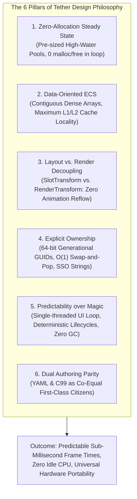
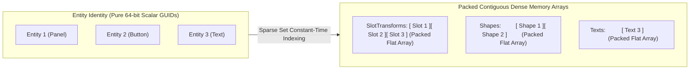
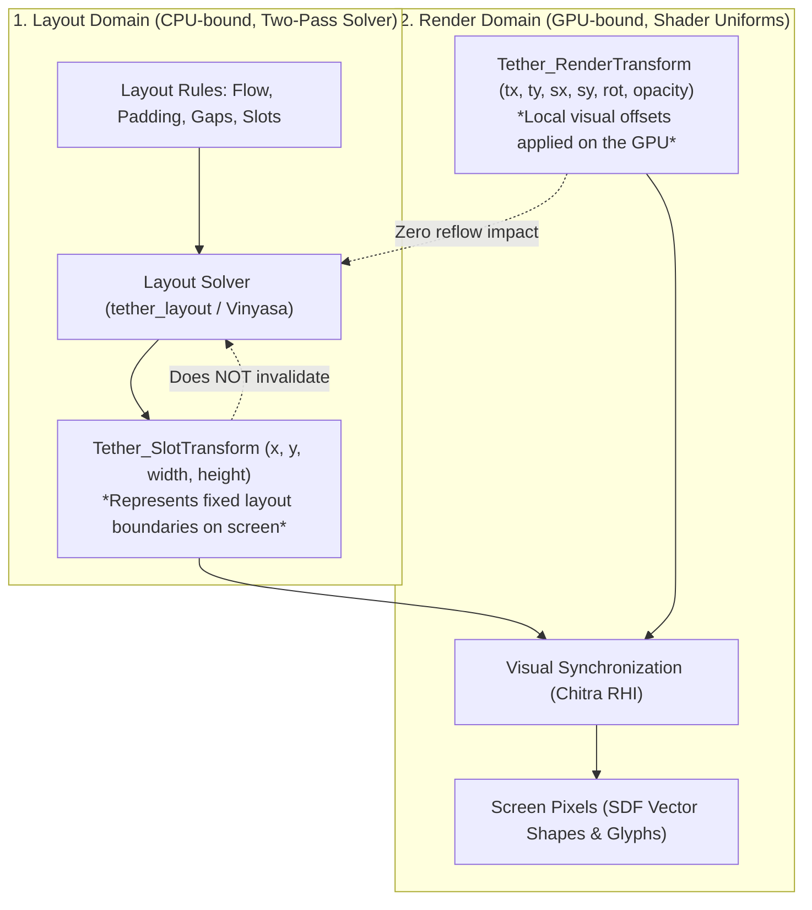
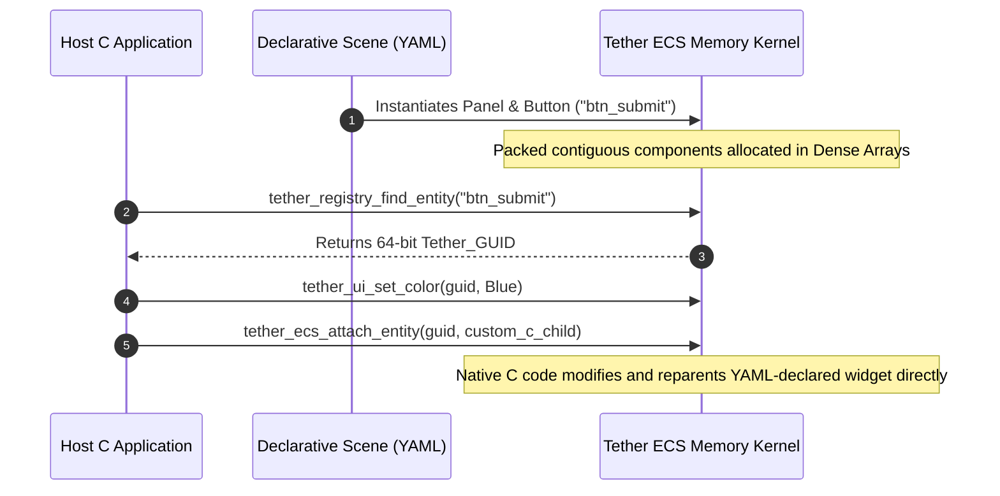

# Chapter 03: Design Philosophy and Principles

[<- Previous: Chapter 02 - Motivation and Problems Being Solved](02_motivation_and_problems.md) | [Documentation Master Index](../index.md) | [Next: Chapter 04 - Tether Ecosystem and Architecture ->](04_ecosystem_and_architecture.md)

---

## 1. Executive Summary

Software performance is not created by low-level micro-optimizations or compiler flags; it is the natural consequence of sound **architectural discipline**. When an architecture aligns with the physical realities of modern hardware, high performance, low latency, and deterministic memory behavior emerge effortlessly.

Tether is built upon six foundational design principles:
1. **Zero-Allocation Steady State**: Memory is never dynamically allocated or freed on the steady-state rendering and layout loops.
2. **Data-Oriented Architecture (DOD)**: Data is stored in contiguous memory pools optimized for CPU cache lines, completely rejecting classical OOP inheritance trees and vtable indirection.
3. **Decoupling of Layout Space from Render Space**: Visual GPU transformations (animations, scales, rotations, fades) must never invalidate container layout bounds or trigger reflow storms.
4. **Explicit Memory Ownership and Lifetime Discipline**: No opaque smart-pointer cycles, no unpredictable garbage collection pauses, and no dangling pointer crashes across language boundaries.
5. **Predictability over Magic**: No hidden background worker threads or invisible state mutations. The host application retains absolute control over execution, frame pacing, and hardware presentation.
6. **Limitless Dual Authoring Parity**: Declarative markup and compiled host code have complete parity; both operate on the exact same underlying ECS state without synthetic abstractions.



---

## 2. Zero-Allocation Steady-State Execution

In high-performance systems programming, dynamic memory allocation (`malloc`, `free`, `new`, `delete`) on real-time execution paths is considered an architectural flaw:
- Heap allocators require operating system syscalls and thread locks that introduce non-deterministic latency spikes.
- Repeated allocation and deallocation of UI nodes across frames produces heap fragmentation, degrading spatial cache locality over time.
- In garbage-collected environments (JavaScript, C#, Java), transient heap allocations force the runtime to trigger periodic stop-the-world garbage collection sweeps.

### The Tether Invariant: Allocate at Setup, Sweep Contiguously
Tether enforces a strict rule across its layout and rendering pipelines:
> **Once the UI scene is loaded and initialized, steady-state frame evaluation, layout recalculation, and rendering synchronization execute with zero dynamic heap allocations.**

- **High-Water Mark Strategy**: Component arrays allocate memory during startup or capacity expansion using geometric growth. Once the peak population is accommodated, memory pools stabilize.
- **In-Place Mutation**: When a label caption updates, a button transitions from hovered to pressed, or an animation interpolates a position, the engine updates values in-place within the contiguous dense arrays.
- **Scratch Arenas for Transient Calculations**: Layout passes that require temporary intermediate scratch calculations (such as Vinyasa multi-reference resolution) utilize fixed transient scratch buffers that reset instantaneously at the conclusion of the pass without touching the OS allocator.

---

## 3. Data-Oriented Design (DOD) over Object-Oriented Design (OOD)

Modern computer architecture has experienced a profound divergence: CPU execution units have become orders of magnitude faster, while memory access latency has remained relatively stagnant. As a result, **modern processors spend the vast majority of their time stalled, waiting for data to arrive from main RAM**.

```
Memory Latency Hierarchy:
  L1 Cache Hit:   ~1 nanosecond   (4-5 CPU cycles)
  L2 Cache Hit:   ~4 nanoseconds  (14 CPU cycles)
  L3 Cache Hit:   ~10 nanoseconds (40-50 CPU cycles)
  Main RAM Access: ~60-100 nanoseconds (200-300 CPU cycles) <-- POINTER CHASING STALLS
```

### The Failure of the Object-Oriented Model in UI
Traditional OOP treats every button, panel, and label as an isolated object containing internal data and virtual methods:
```cpp
// Classical OOP: Scattered across the heap, pointers everywhere
class Button : public Widget {
    Transform transform;
    Style style;
    Text label;
    virtual void on_click();
};
```
When an OOP engine renders a screen with 500 widgets, the CPU must dereference 500 independent memory addresses scattered randomly across the heap. Every dereference is a potential cache miss, stalling the CPU pipeline for hundreds of cycles.

### The Tether Solution: Entity Component System (UI-ECS)
Tether strictly separates **Identity** from **Data**, and **Data** from **Behavior**:



1. **Entities are Pure Identifiers**: An entity is just a 64-bit integer GUID. It owns no memory, contains no pointers, and has no vtables.
2. **Components are Flat Data Structs**: Components of the same type are packed contiguously into unified dense memory arrays.
3. **Systems are Pure Functions**: The layout solver and rendering synchronizer sweep through contiguous memory arrays sequentially. When the CPU fetches memory into a cache line, it automatically prefetches the subsequent components, achieving near 100% L1/L2 cache line utilization.

---

## 4. Separation of Layout Space from Render Space

In traditional web browsers and mobile application frameworks, visual styling and spatial layout are tightly coupled. Modifying a visual property (such as hover scale, a subtle rotation, or an opacity transition) marks the element dirty, triggering a **cascading reflow storm** where the browser re-evaluates the dimensions and positions of the parent and sibling containers.

### The Architectural Divide: `SlotTransform` vs. `RenderTransform`
Tether eliminates animation reflow storms by strictly decoupling layout geometry from visual GPU transformations:



- **`Tether_SlotTransform` (Layout Space)**:
  Represents the absolute geometric rectangle allocated to the entity by the layout solver ($x, y, \text{width}, \text{height}$). It changes **only** when structural layout properties change (e.g., container padding, flex weights, explicit sizes, or text wrapping).
- **`Tether_RenderTransform` (Render Space)**:
  Represents local visual offsets (translation $x/y$, scale $x/y$, rotation in degrees, render pivot, and opacity).
  - High-frequency UI animations (such as hover bounce, button press squish, spinning loading indicators, or smooth fade-ins) mutate **only** `RenderTransform`.
  - These transforms are passed directly to the GPU shader or drawing list during visual synchronization.
  - **Zero CPU layout recalculation occurs**. The surrounding layout remains completely static and clean.

---

## 5. Explicit Memory Ownership and Lifetime Discipline

Tether enforces absolute clarity regarding resource lifetimes, eliminating both garbage collection non-determinism and C++ memory leaks:

### 1. 64-Bit Generational Handles (`Tether_GUID`)
Entities are addressed exclusively by value through 64-bit scalar identifiers (`Tether_GUID`):
- **Lower 32 bits**: Array slot index.
- **Upper 32 bits**: Generational version counter.

When an entity is destroyed, its slot index is placed on a free stack and its generation counter in the internal table increments. If a foreign scripting environment (Python, Lua) or asynchronous callback attempts to query an obsolete GUID, Tether's $O(1)$ validity check (`tether_ecs_is_valid()`) rejects it immediately. Dangling pointers and use-after-free exploits are mathematically eliminated.

### 2. $O(1)$ Swap-and-Pop Deallocation
When a component is removed from an entity, Tether does not leave empty memory holes or shift remaining elements down in an expensive $O(N)$ memory move. Instead, it copies the last element in the dense array into the vacant slot and updates the sparse map in $O(1)$ constant time. Component arrays remain 100% packed and contiguous at all times.

### 3. Small String Optimization (SSO) Tiers
Text captions and labels represent the majority of short allocations in typical UIs. Tether eliminates heap churn for text through four adaptive storage tiers:
- **`TextWord` (32 bytes inline)**: Button captions, numbers, counters, status labels.
- **`TextLabel` (128 bytes inline)**: Headings, list items, navigation links.
- **`TextParagraph` (512 bytes inline)**: Dialog descriptions, notification messages.
- **`TextDynamic` (Heap buffer)**: Massive dynamic text fields, logs, and integrated code editors.

Strings under 512 bytes are stored directly inside the contiguous component struct in cache, requiring zero heap allocations.

---

## 6. Predictability over Magic

Modern UI frameworks often introduce opaque background automations that make debugging and profiling exceedingly difficult:
- **Invisible Threading**: Frameworks spawn background worker threads that mutate state asynchronously, introducing race conditions and requiring complex mutex locking.
- **Hidden Invalidation Cascades**: Changing one property silently invalidates dozens of unrelated subtrees without the developer's knowledge.
- **Non-Deterministic Runtimes**: Garbage collectors run at unpredictable intervals, creating intermittent frame drops during presentations or live demos.

### Tether's Engineering Contract
Tether is engineered as an **embedded micro-kernel**:
- **Single-Threaded UI Kernel**: The core ECS, layout solver, and rendering dispatch run strictly on the designated UI thread. Background worker threads communicate with Tether by enqueuing payloads onto thread-safe application queues and updating the UI during the `on_frame` callback.
- **Explicit Invalidation Tags**: Invalidation is transparent and verifiable. If an element needs layout, it carries `DIRTY_LAYOUT`. If it needs visual sync, it carries `DIRTY_VISUAL`. Developers can inspect dirty pools directly.
- **Zero Surprises**: Tether does what it is instructed to do, when it is instructed to do it.

---

## 7. Limitless Dual Authoring Parity

Many UI engines offer declarative file formats (e.g. QML, XAML) as a second-class wrapper around an underlying C++ engine, creating awkward impedance mismatches:
- Custom widgets created in C++ cannot be used in declarative files without complex registration macros and reflection bindings.
- Code written in declarative files cannot be easily queried, manipulated, or reparented from procedural C/C++ code.

### The Tether Unified State Model
In Tether, **Declarative Markup (YAML) and Imperative Code (C99) have complete architectural symmetry**:



1. **Identical Runtime Representation**: An entity spawned from YAML and an entity created via `tether_ui_button()` in C instantiate the exact same ECS components in the same dense arrays.
2. **Transparent Cross-Querying**: YAML entities assigned an `id:` are instantly queryable in C via `tether_registry_find_entity()`.
3. **Seamless Hybrid Workflows**: Developers can design overall layout hierarchies in declarative YAML for rapid visual iteration, inject dynamic custom controls authored in C, and attach interactive logic in Python or Lua without artificial barriers.

---

[<- Previous: Chapter 02 - Motivation and Problems Being Solved](02_motivation_and_problems.md) | [Documentation Master Index](../index.md) | [Next: Chapter 04 - Tether Ecosystem and Architecture ->](04_ecosystem_and_architecture.md)
