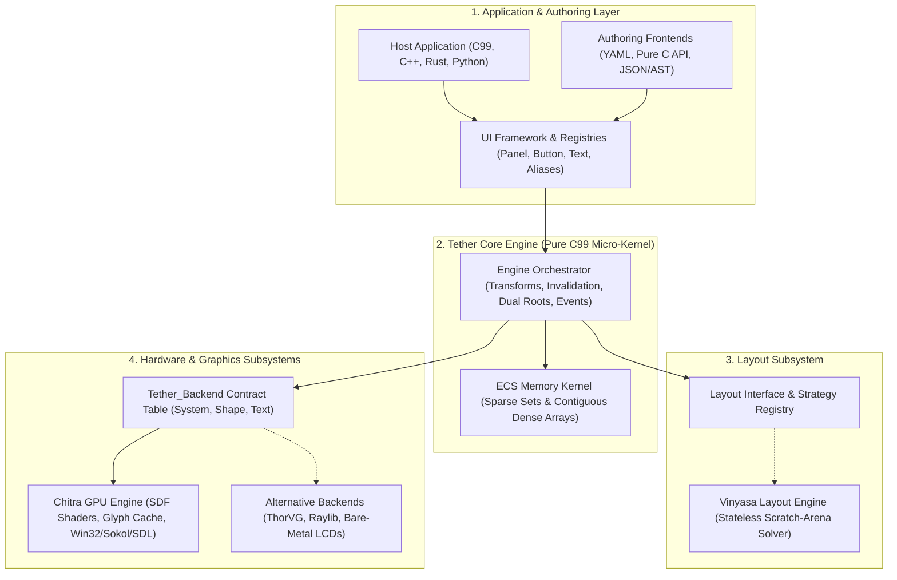
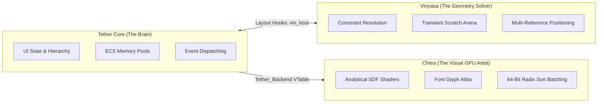
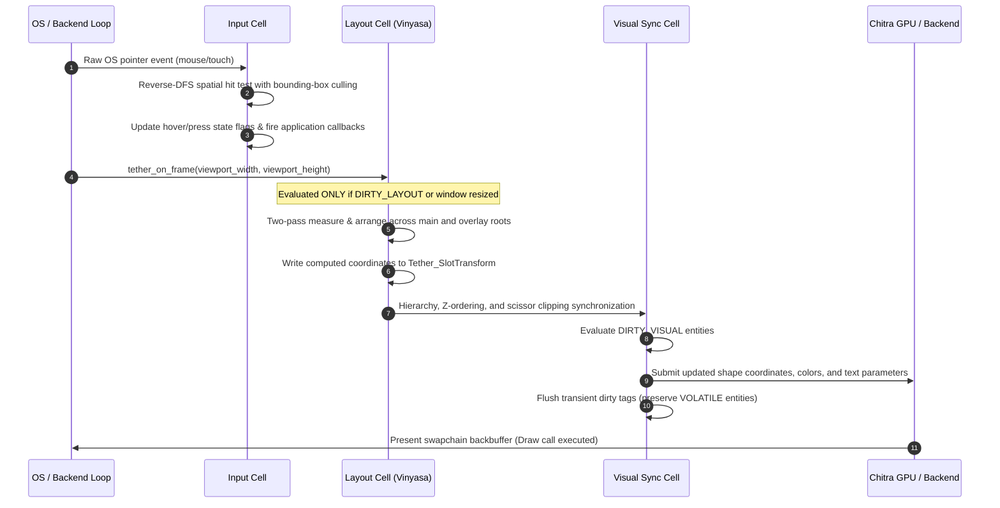

# Chapter 04: Tether Ecosystem and Architecture

[<- Previous: Chapter 03 - Design Philosophy and Principles](03_design_philosophy.md) | [Documentation Master Index](../index.md) | [Next: Chapter 05 - Capabilities and Practical Use Cases ->](05_capabilities_and_use_cases.md)

---

## 1. Executive Summary

Traditional user interface toolkits are built as monolithic codebases where windowing, memory management, constraint solving, widget styling, and graphics rasterization are tightly coupled. In such frameworks, replacing the rendering backend, running without an operating system, or embedding the layout solver into an external tool requires major architectural rewrites.

Tether abandons the monolithic design in favor of a **Cell-Block Subsystem Architecture**. Subsystems exist as decoupled, autonomous cells interacting through rigid, minimal C contracts.

This chapter defines the relationships and boundaries between the primary cells of the Tether ecosystem: **Tether Core**, the **Chitra GPU Rendering Engine**, the **Vinyasa Layout System**, and the pluggable **Backend Driver Interface**.



---

## 2. The Cell-Block Subsystem Model

Tether is divided into six distinct subsystem cells:

| Subsystem Cell | Primary Responsibility | Memory Ownership | Hardware Awareness |
| :--- | :--- | :--- | :---: |
| **ECS Kernel** | Manages 64-bit entity GUIDs, sparse maps, and contiguous dense component arrays. | Owns raw contiguous heap buffers; zero widget knowledge. | Completely Abstract |
| **Engine Systems** | Tracks spatial transforms (`SlotTransform`, `RenderTransform`), tree hierarchy, invalidation tags (`DIRTY_*`), and input events. | Operates directly over Kernel dense arrays. | Completely Abstract |
| **Central Registry & UI** | Maps string aliases to GUIDs, registers widget constructors, and registers layout strategies. | Owns string hash table and function pointer tables. | Completely Abstract |
| **Authoring & Parsing** | Converts declarative YAML into an intermediate format-neutral AST and instantiates live ECS entities. | Temporary parse buffers; copies strings into ECS SSO tiers. | Completely Abstract |
| **Layout Solver** | Resolves container constraints (flex, canvas anchors, padding, gaps, text wrapping). | Stateless; utilizes temporary scratch arenas during passes. | Completely Abstract |
| **Backend Driver** | Window creation, OS input normalization, and graphics hardware rasterization. | Owns GPU vertex buffers, swapchains, device contexts, and font textures. | Hardware Specific |

---

## 3. Subsystem Boundaries: Core vs. Chitra vs. Vinyasa

To prevent architectural bleeding, Tether maintains strict boundaries between its three primary named systems:



### 1. Tether Core (The State Kernel)
- **Role**: Manages UI entity lifecycles, contiguous component arrays, parent-child hierarchies, invalidation tags, and event dispatching.
- **Invariants**: Tether Core contains zero calls to operating system windowing APIs (Win32, Cocoa, X11) and zero calls to graphics APIs (DirectX, Metal, Vulkan, OpenGL). It operates purely on mathematical coordinates, colors, and entity IDs.
- **Portability**: Pure ISO C99. Runs identically on an x86-64 server, an ARM mobile processor, or an 8-bit microcontroller.

### 2. Chitra (The GPU Rendering Engine)
- **Role**: Tether's default, high-performance 2D GPU rendering engine.
- **Capabilities**:
  - Translates abstract draw commands into GPU primitives using analytical Signed Distance Field (SDF) shaders (no mesh tessellation or GPU pipeline stalls).
  - Maintains dynamic font glyph atlases via Fontstash.
  - Implements 64-bit visual key radix sorting, coalescing non-overlapping shapes and text into single instanced draw calls (Z-banding).
  - Handles windowing and OS event interception through Sokol or SDL3.
- **Isolation**: Chitra operates behind the `Tether_Backend` interface. Tether does not assume Chitra is the only renderer; Chitra is an independent, modular graphics library that can be used outside Tether.

### 3. Vinyasa (The Stateless Layout Engine)
- **Role**: Standalone, on-demand layout solver.
- **Capabilities**:
  - Stateless mathematical resolution: Vinyasa does not store a persistent scene tree or widget objects.
  - Operates on calculation roots using temporary scratch arenas (`vin_context.scratch`) that reset immediately after the layout pass.
  - Supports multi-reference relative coordinate resolution: positioning children relative to parent allocated slots, parent self geometry, or global screen roots.
  - Communicates with Tether Core through the `vin_host` bridge interface.

---

## 4. The Link-Time Backend Contract (`Tether_Backend`)

Rather than relying on runtime virtual method tables (vtables) or heavy dynamic dispatch, Tether connects to hardware drivers through a clean C struct table declared in `include/tether/backends/tether_backend.h`:

```c
typedef struct Tether_Backend {
    const Tether_System_API* system; /* OS windowing, frame pacing, draw order, clips */
    const Tether_Shape_API*  shape;  /* Rectangles, corner radii, borders, colors */
    const Tether_Text_API*   text;   /* Font metrics, glyph measurement, text rendering */
} Tether_Backend;

extern Tether_Backend g_backend;
```

### Link-Time Backend Swapping
Because the backend contract is exposed as a global symbol (`g_backend`), swapping the entire graphics and windowing layer requires **zero changes to Tether Core source code**:
- **Default GPU Desktop**: Link `src/backends/chitra_backend.c` to compile with Chitra (Direct3D 11, Metal, Vulkan, WebGPU).
- **Vector Graphics Build**: Link a ThorVG adapter (`thorvg_backend.c`) for pure vector rasterization.
- **Game Engine Integration**: Link a Raylib or SDL3 adapter (`raylib_backend.c`) to draw Tether directly inside an existing game loop.
- **Bare-Metal Microcontrollers**: Link a custom embedded framebuffer driver (`mcu_framebuffer_backend.c`) that writes directly to SPI/Parallel LCD displays with zero OS dependencies.

---

## 5. End-to-End Frame Execution Lifecycle

The collaboration between subsystem cells follows a strictly ordered, deterministic per-frame pipeline:



1. **Input Normalization & Spatial Query**: The backend delivers a normalized `Tether_Pointer_Event`. The input system executes a reverse-DFS traversal, culling non-intersecting bounding boxes in $O(1)$ time per branch, and dispatches callbacks.
2. **On-Demand Layout Solve**: If structural layout flags are dirty (`DIRTY_LAYOUT`), the layout engine executes bottom-up intrinsic measurement and top-down spatial arrangement, writing final pixel bounds to `Tether_SlotTransform`.
3. **Z-Ordering and Scissor Clipping**: The engine traverses the scene hierarchy to calculate global draw orders (monotonic Z-indices) and computes intersected hardware scissor rectangles for overflow containers.
4. **Visual Synchronization**: Entities with `DIRTY_VISUAL` flags update their visual properties in the backend draw list, applying visual `RenderTransform` offsets directly to GPU vertex streams.
5. **Zero-Power Throttling**: Transient dirty tags are flushed. If no visual state changed and no continuous `VOLATILE` entities are active, the engine sleeps, issuing zero GPU draw calls.

---

## 6. Extensibility and Open Architecture

Tether's cell-block architecture ensures that third-party applications have the exact same privileges as built-in engine modules:
- **Custom Components**: Applications register new data structs at runtime via `tether_ecs_register_component_dynamic()`, sharing the same contiguous dense arrays as native engine components.
- **Custom Layout Strategies**: Developers register custom container mathematics (such as radial menus, hexagonal grids, or docking splitters) via `tether_layout_register_strategy()`.
- **Custom Widgets**: Any C function adhering to `Tether_WidgetCreateFn` can be registered with the Central Registry, making it instantly instantiable in declarative YAML files.

---

[<- Previous: Chapter 03 - Design Philosophy and Principles](03_design_philosophy.md) | [Documentation Master Index](../index.md) | [Next: Chapter 05 - Capabilities and Practical Use Cases ->](05_capabilities_and_use_cases.md)
