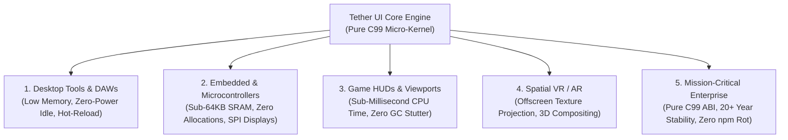
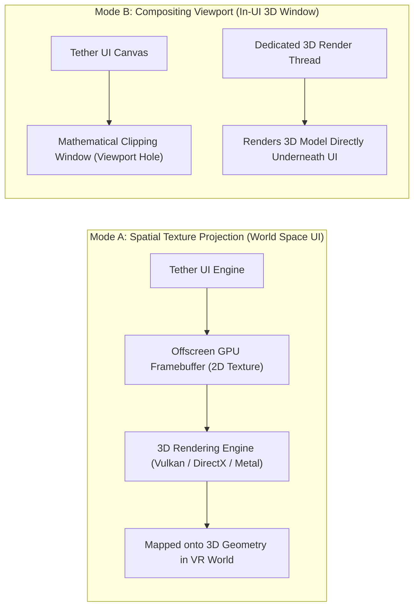

# Chapter 05: Capabilities and Practical Use Cases

[<- Previous: Chapter 04 - Tether Ecosystem and Architecture](04_ecosystem_and_architecture.md) | [Documentation Master Index](../index.md) | [Next: Chapter 06 - Comparison with Existing UI Technologies ->](06_comparison.md)

---

## 1. Executive Summary

Most graphical user interface frameworks are optimized for a single computing domain. Web frameworks (Electron, React) target desktop and cloud applications at the cost of massive resource consumption. Immediate-mode toolkits (Dear ImGui) target game engine debug menus at the cost of continuous power drain. Embedded GUI toolkits (LVGL, TouchGFX) target microcontrollers at the cost of rigid, proprietary authoring pipelines.

Tether is architected to transcend these artificial boundaries. By separating data-oriented state management, constraint solving, and hardware rasterization into decoupled cells, Tether scales seamlessly across five major computing domains:
1. **Desktop Creative Tools and Developer Utilities**
2. **Embedded Touchscreens, Automotive, and Medical Devices**
3. **AAA Game HUDs and Interactive Viewports**
4. **Spatial Computing and Virtual/Augmented Reality (VR/AR)**
5. **Mission-Critical Enterprise Software with Decadal Lifespans**

---

## 2. Desktop Creative Tools and Developer Utilities

Desktop utilities, developer tools, telemetry dashboards, audio workstations (DAWs), and hardware monitoring suites require high information density, fast responsiveness, and minimal resource footprints.

### The Problem in Desktop Software Today
Developers building desktop utilities frequently resort to web runtimes (Electron), bundling an entire Chromium browser and Node.js environment just to render a basic settings window or system monitor. This results in:
- $200\text{ MB} - 500+\text{ MB}$ of resident memory consumption.
- Background battery drain on laptops caused by continuous Chromium event loop wakeups.
- Sluggish multi-second cold startup times.

### The Tether Solution
- **Kilobyte-Scale Core Data**: The internal ECS component tables for hundreds of active widgets consume mere tens of kilobytes in contiguous memory.
- **Zero-Power Idle State**: In steady-state operation, Tether wakes only when user input occurs or when host telemetry triggers an invalidation tag. When the display is static, Tether consumes zero CPU cycles and issues zero GPU draw calls.
- **Rapid Prototyping with Live Hot-Reload**: Developers can build complex desktop interfaces in declarative YAML, modifying layout, colors, and typography in real time using the Sandbox showcase without restarting the application.
- **Instant Cold Boot**: Standalone desktop applications built with Tether launch instantaneously in under $50\text{ milliseconds}$.

---

## 3. Embedded Touchscreens, Automotive, and Medical Devices

Resource-constrained embedded platforms, including microcontrollers (STM32, ESP32, NXP i.MX, Raspberry Pi RP2040) and real-time operating systems (FreeRTOS, Zephyr, embedded Linux), operate under severe hardware limits.

### The Problem in Embedded UI
Traditional desktop UI toolkits cannot boot on microcontrollers due to memory fragmentation, OS dependencies, and large binary footprints. Proprietary embedded GUI engines often require expensive commercial runtime licenses and rigid, vendor-locked visual design tools.

### The Tether Solution
- **Pipeline 1 (Pure C Imperative Mode)**:
  Bypasses the YAML parser and filesystem dependencies entirely. The user interface is constructed directly in pure C99 code (`tether_ui_panel`, `tether_ui_button`, `tether_ui_text`).
- **Pre-Sized Static Component Pools**:
  Memory capacities are pre-allocated during initialization. During active runtime, Tether executes zero dynamic heap allocations (`malloc`, `free`), guaranteeing that the application will never encounter out-of-memory crashes or fragmentation failures during operation.
- **Strict SRAM Budgeting**:
  A complete, multi-screen embedded UI with dozens of buttons, status gauges, and text displays fits comfortably within strict microcontroller internal SRAM budgets ($< 64\text{ KB}$).
- **Custom Framebuffer Drivers**:
  Tether connects directly to custom SPI, I2C, or parallel LCD display drivers via the simple `Tether_Backend` interface, writing pixels directly to hardware framebuffers without requiring an operating system or GPU.

---

## 4. AAA Game HUDs and Interactive Viewports

Game development requires UI systems capable of operating within strict per-frame budgets (e.g. less than $1\text{ millisecond}$ of total CPU time at 120 FPS) without ever triggering garbage collection stutter.

### The Problem in Game UI
Game developers often struggle with UI integration:
- Web-based game UI layers (such as Ultralight or Coherent UI) introduce significant memory overhead and thread synchronization latency.
- Pure immediate-mode toolkits (Dear ImGui) lack advanced multi-pass layout constraints (proportional flexbox, auto-wrapping text, anchor docking) and force 100% continuous CPU polling.

### The Tether Solution
- **Sub-Millisecond Frame Times**: By storing all UI data in contiguous dense arrays, Tether processes layout and visual synchronization with extreme CPU cache efficiency, completing frame passes in fractions of a millisecond.
- **Zero Garbage Collection (GC) Stutter**: Being written in pure C99, Tether generates zero garbage-collection churn. Frame rates remain rock-solid across hours of continuous gameplay.
- **Zero-Reflow Visual Animations**: In-game HUD elements frequently pulse, scale on hover, or fade out. Tether's mathematical separation of `SlotTransform` (layout geometry) from `RenderTransform` (GPU visual offsets) ensures that animations execute purely on the GPU without triggering CPU layout reflow passes.
- **Analytical SDF Vector Graphics**: Chitra's Signed Distance Field (SDF) rasterizer renders smooth vector shapes and crisp typography at arbitrary display resolutions (1080p, 4K, ultrawide) without requiring multi-resolution raster asset swapping.
- **Host-Driven Frame Ticking**: Games do not relinquish control of their main loop to Tether. The game engine simply invokes `tether_on_frame(width, height)` during its existing render pass.

---

## 5. Spatial Computing and Virtual/Augmented Reality (VR/AR)

Spatial computing viewports (such as VR headsets, AR glasses, and 3D simulation cockpits) require interfaces that can exist as 2D flat projections or as interactive 3D virtual panels positioned within world space.

Tether provides two distinct architectural mechanisms for spatial integration:

### 1. Spatial Texture Projection (World-Space VR Panels)
For virtual computer terminals, in-game tablets, or floating holographic panels in VR:
- Tether renders the entire user interface into an isolated offscreen 2D GPU render target texture.
- The external 3D engine (e.g. Unreal Engine, Unity, or a custom Vulkan pipeline) samples this flat texture and maps it onto 3D polygonal geometry in virtual space.
- Ray-casted collision coordinates from VR hand controllers are normalized into 2D $(x, y)$ coordinates and forwarded into `tether_on_input()`, driving hover states and clicks seamlessly.

### 2. Compositing Viewports (3D Inside 2D UI)
For CAD software, 3D model viewers, or character customizers where a 3D scene must appear inside a 2D desktop application:
- Tether computes the 2D layout and leaves an explicit mathematical clipping window for the 3D viewport.
- Tether hands off the viewport screen rectangle to the 3D rendering thread to draw 3D meshes directly into the window backbuffer, while Tether draws overlay controls (toolbars, inspection sidebars) on top.

---

## 6. Mission-Critical Enterprise Software with Decadal Lifespans

Industrial automation, aerospace telemetry, defense applications, and enterprise infrastructure software are built to operate reliably for decades without code modification.

### The Fragility of Modern Framework Churn
Web and mobile frameworks experience notorious dependency churn:
- Modern web applications depend on thousands of nested third-party packages in `node_modules`, creating severe supply-chain security vulnerabilities and frequent breaking changes across minor version upgrades.
- Framework paradigms shift rapidly (e.g., AngularJS to Angular 2+, React class components to hooks), rendering codebases obsolete within three to five years.

### The Long-Term Stability of Pure C99
- **The Timelessness of ISO C99**: C99 is one of the most stable, widely supported computing standards in existence. A Tether C99 codebase written today will compile and execute without modification on operating systems and compilers twenty years from now.
- **Zero Third-Party Dependency Trees**: Tether core requires zero external runtime libraries beyond standard C library math and memory functions.
- **Verifiable Memory Safety**: The combination of generational GUID handles, contiguous dense memory pools, and zero heap allocations on frame loops eliminates the vast majority of memory corruption vulnerabilities common to legacy C/C++ codebases.

---

## 7. Practical Capabilities Matrix

| Application Requirement | Traditional UI Solutions | How Tether Meets the Need |
| :--- | :--- | :--- |
| **Instant Cold Boot** | Multi-second delays (Chromium / V8 startup) | Sub-$50\text{ ms}$ startup; direct C initialization |
| **Low Steady-State RAM** | $200\text{ MB} - 500+\text{ MB}$ (Electron) | Kilobyte-scale core data arrays; sub-$64\text{ KB}$ on bare metal |
| **Zero-Power Battery Conservation** | Continuous background polling | Retained-mode dirty tag invalidation; 0 draw calls when static |
| **Deterministic Frame Pacing** | Periodic GC stutter spikes | Zero heap allocations on frame loop; rock-solid frame times |
| **Rapid Prototyping** | Recompile required on C++ toolkits | Declarative YAML markup with live Sandbox hot-reloading |
| **Multi-Language Interoperability** | Complex C++ vtable wrappers | Scalar 64-bit integer GUIDs over standard C calling conventions |
| **Microcontroller Suitability** | Impossible without extensive rewrites | Pipeline 1 (Pure C) with custom framebuffer drivers |

---

[<- Previous: Chapter 04 - Tether Ecosystem and Architecture](04_ecosystem_and_architecture.md) | [Documentation Master Index](../index.md) | [Next: Chapter 06 - Comparison with Existing UI Technologies ->](06_comparison.md)
