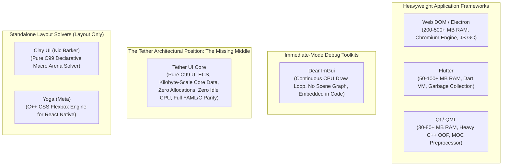
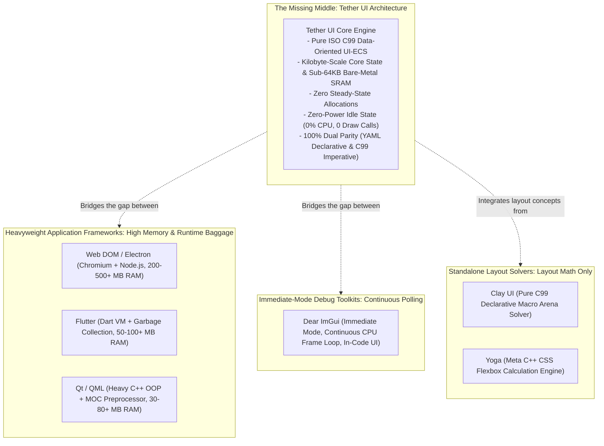

# Chapter 06: Comparison with Existing UI Technologies

[<- Previous: Chapter 05 - Capabilities and Practical Use Cases](05_capabilities_and_use_cases.md) | [Documentation Master Index](../index.md) | [Next: Chapter 07 - Cross-Platform Portability and Consistency ->](07_portability_and_consistency.md)

---

## 1. Executive Summary

The modern software landscape offers dozens of graphical user interface solutions, each shaped by distinct historical constraints and architectural trade-offs. However, the ecosystem is polarized into two extremes:
1. **Ultra-Heavyweight Application Frameworks** (Web DOM, Electron, Qt, Flutter): Provide rich declarative capabilities, layout engines, and styling at the cost of massive binary footprints, hundreds of megabytes of resident memory, garbage collection pauses, and multi-layered dependency chains.
2. **Immediate-Mode Debug Toolkits** (Dear ImGui): Provide lightweight, immediate code iteration and low binary overhead at the cost of continuous CPU frame polling (100% active frame loops), lack of retained layout hierarchies, and rigid procedural code coupling.

Tether occupies a distinct, deliberate architectural position: **The Missing Middle**. It delivers the clean developer ergonomics and declarative authoring of modern retained UI frameworks while matching the zero-allocation steady-state performance, kilobyte-scale memory efficiency, and rock-solid determinism of low-level systems programming.

This chapter provides a rigorous, objective architectural comparison between Tether and the prominent GUI technologies in industry use today: **Dear ImGui**, **Qt / QML**, **Flutter**, **Slint**, **Clay UI**, **Yoga (Meta)**, and **Web DOM / Electron**.

---

## 2. Comprehensive Architectural Comparison Matrix

| Architectural Dimension | Tether UI | Dear ImGui | Qt / QML | Flutter | Slint | Clay UI | Yoga (Meta) | Web DOM / Electron |
| :--- | :--- | :--- | :--- | :--- | :--- | :--- | :--- | :--- |
| **Core Paradigm** | Retained (Reactive Invalidation) | Immediate Mode | Retained (Widget Tree) | Retained (Widget Tree) | Retained (Reactive Property) | Declarative Layout Solver | Retained Flexbox Solver | Retained (DOM Tree) |
| **State Architecture** | Data-Oriented UI-ECS (Contiguous Arrays) | Procedural Stack / Immediate Call | Object-Oriented (QObject Hierarchy) | Functional Reactive (Immutable Widgets) | Reactive Properties & Structs | Declarative Macro Arena | Retained Node Tree | Object-Oriented (DOM Nodes) |
| **Primary Language / ABI** | Pure ISO C99 | C++ | C++ (MOC Preprocessor) | Dart (Dart VM) | Rust / C++ | Pure ISO C99 | C++ (C API Wrappers) | JavaScript / Chromium C++ |
| **Core UI Data RAM** | Kilobytes (Tens of KB) | Kilobytes | Megabytes (10 MB - 50+ MB) | Megabytes (20 MB - 80+ MB) | Megabytes (5 MB - 20 MB) | Kilobytes (Transient Arena) | Kilobytes to Megabytes | Hundreds of MB (200 - 500+ MB) |
| **Idle CPU Overhead** | **Zero Cycles** (Event-driven sleep) | **Continuous Polling** (Active frame loop) | Low (Event-driven sleep) | Low (Event-driven sleep) | Low (Event-driven sleep) | N/A (Layout solver only) | N/A (Layout solver only) | High (Background timer polling) |
| **Steady-State Allocations** | **Zero Allocations** (High-water pools) | Frequent Per-Frame Arena Allocations | Frequent Heap Churn (`malloc` / `new`) | Continuous Heap Garbage Collection | Occasional Dynamic Allocations | Per-Frame Scratch Arena Reset | Dynamic Heap Allocations | Continuous GC Churn (V8 Engine) |
| **Layout / Render Separation** | Decoupled (`Slot` vs. `Render`) | Coupled (Immediate ImDrawList) | Coupled (QGraphicsItem / QWidget) | Coupled (RenderObject pipeline) | Partially Decoupled | Layout Only (Emits Draw Commands) | Layout Solver Only (No Rendering) | Tightly Coupled (Reflow Storms) |
| **Declarative / Code Parity** | 100% Parity (YAML / C99) | No Declarative Mode | QML vs. C++ Widget split | Dart DSL Only | Slint DSL vs. Rust / C++ | Pure C Macros Only | Imperative C/C++ API | HTML / CSS vs. JS |
| **Microcontroller / Bare Metal** | Yes (Sub-64 KB SRAM capable) | Partial (Requires OS/C++ runtime) | No (Heavy runtime requirements) | No (Requires Dart VM + Skia) | Partial (MCU backend available) | Yes (Header-only C99) | Limited (C++ runtime required) | No (Requires OS + Chromium) |

---

## 3. In-Depth Comparative Analysis



---

### 3.1 Tether vs. Dear ImGui

**Dear ImGui** is one of the most successful and widely adopted developer UI libraries in the games and real-time graphics industry. Its immediate-mode API allows developers to inject debug controls directly into rendering code with extraordinary speed. However, using immediate-mode for consumer-facing, production-grade applications reveals severe architectural constraints:

#### 1. Continuous Polling vs. Zero-Power Idle State
- **Dear ImGui**: Operates on an immediate-mode loop where the application must re-execute the entire UI code every single frame. Even when the user is not touching the keyboard or mouse and the screen is completely static, ImGui continuously evaluates widgets and rebuilds vertex buffers. On battery-powered laptops, handheld gaming devices, and mobile hardware, this continuous execution causes unnecessary thermal throttling and battery drain.
- **Tether**: Operates on a retained-mode model governed by fine-grained reactive invalidation tags (`DIRTY_LAYOUT`, `DIRTY_VISUAL`, `DIRTY_HIERARCHY`). When no user interaction occurs and visual animations are idle, Tether consumes **zero CPU cycles** and issues **zero GPU draw calls**.

#### 2. Layout Capabilities and Dynamic Reflow
- **Dear ImGui**: Designed primarily for procedural tool panels and developer debug windows. It lacks modern constraint-based layout solvers, multi-reference dynamic positioning, flexbox wrapping, and percentage-based sizing. Creating responsive layouts that adapt dynamically to arbitrary window resizing requires extensive manual math in the application loop.
- **Tether**: Integrates the Vinyasa layout solver, providing full support for flexbox containers, auto-wrapping, multi-reference canvas anchoring, padding, and gap distributions.

#### 3. Separation of Concerns and Runtime Theming
- **Dear ImGui**: UI structure, styling, and application logic are hardcoded directly into imperative C++ routines. Changing a layout requires modifying source code and recompiling the application.
- **Tether**: Decouples scene definitions into declarative YAML files that lower into a format-neutral scene AST. Layouts, visual styles, and themes can be updated and hot-reloaded at runtime without recompilation, while maintaining 100% parity with compiled C99 code.

---

### 3.2 Tether vs. Qt / QML

**Qt** is the enterprise standard for cross-platform desktop application development, powering automotive infotainment, digital audio workstations, and industrial machinery. However, Qt represents the culmination of 1990s-era Object-Oriented Programming (OOP) architecture:

#### 1. Heavy C++ OOP and Virtual Method Dispatch (vtables)
- **Qt**: Every widget inherits from massive base classes (`QObject`, `QWidget`, `QGraphicsItem`). A simple button contains complex vtables, internal event filters, dynamic property dictionaries, and thread-affinity structures. Rendering a screen with hundreds of widgets requires traversing deep pointer webs across fragmented heap allocations, triggering continuous CPU L1/L2 cache misses.
- **Tether**: Strictly adheres to Data-Oriented Design (DOD). Widgets possess no vtables, no inheritance hierarchies, and no hidden pointers. All UI components are packed sequentially into contiguous dense arrays in memory. System passes (layout resolution, visual synchronization) sweep linearly through memory, maximizing hardware cache prefetching.

#### 2. Memory Footprint and Runtime Baggage
- **Qt**: A minimal Qt desktop application typically consumes $30\text{ MB} - 80+\text{ MB}$ of resident RAM upon startup, requiring multiple shared dynamic libraries (`QtCore`, `QtGui`, `QtWidgets`, or the entire QML/V4 JavaScript runtime engine).
- **Tether**: Tether's core ECS component tables occupy mere **tens of kilobytes** for hundreds of active entities. The entire compiled C99 static library is a few hundred kilobytes. When running on desktop with hardware acceleration, any resident memory is allocated strictly by the host operating system's GPU driver (DirectX 11 swapchains, device context, and font atlas textures), with zero framework baggage. On microcontrollers, Tether operates comfortably in sub-$64\text{ KB}$ SRAM environments.

#### 3. ABI Friction and Language Interoperability
- **Qt**: Relies on a proprietary preprocessor, the Meta-Object Compiler (`moc`), to implement signals and slots. Interfacing Qt with other programming languages (such as Rust, Python, or Zig) requires complex C++ wrapper layers and foreign function boundary gymnastics.
- **Tether**: Exposes a pure, clean ISO C99 Application Binary Interface (ABI). Entities are passed as simple 64-bit scalar integers (`Tether_GUID`). Any programming language capable of calling standard C functions can bind to Tether natively with zero overhead.

---

### 3.3 Tether vs. Flutter

**Flutter** (developed by Google) is a popular framework for building multi-platform applications from a single codebase. It renders its own widgets using a custom graphics engine (Impeller / Skia) driven by the Dart language runtime:

#### 1. Garbage Collection (GC) Stutter vs. Deterministic Pacing
- **Flutter**: Dart relies on an automated tracing garbage collector. While optimized for UI development, garbage collection cycles introduce non-deterministic pause times. In high-performance applications (such as AAA game engine editor overlays, audio synthesis software, or high-frequency telemetry monitors), GC pauses cause visible frame drops and micro-stutter (jank).
- **Tether**: Eliminates garbage collection entirely. Tether never performs heap allocations (`malloc`, `free`) during steady-state frame execution. Memory buffers grow geometrically during startup into pre-sized high-water pools. Frame execution times are completely deterministic and predictable down to the sub-millisecond level.

#### 2. Runtime Overhead and Binary Size
- **Flutter**: Requires bundling the full Dart Virtual Machine and runtime libraries. A minimal Flutter mobile or desktop binary starts at $15\text{ MB} - 25+\text{ MB}$, and baseline memory consumption ranges from $50\text{ MB} - 100+\text{ MB}$.
- **Tether**: Has zero runtime VM requirements. It compiles to native machine code via any standard C compiler (GCC, Clang, MSVC) with a binary footprint measured in hundreds of kilobytes.

---

### 3.4 Tether vs. Slint

**Slint** is a modern, lightweight GUI toolkit written in Rust, specifically targeting embedded platforms and desktop software:

#### 1. Proprietary Markup DSL vs. Format-Neutral AST
- **Slint**: Relies on a proprietary declarative language (`.slint`) that requires dedicated compiler toolchains to translate markup into Rust or C++ source code during the build process.
- **Tether**: Utilizes standard, human-readable YAML as its default declarative format. Rather than generating rigid code at build time, Tether parses declarative definitions into a runtime format-neutral Abstract Syntax Tree (AST) that directly populates standard ECS component tables. This architecture allows dynamic runtime scene generation, network-driven UI streaming, and live hot-reloading.

#### 2. Pure C99 Portability vs. Rust Toolchain Constraints
- **Slint**: Its core engine is implemented in Rust. While Rust offers excellent memory safety guarantees, its toolchain is not supported on many legacy embedded platforms, specialized real-time operating systems (RTOS), proprietary DSP chips, or older industrial architectures.
- **Tether**: Written in 100% portable ISO C99. A standard C99 compiler exists for virtually every computing architecture ever fabricated, allowing Tether to deploy universally from low-power 8-bit/32-bit microcontrollers to massive multi-core workstations.

---

### 3.5 Tether vs. Clay UI (Nic Barker)

**Clay UI** is a high-performance, single-header pure C99 declarative layout library created by Nic Barker:

#### 1. Scope: Layout Solver vs. Full Retained UI Framework
- **Clay UI**: Clay is strictly a layout calculation engine. It computes bounding boxes based on declarative C macros and emits a flat array of `Clay_RenderCommand` structs for the host application to draw. Clay has no retained ECS state, no persistent entity handles, no input state machine (hover, active, focus transitions must be written manually by the host), and no graphics rendering implementation.
- **Tether UI**: Tether is a complete retained-mode UI architecture. While Tether includes high-performance layout solving (via Vinyasa and its built-in two-pass engine), it also provides the entire UI ecosystem: 64-bit generational GUID handles, contiguous ECS component storage, reactive dirty tag invalidation, normalized event dispatching, spatial hit-testing, dynamic font glyph atlases, and GPU Signed Distance Field (SDF) rasterization.

#### 2. Execution Model: Scratch Arena Reset vs. Retained Invalidation
- **Clay UI**: Re-evaluates layout declarations every frame using a linear scratch arena allocator that is reset at the conclusion of each frame. While very fast, this requires continuously re-declaring the UI tree in code every frame.
- **Tether UI**: Retains scene geometry and component tables in memory. Layout is re-evaluated only when structural properties change (`DIRTY_LAYOUT`), and static scenes consume zero CPU cycles.

---

### 3.6 Tether vs. Yoga (Meta / React Native)

**Yoga** is Meta's widely used, cross-platform layout engine that implements the W3C CSS Flexbox specification in C++:

#### 1. Scope: Pure Flexbox Layout Engine vs. Complete UI Subsystem
- **Yoga**: Yoga calculates Flexbox layout coordinates for arbitrary node hierarchies (`YGNodeRef`). Like Clay, Yoga is solely a layout calculator. It does not provide pixel rendering, text rasterization, event handling, input normalization, or widget state machines. Applications using Yoga (such as React Native or custom game engine tools) must build their own retained scene graphs and graphics bridges on top.
- **Tether UI**: Tether incorporates constraint and flexbox layout as an isolated subsystem cell while providing the complete, end-to-end retained UI framework architecture: contiguous ECS component tables, spatial transform decoupling, 64-bit radix sort batching, and pluggable hardware drivers.

#### 2. Implementation Language & Overhead
- **Yoga**: Written in C++ with dynamic memory allocations across node trees.
- **Tether UI**: Written in pure ISO C99. Layout solving in Tether uses stateless transient scratch arenas, avoiding heap allocations during steady-state execution.

---

### 3.7 Tether vs. Web DOM / Electron

**Electron** packages the Chromium web browser engine and Node.js runtime into standalone desktop executables. It powers major desktop utilities, communications tools, and developer editors:

```
Memory Consumption Comparison (Active Desktop Baseline):
  Electron Application: [==================================================] 250 MB - 500+ MB
  Qt Desktop Suite:     [======] 30 MB - 80 MB
  Tether UI (Core Data):[.] Tens of Kilobytes (Driver memory managed by host OS/GPU)
```

#### 1. The Immense Cost of the Web Stack
- **Web DOM / Electron**: Bundles millions of lines of browser engine code, V8 JavaScript just-in-time compilers, HTML parsers, CSS style recalculation engines, and multi-process IPC layers. A simple system tray utility built with Electron easily consumes $250\text{ MB} - 500+\text{ MB}$ of system memory and introduces noticeable startup latency.
- **Tether**: Eliminates all web layers. The entire Tether core runs natively in-process. Core UI state consumes mere tens of kilobytes in contiguous arrays, starting up in under $50\text{ milliseconds}$.

#### 2. Cascading Reflow Storms vs. Transform Decoupling
- **Web DOM**: Visual styling (CSS) and document layout (DOM) are heavily interdependent. Modifying a visual property (such as scale or hover translation) often marks the node dirty, causing cascading reflow passes where the browser re-evaluates the layout geometry of parent and sibling nodes across the tree.
- **Tether**: Solves this through the strict decoupling of `SlotTransform` (layout geometry $x, y, w, h$) from `RenderTransform` (GPU visual translation, scale, rotation, opacity). High-frequency animations mutate only `RenderTransform`, executing directly on the GPU without triggering a single CPU layout reflow calculation.

---

## 4. The Architectural Trade-Off Spectrum

UI engineering is fundamentally a discipline of managing trade-offs. The diagram below illustrates how prominent UI technologies map across architectural paradigms and system resource requirements:



### Architectural Classification Summary

| Technology | Architecture Class | Primary Strength | Primary Limitation |
| :--- | :--- | :--- | :--- |
| **Tether UI** | **Data-Oriented Retained UI-ECS** | Sub-64 KB memory capability, zero idle CPU, zero allocations, declarative/C parity. | Single-threaded UI main loop (worker threads must marshal updates). |
| **Dear ImGui** | **Immediate Mode Toolkit** | Rapid debug control injection in graphics experiments. | Continuous 100% frame polling, lacks retained layouts and zero-power idle. |
| **Qt / QML** | **Object-Oriented Desktop Toolkit** | Massive enterprise ecosystem and rich standard widgets. | Heavy C++ vtables, MOC preprocessor, multi-megabyte memory footprint. |
| **Flutter** | **Reactive Virtual Machine Toolkit** | Unified multi-platform mobile/desktop development. | Dart VM garbage collection pauses, multi-megabyte binaries. |
| **Slint** | **Declarative Rust Toolkit** | Type-safe declarative UI compilation. | Rust toolchain required, proprietary markup syntax. |
| **Clay UI** | **C99 Declarative Layout Solver** | Lightweight single-header C99 declarative macro layout. | Layout only: no retained ECS, no event system, no GPU renderer. |
| **Yoga** | **C++ Flexbox Solver** | Standard W3C CSS Flexbox layout calculation. | Layout only: no rendering, no input handling, C++ dependency. |
| **Electron** | **Bundled Web Browser Runtime** | Standard web technology stack (HTML/CSS/JS). | Extreme memory consumption (200-500+ MB), high idle CPU, multi-process bloat. |

---

## 5. Summary: Why Tether Matters in the Modern Systems Landscape

Tether exists because systems software, embedded hardware, creative desktop tools, and game engines have long suffered from a false dichotomy: **choose between the bloated memory consumption of web runtimes, the fragile OOP complexity of legacy C++ frameworks, or the continuous polling and coupled code of immediate-mode debuggers**.

By establishing a pure C99 Data-Oriented Entity Component System with zero steady-state allocations, format-neutral declarative authoring, decoupled layout/render pipelines, and pluggable hardware drivers, Tether provides the foundational, reliable micro-kernel that modern graphical applications require.

---

[<- Previous: Chapter 05 - Capabilities and Practical Use Cases](05_capabilities_and_use_cases.md) | [Documentation Master Index](../index.md) | [Next: Chapter 07 - Cross-Platform Portability and Consistency ->](07_portability_and_consistency.md)
