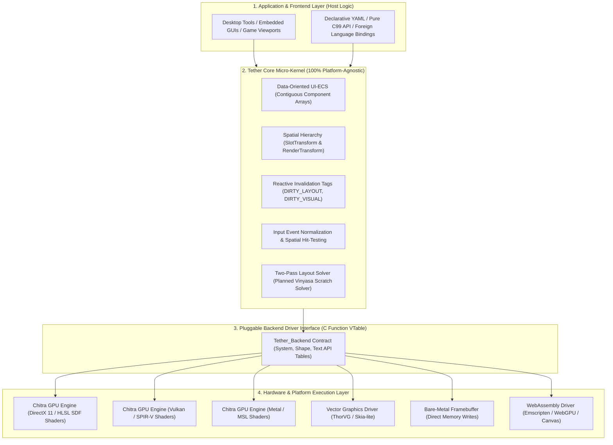

# Chapter 07: Cross-Platform Portability and Consistency

[<- Previous: Chapter 06 - Comparison with Existing UI Technologies](06_comparison.md) | [Documentation Master Index](../index.md) | [Next: Chapter 08 - Demonstrations and Verified Performance ->](08_demonstrations_and_benchmarks.md)

---

## 1. Executive Summary

Cross-platform software development has historically forced engineers to accept an uncomfortable compromise between two flawed approaches:
1. **Platform Divergence (Native Silos)**: Developing independent user interface implementations for each operating system (Win32 for Windows, Cocoa for macOS, GTK for Linux). This multiplies engineering maintenance costs, causes subtle behavioral bugs across platforms, and slows release cadences.
2. **Runtime Abstraction Bloat (Bundled Runtimes)**: Packaging heavy third-party runtimes (Chromium/Electron, Flutter, or large Java/Dart virtual machines) to execute identical code everywhere. This solves API consistency at the cost of hundreds of megabytes of resident memory, sluggish startup times, and uncontrollable background battery drain.

Tether resolves this dilemma through a clean separation of responsibilities:
- **Tether Core** is a 100% platform-agnostic, dependency-free ISO C99 micro-kernel. It operates solely on mathematical coordinates, entity IDs, and abstract component arrays. It contains zero operating system headers (`windows.h`, `X11/Xlib.h`) and zero graphics API calls (`d3d11.h`, `vulkan.h`, `gl.h`).
- **Hardware and OS Drivers** are isolated behind a clean 3-table C interface (`Tether_Backend`: `.system`, `.shape`, `.text`). Replacing the rendering subsystem or porting to a new OS requires implementing this contract without modifying Tether Core.

This chapter details Tether's portability architecture, its multi-tiered hardware support, its philosophy of semantic consistency over pixel-perfect dogma, and its pluggable driver model.

---

## 2. The Layered Portability Architecture

Tether structures portability into four distinct, isolated architectural tiers:



---

## 3. Supported Platform Deployment Tiers

Tether's minimal requirements allow it to deploy across a wide spectrum of hardware:

### Tier 1: Desktop Operating Systems (`v0.0.3-preview` Focus)
- **Target Environments**: Microsoft Windows 10/11 (validated in CI with MSVC and Clang ASan); Linux (X11/OpenGL) and macOS (Cocoa/Metal) configurations exist in `CMakeLists.txt` via Chitra/Sokol and await CI validation.
- **Default Backend**: **Chitra GPU Engine** (`src/backends/chitra_backend.c`).
- **Display Pipeline**: SDF rounded-rectangle/border shaders, dynamic Fontstash glyph caching, and 64-bit radix-sorted draw batching.
- **Windowing & Events**: Integrated via Sokol (`sokol_app` / `sokol_gfx`) in the bundled Chitra backend.
- **Resource Profile**: Flat C ECS arrays; hardware acceleration memory (swapchains, device contexts, and font atlas textures) is managed directly by the OS windowing system and GPU driver.

### Tier 2: Embedded Systems and Real-Time Operating Systems (Roadmap Target)
- **Target Environments**: Embedded Linux (Raspberry Pi, Toradex, Yocto), FreeRTOS, Zephyr RTOS, NuttX.
- **Use Cases**: Industrial automation HMIs, medical monitoring devices, automotive dashboard instrumentation.
- **Backend Strategy**: Custom `Tether_Backend` adapters targeting OpenGL ES 2.0/3.0, ThorVG vector graphics, or Linux Direct Rendering Manager (DRM/KMS).
- **Resource Goal**: Sub-megabyte binary, steady-state zero-alloc tuning, and deterministic frame pacing (unvalidated in preview).

### Tier 3: Bare-Metal Microcontrollers (Roadmap Target)
- **Target Environments**: ARM Cortex-M (Cortex-M4, Cortex-M7), ESP32-S3, RISC-V microcontrollers.
- **Use Cases**: Smart home control panels, handheld testing equipment, hardware synthesizers, low-power appliances.
- **Backend Strategy**: **Pipeline 1 (Pure C Imperative)** paired with a software framebuffer driver for SPI, I8080, or parallel LCD displays.
- **Resource Goal**: Sub-64 KB static SRAM operation without AST/YAML parser overhead (roadmap target, not yet measured).

### Tier 4: WebAssembly (WASM - Roadmap Target)
- **Target Environments**: Modern web browsers (Chrome, Firefox, Safari, Edge).
- **Backend Strategy**: Emscripten builds targeting WebGL2/WebGPU via Sokol or custom JS/WASM `Tether_Backend` glue.
- **Use Cases**: High-performance interactive web tools, CAD viewers, embedded playground sandboxes.

---

## 4. Semantic and Behavioral Consistency vs. Pixel-Perfect Dogma

Cross-platform UI development often falls into the trap of pursuing "pixel-perfect" parity: the demand that an identical widget must render to the exact same mathematical pixel coordinates across an iPhone, a 4K desktop monitor, an automotive display, and an electronic ink screen.

In real-world systems, pixel-perfect rendering across disparate screens is a physical impossibility due to hardware variances:
- **Display Pixel Density (DPI / PPI)**: Ranges from 96 DPI (standard desktop monitors) to over 450 DPI (mobile displays).
- **Subpixel Geometry**: RGB horizontal stripe, BGR, PenTile, and OLED subpixel layouts alter font rasterization and edge filtering.
- **Color Gamuts and Tone Mapping**: Discrepancies between standard sRGB, Display P3, and Rec. 2020 color spaces.
- **OS Text Hinting and Antialiasing**: Operating systems apply differing font rasterization algorithms (Windows ClearType, macOS grayscale smoothing, Linux FreeType hinting).

### Design Goals: Semantic and Behavioral Consistency
Instead of pursuing rigid pixel dogma, Tether designs for **structural, mathematical, and behavioral consistency** across backends (cross-platform hardware parity remains to be tested as additional targets come online):

#### 1. Layout Determinism
A given Tether scene runs the same layout algorithm across builds for consistent relative geometry, subject to per-platform font metrics and floating-point behavior.

#### 2. Normalized Interaction Routing
The input subsystem normalizes pointer events and resolves widget states (normal, hover, pressed, disabled) consistently inside core ECS (`v0.0.3-preview` exercises mouse/pointer input; full keyboard focus navigation, gamepad, and spatial pointers await expansion).

#### 3. Resolution-Independent SDF Shapes
Chitra uses Signed Distance Field (SDF) shaders for rounded rectangles and borders so card primitives scale cleanly with display density (arbitrary vector icon pipelines and multi-backend parity remain roadmap items).

### The Universal Media Paradigm: The PNG, MP3, and PDF of User Interfaces

Tether approaches interface portability using the same foundational model that established universal digital media standards:
- **Audio (MP3 / FLAC)**: An MP3 file is completely decoupled from sound cards, speaker hardware, and operating system audio APIs. Any device with an MP3 decoder decodes and plays the exact same sound waveform consistently.
- **Images (PNG / JPEG)**: A PNG file is completely decoupled from graphics hardware and display technology. Any device with a PNG decoder presents the exact same image pixels consistently.
- **Documents (PDF)**: A PDF document is completely decoupled from word processor software, operating system fonts, and printer hardware. Any PDF viewer opens and presents the layout with absolute structural fidelity.

**Tether applies this exact paradigm to interactive graphical user interfaces.**

Historically, user interfaces have been treated as ephemeral code constructs bound to specific operating system compilers (Win32, Cocoa, Qt) or packaged inside multi-hundred-megabyte web browser runtimes (Chromium/Electron).

Tether redefines UI as a **universal, self-contained interactive media asset**. A single declarative YAML definition or pre-compiled binary bytecode file (`.tbc`) contains the entire layout hierarchy, styling rules, typography properties, and interaction behaviors. Any platform, operating system, or device embedding the Tether micro-kernel opens and executes that UI asset with identical behavior and semantic consistency:
- An engineer can author a UI once on a desktop workstation.
- That exact same UI asset opens natively inside an embedded microcontroller display, an in-game HUD overlay, a web browser via WebAssembly, or a native Linux HMI.
- No platform rewrites, no intermediate translation layers, and zero framework bloat.

---

## 5. The `Tether_Backend` Interface: Link-Time Driver Swapping

Tether achieves total decoupling from hardware through the `Tether_Backend` contract table (`include/tether/backends/tether_backend.h`). The core engine never links against DirectX, Metal, Vulkan, or OpenGL directly. Instead, it interacts with hardware through three structured API tables bound to the global `g_backend` (`g_rhi`) symbol:

```c
typedef struct {
    Tether_System_API* system; /* Window loop, resolution, dirty mark, scissor clips, draw order */
    Tether_Shape_API*  shape;  /* Retained SDF rectangles, radii, borders, opacity, rotation */
    Tether_Text_API*   text;   /* Font loading, layout text measurement, retained text elements */
} Tether_Backend;

extern Tether_Backend g_backend;
```

### Architectural Benefits of the Backend Contract
1. **Link-Time Swapping**: An application swaps rendering and windowing drivers cleanly by linking a custom `Tether_Backend g_backend` translation unit in the build without modifying core engine source code.
2. **Headless Execution for Automated Testing**: Developers can run full UI integration tests in CI/CD pipelines using the headless backend stub (`tests/headless_backend.c`). The engine executes layout, invalidation, and input dispatching without opening a window or connecting to a display server.
3. **Zero Leaked Types**: No platform-specific structs (such as `HWND`, `ID3D11Device`, or `VkInstance`) are exposed to Tether Core or client applications.

---

## 6. Architecture-Level Determinism and Memory Layout

To keep Tether portable across desktop hosts and future embedded targets, the architecture separates flat core data structures from host graphics memory (`Note`: explicit static alignment/endianness bytecode rules apply to the target architecture and upcoming `.tbc` specification):

### 1. Alignment & Packed ECS Storage (Architecture Target)
Dense arrays store flat C99 structs contiguously by component type. As embedded microcontroller targets come online, enforcing strict 8-byte pool alignment avoids unaligned-access traps on RISC cores while improving cache utilization on x86-64 and ARM.

### 2. Endian-Neutral Binary Specification (`.tbc` Roadmap)
Tether's planned AOT bytecode format (`.tbc`) specifies little-endian integer encoding with load-time normalization for big-endian hosts (in `v0.0.3-preview`, scenes parse from text YAML at runtime).

### 3. Clear Memory Separation: Core Data vs. Host Graphics Memory
- **Core ECS Memory**: Entity tables, sparse maps, and component arrays keep internal data compact (`TextDynamic` and expanding capacity pools use standard heap allocation today; sub-64 KB bare-metal static sizing is roadmap work).
- **Native Library Footprint**: Compiled core binaries remain small, without bundled JS/Dart VM runtimes.
- **Host GPU Allocations**: On desktop platforms via Chitra/Sokol, swapchain backbuffers, OS window handles, device contexts, and GPU font atlas textures live in the OS graphics subsystem and GPU drivers.

---

## 7. Summary: A Stable Foundation Across Decades and Architectures

Operating systems, graphics APIs, and web standards change frequently. Over the past twenty years, desktop developers have witnessed the arrival and deprecation of DirectWrite, Direct2D, OpenGL versions, Vulkan, Metal, WPF, UWP, and countless web UI frameworks.

Tether protects developer investments by anchoring its core architecture to the most enduring standard in computer science: **ISO C99**.

By keeping the core micro-kernel completely decoupled from graphics hardware and operating system windowing calls, Tether ensures that UI investments made today will remain functional, efficient, and portable across platforms and architectures for decades to come.

---

[<- Previous: Chapter 06 - Comparison with Existing UI Technologies](06_comparison.md) | [Documentation Master Index](../index.md) | [Next: Chapter 08 - Demonstrations and Verified Performance ->](08_demonstrations_and_benchmarks.md)
