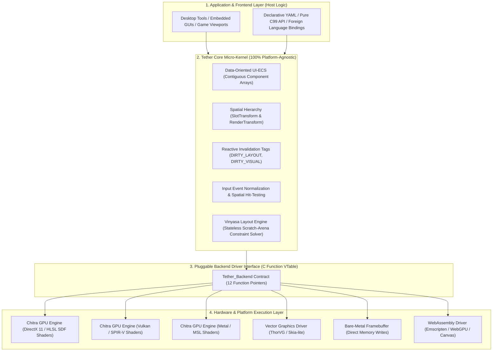

# Chapter 07: Cross-Platform Portability and Consistency

[<- Previous: Chapter 06 - Comparison with Existing UI Technologies](06_comparison.md) | [Documentation Master Index](../index.md) | [Next: Chapter 08 - Demonstrations and Verified Performance ->](08_demonstrations_and_benchmarks.md)

---

## 1. Executive Summary

Cross-platform software development has historically forced engineers to accept an uncomfortable compromise between two flawed approaches:
1. **Platform Divergence (Native Silos)**: Developing independent user interface implementations for each operating system (Win32 for Windows, Cocoa for macOS, GTK for Linux). This multiplies engineering maintenance costs, causes subtle behavioral bugs across platforms, and slows release cadences.
2. **Runtime Abstraction Bloat (Bundled Runtimes)**: Packaging heavy third-party runtimes (Chromium/Electron, Flutter, or large Java/Dart virtual machines) to execute identical code everywhere. This solves API consistency at the cost of hundreds of megabytes of resident memory, sluggish startup times, and uncontrollable background battery drain.

Tether resolves this dilemma through a clean separation of responsibilities:
- **Tether Core** is a 100% platform-agnostic, dependency-free ISO C99 micro-kernel. It operates solely on mathematical coordinates, entity IDs, and abstract component arrays. It contains zero operating system headers (`windows.h`, `X11/Xlib.h`) and zero graphics API calls (`d3d11.h`, `vulkan.h`, `gl.h`).
- **Hardware and OS Drivers** are isolated behind a minimal, 12-function C interface (`Tether_Backend`). Replacing the rendering subsystem or porting to a novel real-time operating system requires implementing this contract without modifying a single line of Tether Core.

This chapter details Tether's portability architecture, its multi-tiered hardware support, its philosophy of semantic consistency over pixel-perfect dogma, and its pluggable driver model.

---

## 2. The Layered Portability Architecture

Tether structures portability into four distinct, isolated architectural tiers:



---

## 3. Supported Platform Deployment Tiers

Tether's minimal requirements allow it to deploy across a wide spectrum of hardware:

### Tier 1: Desktop Operating Systems
- **Target Environments**: Microsoft Windows 10/11 (x86-64, ARM64), Linux (x86-64, ARM64), macOS (Apple Silicon, Intel x86-64).
- **Default Backend**: **Chitra GPU Engine**.
- **Display Pipeline**: Analytical Signed Distance Field (SDF) procedural vector shaders, dynamic Fontstash glyph caching, and instanced draw batching.
- **Windowing & Events**: Handled via lightweight platform glue (Sokol, SDL3, or direct Win32/X11/Wayland event loops).
- **Resource Profile**: Kilobyte-scale core component data. Hardware acceleration memory (DirectX 11 swapchain backbuffers, device context, and font atlas textures) is managed directly by the host operating system and GPU driver.

### Tier 2: Embedded Systems and Real-Time Operating Systems (RTOS)
- **Target Environments**: Embedded Linux (Raspberry Pi, Toradex, Yocto), FreeRTOS, Zephyr RTOS, NuttX.
- **Use Cases**: Industrial automation HMIs, medical monitoring devices, automotive dashboard instrumentation.
- **Backend Strategy**: OpenGL ES 2.0/3.0, ThorVG vector graphics, or direct Linux Direct Rendering Manager (DRM/KMS) hardware plane blitting.
- **Resource Profile**: Sub-megabyte binary, zero runtime heap allocations during steady-state rendering, deterministic frame execution times.

### Tier 3: Bare-Metal Microcontrollers (No OS)
- **Target Environments**: ARM Cortex-M (Cortex-M4, Cortex-M7), ESP32-S3, RISC-V microcontrollers.
- **Use Cases**: Smart home control panels, handheld testing equipment, hardware synthesizers, low-power appliances.
- **Backend Strategy**: **Pipeline 1 (Pure C Imperative)**. Direct memory-mapped software rasterization to SPI, I8080, or parallel LCD displays.
- **Resource Profile**: **Sub-64 KB SRAM operation**. Pre-allocated static component tables, zero dynamic memory allocations, and format-neutral AST bypass.

### Tier 4: WebAssembly (WASM)
- **Target Environments**: Modern web browsers (Chrome, Firefox, Safari, Edge).
- **Backend Strategy**: Compiled via Emscripten targeting WebAssembly with a WebGPU or WebGL2 rendering driver.
- **Use Cases**: High-performance interactive web tools, CAD viewers, embedded playground sandboxes.
- **Resource Profile**: Native C99 performance running inside the browser sandbox without DOM or JavaScript overhead.

---

## 4. Semantic and Behavioral Consistency vs. Pixel-Perfect Dogma

Cross-platform UI development often falls into the trap of pursuing "pixel-perfect" parity: the demand that an identical widget must render to the exact same mathematical pixel coordinates across an iPhone, a 4K desktop monitor, an automotive display, and an electronic ink screen.

In real-world systems, pixel-perfect rendering across disparate screens is a physical impossibility due to hardware variances:
- **Display Pixel Density (DPI / PPI)**: Ranges from 96 DPI (standard desktop monitors) to over 450 DPI (mobile displays).
- **Subpixel Geometry**: RGB horizontal stripe, BGR, PenTile, and OLED subpixel layouts alter font rasterization and edge filtering.
- **Color Gamuts and Tone Mapping**: Discrepancies between standard sRGB, Display P3, and Rec. 2020 color spaces.
- **OS Text Hinting and Antialiasing**: Operating systems apply differing font rasterization algorithms (Windows ClearType, macOS grayscale smoothing, Linux FreeType hinting).

### What Tether Guarantees: Semantic and Behavioral Consistency
Instead of pursuing rigid pixel dogma, Tether guarantees absolute **structural, mathematical, and behavioral consistency**:

#### 1. Layout Constraint Determinism
Layout calculation is strictly deterministic. A flex container configured with a 30% width ratio, 12-pixel padding, and auto-wrapping calculates identical bounding box geometry on an x86-64 Windows workstation and an ARM Cortex-M microcontroller.

#### 2. Interaction State Machine Determinism
User interaction states follow an exact, platform-agnostic state transition machine:
- `DEFAULT` -> `HOVERED` -> `PRESSED` -> `FOCUSED` -> `DISABLED`.
- Hit-test bounds and input event bubbling resolve consistently regardless of whether the input originates from a physical mouse, a capacitive touchscreen, a gamepad, or a virtual spatial pointer.

#### 3. Resolution-Independent Vector Fidelity
Chitra's default renderer uses procedural **Signed Distance Fields (SDF)** to render rounded rectangles, borders, and vector icons directly inside fragment shaders. Shapes render smoothly at any display resolution or scale factor without pixelation or polygon tessellation artifacts.

### The Universal Media Paradigm: The PNG, MP3, and PDF of User Interfaces

Tether approaches interface portability using the same foundational model that established universal digital media standards:
- **Audio (MP3 / FLAC)**: An MP3 file is completely decoupled from sound cards, speaker hardware, and operating system audio APIs. Any device with an MP3 decoder decodes and plays the exact same sound waveform consistently.
- **Images (PNG / JPEG)**: A PNG file is completely decoupled from graphics hardware and display technology. Any device with a PNG decoder presents the exact same image pixels consistently.
- **Documents (PDF)**: A PDF document is completely decoupled from word processor software, operating system fonts, and printer hardware. Any PDF viewer opens and presents the layout with absolute structural fidelity.

**Tether applies this exact paradigm to interactive graphical user interfaces.**

Historically, user interfaces have been treated as ephemeral code constructs bound to specific operating system compilers (Win32, Cocoa, Qt) or packaged inside multi-hundred-megabyte web browser runtimes (Chromium/Electron).

Tether redefines UI as a **universal, self-contained interactive media asset**. A single declarative YAML definition or pre-compiled binary bytecode file (`.tbc`) contains the entire layout hierarchy, styling rules, typography properties, and interaction behaviors. Any platform, operating system, or device embedding the Tether micro-kernel opens and executes that UI asset with identical behavior and semantic consistency:
- An engineer can author a UI once on a desktop workstation.
- That exact same UI asset opens natively inside an embedded microcontroller display, an in-game HUD overlay, a web browser via WebAssembly, or a native Linux HMI.
- No platform rewrites, no intermediate translation layers, and zero framework bloat.

---

## 5. The `Tether_Backend` Interface: Link-Time Driver Swapping

Tether achieves total decoupling from hardware through the `Tether_Backend` contract table. The core engine never links against DirectX, Metal, Vulkan, or OpenGL. Instead, it interacts with hardware through a lightweight structure of function pointers:

```c
typedef struct Tether_Backend {
    /* 1. System Lifecycle */
    bool (*init)(void* user_data);
    void (*shutdown)(void);
    void (*begin_frame)(int width, int height);
    void (*end_frame)(void);

    /* 2. Shape Rasterization */
    void (*draw_rect)(float x, float y, float w, float h, uint32_t color);
    void (*draw_rounded_rect)(float x, float y, float w, float h, float radius, uint32_t color);
    void (*draw_circle)(float cx, float cy, float radius, uint32_t color);
    void (*draw_line)(float x1, float y1, float x2, float y2, float thickness, uint32_t color);

    /* 3. Dynamic Typography */
    void (*draw_text)(const char* text, float x, float y, float font_size, uint32_t color);
    void (*measure_text)(const char* text, float font_size, float* out_w, float* out_h);

    /* 4. Clipping and Scissor Rectangles */
    void (*push_clip_rect)(float x, float y, float w, float h);
    void (*pop_clip_rect)(void);
} Tether_Backend;
```

### Architectural Benefits of the Backend Contract
1. **Link-Time and Runtime Swapping**: An application can swap rendering drivers simply by passing a different backend pointer during initialization (`tether_init(&backend)`).
2. **Headless Execution for Automated Testing**: Developers can run full UI integration tests in CI/CD pipelines using a null backend (`tether_backend_null`). The engine executes full layout, invalidation, and input dispatching without opening a window or connecting to a display server.
3. **Zero Leaked Types**: No platform-specific structs (such as `HWND`, `ID3D11Device`, or `VkInstance`) are exposed to Tether Core or client applications.

---

## 6. Architecture-Level Determinism and Memory Layout

To ensure robust execution across architectures ranging from 8-bit microcontrollers to 64-bit multi-core processors, Tether enforces strict data discipline:

### 1. 8-Byte Alignment Guarantees
All component pools and dense array allocations are strictly aligned to 8-byte boundaries. This prevents hardware unaligned memory access traps on RISC architectures (such as ARM Cortex-M0 or older MIPS processors) and maximizes SIMD vectorization efficiency on modern x86-64 and ARM NEON processors.

### 2. Endian-Neutral Serialization
Tether's internal formats and bytecode specifications store multi-byte integers in little-endian byte order. When running on big-endian architectures, data is normalized automatically during parsing, ensuring cross-platform asset portability.

### 3. Clear Memory Separation: Core Data vs. Host Graphics Memory
Tether maintains transparent memory reporting:
- **Core ECS Memory (Kilobytes)**: Tether's internal entity tracking, sparse maps, and contiguous component arrays require tens of kilobytes for hundreds of interactive UI widgets. On bare-metal devices, the entire state easily fits inside sub-64 KB SRAM.
- **Binary Footprint (Hundreds of Kilobytes)**: The compiled Tether C library adds negligible weight to host binaries, avoiding the multi-megabyte overhead of modern UI toolkits.
- **Host GPU Allocations**: On desktop platforms with hardware acceleration (DirectX 11, Metal, Vulkan), any additional resident memory is allocated by the host operating system's windowing system and GPU drivers (such as swapchain backbuffers, device context, and GPU font atlas textures). Tether itself introduces zero runtime framework bloat.

---

## 7. Summary: A Stable Foundation Across Decades and Architectures

Operating systems, graphics APIs, and web standards change frequently. Over the past twenty years, desktop developers have witnessed the arrival and deprecation of DirectWrite, Direct2D, OpenGL versions, Vulkan, Metal, WPF, UWP, and countless web UI frameworks.

Tether protects developer investments by anchoring its core architecture to the most enduring standard in computer science: **ISO C99**.

By keeping the core micro-kernel completely decoupled from graphics hardware and operating system windowing calls, Tether ensures that UI investments made today will remain functional, efficient, and portable across platforms and architectures for decades to come.

---

[<- Previous: Chapter 06 - Comparison with Existing UI Technologies](06_comparison.md) | [Documentation Master Index](../index.md) | [Next: Chapter 08 - Demonstrations and Verified Performance ->](08_demonstrations_and_benchmarks.md)
