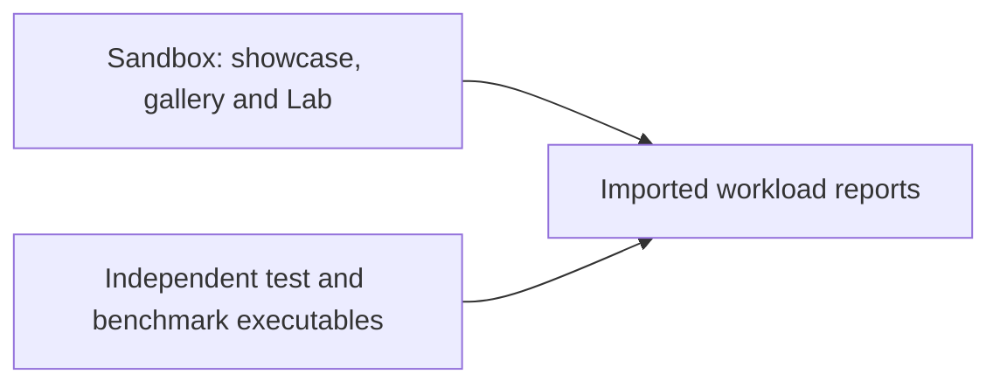

# Chapter 08: Demonstrations and Verified Performance

[<- Previous: Chapter 07 - Cross-Platform Portability and Consistency](07_portability_and_consistency.md) | [Documentation Master Index](../index.md) | [Next: Chapter 09 - Current Status, Limitations, and Trade-offs ->](09_status_limitations_tradeoffs.md)

---

## 1. Executive Summary

In systems-level software engineering, architectural claims of high performance, cache efficiency, and low memory consumption must be backed by empirical, reproducible verification. Theoretical elegance is meaningless if an engine suffers from non-deterministic frame pacing, memory leaks, or thermal throttling under real-world loads.

Tether validates its architectural design through two complementary mechanisms:
1. **The Interactive Sandbox Showcase (`examples/sandbox/`)**: A rich, standalone graphical application that exercises live UI components, dynamic layout recalculations, fluent API declarations, and manual YAML reload in real time.
2. **The Automated Benchmarking Harness (`tests/runners/` and `tests/benchmarks/`)**: High-precision, headless and graphical CLI runners (`tether_bench.exe`, `tether_test.exe`) that evaluate ECS churn, layout reflow throughput, and GPU draw list submission across scales ranging from 1,000 to 100,000 entities.

This chapter details the capabilities of the interactive showcase, the methodology of the benchmarking harness, and how to interpret benchmark results.




---

## 2. The Interactive Sandbox Showcase

The Sandbox showcase located in `examples/sandbox/` demonstrates Tether's capabilities in a unified, interactive desktop environment:

### 1. Dual Authoring Showcase
The Sandbox demonstrates the use of shared widget factories between declarative markup and compiled C code:
- Complex multi-column control panels declared in clean, human-readable YAML.
- Procedural, programmatic controls declared via the fluent C99 API (`tether_ui_panel()`, `tether_ui_button()`, `tether_ui_text()`).
- Both authoring pathways lower into the exact same ECS component arrays and execute through identical rendering pipelines.

### 2. YAML Reload and Refresh
The sandbox can refresh its UI and reload YAML scenes in the playground. Reloading destroys and reconstructs the affected UI; it does not reconcile entities in place or promise to preserve their state. Automatic watched-file reload is a future possibility.

### 3. Lab Results
The Lab launches separate workload executables and imports their reports. Reports contain measurements and environment details; they are not a live ECS or frame-time inspector.

---

## 3. Benchmark Methodology and Engineering Invariants

To eliminate measurement bias and provide actionable data, Tether's automated benchmarking suite adheres to four strict engineering invariants:

### 1. Detached, Out-of-Process Execution
Benchmark harnesses (`tether_bench.exe`, `tether_test.exe`) run as standalone command-line executables completely decoupled from the interactive showcase. This ensures that benchmark measurements are not skewed by GUI windowing events, background rendering layers, or developer UI overlays.

### 2. Zero Workload Execution During Builds
Compilation produces binary test runners without executing benchmark workloads during build time. This keeps build times fast and prevents machine load during compilation from polluting performance telemetry.

### 3. Monotonic High-Resolution Timing
Timing measurements utilize OS-level monotonic high-resolution clocks (`QueryPerformanceCounter` on Windows, `clock_gettime(CLOCK_MONOTONIC)` on POSIX platforms). Warm-up and reported samples depend on the selected workload and configuration; consult the report methodology.

### 4. Structured Machine Telemetry
Workload results are exported simultaneously to structured JSON files (`report.json`) for automated CI/CD regression tracking and formatted human-readable summaries (`report.json.txt`) for engineering review.

---

## 4. Interpreting Performance Results

Performance depends on the workload, build, hardware, and environment. Use the workload reports and methodology under `tests/docs/` to evaluate a specific run. The project has not established universal idle CPU, allocation, frame-time, or embedded-memory guarantees. GPU execution time is not measured by the current harness.

Long-term ideas for reducing allocations, supporting embedded systems, and evaluating additional backends are recorded in the [roadmap](10_roadmap_and_community.md).

---

## 5. Reproducing Benchmark Results

Developers and evaluators can independently reproduce all benchmark measurements using the provided automated scripts:

### Executing the Standard Benchmark Matrix
The standard benchmark suite executes automated workloads across scale boundaries:

```powershell
# Navigate to the benchmark suite directory
cd tests/benchmarks

# Run the standard benchmark matrix across all scale boundaries
./run_standard.ps1
```

### Running the Standalone Benchmark Binary Directly
```bash
# Execute the standalone CLI benchmark harness (Windows Release build)
./build/Release/tether_bench.exe --scenario ecs --count 10000 --frames 120

# Run layout reflow stress testing
./build/Release/tether_bench.exe --scenario layout --count 5000

# Export structured JSON telemetry for analysis
./build/Release/tether_bench.exe --scenario render --count 5000 --output report.json
```

---

## 6. Summary

Tether focuses on structural clarity in how UI data is stored, invalidated, and presented:
- Data-oriented dense arrays for component storage and linear traversal.
- Retained dirty flags (`DIRTY_LAYOUT`, `DIRTY_VISUAL`, `DIRTY_HIERARCHY`) so unchanged frames can skip work (`tether_did_draw() == false`).
- Separation of layout bounds (`SlotTransform`) from visual presentation offsets (`RenderTransform`).
- Independent CLI correctness and benchmark runners that emit reproducible JSON telemetry (`report.json` and `report.json.txt`).

---

[<- Previous: Chapter 07 - Cross-Platform Portability and Consistency](07_portability_and_consistency.md) | [Documentation Master Index](../index.md) | [Next: Chapter 09 - Current Status, Limitations, and Trade-offs ->](09_status_limitations_tradeoffs.md)
