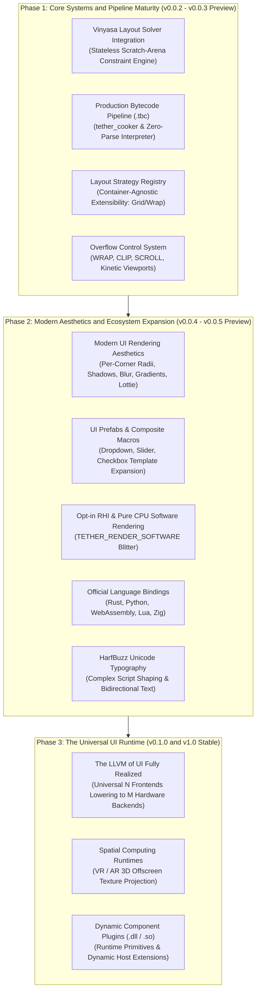

# Chapter 10: Future Roadmap and Community Participation

[<- Previous: Chapter 09 - Current Status, Limitations, and Trade-offs](09_status_limitations_tradeoffs.md) | [Documentation Master Index](../index.md) | [Back to Master Navigation Hub ->](../index.md)

---

## 1. Executive Summary

Tether is architected not merely as an isolated graphical user interface library, but as an open, universal UI micro-kernel: **The LLVM of User Interfaces**.

Just as LLVM decoupled programming language frontends (Clang, Rust, Swift) from target machine architectures (x86, ARM, RISC-V) through a common Intermediate Representation (IR), Tether decouples UI authoring formats (YAML, C99, Rust, Python) from display hardware (DirectX 11, Metal, Vulkan, Bare-Metal LCDs) through a format-neutral scene AST and a Data-Oriented Entity Component System.

This chapter outlines the phased architectural roadmap for Tether's future development, its non-negotiable architectural invariants, and the governance philosophy guiding open-source community contributions.



---

## 2. Non-Negotiable Architectural Invariants

As Tether evolves, all future development, feature additions, and community pull requests must adhere to four permanent engineering invariants:

### 1. ISO C99 ABI Stability
The core Tether engine will remain implemented in pure, portable ISO C99. The public C Application Binary Interface (ABI) will remain stable across minor versions. Entities will be addressed exclusively via 64-bit scalar values (`Tether_GUID`), ensuring zero-friction, safe interoperability across all programming languages without foreign function boundary memory corruption.

### 2. Zero Steady-State Heap Allocations
Tether will never perform dynamic memory allocations (`malloc`, `free`, `realloc`) during steady-state frame execution loops, layout recalculations, or input dispatching. All internal buffers must grow geometrically during initialization into pre-allocated high-water pools.

### 3. Kilobyte-Scale Core State & Microcontroller Viability
The core ECS state for typical UI hierarchies will remain measured in kilobytes, preserving bare-metal suitability on microcontrollers with sub-$64\text{ KB}$ SRAM constraints. Hardware-accelerated desktop builds will continue to isolate graphics driver memory (swapchains and font textures) strictly within the host operating system and GPU subsystem.

### 4. Complete Parity Between Declarative Markup and Compiled Code
Every capability expressible in declarative markup (YAML or future bytecode) must have direct, 100% equivalent parity in the compiled C API, and vice versa. There will never be "declarative-only" or "code-only" features.

---

## 3. Phased Architectural Roadmap

### Phase 1: Core Systems & Pipeline Maturity (v0.0.2 - v0.0.3 Preview)

#### 1. Full Vinyasa Layout Solver Integration
- **Context**: Tether currently integrates a built-in two-pass layout solver supporting flexbox and canvas anchor modes. The standalone Vinyasa layout engine expands on this with advanced multi-reference constraint solving and dynamic flex wrapping.
- **Milestone Goals**:
  - Connect the `vin_host` bridge hooks directly to Tether's `DIRTY_LAYOUT` invalidation subsystem.
  - Utilize Vinyasa's stateless transient scratch arena (`vin_context.scratch`) to evaluate massive container hierarchies in fractions of a millisecond with zero persistent memory bloat.

#### 2. Container-Agnostic Layout Architecture (Strategy Registry)
- **Context**: Enabling new container types without modifying core engine source code.
- **Milestone Goals**:
  - Implement the `Tether_LayoutStrategy` registry:
    ```c
    void tether_layout_register_strategy(uint32_t comp_id, 
                                         Tether_Measure_Fn measure_fn, 
                                         Tether_Arrange_Fn arrange_fn);
    ```
  - Decouple layout resolution so custom container types (such as Grid, Wrap, Stacks, and Docking) can be registered dynamically by plugins or user code without patching core engine headers.

#### 3. Production Deployment Pipeline: Ahead-of-Time (AOT) Bytecode Cooker (`.tbc`)
- **Context**: In embedded and microcontroller environments, parsing text-based YAML at startup introduces CPU overhead and requires bundling text parser code.
- **Milestone Goals**:
  - **Standalone Cooker Tool (`tether_cooker`)**: A CLI tool that parses declarative YAML and compiles it into a flat, little-endian binary bytecode file (`.tbc`):
    ```c
    void compile_yaml_to_tbc(const char* yaml_file, const char* out_file);
    ```
  - **Zero-Parse Bytecode Loader (`tether_interpreter`)**:
    ```c
    void tether_load_tbc(const char* tbc_filepath);
    ```
    Memory-maps `.tbc` bytecode directly into contiguous ECS component arrays, enabling instant sub-millisecond cold boot on low-power microcontrollers without including text parser code in firmware binaries.

#### 4. Overflow Control System & Viewport Scrolling
- **Context**: Managing child boundaries within dynamic containers and supporting scrollable viewports.
- **Milestone Goals**:
  - Implement the `Tether_Overflow` component supporting four container policies:
    - `TETHER_OVERFLOW_WRAP`: Children wrap dynamically to the next row or column.
    - `TETHER_OVERFLOW_CLIP`: Children extending past bounds are scissored out cleanly.
    - `TETHER_OVERFLOW_SCROLL`: Generates an interactive, kinetic scrolling viewport with scrollbars.
    - `TETHER_OVERFLOW_VISIBLE`: Children overflow bounds without clipping.
  - Integrate hierarchical hardware scissor clipping with scrolling offset coordinates.

---

### Phase 2: Modern Aesthetics and Ecosystem Expansion (v0.0.4 - v0.0.5 Preview)

#### 1. Modern UI Rendering Aesthetics
- **Context**: Bringing Tether to full aesthetic parity with high-end modern design tools (Figma, CSS).
- **Milestone Goals**:
  - **Borders & Asymmetric Radii**: Multi-corner independent rounding (e.g., rounded top, square bottom), border stroke widths, inner/outer borders, and content clipping.
  - **Shadows & Glows**: Outer drop shadows, inner shadows, and soft ambient glows.
  - **Color Gradients**: Linear, radial, and multi-stop color gradients evaluated procedural in fragment shaders.
  - **Glassmorphism & Visual Effects**: Real-time backdrop blur, frosted glass, and composite post-process shaders.
  - **Images & Vector Media**: Native decoding and rendering of PNG, JPG, vector SVG, and Lottie animations.

#### 2. UI Prefabs and Composite Macros (Slate / UMG Composition)
- **Context**: Allowing developers to instantiate complex composite controls with a single line of YAML.
- **Milestone Goals**:
  - Implement macro expansion for composite widgets (`Dropdown`, `Slider`, `Checkbox`, `ColorPicker`, `ProgressBar`).
  - Instantiating `- Dropdown:` in YAML expands automatically into the constituent ECS primitives: Panel, Interactable, Text, and Border entities.
  - Custom user prefab system allowing developers to define reusable YAML templates instanced across multiple scenes.

#### 3. Developer Experience & Opt-in Rendering Modes
- **Context**: Making graphics dependencies strictly opt-in and supporting systems without GPUs.
- **Milestone Goals**:
  - **Pure CPU Software Rendering**: Add `TETHER_RENDER_SOFTWARE` to `Tether_App_Config`, initializing a pure CPU software blitter for systems without GPU acceleration.
  - **Opt-in CMake Build Flags**: Wrap GPU dependencies cleanly: `TETHER_GPU_API=GL`, `WGPU`, `D3D11`, `METAL`, or `VULKAN`, allowing developers to compile minimal binaries without downloading massive external SDKs.

#### 4. Official Foreign Language Bindings
- **Context**: Tether's 64-bit scalar GUID architecture enables zero-overhead language interop.
- **Milestone Goals**:
  - **Rust**: Safe, idiomatic Rust bindings providing compile-time type safety over Tether's C ABI.
  - **Python**: Dynamic scripting wrappers for scientific visualization, telemetry dashboards, and rapid desktop utility prototyping.
  - **WebAssembly (WASM)**: Emscripten-based bindings for running native Tether applications inside modern web browsers via WebGPU and Canvas.
  - **Zig & Lua**: Lightweight bindings for embedded game scripting and systems utilities.

#### 5. Extended Typography & Complex Script Shaping
- **Context**: Expanding typography beyond Latin and monospace fonts.
- **Milestone Goals**:
  - Optional backend shims for HarfBuzz and FreeType.
  - Full support for bidirectional text layout (Arabic, Hebrew) and contextual ligature shaping (Devanagari, Thai).

#### 6. 2D Affine Inverse-Matrix Hit-Testing
- **Context**: Hit-testing currently queries the layout space bounding box (`SlotTransform`).
- **Milestone Goals**:
  - Implement full 2D affine inverse-transformation projection during spatial hit-testing.
  - Enable accurate pointer and touch interaction for UI entities with visual rotations, scaling, or translation offsets applied via `RenderTransform`.

---

### Phase 3: The Universal UI Runtime (v0.1.0 Preview and v1.0 Stable)

#### 1. The LLVM of UI Fully Realized
- **Universal IR Ecosystem**: An open ecosystem where any frontend authoring tool (visual drag-and-drop IDEs, Figma design exporters, markdown documentation engines) targets Tether's format-neutral scene AST.
- **Universal Hardware Execution**: The same UI definition executes flawlessly whether deployed to an 8-bit microcontroller running a 128x64 LCD, a 4K desktop workstation, or a web browser via WebAssembly.

#### 2. Spatial Computing (VR / AR) Runtimes
- **Context**: Next-generation spatial headsets require interactive 2D user interfaces projected onto 3D surfaces in virtual space.
- **Milestone Goals**:
  - Implement zero-copy offscreen GPU texture rendering pipelines.
  - Enable host 3D engines (Unreal, Unity, Godot, custom Vulkan/Metal engines) to project interactive Tether UI trees onto 3D meshes with spatial pointer raycasting.

#### 3. Dynamic Plugin Loading
- **Context**: Extending running applications without recompiling host binaries.
- **Milestone Goals**:
  - Implement `tether_dynamic.c`:
    ```c
    void tether_load_plugin(const char* dll_path);
    ```
  - Enables runtime loading of custom widgets, layout strategies, and third-party components via shared libraries (`.dll`, `.so`).

#### 4. The Open Interactive UI Document Standard (The "PDF of User Interfaces")
- **Context**: Just as PNG standardized digital images, MP3 standardized digital audio, and PDF standardized static document interchange across all computing hardware, the software industry lacks an open, universal standard for interactive user interfaces.
- **Milestone Goals**:
  - Formalize the `.tbc` binary bytecode format and format-neutral scene AST into an open, vendor-neutral specification for portable interactive graphical interfaces.
  - Enable any platform, operating system, or device supporting a Tether micro-kernel to open and execute Tether UI assets with absolute behavioral determinism, responsive layout consistency, and interactive fidelity, just as consistently as an image viewer opens a PNG or a document viewer opens a PDF.

---

## 4. Community Contribution and Governance Philosophy

Tether is developed as an open, community-driven project dedicated to engineering excellence, transparency, and architectural discipline.

### The RFC (Request for Comments) Process
Major architectural revisions, public API modifications, or new subsystem additions must begin with an RFC document submitted to the project repository:
1. **Motivation & Problem Statement**: Clear explanation of the real-world limitation being addressed.
2. **Detailed Design**: Proposed C function signatures, component data structures, and memory layout.
3. **Alternative Solutions Considered**: Why alternative designs were rejected.
4. **Verification Strategy**: How the proposed change will be tested and benchmarked.

### Contribution Standards & Code Guidelines
To ensure that Tether maintains its high performance and reliability, all pull requests must comply with the following standards:

| Requirement | Specification |
| :--- | :--- |
| **Language Standard** | Pure ISO C99 (`-std=c99` or MSVC C99 mode). No C11/C23 extensions or compiler-specific intrinsics without standard fallbacks. |
| **Zero Runtime Dependencies** | Core engine code must depend exclusively on standard C library math and memory functions. No external dynamic libraries. |
| **Memory Discipline** | Zero dynamic heap allocations (`malloc`, `free`) on steady-state frame execution loops. Pre-allocated geometric growth pools only. |
| **Data Alignment** | All component arrays and dense memory buffers must maintain 8-byte alignment for RISC hardware compatibility. |
| **Automated Testing** | Every new widget, component, or system must include automated unit tests in `tests/unit/` and verify clean CTest execution. |
| **Zero Performance Regressions** | Pull requests must not regress verified metrics captured by `tether_bench.exe`. |

### How to Get Involved
- **Authoring New Backends**: Implement the 12-function `Tether_Backend` interface for novel platforms, embedded microcontrollers, or game engines.
- **Building Language Bindings**: Create idiomatic foreign function interfaces for your preferred programming language.
- **Expanding the Showcase**: Contribute real-world example interfaces, creative utility layouts, and benchmark workloads to `examples/sandbox/`.

---

## 5. Closing Perspective: Building the Foundation for Decades of Systems UI

Operating systems, web frameworks, and application ecosystems change rapidly. The modern tendency to discard UI toolkits every few years in pursuit of ephemeral trends has created an industry plagued by bloated applications, fragile dependencies, and unnecessary resource waste.

Tether stands for a different engineering philosophy: **build simple, predictable, data-oriented systems on stable computing foundations, and build them to last for decades**.

By anchoring Tether to pure ISO C99, separating data from behavior, eliminating steady-state allocations, and honoring the separation between layout geometry and GPU rasterization, we invite developers across the systems software community to build the next generation of high-performance, respectful user interfaces together.

---

[<- Previous: Chapter 09 - Current Status, Limitations, and Trade-offs](09_status_limitations_tradeoffs.md) | [Documentation Master Index](../index.md) | [Back to Master Navigation Hub ->](../index.md)
