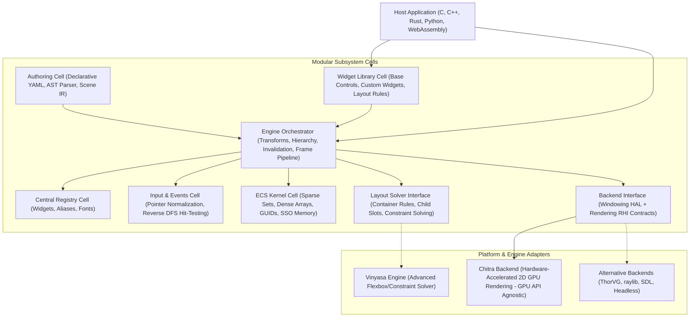
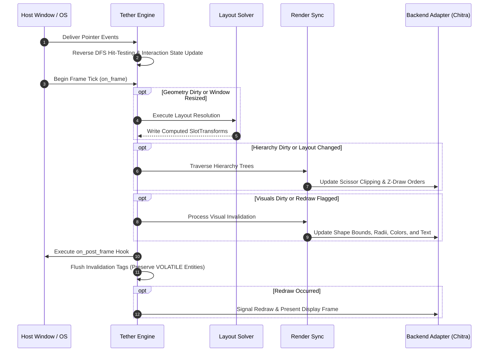

# Chapter 02: Core Architecture and Execution Model

[<- Previous: Chapter 01 - Getting Started and Examples](01_getting_started.md) | [Documentation Master Index](../index.md) | [Next: Chapter 03 - ECS, Memory Management, and Lifecycle ->](03_ecs_and_memory.md)

Tether is a modular 2D UI engine written in standard C99. Rather than acting as a heavyweight, monolithic application framework, Tether provides the foundational runtime infrastructure required to build universal, high-performance user interface systems: data-oriented component storage, scene hierarchy, spatial mathematics, central registries, input dispatch, declarative parsing, and pluggable boundaries for layout calculation and hardware rendering.

Just as compiler infrastructures (such as LLVM) decouple source language frontends from machine code targets through intermediate representations, Tether decouples UI authoring, widget composition, layout constraint solving, and GPU rasterization into isolated subsystem cells coordinated through explicit C contracts.

---

## 1. The Modular Cell-Block Architecture

### Moving Beyond Rigid Hierarchical Stacks

Traditional UI engines commonly force subsystems into a rigid vertical stack where each layer depends strictly on the layer immediately beneath it. This structure introduces significant friction:
- Higher-level layers cannot interact with lower-level services without traversing intermediate abstractions.
- Subsystem details leak across boundaries, forcing widget authors to handle graphics state or forcing renderers to maintain scene hierarchy.
- Swapping a major subsystem (such as replacing a layout solver or rendering backend) requires intrusive modifications across the entire vertical stack.

Tether organizes subsystems as **independent, decoupled cell blocks**. Each cell encapsulates a single functional responsibility, communicates via explicit C function tables or abstract data structures, and avoids direct compile-time coupling with other cells.



### Subsystem Cell Breakdown

| Subsystem Cell | Core Responsibility | Primary Headers / Sources |
| :--- | :--- | :--- |
| **Host Application** | Owns business logic, application domain state, pre-init setup, and outer configuration. | User Application Code |
| **Authoring Cell** | Parses declarative markup into an AST and compiles the scene into ECS entities. | `include/tether/engine/parser/` |
| **Widget Library Cell** | Composes controls out of pure data components without class inheritance. | `include/tether/ui/` |
| **Central Registry Cell** | Central directory for widget factories, string aliases, and fonts. | `include/tether/core/` |
| **Engine Orchestrator** | Coordinates scene hierarchy, spatial bounds, invalidation flags, and frame timing. | `include/tether/engine/` |
| **Input & Events Cell** | Normalizes pointer events, performs reverse DFS hit-testing, and routes callbacks. | `include/tether/core/` |
| **ECS Kernel Cell** | High-performance, data-oriented memory management (Sparse Sets, Dense Arrays). | `include/tether/core/` |
| **Layout Solver Interface** | Resolves geometric bounds from container rules and child slot constraints. | `include/tether/engine/` |
| **Backend Interface** | Abstract C contracts for OS windowing, display timing, and graphics drawing. | `include/tether/backends/` |
| **Backend Adapter (Chitra)** | Hardware-accelerated 2D GPU rendering engine (GPU API-agnostic). | `src/backends/` |

---

## 2. Entities, Primitives, and Component Taxonomy

Tether completely departs from traditional Object-Oriented UI paradigms where visual controls inherit from base classes (e.g. `Widget -> VisualElement -> Control -> Button`). Instead, Tether represents UI through a pure **Entity Component System (ECS)**.

### Entities and Primitives
- **Entity**: An entity is simply a 64-bit integer identifier (`Tether_GUID`) combining a recycled array index with a generation version to mathematically eliminate dangling pointers.
- **Primitive**: In Tether, a primitive is an individual element entity in the scene hierarchy. It can act as a parent or a child, and it acquires layout, visual, and behavioral characteristics based on the components attached to it.
- **Native vs. Dynamic Primitives**:
  - **Native Primitives**: Core elements built directly into the engine, composed of statically registered native components.
  - **Dynamic Primitives**: Custom, developer-defined UI elements registered at runtime for specialized controls, external plugins, or custom graphics graphs.

### Component Taxonomy: Visible vs. Non-Visible Components
Every component attached to a primitive belongs to one of two functional categories:

```
+-------------------------------------------------------------------------+
|                           PRIMITIVE (ENTITY)                            |
+-------------------------------------------------------------------------+
       |                                                   |
       v                                                   v
+-------------------------------+   +-------------------------------------+
|      VISIBLE COMPONENTS       |   |       NON-VISIBLE COMPONENTS        |
|  (What Physically Appears)    |   |  (Behavior, Layout & Structure)     |
|                               |   |                                     |
|  - Shape (fill, border, radii)|   |  - SlotTransform (computed bounds)  |
|  - Text (font, glyphs, color) |   |  - RenderTransform (GPU offsets)    |
|  - Image (bitmap textures)    |   |  - Hierarchy (parent/child links)   |
|  - Path (vector curves)       |   |  - Visibility (visible/hidden)      |
|                               |   |  - Interactable (hit-test & hover)  |
|                               |   |  - Container & Slot Settings        |
|                               |   |  - Invalidation Tags (dirty flags)  |
+-------------------------------+   +-------------------------------------+
```

1. **Visible Components (Physical Appearance)**:
   - Responsible for drawing pixels on screen.
   - Examples: `Shape` (background fill, border width, border color, corner radii), `Text` (font ID, font size, glyph layout, text color), `Image` (texture references), `Path` (vector curves and fills).
2. **Non-Visible Components (Behavioral, Structural & Logical)**:
   - Manage spatial boundaries, hierarchy, layout rules, and interaction capability without rendering pixels directly.
   - **Spatial & Structural**: `SlotTransform` (computed layout bounds), `RenderTransform` (GPU visual translation, scale, rotation, opacity), `Hierarchy` (parent, sibling, and child links), `Visibility` (visible, hidden, collapsed).
   - **Interaction**: `Interactable` (defines hit-testing behavior, hover and pressed states, automatic or manual color shifts).
     > **Key Principle**: A visible component can or cannot be interactive based entirely on whether an `Interactable` component is attached to its entity!
   - **Layout Roles**: Container configuration components (Canvas, Flex flow) and Slot behavior components (Flex slot, Anchor slot).
   - **Invalidation & Lifecycle**: Invalidation tag components (`DIRTY_LAYOUT`, `DIRTY_VISUAL`, `DIRTY_HIERARCHY`, `DIRTY_TEXT_CONTENT`, `VOLATILE`).

### Native vs. Dynamic Component Registration
Tether establishes a clean compile-time boundary via `TETHER_COMPONENT_MAX`:
- **Native Components**: Statically registered at compile time or engine boot using `tether_ecs_register_component_static()`, occupying IDs from `0` to `TETHER_COMPONENT_MAX - 1`. Each static component receives a compile-time constant ID for direct $O(1)$ array lookups without hash tables or pointer indirection.
- **Dynamic Components**: Runtime-allocated components for user widgets, third-party plugins, and application-specific data. Dynamic registration begins immediately at `TETHER_COMPONENT_MAX` and increments sequentially via `tether_ecs_register_component_dynamic()`. Dynamic components reside in identical contiguous dense arrays as native components, maintaining maximum CPU cache locality.

---

## 3. The Central Registry System

The registry in `include/tether/core/tether_registry.h` stores widget factories, entity aliases, and font registrations. Event callbacks are maintained by `tether_events.c`.

Layout strategies and named YAML action bindings are future design ideas described in the [roadmap](../presentation/10_roadmap_and_community.md); the current layout solver handles its flow modes directly.

---

## 4. The Layout & Visual Triad: Primitives, Containers, and Slots

Layout calculation and visual arrangement in Tether are governed by three complementary concepts: **Primitives**, **Containers**, and **Slots**.

```
+-------------------------------------------------------------+
| Parent Primitive (Acts as Container)                        |
| Container Settings: Flow Direction, Alignment, Padding      |
|                                                             |
|   +-----------------------------------------------------+   |
|   | Child Primitive (Acts as Slot + Primitive)          |   |
|   | Slot Settings:      Flex Factors, Anchor Rules      |   |
|   | Primitive Settings: Shape, Border, Radius, Text     |   |
|   +-----------------------------------------------------+   |
+-------------------------------------------------------------+
```

### 1. Primitives (The Elements)
A primitive is the individual entity participating in the scene. It provides intrinsic content dimensions (such as text bounding boxes or image aspect ratios) and visual attributes.

### 2. Containers (Parent Context)
A container defines the spatial rules and layout context that govern its children:
- Container settings establish how available screen real estate is distributed among child elements.
- Examples include **Canvas** (absolute coordinate positioning), **Flex Container** (row or column directional flow with automatic distribution), and **Grid**.
- Containers manage internal padding, child spacing, and boundary constraints.

### 3. Slots (Child Behavior Relative to Container)
A slot defines how an individual child entity behaves within its parent's container rules:
- Slot settings attach to the child entity, specifying how that child claims space inside the parent container.
- Examples include **Flex Slot** (grow factor, shrink factor, alignment override) and **Anchor Slot** (top-left, center, stretch, margin offsets).
- The layout solver reads the parent's container rules, evaluates each child's slot configuration, and writes the final computed pixel coordinates into the child's `SlotTransform`.

> **Dual Participation**: An entity frequently acts as both a **Slot** and a **Container**. For example, a card panel acts as a child slot positioned inside a vertical column container, while simultaneously acting as a parent container organizing title text and buttons within its own interior.

---

## 5. Separation of Layout and Presentation Transforms

A central architectural pillar in Tether is the strict mathematical decoupling between layout geometry and visual presentation:

- **`SlotTransform` (Layout Domain)**:
  Represents the resolved spatial allocation calculated by the layout solver (`x`, `y`, `width`, `height`). This struct is modified **only** when layout constraints, window dimensions, or container hierarchies change.
- **`RenderTransform` (Visual Presentation Domain)**:
  Represents GPU-level presentation offsets applied during the rendering pass (`translation_x`, `translation_y`, `scale_x`, `scale_y`, `rotation_deg`, `render_pivot`, `opacity`).

```
+-------------------------------------------------------------+
| Layout Solver Pass                                          |
| Reads: Container Rules, Slot Constraints, Intrinsic Sizes   |
| Writes: SlotTransform (x, y, width, height)                 |
+-------------------------------------------------------------+
                              |
                              v
+-------------------------------------------------------------+
| Visual Synchronization Pass                                 |
| Final Screen X = SlotTransform.x + RenderTransform.trans_x  |
| Final Screen Y = SlotTransform.y + RenderTransform.trans_y  |
| Final Screen W = SlotTransform.w * RenderTransform.scale_x  |
| Final Screen H = SlotTransform.h * RenderTransform.scale_y  |
| Visual Opacity = RenderTransform.opacity                    |
+-------------------------------------------------------------+
```

### Why Decoupling is Essential
In traditional DOM and UI frameworks, animating an element (such as a hover bounce, scale transition, or rotation) modifies bounding box properties, triggering a costly **layout reflow**. Reflow ripples through parent and sibling nodes, consuming CPU cycles and dropping frames.

In Tether, non-layout presentation updates (`RenderTransform` offsets and opacity, or color updates) mark `DIRTY_VISUAL` without dirtying `DIRTY_LAYOUT`. Note that changing text rotation, scale, or pivot also sets `DIRTY_TEXT_CONTENT` so glyph geometry can be rebuilt on the CPU.

---

## 6. Dual Authoring: Script and Programming Interoperability

Tether is fundamentally format-agnostic. It treats declarative markup (YAML) and procedural code (C/C++) as equal first-class authoring methods:

```
                  +-----------------------------------+
                  |     Declarative UI Markup (YAML)  |
                  +-----------------+-----------------+
                                    |
                                    v
                            Authoring Parser
                                    |
                                    v
+-----------------------+   +-------+-------+   +------------------------+
| Procedural C / C++ API|-->|   ECS KERNEL  |<--| Future Language FFI    |
| (Direct Entity Create)|   | (Single Truth)|   | (Rust, Python, Zig)    |
+-----------------------+   +---------------+   +------------------------+
```

- **Seamless Interoperability**:
  - A developer can construct an entire UI hierarchy in declarative YAML.
  - A developer can construct an entire UI hierarchy purely in procedural C.
  - A developer can seamlessly combine both: loading a declarative layout from markup, querying entities via aliases, and injecting dynamic procedural C children into them at runtime.
- **Unified Single Source of Truth**:
  Both authoring approaches resolve to identical data inside the ECS Kernel. The engine, layout solver, input system, and rendering backend treat procedural entities and markup-generated entities identically.

---

## 7. The 4-Pipeline Deployment System

To scale from microcontrollers up to desktop tools and game engines, Tether supports four execution pipelines:

1. **The Parser (JIT Iteration)**:
   A lightweight runtime text parser that reads human-readable `.yaml` markup and immediately constructs the ECS memory arrays at runtime. Used for rapid desktop tool iteration, live reload, and designer workflows.
2. **The Asset Cooker (AOT Compilation)**:
   A developer tool that compiles `.yaml` markup ahead of time into a dense, hexadecimal binary bytecode (`.tbc`).
3. **The Interpreter (Secure Runtime)**:
   A lightweight, zero-dependency C runtime that loads `.tbc` bytecode directly into memory. It eliminates string parsing overhead and complies with environments (such as iOS or locked embedded systems) where dynamic code generation is restricted.
4. **The JIT Compiler (Dynamic Logic)**:
   Compiles heavy custom UI logic and dynamic primitives into native machine code at runtime for maximum throughput on open desktop and mobile operating systems.

---

## 8. Widget Framework & Composition Architecture

In Tether, widgets are not monolithic classes or inheritance trees. Instead, a widget is a **composition recipe** executed by a factory function:

- **Factory Pattern**: Widgets register their factory functions with the central widget registry (`tether_register_widget("Button", factory)`).
- **Component Assembly**: When a widget is instantiated:
  1. An entity GUID is allocated in the ECS Kernel.
  2. Foundational spatial components are attached (`SlotTransform`, `Hierarchy`, `Visibility`).
  3. Layout container or slot components are attached based on its role.
  4. Visible components (`Shape`) and non-visible behavioral components (`Interactable`) are attached.
  5. Child entities (such as a child entity for `Text`) are created and linked into the hierarchy.
- **Volatile Auto-Tagging**: Interactive widgets automatically receive `TETHER_COMPONENT_VOLATILE` so their hover and press state machines tick consistently across frames.
- **Extensibility**: User-created custom widgets follow the exact same factory pattern and component registration as engine-provided widgets.

---

## 9. Input and Event Subsystem

Tether provides an event-driven input architecture that cleanly decouples hardware input from application logic:

- **Input Normalization**: All hardware input from the platform backend is translated into a unified `Tether_Pointer_Event` struct (containing event type, normalized coordinates, and button states).
- **Reverse Depth-First Search (DFS) Hit-Testing**: When a pointer event arrives, the engine traverses scene trees in reverse depth-first order:
  - Traverses the `overlay_root` first (to prioritize modals, popups, and dropdown menus).
  - Traverses the `main_root` second.
- **Hit Detection**: For each candidate entity possessing an `Interactable` component, the engine tests the cursor position against the resolved `SlotTransform` bounds (taking scissor clipping into account).
- **State Resolution & Callbacks**: The topmost hit entity updates its hover and press state flags. If an application callback is registered for that entity and event type, the callback is dispatched immediately.
- **Event-Driven Data Flow**: Application logic remains strictly outside the UI tree. When callbacks fire, the host application updates its domain state and selectively marks affected ECS entities dirty.

---

## 10. Unified Application Execution Lifecycle

Tether coordinates engine systems and provides clear lifecycle hooks to the host application through a unified lifecycle model:

```
Host Pre-Init Setup
  |
  +--> Host prepares config, registers custom fonts or domain data
  |
  v
tether_run(&config)
  |-- 1. Engine Core Init: Initializes ECS kernel, registers native components, creates scene roots
  |-- 2. Post-Init Setup: Registers built-in widget factories and standard UI components
  |-- 3. Backend Setup: Initializes OS window and graphics context via backend adapter
  |-- 4. Initial Scene Load: Loads initial YAML (if specified) and loads registered fonts into backend
  |-- 5. on_init() Hook: Host custom widget creation, scene building, and event callback registration
  |
  |-- 6. Main Display Loop (Driven by Backend Runner)
  |       |
  |       +--> on_frame() Hook: Host per-frame updates
  |       +--> Input Delivery & Reverse DFS Hit-Testing
  |       +--> Layout Resolution Pass (if dirty)
  |       +--> Hierarchy & Scissor Clip Sync (if dirty)
  |       +--> Visual Synchronization Pass (if dirty)
  |       +--> on_post_frame() Hook: Host post-frame hook
  |       +--> Invalidation Tag Flush (preserves VOLATILE entities)
  |       \--> Display Presentation (flushes GPU work if dirty)
  |
  \-- 7. Shutdown: on_term() Hook -> Teardown RHI handles -> Teardown ECS memory pools
```

### Complete Lifecycle Code Example
```c
#include "tether/tether.h"

/* Pre-Init: Executed before tether_run */
static void app_pre_init(void) {
    /* Register custom fonts or prepare host domain memory */
    tether_font_register("Inter", "Font/Inter-Regular.ttf");
}

/* Post-Init: Executed by Tether after engine and scene initialization */
static void app_on_init(void) {
    /* Create programmatic widgets, attach event callbacks, or query loaded YAML entities */
}

/* Per-Frame: Executed at the beginning of each frame tick */
static void app_on_frame(void) {
    /* Update host-driven animations or poll data feeds */
}

/* Post-Frame: Executed after layout and visual synchronization completes */
static void app_on_post_frame(void) {
    /* Capture frame statistics or execute post-rendering logic */
}

/* Cleanup: Executed during application shutdown prior to ECS teardown */
static void app_on_term(void) {
    /* Release host-allocated domain resources */
}

int main(void) {
    /* 1. Host Pre-Init Setup */
    app_pre_init();

    /* 2. Configure Application and Lifecycle Hooks */
    Tether_Config config = {
        .width = 1280,
        .height = 720,
        .title = "Tether Application",
        .initial_yaml = "app.yaml",
        .on_init = app_on_init,
        .on_frame = app_on_frame,
        .on_post_frame = app_on_post_frame,
        .on_term = app_on_term
    };

    /* 3. Hand control over to Tether to drive execution */
    tether_run(&config);
    return 0;
}
```

---

## 11. The Tether Engine Execution Pipeline

During each frame tick, Tether executes its subsystem passes in a fixed, deterministic sequence:



### Pipeline Stages
1. **Input Delivery**: Normalized pointer events are processed. Reverse DFS traverses `overlay_root` and `main_root` to identify the topmost hit entity, updating hover and press states and invoking registered callbacks.
2. **Layout Resolution**: If window dimensions changed or entities possess layout invalidation tags, the layout solver computes geometric bounds across the scene tree and writes resolved coordinates to `SlotTransform`.
3. **Hierarchy and Scissor Synchronization**: The engine traverses the hierarchy to assign back-to-front draw orders and compute scissor clipping intersections for overflow containers.
4. **Visual Synchronization**: Entities with visual dirty tags resolve their interactive colors, apply `RenderTransform` offsets and opacity, and synchronize retained visual handles with the backend RHI.
5. **Invalidation Flush**: Transient dirty flags (`DIRTY_LAYOUT`, `DIRTY_VISUAL`, `DIRTY_HIERARCHY`) are cleared. Elements marked `VOLATILE` (continuous animations, timers, video feeds) retain their dirty state to update again on the following frame.
6. **Backend Delegation**: If visual updates occurred, Tether notifies the backend adapter via `mark_dirty()`. The backend (Chitra) flushes GPU commands and presents the rendered frame to the display.

---

## 12. Architectural Decision Summary

| Architectural Decision | Rationale | Alternatives Considered & Rejected |
| :--- | :--- | :--- |
| **Modular Cell-Block Design** | Allows independent testing, extension, and swapping of layout, rendering, or parsing subsystems without ripple effects. | Rigid vertical multi-tier stack (tightly coupled, leaky abstractions, difficult to embed). |
| **Pure C99 Data-Oriented ECS** | Maximizes CPU cache locality, eliminates heap fragmentation, and provides $O(1)$ memory access via sparse sets. | Object-Oriented inheritance tree (virtual call overhead, pointer chasing, severe heap fragmentation). |
| **Separation of Transforms** | Layout (`SlotTransform`) and visual offsets (`RenderTransform`) stay separate; non-text visual changes bypass layout. | Unified bounding box (every visual change invalidates parent and sibling layout). |
| **Primitives / Containers / Slots** | Provides clear separation of concerns between visual rendering, parent layout context, and child behavior. | Monolithic widget definitions where rendering, container rules, and child behavior are tangled together. |
| **Visible vs. Non-Visible Taxonomy** | Clear functional boundary: visible components render pixels; non-visible components define layout, structure, and interaction. | Monolithic component structs that mix visual pixels and interaction logic. |
| **Central Registry Architecture** | Modular directories for widgets, aliases, container layout strategies, and event bindings. | Hardcoded switch statements throughout core engine code. |
| **Dual Authoring (YAML + C)** | Developers can build UI in markup, in code, or mix both seamlessly with the ECS Kernel as single source of truth. | Markup-only or code-only architectures that restrict workflows. |
| **Abstract Backend Contract** | Completely isolates graphics API and windowing dependencies from engine logic. | Direct GPU calls inside engine systems (locks engine to a specific graphics API). |
| **Deterministic Single-Threaded Loop** | Provides absolute determinism, zero mutex overhead, and simplified embedding for host applications. | Complex multi-threaded locking in the core loop (high synchronization overhead, race conditions). |

---

[<- Previous: Chapter 01 - Getting Started and Examples](01_getting_started.md) | [Documentation Master Index](../index.md) | [Next: Chapter 03 - ECS, Memory Management, and Lifecycle ->](03_ecs_and_memory.md)
