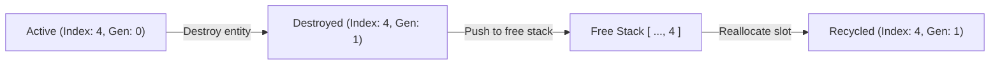
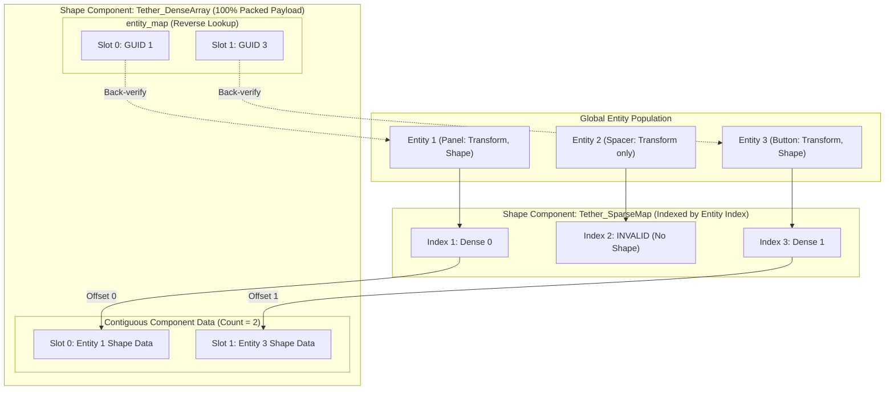
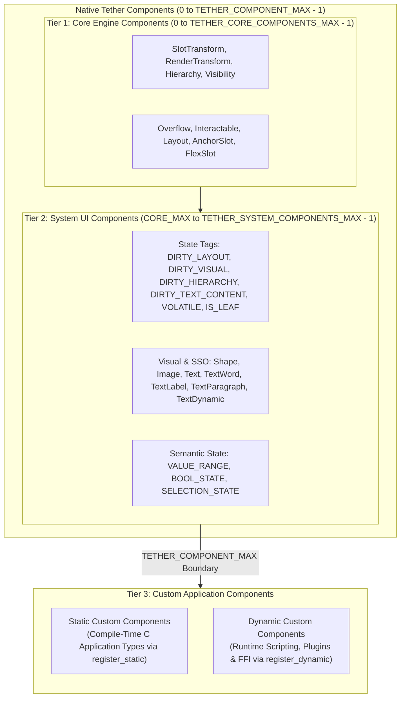
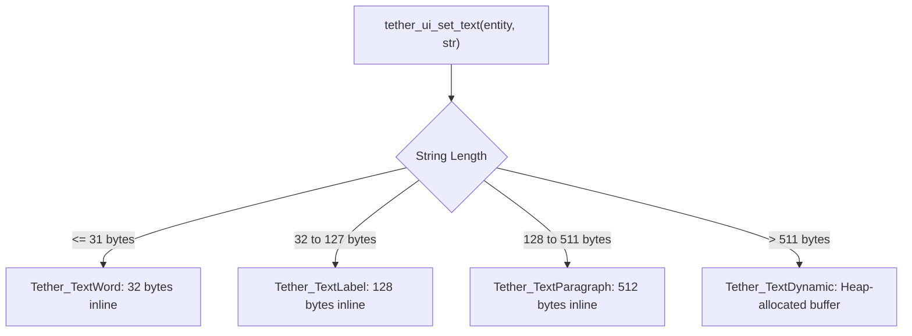
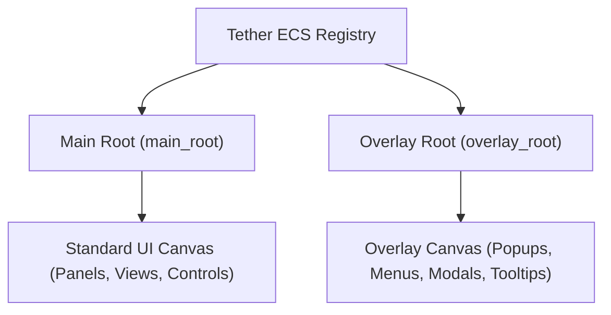

# Chapter 03: ECS, Memory Management, and Lifecycle

[<- Previous: Chapter 02 - Tether Core Architecture and Execution Model](02_core_architecture.md) | [Documentation Master Index](../index.md) | [Next: Chapter 04 - Components, State, Invalidation, and Updates ->](04_components_and_invalidation.md)

At the foundation of Tether lies its custom Entity Component System (ECS) kernel and memory model. Rather than organizing user interface elements as traditional class instances connected by heap memory pointers, Tether represents UI elements as lightweight integer identifiers, storing their properties in flat, cache-coherent memory pools.

This chapter details Tether's data-oriented memory strategy, generational 64-bit entity identity (`Tether_GUID`), sparse-set storage mechanics, swap-and-pop deallocation algorithms, pointer invalidation contracts, Small String Optimization (SSO), and the global dual-root scene architecture.

---

## 1. Memory Strategy: IDs and Pools vs. Pointers and Heap

User interface systems face distinct memory challenges: elements are created, destroyed, reparented, restyled, and animated continuously. Traditional UI frameworks rely on fragmented heap allocations (`malloc` or `new`) and direct memory pointers between parent and child nodes. At scale, this introduces critical performance issues:

- **Heap Fragmentation**: Allocating thousands of small widgets across the heap scatters memory, increasing allocator overhead and page faults.
- **Dangling Pointers and Use-After-Free**: If a widget is destroyed while another element, callback, or host script retains its memory address, dereferencing that pointer causes memory corruption or crashes.
- **CPU Cache Inefficiency**: Traversing a hierarchy of heap nodes causes constant cache misses as the CPU jumps between arbitrary memory addresses.

Tether eliminates direct pointer chasing across elements through three structural decisions:

1. **Entities are IDs, Never Pointers**: UI elements are addressed exclusively through 64-bit handles (`Tether_GUID`). Elements store IDs for all relationships (parents, children, siblings, event targets). Generational checks prevent stale handle lookups.
2. **Contiguous Component Pools**: Components of the same type live in packed, contiguous arrays that grow geometrically. Iteration sweeps flat memory sequentially, maximizing CPU L1 and L2 cache prefetching.
3. **Allocation-Aware Design**: Component pools grow geometrically and stabilize after initial growth, while `TextDynamic` and pool expansion still use standard C heap allocation; minimizing steady-state allocations is an ongoing goal.

---

## 2. Entity Representation: `Tether_GUID`

Every entity in Tether is identified by a 64-bit integer handle (`Tether_GUID`). To ensure constant-time array access while preventing stale handle corruption, the identifier is split into an Index and a Generation counter:

```
+-----------------------------------+-----------------------------------+
|     Generation (Upper 32 bits)    |       Index (Lower 32 bits)       |
+-----------------------------------+-----------------------------------+
 63                               32 31                                0
```

### Identification API (`include/tether/core/tether_ecs.h`)

```c
typedef uint64_t Tether_GUID;

#define TETHER_INVALID_GUID 0

/* Extracts the 32-bit index for direct array indexing */
static inline uint32_t tether_ecs_get_index(Tether_GUID guid);

/* Extracts the 32-bit generation version counter */
static inline uint32_t tether_ecs_get_generation(Tether_GUID guid);

/* Constructs a GUID from an index and generation */
static inline Tether_GUID tether_ecs_make_guid(uint32_t index, uint32_t generation);
```

### Generational Safety

When UI elements are removed (e.g. closing a dialog or recycling list items), their array slots are recycled to keep memory compact. Without versioning, a recycled slot would allow stale handles held by event callbacks or external bindings to mistakenly manipulate new elements.

Tether resolves this through generational counters:



1. The kernel maintains a global generation table: `uint32_t generations[]`.
2. When an entity is destroyed, its entry in `generations[index]` increments, and its index is pushed onto `free_indices`.
3. When the index is reused later, the newly issued `Tether_GUID` contains the incremented generation counter.
4. Calling `tether_ecs_is_valid(guid)` performs an instant comparison between the GUID's embedded generation and the table:

$$\text{is\_valid}(guid) := (index > 0) \land (index < next\_entity\_index) \land (generations[index] == guid.generation)$$

If an obsolete GUID is checked, the generation mismatch is detected immediately in $O(1)$ time without reading invalid memory. Index `0` is strictly reserved for `TETHER_INVALID_GUID`.

---

## 3. Sparse-Set Storage Architecture

To achieve constant-time component addition, lookup, and deletion while maintaining 100% packed contiguous arrays for iteration, Tether uses a **Sparse-Set** architecture for each registered component type.

### Understanding Sparse vs. Dense Storage

- **Entity IDs are Global**: All entities share the same global index pool ($0, 1, 2, 3, \dots$).
- **Component Absence**: Not every entity possesses every component. For example, a visual button has both a `SlotTransform` and a `Shape`, whereas an invisible layout container has a `SlotTransform` but no `Shape`.
- **The Sparse Map**: Direct-mapped array indexed by the global Entity Index. If an entity lacks a component, its sparse slot contains `TETHER_SPARSE_INVALID_INDEX` (`0xFFFFFFFF`). This indicates component absence without wasting payload memory.
- **The Dense Array**: A flat contiguous block containing only components for entities that actually have them. It contains zero empty slots and zero memory fragmentation.



### Core Data Structures (`include/tether/core/tether_ecs.h`)

```c
#define TETHER_SPARSE_INVALID_INDEX 0xFFFFFFFF

typedef struct Tether_SparseMap {
    uint32_t* dense_indices; /* Indexed by Entity Index; stores Dense Index */
    uint32_t  capacity;
} Tether_SparseMap;

typedef struct Tether_DenseArray {
    void*        data;         /* Flat contiguous component payload */
    Tether_GUID* entity_map;   /* Maps dense index back to owning Tether_GUID */
    size_t       element_size; /* Size of one component struct in bytes */
    uint32_t     count;        /* Active component count */
    uint32_t     capacity;     /* Allocated buffer capacity */
    void*        default_data; /* Optional default template copied on add_component */
} Tether_DenseArray;
```

---

## 4. Kernel Operations and Memory Lifecycle

The kernel exposes lifecycle and manipulation functions operating under strict algorithmic bounds.

### Lifecycle Complexity Matrix

| Operation | Function Signature | Complexity | Description |
| :--- | :--- | :---: | :--- |
| **Create Entity** | `tether_ecs_create_entity()` | $O(1)$ | Pops from free stack or allocates sequential index. |
| **Destroy Entity** | `tether_ecs_destroy_entity()` | $O(C + K)$ | Cascades to children, removes components, increments generation. |
| **Validate Entity** | `tether_ecs_is_valid()` | $O(1)$ | Verifies generation counter match. |
| **Add Component** | `tether_ecs_add_component()` | $O(1)$ amortized | Appends to dense array, updates sparse index, returns memory pointer. |
| **Get Component** | `tether_ecs_get_component()` | $O(1)$ | Direct sparse lookup into dense array. |
| **Remove Component** | `tether_ecs_remove_component()` | $O(1)$ | Replaces removed item with last item using Swap-and-Pop. |

*(Where $C$ is the number of component types, and $K$ is the count of recursive child entities.)*

### Swap-and-Pop Deletion Algorithm

Removing a component from the middle of a dense array must not leave a hole or require shifting subsequent elements in $O(N)$ time. Tether uses **Swap-and-Pop**:

1. The target component in dense slot $K$ is overwritten by copying the tail component from slot $\text{count} - 1$.
2. The `entity_map` for slot $K$ is updated to record the relocated entity.
3. The sparse map entry for the relocated entity is updated to point to slot $K$.
4. The sparse map entry for the removed entity is set to `TETHER_SPARSE_INVALID_INDEX`.
5. The dense array `count` is decremented.

```
Initial State:
Dense Array: [ Item 0 (Entity 1) | Item 1 (Entity 5) | Item 2 (Entity 9) ]  count = 3
Target: Remove Item 0 (Entity 1)

Step 1: Overwrite Slot 0 with Slot 2 (Entity 9)
Dense Array: [ Item 2 (Entity 9) | Item 1 (Entity 5) | Item 2 (Entity 9) ]

Step 2: Update Entity 9 Sparse Map -> Index 0
Step 3: Update Entity 1 Sparse Map -> INVALID (0xFFFFFFFF)
Step 4: Decrement count to 2

Final State:
Dense Array: [ Item 0 (Entity 9) | Item 1 (Entity 5) ]  count = 2 (100% Packed)
```

This operation completes in $O(1)$ constant time, requires zero memory reallocations, and maintains 100% contiguous memory packing for linear iteration.

---

## 5. Component Registration and Three-Tier Architecture

Tether organizes all component types into a structured three-tier architecture, maintaining clear boundaries between low-level engine infrastructure, high-level UI controls, and user-defined application logic:



### 1. Tier 1: Core Engine Components (Static Compile-Time)
Defined within the enum range `0` to `TETHER_CORE_COMPONENTS_MAX - 1`. These components form the structural, spatial, and interaction baseline used across the engine:
- Spatial layout bounds (`Tether_SlotTransform`)
- Visual presentation transforms (`Tether_RenderTransform`)
- Tree hierarchy topology (`Tether_Hierarchy`)
- Inherited and local visibility (`Tether_Visibility`)
- Scissor clipping and overflow policies (`Tether_Overflow`)
- Pointer interaction and enabled state (`Tether_Interactable`)
- Container layout parameters and positioning mode (`Tether_Layout`)
- Container slot constraints (`Tether_AnchorSlot`, `Tether_FlexSlot`)

### 2. Tier 2: System UI Components (Static Compile-Time)
Defined within the enum range `TETHER_CORE_COMPONENTS_MAX` to `TETHER_SYSTEM_COMPONENTS_MAX - 1`. These components implement invalidation tags, graphical primitives, typography storage, and semantic UI widget state:
- Core invalidation and guard tags (`DIRTY_LAYOUT`, `DIRTY_VISUAL`, `DIRTY_HIERARCHY`, `DIRTY_TEXT_CONTENT`, `VOLATILE`, `IS_LEAF`)
- Visual vector shapes and borders (`Tether_Shape`), images (`Tether_Image`), and typography metadata (`Tether_Text`)
- Small String Optimization (SSO) storage tiers (`TextWord`, `TextLabel`, `TextParagraph`, `TextDynamic`)
- Pure ECS semantic widget state (`Tether_ValueRange`, `Tether_BoolState`, `Tether_SelectionState`)

Together, Tier 1 and Tier 2 constitute the **Native Components of Tether**, bounded at compile time by `TETHER_COMPONENT_MAX` (`TETHER_COMPONENT_MAX = TETHER_SYSTEM_COMPONENTS_MAX`).

### 3. Tier 3: Custom Application Components (Static & Dynamic)
Tether provides two distinct registration pathways for custom components created outside the native engine. Both accept an optional `default_data` byte template copied automatically whenever `tether_ecs_add_component()` attaches the component (passing `NULL` leaves non-tag memory zero-initialized):

1. **Compile-Time Static Custom Components**:
   When host applications, games, or internal extensions compile directly alongside Tether, custom component types can be assigned fixed IDs and registered via:
   ```c
   void tether_ecs_register_component_static(uint32_t component_id, size_t element_size, const void* default_data);
   ```
2. **Runtime Dynamic Custom Components**:
   When external systems, dynamically loaded plugins, or scripting languages (such as Python, Lua, or JavaScript) run outside the compiled C source without prior compile-time ID knowledge, they register custom types at runtime via:
   ```c
   /* Registers a dynamic component with optional default template and returns its allocated ID */
   uint32_t tether_ecs_register_component_dynamic(size_t element_size, const void* default_data);
   ```
   The engine initializes `next_custom_component_id` to `TETHER_COMPONENT_MAX`. Each call to `tether_ecs_register_component_dynamic()` allocates the next sequential ID, automatically expanding sparse maps and dense arrays as required. Dynamic components reside in the exact same cache-coherent dense arrays as native components, guaranteeing zero memory fragmentation and identical $O(1)$ access times.

### Engine Teardown Cleanup
During shutdown (`tether_ecs_term()`), the kernel iterates any remaining `Tether_TextDynamic` payloads to free heap-allocated strings, releases all copied `default_data` templates, and frees all sparse maps and dense arrays cleanly.

### 4. Tag Components (Zero-Size Payloads)
Any component across Tier 1, Tier 2, or Tier 3 can be registered as a **Tag Component** with `element_size = 0`:
- Consumes zero bytes in the dense data buffer.
- `tether_ecs_add_component()` records presence in the sparse map and returns a non-null sentinel pointer `(void*)1`.
- `tether_ecs_get_component()` returns `(void*)1` if the entity possesses the tag, or `NULL` if absent.

Standard native tags include `DIRTY_LAYOUT`, `DIRTY_VISUAL`, `DIRTY_HIERARCHY`, `DIRTY_TEXT_CONTENT`, `VOLATILE`, and `IS_LEAF`. Application code can freely register custom tags to flag entities for gameplay states, animation states, or custom system filtering.

---

## 6. Memory Lifetime and Pointer Invalidation

Because Tether optimizes memory layout through packed buffers that grow via geometric reallocation and reorganize via Swap-and-Pop, code interacting with the ECS must adhere to strict lifetime rules:

### Pointer Invalidation Triggers

- **Buffer Reallocation**: Adding a component may trigger a geometric growth of the dense array buffer, invalidating all previously returned pointers to that component type.
- **Swap-and-Pop Relocation**: Removing a component causes the tail element in the dense array to be copied into the deleted slot, moving its memory location.
- **Entity Destruction**: Destroying an entity triggers swap-and-pop removal for all its attached components.

### Safe Access Patterns

1. **Never Cache Component Pointers Across Mutations**:
   A pointer returned by `tether_ecs_get_component()` references a slot within the dense array. If any entity adds or removes that component type, memory may be reallocated or swapped, leaving the pointer dangling.
2. **Store Entity GUIDs for Persistent Referencing**:
   Always store `Tether_GUID`. Re-querying a component via `tether_ecs_get_component(guid, COMP_ID)` is a trivial array lookup that eliminates stale pointer bugs.
3. **Sequential Dense Batch Iteration is Read-Safe**:
   Systems that process components linearly (such as renderer submissions or layout calculations) can safely iterate over `Tether_DenseArray.data` sequentially, provided the loop does not add or remove components during iteration.

---

## 7. Small String Optimization (SSO) for Text

User interfaces display large quantities of short strings: button captions, numeric counters, status badges, and headers. Allocating each string individually on the heap causes severe memory fragmentation.

Tether implements an adaptive, four-tier Small String Optimization (SSO) system directly within the kernel:



### Storage Tiers

| Component Type | Storage Capacity | Allocation Type | Primary Application |
| :--- | :---: | :---: | :--- |
| `Tether_TextWord` | 32 bytes (`data[32]`) | Flat inline buffer | Numbers, short button labels, status badges, counters. |
| `Tether_TextLabel` | 128 bytes (`data[128]`) | Flat inline buffer | Titles, navigation items, tooltips, list row headers. |
| `Tether_TextParagraph` | 512 bytes (`data[512]`) | Flat inline buffer | Dialog messages, notifications, article previews. |
| `Tether_TextDynamic` | Dynamic capacity | Heap buffer (`malloc`) | Large text documents, logs, dynamic text entry fields. |

### Adaptive Promotion and Demotion (`include/tether/ui/widgets/tether_text.h`)
- `tether_ui_set_text(entity, str)`: Measures string length, frees any existing dynamic heap buffers if downgrading, removes old tier components, attaches the entity to the most compact tier, and tags `DIRTY_TEXT_CONTENT`, `DIRTY_VISUAL`, and `DIRTY_LAYOUT`.
- `tether_ui_get_text(entity)`: Scans tiers from smallest to largest and returns a direct pointer to the `const char*` buffer without heap allocation or copying.

---

## 8. Dual-Root Hierarchy and Lifecycle

At startup, the ECS kernel initializes global state and instantiates two permanent, isolated root entities:



1. **Main Root (`main_root`)**: The foundation of the primary UI canvas. Standard layout containers, windows, panels, and widgets attach as children of this root.
2. **Overlay Root (`overlay_root`)**: An isolated root dedicated to floating elements such as tooltips, context menus, and modal dialogs.

Separating these roots at the kernel level ensures that floating overlays render on top of the main scene without requiring artificial Z-index overrides, while keeping overlay transformations independent of parent layout changes.

### Root Query API (`include/tether/core/tether_ecs.h`)

```c
/* Get the primary root entity for the layout tree */
Tether_GUID tether_ecs_get_main_root(void);

/* Get the global overlay root entity for tooltips and dropdowns */
Tether_GUID tether_ecs_get_overlay_root(void);
```

---

[<- Previous: Chapter 02 - Tether Core Architecture and Execution Model](02_core_architecture.md) | [Documentation Master Index](../index.md) | [Next: Chapter 04 - Components, State, Invalidation, and Updates ->](04_components_and_invalidation.md)

