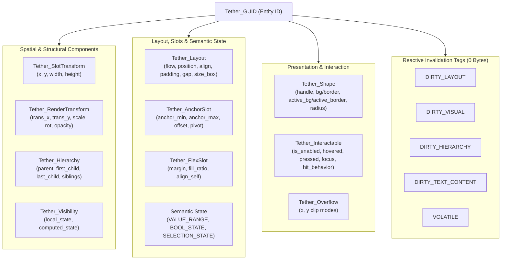
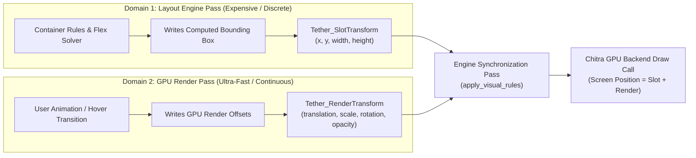
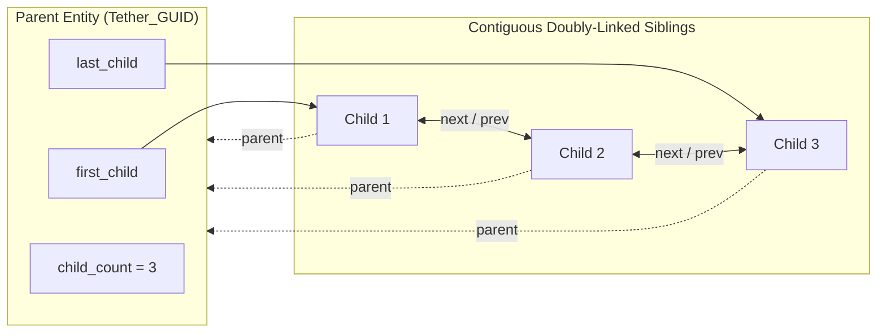
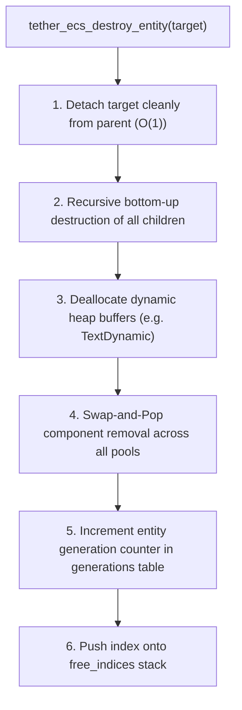
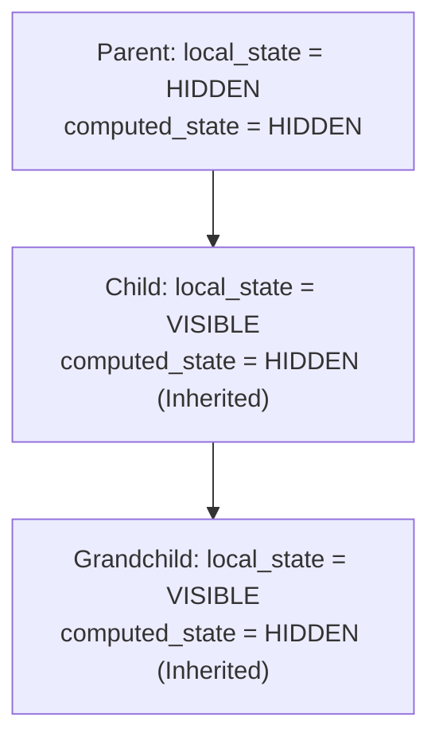

# Chapter 04: Components, State, Invalidation, and Updates

[<- Previous: Chapter 03 - ECS, Memory Management, and Lifecycle](03_ecs_and_memory.md) | [Documentation Master Index](../index.md) | [Next: Chapter 05 - UI Framework, Widget Registry, and Extensibility ->](05_ui_framework_and_widgets.md)

---

## 1. Executive Summary

In Tether, user interface entities do not exist as heavyweight object-oriented class instances or DOM nodes. Instead, every visual element, layout container, interactive control, and structural node is represented by a lightweight 64-bit entity identifier (`Tether_GUID`) attached to flat, typed component payloads stored within the ECS kernel.

This chapter details:
1. **Base Node Components**: The foundational data structures that constitute an element in the scene graph, initialized automatically from `default_data` templates.
2. **Separation of Layout and Presentation Transforms**: Why physical layout boundaries (`SlotTransform`) and visual GPU transformations (`RenderTransform`) are decoupled into separate components.
3. **Scene Tree Hierarchy (`Tether_Hierarchy`)**: Doubly-linked tree topologies stored in contiguous memory, $O(1)$ reparenting, and cascading deletion.
4. **Visibility System (`Tether_Visibility`)**: Local vs. computed visibility states (`VISIBLE`, `HIDDEN`, `COLLAPSED`) and their impact on layout participation and rendering.
5. **Interactive Hit-Testing, State & Styling (`Tether_Interactable`, `Tether_Shape`)**: Spatial culling, hit-behavior policies, enabled gating (`is_enabled`), hover/press/focus state tracking, and widget-driven `active_bg`/`active_border` overrides.
6. **Semantic UI State & Position Modes**: Pure ECS state components (`VALUE_RANGE`, `BOOL_STATE`, `SELECTION_STATE`) and CSS `Tether_PositionMode` (`RELATIVE`, `ABSOLUTE`, `FIXED`).
7. **Reactive Invalidation Tags**: Zero-payload ECS tag components (`DIRTY_LAYOUT`, `DIRTY_VISUAL`, `DIRTY_HIERARCHY`, `DIRTY_TEXT_CONTENT`, `VOLATILE`) coordinating targeted system execution.
8. **The Engine Update Cycle and Realization Lifecycle**: Sequential execution inside `tether_engine_frame()` and GPU backend handle management.

---

## 2. Base Node Components and Three-Tier Architecture

### Three-Tier Component Architecture
Tether classifies every component into a clear three-tier taxonomy that separates foundational engine plumbing, concrete UI controls, and user-defined application components:

1. **Tier 1: Core Engine Components (Static Compile-Time)**:
   Defined from `0` to `TETHER_CORE_COMPONENTS_MAX - 1`. These components represent fundamental spatial math, scene graph links, visibility, layout container rules, and reactive invalidation tags.
2. **Tier 2: System UI Components (Static Compile-Time)**:
   Defined from `TETHER_CORE_COMPONENTS_MAX` to `TETHER_SYSTEM_COMPONENTS_MAX - 1`. These components provide visual styling, typography, container slots, pointer interaction state, overflow clipping, and Small String Optimization (SSO) storage.
   *Together, Tier 1 and Tier 2 comprise the Native Components of Tether (`0` to `TETHER_COMPONENT_MAX - 1`).*
3. **Tier 3: Custom Application Components (Static & Dynamic)**:
   - **Static Custom Components**: Defined with fixed IDs by compiled C applications via `tether_ecs_register_component_static(id, size, default_data)`.
   - **Dynamic Custom Components**: Registered at runtime by external systems, dynamic plugins, or scripting languages via `tether_ecs_register_component_dynamic(size, default_data)`. These allocate monotonic IDs starting at `TETHER_COMPONENT_MAX` and up, sharing the exact same cache-coherent dense arrays as native components. Both paths copy `default_data` automatically when `tether_ecs_add_component()` attaches the component (or zero-initialize if `default_data` is `NULL`).

When a UI element is instantiated via the widget subsystem (e.g., `tether_widget_create_container()`), the kernel allocates a base suite of core components initialized from their registered `default_data` templates (`TETHER_DEFAULT_SLOT_TRANSFORM`, `TETHER_DEFAULT_LAYOUT`, `TETHER_DEFAULT_VISIBILITY`, `TETHER_DEFAULT_RENDER_TRANSFORM`, `TETHER_DEFAULT_OVERFLOW`, `TETHER_DEFAULT_ANCHOR_SLOT`, `TETHER_DEFAULT_FLEX_SLOT`):



### Component Data Definitions (`include/tether/core/tether_components.h`)

| Component ID | Struct Type | Domain Responsibility |
| :--- | :--- | :--- |
| `TETHER_COMPONENT_SLOT_TRANSFORM` | `Tether_SlotTransform` | Output geometry calculated strictly by the layout solver (`16` bytes). |
| `TETHER_COMPONENT_RENDER_TRANSFORM` | `Tether_RenderTransform` | Visual GPU offsets, scaling, rotation, pivot, and opacity. |
| `TETHER_COMPONENT_HIERARCHY` | `Tether_Hierarchy` | Contiguous doubly-linked scene graph topology. |
| `TETHER_COMPONENT_VISIBILITY` | `Tether_Visibility` | Local requested state and hierarchically resolved effective state. |
| `TETHER_COMPONENT_OVERFLOW` | `Tether_Overflow` | Scissor clipping policies (`CLIP`, `VISIBLE`, `WRAP`, `SCROLL`). |
| `TETHER_COMPONENT_INTERACTABLE` | `Tether_Interactable` | Pointer hit behavior, `is_enabled` gating, hover, press, and focus states. |
| `TETHER_COMPONENT_LAYOUT` | `Tether_Layout` | Parent-side layout container rules (`flow`, `position`, alignment, gap, padding). |
| `TETHER_COMPONENT_ANCHOR_SLOT` | `Tether_AnchorSlot` | Canvas container child-side anchoring and stretch rules. |
| `TETHER_COMPONENT_FLEX_SLOT` | `Tether_FlexSlot` | Flex container child-side margin, fill ratio, and self-alignment. |
| `TETHER_COMPONENT_SHAPE` | `Tether_Shape` | Vector handle, `bg_color`/`border_color`, transient `active_bg`/`active_border`, corner radii. |
| `TETHER_COMPONENT_TEXT` | `Tether_Text` | Text handle, font sizing, alignment, wrapping, and intrinsic bounds. |
| `TETHER_COMPONENT_VALUE_RANGE` | `Tether_ValueRange` | Scalar value, min, max, step (`16` bytes, 4 floats) backing Slider and ProgressBar. |
| `TETHER_COMPONENT_BOOL_STATE` | `Tether_BoolState` | Boolean state (`value`) backing Toggle, Checkbox, and Collapsible. |
| `TETHER_COMPONENT_SELECTION_STATE` | `Tether_SelectionState` | Index, count, and open flag backing Radio, SegmentedBar, List, Menu, Dropdown, and Switcher. |
| `TETHER_COMPONENT_IS_LEAF` | Tag Component (`0` bytes) | Structural guard forbidding child attachment (e.g., text, icons). |

> [!NOTE]
> `Tether_Layout.position` supports `TETHER_POSITION_RELATIVE` (default flow/tree order), `TETHER_POSITION_ABSOLUTE`, and `TETHER_POSITION_FIXED`. Absolute and fixed subtrees render in a single-pass overlay Z-layer (`abs_z`) and clear `parent_clip_id = 0` so popups and dropdown menus escape parent card clipping cleanly.

---

## 3. Separation of Layout and Presentation Transforms

A critical architectural distinction in Tether is the complete separation between **structural layout geometry** and **visual presentation transforms**.

```c
typedef struct Tether_SlotTransform {
    float x;
    float y;
    float width;
    float height;
} Tether_SlotTransform;

typedef struct Tether_RenderTransform {
    float translation_x;
    float translation_y;
    float scale_x;
    float scale_y;
    float rotation_deg;
    Tether_Vec2 render_pivot; /* Default {0.5f, 0.5f} */
    float opacity;            /* Default 1.0f */
} Tether_RenderTransform;
```

### The Architectural Problem with Traditional Toolkits
In classical UI frameworks (such as the standard web DOM or immediate-mode engines lacking transform layers), altering an element's position, scale, or rotation directly modifies its bounding box. This triggers a catastrophic cascading layout reflow:
1. Scaling up a button on hover shifts every sibling element next to it.
2. The parent container must recalculate its auto-wrapping or flex measurements.
3. Ancestor containers all the way to the root window re-run layout passes.
4. Frame rates collapse from 60+ FPS to single digits during continuous visual animations.

### The Tether Solution: Two Decoupled Domains



### Mathematical Transform Synthesis
During the engine visual synchronization pass (`apply_visual_rules()` in `src/engine/tether_engine.c`), Tether computes the final screen coordinates for backend submission without altering `SlotTransform`:

$$\text{Final } X = \text{SlotTransform}.x + \text{RenderTransform}.\text{translation\_x}$$

$$\text{Final } Y = \text{SlotTransform}.y + \text{RenderTransform}.\text{translation\_y}$$

$$\text{Final } W = \text{SlotTransform}.\text{width} \times \text{RenderTransform}.\text{scale\_x}$$

$$\text{Final } H = \text{SlotTransform}.\text{height} \times \text{RenderTransform}.\text{scale\_y}$$

$$\text{Origin } X = \text{Final } X + \text{Final } W \times \text{RenderTransform}.\text{render\_pivot}.x$$

$$\text{Origin } Y = \text{Final } Y + \text{Final } H \times \text{RenderTransform}.\text{render\_pivot}.y$$

$$\text{Final Opacity} = \text{RenderTransform}.\text{opacity}$$

### Performance Implications
- **Separated Visual Offsets**: Visual offsets and opacity changes write to `RenderTransform` and mark `TETHER_COMPONENT_DIRTY_VISUAL`, avoiding layout invalidation unless text transforms (`DIRTY_TEXT_CONTENT`) also rebuild glyph geometry.
- **Stable Sibling Layout**: Neighboring widgets retain their precise layout grid positions because `SlotTransform` remains undisturbed.
- **Hardware-Accelerated Scissor Preservation**: Layout clipping boxes remain anchored to `SlotTransform`, while inner contents smoothly translate or rotate inside.

---

## 4. Scene Tree Hierarchy (`Tether_Hierarchy`)

Scene graphs in Tether are structured as contiguous doubly-linked trees stored in the dense component array of `TETHER_COMPONENT_HIERARCHY`.

```c
typedef struct Tether_Hierarchy {
    uint64_t parent;        /* Parent entity GUID (0 if root or detached) */
    uint64_t first_child;   /* First child entity GUID */
    uint64_t last_child;    /* Last child entity GUID */
    uint64_t prev_sibling;  /* Previous sibling entity GUID */
    uint64_t next_sibling;  /* Next sibling entity GUID */
    uint32_t child_count;   /* Count of active direct children */
} Tether_Hierarchy;
```



### Hierarchy Manipulation Operations

The ECS kernel provides core primitive functions for manipulating tree structures under strict algorithmic bounds:

| API Function | Algorithmic Complexity | Execution Semantics |
| :--- | :---: | :--- |
| `tether_ecs_attach_entity(parent, entity)` | $O(1)$ | Validates GUIDs, verifies parent is not a leaf, detaches entity from previous parent, appends to tail via `last_child`, increments `child_count`, and tags parent with `DIRTY_HIERARCHY`. |
| `tether_ecs_detach_entity(entity)` | $O(1)$ | Unlinks entity from parent and sibling chain, stitches adjacent siblings (`prev->next = next`, `next->prev = prev`), decrements parent `child_count`, and tags parent with `DIRTY_HIERARCHY`. |
| `tether_ecs_bring_to_front(entity)` | $O(1)$ | Detaches entity and re-attaches it to the tail of the parent's sibling chain. Because rendering traverses siblings from first to last, the tail child receives the highest Z-order. |

### Leaf Node Protection (`TETHER_COMPONENT_IS_LEAF`)
Certain UI primitives (such as pure text runs, glyph icons, or raster images) cannot structurally contain children. Attaching children to a leaf entity creates undefined layout states. 

Tether enforces structural safety through the zero-payload tag `TETHER_COMPONENT_IS_LEAF`. During `tether_ecs_attach_entity()`, the kernel checks if the candidate parent possesses this tag; if present, the attachment is rejected immediately without tree corruption.

### Cascading Deletion Lifecycle
Destroying an entity via `tether_ecs_destroy_entity(entity)` executes a bottom-up recursive cascade:



1. **Unlink**: The entity is cleanly detached from its parent and sibling chain.
2. **Subtree Cascade**: The kernel traverses `first_child` through `next_sibling`, recursively invoking `tether_ecs_destroy_entity()` on all descendants. Subtrees are destroyed from the leaves up to prevent orphan references.
3. **Dynamic Buffer Teardown**: If an entity contains dynamic heap-allocated memory (e.g., Tier 4 `Tether_TextDynamic`), the buffer is deallocated.
4. **Swap-and-Pop Component Removal**: All attached components across all dense arrays are removed using $O(1)$ Swap-and-Pop.
5. **Generational Invalidation**: The generation counter for the slot is incremented. Any stale GUID stored by application callbacks or scripts is immediately invalidated.
6. **Slot Recycling**: The integer index is added to `free_indices` for subsequent entity reuse.

---

## 5. Visibility System (`Tether_Visibility`)

Tether distinguishes between the **locally requested visibility state** of an element and its **effective computed visibility** resolved from the hierarchy.

```c
typedef enum {
    TETHER_VISIBLE = 0,   /* Element is rendered, participates in layout, receives input */
    TETHER_HIDDEN,        /* Invisible, receives no input, but preserves layout bounds */
    TETHER_COLLAPSED      /* Completely removed from layout (zero size), invisible, no input */
} Tether_VisibilityState;

typedef struct {
    Tether_VisibilityState local_state;    /* Explicitly assigned state */
    Tether_VisibilityState computed_state; /* Effective state inherited from hierarchy */
} Tether_Visibility;
```

### Visibility State Comparison Matrix

| Visibility State | Participates in Layout? | Preserves Layout Space? | Receives Input Hits? | Backend Render Opacity | Triggers Layout Reflow? |
| :--- | :---: | :---: | :---: | :---: | :---: |
| `TETHER_VISIBLE` | Yes | Yes | Yes | $1.0$ (scaled by `RenderTransform`) | Only when resized |
| `TETHER_HIDDEN` | Yes | Yes | No | $0.0$ (backend hidden) | No (preserves slot) |
| `TETHER_COLLAPSED` | No | No | No | $0.0$ (backend hidden) | Yes (siblings reflow) |

### Local vs. Computed Propagation
When `tether_widget_set_visibility(entity, state)` is called:
1. `vis->local_state` is assigned the requested state.
2. The tree is recomputed recursively (`recompute_visibility_tree()`):
   - If the parent's `computed_state` is `TETHER_HIDDEN` or `TETHER_COLLAPSED`, the child inherits that state regardless of its own `local_state`.
   - If the parent is `TETHER_VISIBLE`, the child's `computed_state` resolves to its own `local_state`.



### Selective Dirty Flagging
Tether optimizes invalidation based on state transition boundaries:
- **`VISIBLE` $\leftrightarrow$ `HIDDEN` Transition**: The element's layout geometry is unchanged (the slot size remains reserved). Only `TETHER_COMPONENT_DIRTY_VISUAL` is tagged, instructing the renderer to adjust opacity without triggering layout recalculation.
- **Transitions involving `TETHER_COLLAPSED`**: Collapsing or un-collapsing an element reclaims or requires layout space. The engine tags both `TETHER_COMPONENT_DIRTY_VISUAL` and `TETHER_COMPONENT_DIRTY_LAYOUT`, triggering a layout pass to reflow parent and sibling containers.

---

## 6. Interactive Hit-Testing and State Styles (`Tether_Interactable`)

User interaction state is tracked by the `Tether_Interactable` component:

```c
typedef enum {
    TETHER_HIT_BLOCK = 0,     /* Catches pointer hits; halts propagation to underlying elements */
    TETHER_HIT_IGNORE = 1,    /* Transparent: pointer events pass through self and children */
    TETHER_HIT_SELF_ONLY = 2, /* Catches hits on self; child clicks pass through */
    TETHER_HIT_CHILD_ONLY = 3 /* Self is transparent; interactive children can receive hits */
} Tether_HitBehavior;

typedef struct Tether_Interactable {
    bool is_enabled;
    bool is_hovered;
    bool is_pressed;
    bool has_focus;
    Tether_HitBehavior hit_behavior;
} Tether_Interactable;
```

> [!NOTE]
> `Tether_Interactable` defines per-entity enabled gating, interactive state flags, and hit filter policies. For the full spatial query algorithm (`tether_hit_test`), priority routing (`tether_input_set_route`), and input event dispatching pipeline, see [Chapter 09: Input and Event System](09_input_and_events.md).

### Active Visual Colors (`active_bg` / `active_border`)
Rather than hardcoding color rules in the core renderer, widgets react to hover/press events and write transient highlight colors via `tether_ui_set_active_color()` / `tether_ui_reset_active_color()` (using helpers like `tether_ui_interaction_offset()` and `tether_ui_adjust_color()`). During visual synchronization (`apply_visual_rules()` in `src/engine/tether_engine.c`), the engine simply checks whether an active override has non-zero alpha:

```c
Tether_Color fill_c   = (shape->active_bg.a != 0)     ? shape->active_bg     : shape->bg_color;
Tether_Color border_c = (shape->active_border.a != 0) ? shape->active_border : shape->border_color;
```

When `tether_widget_set_enabled(entity, false)` is called, interaction state is cleared, `active_bg`/`active_border` are reset, opacity is dimmed recursively, and the widget subtree is skipped during hit-testing.

---

## 7. Reactive Invalidation Tag Components

Tether utilizes zero-payload ECS tag components to implement a fine-grained reactive invalidation model:

```c
enum {
    TETHER_COMPONENT_DIRTY_LAYOUT = TETHER_CORE_COMPONENTS_MAX,
    TETHER_COMPONENT_DIRTY_VISUAL,
    TETHER_COMPONENT_DIRTY_HIERARCHY,
    TETHER_COMPONENT_DIRTY_TEXT_CONTENT,
    TETHER_COMPONENT_VOLATILE,
    TETHER_COMPONENT_IS_LEAF,
    /* ... */
};
```

### Tag Component Characteristics

| Tag Component | Memory Overhead | Set By | Consumed By | Flush Rule |
| :--- | :---: | :--- | :--- | :--- |
| `TETHER_COMPONENT_DIRTY_LAYOUT` | 0 bytes | Size changes, visibility transitions to/from `COLLAPSED`, child addition/removal. | Layout Solver (`tether_layout_process_all`) | Cleared after layout, unless entity is `VOLATILE`. |
| `TETHER_COMPONENT_DIRTY_VISUAL` | 0 bytes | Color updates, transform adjustments, hover/press state changes, visibility changes. | Visual Sync (`apply_visual_rules`) | Cleared after visual sync, unless entity is `VOLATILE`. |
| `TETHER_COMPONENT_DIRTY_HIERARCHY` | 0 bytes | Reparenting, attachment, detachment, position mode change (`ABSOLUTE`/`FIXED`), sibling reordering (`bring_to_front`). | Hierarchy Sync (`sync_hierarchy_recursive`) | Cleared unconditionally after Z-order and clip sync. |
| `TETHER_COMPONENT_DIRTY_TEXT_CONTENT` | 0 bytes | `tether_ui_set_text()`, `tether_ui_set_text_size()`, wrapping/transform changes. | Visual Sync (`g_rhi.text->set_text`) | Cleared only when text is visible and successfully submitted to RHI. |
| `TETHER_COMPONENT_VOLATILE` | 0 bytes | Continuous animation controllers or explicit volatile containers. | Dirty Flag Flush | **Never cleared** during frame flushes. |

### The `VOLATILE` Optimization Pattern
In typical retained-mode UI toolkits, running a continuous per-frame animation requires marking entities dirty on every tick. Tether solves this through the `TETHER_COMPONENT_VOLATILE` tag:
- Attached selectively to entities that must update continuously every frame (such as live telemetry views or shader/animation drivers). Standard interactive widgets (Button, Slider, Toggle, etc.) instead stay idle until input events or property setters tag `DIRTY_VISUAL` / `DIRTY_LAYOUT`, preserving zero-power idle execution.
- During the dirty flush stage of `tether_engine_frame()`, any entity carrying `TETHER_COMPONENT_VOLATILE` retains its `DIRTY_LAYOUT` or `DIRTY_VISUAL` tags across flushes.

---

## 8. Invalidation Tag Lifecycle and System Coordination

Rather than traversing deep object graphs or running dirty checks on every component every frame, Tether coordinates engine subsystems through the presence and absence of zero-payload tag components.

### Subsystem Tag Coordination

| Tag Component | Set By | Consumed By | Architectural Effect |
| :--- | :--- | :--- | :--- |
| `TETHER_COMPONENT_DIRTY_LAYOUT` | Widget dimension changes, visibility toggles to/from `COLLAPSED`, child additions/removals. | Layout Solver (`tether_layout_process_all`) | Signals that bounds must be re-evaluated. Recalculates `Tether_SlotTransform` across affected branches. |
| `TETHER_COMPONENT_DIRTY_HIERARCHY` | Reparenting, attachment, detachment, position mode transitions (`ABSOLUTE`/`FIXED`), sibling reordering (`bring_to_front`). | Hierarchy Synchronizer (`sync_hierarchy_recursive`) | Recomputes single-pass Z-orders (`current_z` / `abs_z`) and scissor clipping intersection rectangles. |
| `TETHER_COMPONENT_DIRTY_VISUAL` | Color/active-color modifications, hover/press state changes, opacity updates, transform adjustments. | Visual Synchronizer (`apply_visual_rules`) | Pushes updated vector coordinates, corner radii, borders, and state colors to backend GPU handles. |
| `TETHER_COMPONENT_DIRTY_TEXT_CONTENT` | String mutations via `tether_ui_set_text()`, font size modifications, text wrap changes. | Text Synchronizer (`g_rhi.text->set_text`) | Pushes updated text strings and wrapping constraints to the font rasterizer. |
| `TETHER_COMPONENT_VOLATILE` | Continuous animations, live timers, telemetry plots. | Dirty Flag Flush | Exempts entities from having their dirty flags cleared during frame flushes. |

### Reverse Dense Array Flush Mechanics
At the conclusion of each frame pass, the engine flushes dirty component arrays. Because removing a component invokes Swap-and-Pop (relocating the tail element into the vacated slot), forward iteration over a dense array while removing items causes elements to be skipped.

Tether flushes dirty tags through safe **reverse dense array iteration**:

```c
Tether_DenseArray* dirty_visual = tether_ecs_get_dense_array(TETHER_COMPONENT_DIRTY_VISUAL);
if (dirty_visual) {
    for (int i = (int)dirty_visual->count - 1; i >= 0; i--) {
        Tether_GUID id = dirty_visual->entity_map[i];
        if (!tether_ecs_get_component(id, TETHER_COMPONENT_VOLATILE)) {
            tether_ecs_remove_component(id, TETHER_COMPONENT_DIRTY_VISUAL);
        }
    }
}
```

1. Non-volatile entities cleanly shed their dirty tags in $O(1)$ time per component.
2. Entities possessing `TETHER_COMPONENT_VOLATILE` remain flagged, guaranteeing that interactive color transitions and real-time animations evaluate continuously without manual per-frame invalidation.
3. Text dirty tags are only removed if the text entity is realized, visible, and successfully submitted to the graphics backend.

> [!NOTE]
> For the macro 6-stage engine execution pipeline (`tether_engine_frame`), see [Chapter 02: Core Architecture and Execution Model](02_core_architecture.md#7-the-engine-execution-pipeline). For widget-level GPU resource realization and teardown, see [Chapter 05: UI Framework, Widget Registry, and Extensibility](05_ui_framework_and_widgets.md).

---

[<- Previous: Chapter 03 - ECS, Memory Management, and Lifecycle](03_ecs_and_memory.md) | [Documentation Master Index](../index.md) | [Next: Chapter 05 - UI Framework, Widget Registry, and Extensibility ->](05_ui_framework_and_widgets.md)
