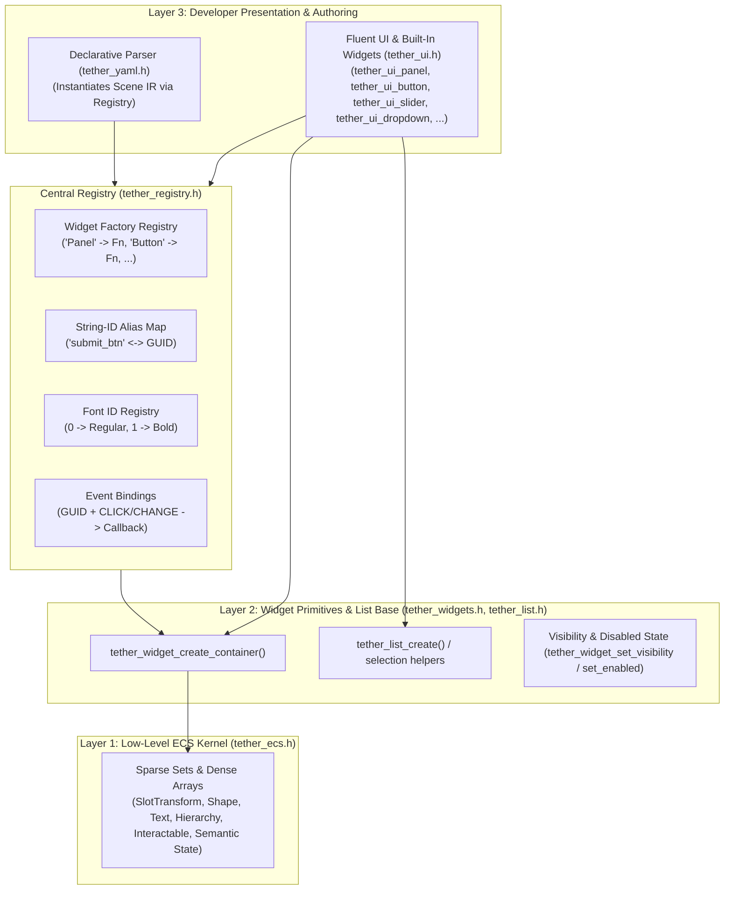
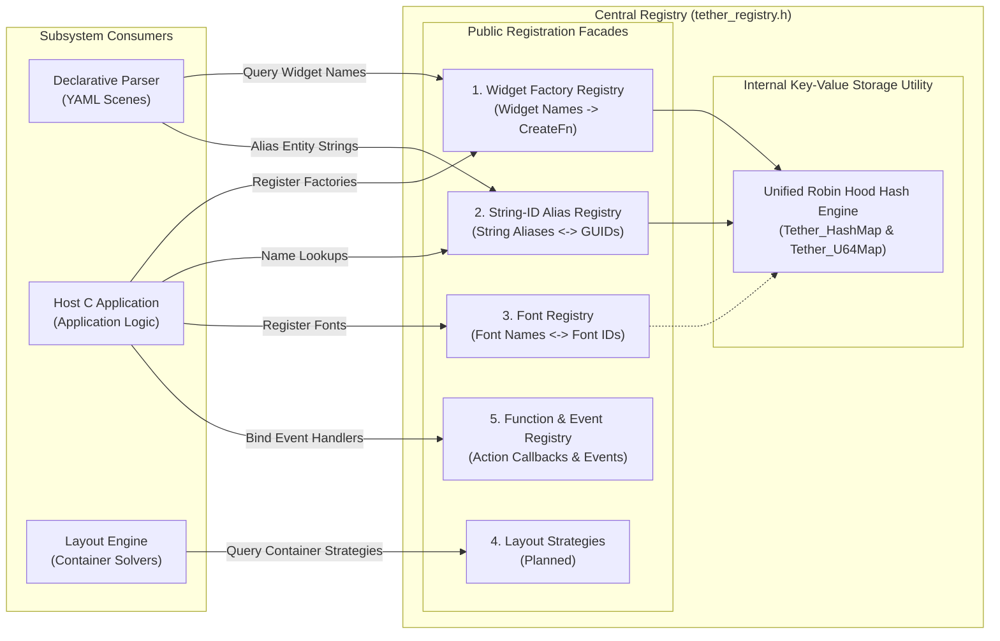
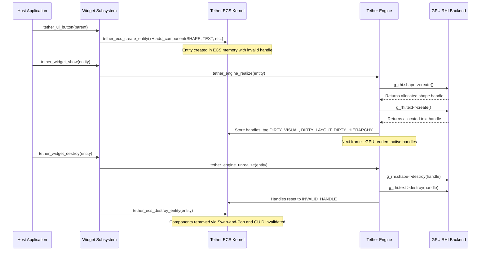

# Chapter 05: UI Framework, Widget Registry, and Extensibility

[<- Previous: Chapter 04 - Components, State, Invalidation, and Updates](04_components_and_invalidation.md) | [Documentation Master Index](../index.md) | [Next: Chapter 06 - Vinyasa Layout System ->](06_vinyasa_layout.md)

---

## 1. Executive Summary

While the Tether ECS kernel provides raw data arrays (`SlotTransform`, `Hierarchy`, `Shape`, `Text`, `Interactable`), developing user interfaces directly against raw component IDs requires verbose boilerplate. 

The **UI Framework** and **Central Registry** subsystems provide the foundational composition layer that bridges low-level data-oriented ECS storage with high-level developer ergonomics:
1. **The Native Widget Foundation (`include/tether/ui/tether_widgets.h`, `include/tether/ui/tether_list.h`)**: Base container creation (`tether_widget_create_container`), hierarchy helpers, visibility/enabled state propagation, and logical selection list containers.
2. **The Fluent UI Layer & Built-In Widgets (`include/tether/ui/tether_ui.h`, `include/tether/ui/widgets/*.h`)**: Container/layout/style modifiers (`tether_ui_panel`, `tether_ui_set_container`, `tether_ui_set_position`, `tether_ui_set_flex`, active hover/press styling) plus 13 modular built-in widgets (Text, Button, ProgressBar, Slider, Toggle, Checkbox, Radio, SegmentedBar, Menu, Dropdown, ContextMenu, Collapsible, Switcher).
3. **The Central Registry (`include/tether/core/tether_registry.h`)**: Widget factories, human-readable string aliases, and font tables. Events use their own binding system; layout strategy registration is planned.
4. **Extensibility & Dynamic Composition**: How host applications, games, and plugins register custom widget types and custom components without modifying the core engine.

---

## 2. Architecture of the UI Framework

Tether divides UI construction into complementary abstraction tiers:



---

## 3. The Native Widget Foundation (`tether_widgets.h`, `tether_list.h`)

Widgets in Tether are not C++ classes with virtual function tables. Instead, they are pure C factory functions that instantiate a new entity GUID, attach a tailored collection of native components (initialized from registered `default_data` templates), and compose sub-entities in the hierarchy.

### 1. Base Container Construction (`tether_widget_create_container`)
Every widget in Tether begins by calling `tether_widget_create_container(parent)`. Because core components are registered with `default_data` templates, adding each component populates safe spatial, layout, visibility, transform, and overflow defaults automatically:

```c
Tether_GUID tether_widget_create_container(Tether_GUID parent) {
    Tether_GUID entity = tether_ecs_create_entity();

    tether_ecs_add_component(entity, TETHER_COMPONENT_SLOT_TRANSFORM);
    tether_ecs_add_component(entity, TETHER_COMPONENT_LAYOUT);
    tether_ecs_add_component(entity, TETHER_COMPONENT_VISIBILITY);
    tether_ecs_add_component(entity, TETHER_COMPONENT_ANCHOR_SLOT);
    tether_ecs_add_component(entity, TETHER_COMPONENT_FLEX_SLOT);
    tether_ecs_add_component(entity, TETHER_COMPONENT_RENDER_TRANSFORM);
    tether_ecs_add_component(entity, TETHER_COMPONENT_OVERFLOW);

    tether_widget_add_to_parent(entity, parent);
    tether_widget_set_visibility(entity, TETHER_VISIBLE);

    return entity;
}
```

### 2. Panel Primitive (`tether_ui_panel`)
A Panel extends a container with a visual rectangle:
- Calls `tether_widget_create_container(parent)` and attaches `Tether_Shape` (handle `TETHER_INVALID_HANDLE` until realization, default slate `bg_color`).
- Uses `Tether_Overflow` clipping (`TETHER_OVERFLOW_CLIP`) by default unless switched to `TETHER_OVERFLOW_VISIBLE`.
- Serves as the standard card background, divider, or styled container when configured via `tether_ui_set_container(panel, TETHER_FLOW_ROW | TETHER_FLOW_COLUMN)`.

### 3. Text Widget (`tether_ui_text`)
A Text widget displays typographical content:
- Calls `tether_widget_create_container(parent)` and attaches `Tether_Text` (`TETHER_DEFAULT_TEXT`).
- Sets `Tether_FlexSlot.fill_ratio = 0.0f` so the text defaults to shrink-wrap sizing rather than expanding greedily.
- Keeps no `Tether_Interactable` component by default (acting as non-blocking `TETHER_HIT_CHILD_ONLY` unless interaction is explicitly attached), so label text inside a button does not block clicks on the parent button.

### 4. Button Widget (`tether_ui_button`)
A Button demonstrates pure ECS widget composition:
- Creates a base `Panel` with default padding, rounded corners, and centered content alignment.
- Attaches `Tether_Interactable` via `tether_widget_add_interaction(btn, TETHER_HIT_BLOCK)`.
- Binds internal hover/press/release handlers (`tether_bind_event`) that call `tether_ui_interaction_offset()`, `tether_ui_adjust_color()`, and `tether_ui_set_active_color()` / `tether_ui_reset_active_color()` to drive transient highlight states on `Tether_Shape.active_bg`.
- Attaches a child `Text` entity displaying `"Button"`; modifying the button label uses `tether_ui_set_button_label(btn, label)`.

### 5. Disabled Interaction State (`tether_widget_set_enabled`)
Any widget or compound subtree can be enabled or disabled at runtime:
```c
void tether_widget_set_enabled(Tether_GUID entity, bool enabled);
bool tether_widget_is_enabled(Tether_GUID entity);
```
Disabling an entity sets `Interactable.is_enabled = false`, clears active hover/press/focus flags and `shape->active_bg` / `active_border`, dims `RenderTransform.opacity` recursively across all child entities, and causes `tether_hit_test()` to skip the entire subtree.

### 6. Built-In Widget Suite & Logical List Base
All built-in controls share the same ECS primitives (`tether_ui.h`), semantic state components (`VALUE_RANGE`, `BOOL_STATE`, `SELECTION_STATE`), and logical `tether_list` selection container (`include/tether/ui/tether_list.h`):

| Widget | Header | Underlying Components / Base | Key Role |
| :--- | :--- | :--- | :--- |
| `Container` | `tether_widgets.h` | Layout, Slot, Visibility, Transform, Overflow | Invisible flex/canvas layout container. |
| `Panel` | `tether_ui.h` | Container + `Tether_Shape` | Visual rectangle, card, separator, or styled flex container. |
| `Text` | `widgets/tether_text.h` | Container + `Tether_Text` + SSO tiers | Typography with wrap and intrinsic measurement. |
| `Button` | `widgets/tether_button.h` | Panel + `Interactable` + Label child | Interactive pushbutton with active color feedback. |
| `ProgressBar` | `widgets/tether_progress_bar.h` | Panel + `VALUE_RANGE` + Fill child | Continuous progress indicator `[0..1]` or custom range. |
| `Slider` | `widgets/tether_slider.h` | ProgressBar + Thumb + Drag `Interactable` | Draggable range control emitting `TETHER_EVENT_CHANGE`. |
| `Toggle` | `widgets/tether_toggle.h` | Panel + Thumb + `BOOL_STATE` | Sliding boolean switch emitting `TETHER_EVENT_CHANGE`. |
| `Checkbox` | `widgets/tether_checkbox.h` | Box + Checkmark indicator + `BOOL_STATE` | Standalone boolean check box emitting `TETHER_EVENT_CHANGE`. |
| `Radio` | `widgets/tether_radio.h` | Column/Row group + `SELECTION_STATE` + Ring/Dot/Label items | Single-choice option group backed by `tether_list`. |
| `SegmentedBar` | `widgets/tether_segmented_bar.h` | Row/Column bar + `SELECTION_STATE` + Segment buttons | Mutually exclusive segmented tab/mode bar. |
| `Menu` | `widgets/tether_menu.h` | `TETHER_POSITION_ABSOLUTE` / `overlay_root` + `tether_list` | Shared floating selection menu for dropdowns and context menus. |
| `Dropdown` | `widgets/tether_dropdown.h` | Header button + `SELECTION_STATE` + absolute-positioned `Menu` | Expandable single-select dropdown; the type setter currently does not change its behavior. |
| `ContextMenu` | `widgets/tether_context_menu.h` | `Menu` wrapper positioned at pointer coordinates | Screen-space floating right-click menu using `tether_input_set_route()`. |
| `Collapsible` | `widgets/tether_collapsible.h` | Header + Arrow/Title + Content container + `BOOL_STATE` | Expand/collapse disclosure section toggling content visibility. |
| `Switcher` | `widgets/tether_switcher.h` | Column container + `SELECTION_STATE` | Shows one active view while setting inactive views to `TETHER_COLLAPSED`. |

---

## 4. The Fluent UI Layer (`tether_ui.h`)

For application developers building interfaces in C, Tether provides composable primitives and linear property setters that mutate ECS components and flag the appropriate dirty tags automatically.

### Primitives & Flow Helpers
```c
/* Create a styled container panel */
Tether_GUID tether_ui_panel(Tether_GUID parent);

/* Configure container flow direction (TETHER_FLOW_NONE, TETHER_FLOW_ROW, TETHER_FLOW_COLUMN) */
void tether_ui_set_container(Tether_GUID entity, Tether_Flow flow);

/* Configure CSS positioning mode (RELATIVE, ABSOLUTE, FIXED) */
void tether_ui_set_position(Tether_GUID entity, Tether_PositionMode position);
```

### Content, State & Control Helpers
```c
/* Typography */
Tether_GUID tether_ui_text(Tether_GUID parent);
bool        tether_ui_set_text(Tether_GUID entity, const char* string);
const char* tether_ui_get_text(Tether_GUID entity);
void        tether_ui_set_text_color(Tether_GUID entity, Tether_Color color);
void        tether_ui_set_text_size(Tether_GUID entity, float font_size);
void        tether_ui_set_text_align(Tether_GUID entity, Tether_Align align_x, Tether_Align align_y);

/* Button */
Tether_GUID tether_ui_button(Tether_GUID parent);
void        tether_ui_set_button_label(Tether_GUID btn, const char* label);
void        tether_ui_set_button_color(Tether_GUID btn, Tether_Color color);
```

### Fluent Layout, Style & Interaction Modifiers
- `tether_ui_set_size(entity, width, height)`: Sets explicit dimensions on `Tether_Layout.size_box` (`0` denotes auto/intrinsic sizing).
- `tether_ui_set_padding(entity, top, right, bottom, left)`: Adjusts container inner padding.
- `tether_ui_set_gap(entity, gap_x, gap_y)`: Configures spacing between consecutive children in row or column flow containers.
- `tether_ui_set_flex(entity, fill_ratio)`: Specifies flex weight along the primary layout axis.
- `tether_ui_set_anchor(...)` / `tether_ui_set_offsets(...)`: Sets normalized Canvas anchor bounds and pixel margins.
- `tether_ui_set_color(entity, bg_color)` / `tether_ui_set_border(entity, width, color, radius)`: Configures base fill and border styling on `Tether_Shape`.
- `tether_ui_set_active_color(entity, color)` / `tether_ui_reset_active_color(entity)`: Sets or clears transient hover/press colors on `Tether_Shape.active_bg` without overwriting `bg_color`.
- `tether_ui_set_bool` / `tether_ui_get_bool` / `tether_ui_toggle_bool`: Manipulates `Tether_BoolState`.
- `tether_ui_set_value` / `tether_ui_get_value` / `tether_ui_set_range`: Manipulates `Tether_ValueRange`.

### Practical C Composition Example
```c
/* Build a responsive profile card in pure C */
Tether_GUID card = tether_ui_panel(tether_ecs_get_main_root());
tether_ui_set_container(card, TETHER_FLOW_COLUMN);
tether_ui_set_gap(card, 0.0f, 12.0f);
tether_ui_set_padding(card, 20.0f, 20.0f, 20.0f, 20.0f);
tether_ui_set_color(card, (Tether_Color){35, 39, 46, 255});
tether_ui_set_border(card, 1.0f, (Tether_Color){60, 64, 72, 255}, 8.0f);
tether_ui_set_size(card, 320.0f, 0.0f); /* Fixed 320px width, auto height */

/* Add title and subtitle */
Tether_GUID title = tether_ui_text(card);
tether_ui_set_text(title, "User Profile");
tether_ui_set_text_size(title, 22.0f);
tether_ui_set_text_color(title, (Tether_Color){255, 255, 255, 255});

Tether_GUID subtitle = tether_ui_text(card);
tether_ui_set_text(subtitle, "Systems Engineer");
tether_ui_set_text_size(subtitle, 14.0f);
tether_ui_set_text_color(subtitle, (Tether_Color){170, 178, 190, 255});

/* Add horizontal button row */
Tether_GUID actions = tether_widget_create_container(card);
tether_ui_set_container(actions, TETHER_FLOW_ROW);
tether_ui_set_gap(actions, 8.0f, 0.0f);

Tether_GUID save_btn = tether_ui_button(actions);
tether_ui_set_button_label(save_btn, "Save Changes");
tether_ui_set_button_color(save_btn, (Tether_Color){97, 175, 239, 255});
tether_ui_set_flex(save_btn, 1.0f); /* Button fills remaining row width */
tether_bind_event(save_btn, TETHER_EVENT_CLICK, on_save_clicked, NULL);

/* Display the hierarchy on GPU */
tether_widget_show(card);
```

---

## 5. The Central Registry (`tether_registry.h`)

The Central Registry acts as the universal coordination hub of the engine. It decouples high-level authoring, parsing, and application code from concrete memory addresses and internal implementation details.



### The Unified Hashmap Utility (`include/tether/utils/tether_hashmap.h`)
Rather than maintaining disjointed hash tables or relying on external libraries, Tether provides a standardized, high-performance Robin Hood hash table utility that powers all internal registries:

```c
/* String -> uint64_t Map (Robin Hood) */
typedef struct {
    char* key;
    uint64_t value;
    uint32_t psl;        /* Probe Sequence Length */
    bool occupied;
} Tether_HashEntry;

typedef struct {
    Tether_HashEntry* entries;
    uint32_t count;
    uint32_t capacity;
} Tether_HashMap;

/* uint64_t -> String Map (Robin Hood) */
typedef struct {
    uint64_t key;
    char* value;
    uint32_t psl;
    bool occupied;
} Tether_U64MapEntry;

typedef struct {
    Tether_U64MapEntry* entries;
    uint32_t count;
    uint32_t capacity;
} Tether_U64Map;
```

#### Why Robin Hood Hashing?
1. **Low Variance in Probe Lengths**: During collision resolution, incoming elements with longer probe distances "steal from the rich" (displacing elements with shorter probe sequences). This bounds maximum search lengths and prevents pathological search clustering.
2. **Zero Pointer Chasing**: Entries reside in flat, contiguous memory buffers. Lookups exhibit exceptional CPU cache line locality compared to separate chaining linked lists.
3. **Unified Engine Infrastructure**:
   - Widget Factory Registry: Resolves widget name strings to creation function pointers (`const char* -> (uint64_t)Tether_WidgetCreateFn`).
   - String-ID Forward Map: Resolves alias strings to entity GUIDs (`const char* -> (uint64_t)Tether_GUID`).
   - String-ID Reverse Map: Resolves entity GUIDs back to alias strings (`uint64_t -> const char*`).
   - Font paths and action dispatch tables leverage this same zero-fragmentation infrastructure.

### 1. Widget Factory Registry
Maps human-readable widget type names to C creation function pointers:

```c
typedef Tether_GUID (*Tether_WidgetCreateFn)(Tether_GUID parent);

void tether_register_widget(const char* name, Tether_WidgetCreateFn create_fn);
Tether_GUID tether_create_widget(const char* name, Tether_GUID parent);
```

During engine startup (`src/tether.c`), the complete built-in widget suite is registered automatically:
```c
tether_register_widget("Container", tether_widget_create_container);
tether_register_widget("Panel", tether_ui_panel);
tether_register_widget("Text", tether_ui_text);
tether_register_widget("Button", tether_ui_button);
tether_register_widget("ProgressBar", tether_ui_progress_bar);
tether_register_widget("Slider", tether_ui_slider);
tether_register_widget("Toggle", tether_ui_toggle);
tether_register_widget("Checkbox", tether_ui_checkbox);
tether_register_widget("Radio", tether_ui_radio);
tether_register_widget("SegmentedBar", tether_ui_segmented_bar);
tether_register_widget("Menu", tether_ui_menu);
tether_register_widget("Dropdown", tether_ui_dropdown);
tether_register_widget("ContextMenu", tether_ui_context_menu);
tether_register_widget("Collapsible", tether_ui_collapsible);
tether_register_widget("Switcher", tether_ui_switcher);
```

When the Declarative YAML parser encounters `- Button:`, it does not contain a hardcoded `switch` statement. It simply queries the registry:
```c
Tether_GUID entity = tether_create_widget("Button", parent);
```
If an application or plugin has registered custom widgets (e.g., `"Slider"`, `"ColorPicker"`, `"DataGrid"`), the parser instantiates them transparently without engine modifications.

### 2. String-ID Alias Registry
ECS entity GUIDs are generational 64-bit integers (`Version | Index`). While optimal for memory lookups and cache locality, integer IDs are hostile to human developers and declarative markup.

The String-ID Alias Registry maintains a high-speed, bi-directional mapping between human-readable strings and live ECS GUIDs:

```c
void tether_registry_alias_entity(Tether_GUID entity, const char* alias);
const char* tether_registry_get_alias(Tether_GUID entity);
Tether_GUID tether_registry_find_entity(const char* alias);
void tether_registry_remove_alias(Tether_GUID entity);
```

#### Dual-Map Architecture (`src/core/tether_registry.c`)
- **Forward Lookup (`g_alias_to_entity`)**: A string hash map (`Tether_HashMap`) resolving alias strings to entity GUIDs in $O(1)$ average time.
- **Reverse Lookup (`g_entity_to_alias`)**: A 64-bit integer map (`Tether_U64Map`) resolving entity GUIDs back to alias strings.

#### Automatic Alias Invalidation
When an alias is assigned to an entity via `tether_registry_alias_entity(entity, "main_header")`:
1. If the entity previously held a different alias, the old alias is removed.
2. If another entity previously held the alias `"main_header"`, its mapping is cleanly unlinked.
3. When entities are destroyed, aliases are released to prevent stale string lookups.

The global root nodes are automatically aliased during kernel initialization:
```c
tether_registry_alias_entity(g_registry.main_root, "main_root");
tether_registry_alias_entity(g_registry.overlay_root, "overlay_root");
```

### 3. Font Registry
Typography rendering requires rasterizing font glyphs from TrueType or OpenType files. Tether decouples font file system paths from UI components using 0-based font integer identifiers:

```c
#define TETHER_INVALID_FONT_ID 0xFFFFFFFFU

uint32_t tether_font_register(const char* name, const char* path);
const char* tether_font_get_path(uint32_t font_id);
const char* tether_font_get_name(uint32_t font_id);
```

- **ID 0**: The universal fallback default font, registered during engine initialization.
- **Font IDs**: Directly align with the underlying Chitra and Fontstash rasterization indices, eliminating translation overhead during text layout and rendering.

### 4. Layout Strategy Registry (Planned)
The current layout solver handles its built-in flow modes directly. A registry for custom measure and arrange functions is a future design idea described in the [roadmap](../presentation/10_roadmap_and_community.md).

### 5. Event Bindings
User interaction callbacks are linked to entity GUIDs via `src/core/tether_events.c`:

```c
typedef void (*Tether_EventCallback)(Tether_GUID entity, const Tether_Event *event, void* user_data);

void tether_bind_event(Tether_GUID entity, Tether_EventType type, Tether_EventCallback callback, void* user_data);
void tether_bind_pointer_event(Tether_GUID entity, Tether_EventType type, Tether_MouseButton button,
                               Tether_EventCallback callback, void* user_data);
void tether_unbind_event(Tether_GUID entity, Tether_EventType type);
void tether_dispatch_event(Tether_GUID entity, Tether_EventType type);
```

- **Compact Storage**: Event bindings are maintained in a flat array (`Tether_EventBinding`) operating with Swap-and-Pop deallocation when not dispatching, and reentrancy-safe deferred cleanup (`g_dispatch_depth`) during callbacks.
- **Decoupled Execution**: During pointer input processing, `tether_input_process_event()` identifies hit targets and dispatches `Tether_Event` payloads (`TETHER_EVENT_CLICK`, `TETHER_EVENT_DRAG`, `TETHER_EVENT_CHANGE`, etc.) without traversing deep OOP event listener chains.

---

## 6. Extending Tether with Custom Widgets

Tether's modular architecture allows host applications to define rich custom controls that integrate seamlessly into both the C API and declarative YAML markup.

### Step-by-Step Custom Widget Implementation

```mermaid
sequenceDiagram
    participant Dev as Application Code
    participant Reg as Widget Registry
    participant ECS as ECS Kernel
    participant Parser as YAML Parser

    Dev->>Reg: tether_register_widget("Checkbox", create_checkbox_fn)
    Note over Reg: Checkbox factory mapped to create_checkbox_fn

    rect rgb(28, 36, 43)
        Note over Reg: Dual authoring - Instantiated via YAML or C
        Parser->>Reg: tether_create_widget("Checkbox", parent)
        Reg->>Dev: create_checkbox_fn(parent)
        Dev->>ECS: tether_widget_create_container(parent)
        Dev->>ECS: Attach Custom Components and Child Nodes
        Dev-->>Parser: Returns Tether_GUID
    end
```



#### 1. Define Custom Component Data
```c
typedef struct {
    bool is_checked;
    Tether_Color check_color;
} Custom_CheckboxData;

static uint32_t COMPONENT_CHECKBOX = 0;

void app_register_components(void) {
    /* Register dynamic component type starting above TETHER_COMPONENT_MAX */
    COMPONENT_CHECKBOX = tether_ecs_register_component_dynamic(sizeof(Custom_CheckboxData), NULL);
}
```

#### 2. Implement the Widget Factory Function
```c
static void on_checkbox_clicked(Tether_GUID entity, const Tether_Event* event, void* user_data) {
    (void)event; (void)user_data;
    Custom_CheckboxData* cb = tether_ecs_get_component(entity, COMPONENT_CHECKBOX);
    if (!cb) return;

    cb->is_checked = !cb->is_checked;

    /* Update child visual text checkmark */
    Tether_Hierarchy* h = tether_ecs_get_component(entity, TETHER_COMPONENT_HIERARCHY);
    if (h && h->first_child != TETHER_INVALID_GUID) {
        tether_ui_set_text(h->first_child, cb->is_checked ? "[X]" : "[ ]");
    }
}

Tether_GUID create_custom_checkbox(Tether_GUID parent) {
    /* 1. Create base container row */
    Tether_GUID root = tether_widget_create_container(parent);
    tether_ui_set_container(root, TETHER_FLOW_ROW);
    tether_ui_set_gap(root, 8.0f, 0.0f);
    tether_ui_set_padding(root, 4.0f, 4.0f, 4.0f, 4.0f);
    tether_widget_add_interaction(root, TETHER_HIT_BLOCK);

    /* 2. Attach custom component payload */
    Custom_CheckboxData* data = tether_ecs_add_component(root, COMPONENT_CHECKBOX);
    data->is_checked = false;
    data->check_color = (Tether_Color){97, 175, 239, 255};

    /* 3. Add visual indicator child */
    Tether_GUID indicator = tether_ui_text(root);
    tether_ui_set_text(indicator, "[ ]");
    tether_ui_set_text_size(indicator, 16.0f);
    tether_ui_set_text_color(indicator, data->check_color);

    /* 4. Add label text child */
    Tether_GUID label = tether_ui_text(root);
    tether_ui_set_text(label, "Checkbox Option");
    tether_ui_set_text_size(label, 16.0f);
    tether_ui_set_text_color(label, (Tether_Color){255, 255, 255, 255});

    /* 5. Bind click handler */
    tether_bind_event(root, TETHER_EVENT_CLICK, on_checkbox_clicked, NULL);

    return root;
}
```

#### 3. Register the Widget with the Central Registry
```c
void app_init_ui(void) {
    app_register_components();
    
    /* Register factory into the Central Registry */
    tether_register_widget("Checkbox", create_custom_checkbox);
}
```

#### 4. Instantiate from C or Declarative YAML
Once registered, the new widget can be instantiated via C:
```c
Tether_GUID my_check = tether_create_widget("Checkbox", panel);
```
Or declared directly within YAML markup:
```yaml
- Panel:
    padding: [10, 10, 10, 10]
    children:
      - Checkbox:
          id: terms_agreement
```
The parser encounters `- Checkbox:`, queries the Central Registry, executes `create_custom_checkbox()`, aliases the resulting GUID to `"terms_agreement"`, and mounts it into the scene tree with zero custom parser modifications.

---

## 7. Widget Realization and Unrealization Lifecycle

Tether maintains an explicit architectural boundary between ECS state data and hardware GPU graphics resources. Widgets can be composed, reordered, or parsed from declarative files before any graphics window exists.



### Realization (`tether_widget_show` / `tether_engine_realize`)
To present a widget on screen, its visual components must receive concrete hardware backend handles:
1. `tether_widget_show(entity)` forwards the target GUID to `tether_engine_realize(entity)`.
2. The engine traverses the entity and all descendants recursively.
3. If an entity contains `Tether_Shape` with an invalid handle, it calls `g_rhi.shape->create()`.
4. If an entity contains `Tether_Text` with an invalid handle, it calls `g_rhi.text->create()` and tags `DIRTY_TEXT_CONTENT`.
5. Tags `DIRTY_VISUAL` and `DIRTY_LAYOUT` on all realized elements.
6. Flags the parent entity with `DIRTY_HIERARCHY` so the newly mounted subtree is integrated into Z-ordering and scissor clipping.

### Unrealization (`tether_widget_destroy` / `tether_engine_unrealize`)
When a widget is removed, destroyed, or when the engine shuts down (`tether_engine_term()`):
1. `tether_widget_destroy(entity)` calls `tether_engine_unrealize(entity)`.
2. GPU resources are freed recursively while backend contexts remain valid:
   - `g_rhi.shape->destroy(shape->handle)`
   - `g_rhi.text->destroy(text->handle)`
3. Handles reset to `TETHER_INVALID_HANDLE`.
4. Following unrealization, `tether_ecs_destroy_entity(entity)` removes the underlying ECS state without GPU resource leaks.

---

[<- Previous: Chapter 04 - Components, State, Invalidation, and Updates](04_components_and_invalidation.md) | [Documentation Master Index](../index.md) | [Next: Chapter 06 - Vinyasa Layout System ->](06_vinyasa_layout.md)
