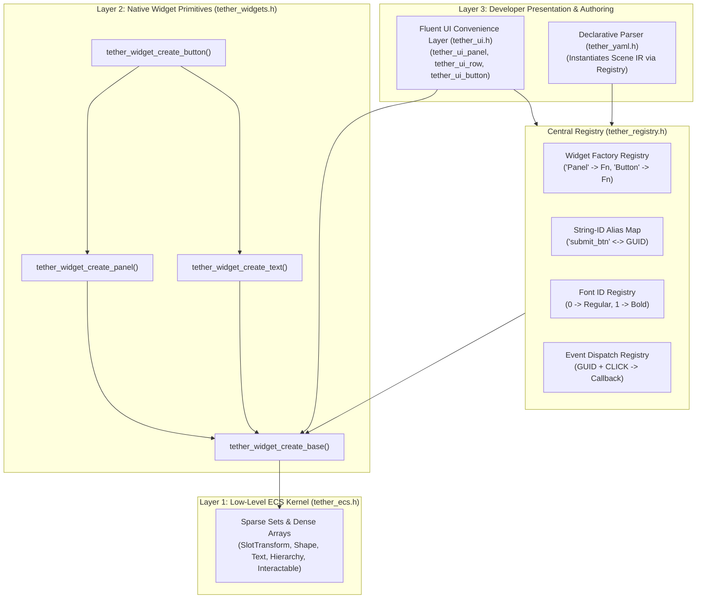
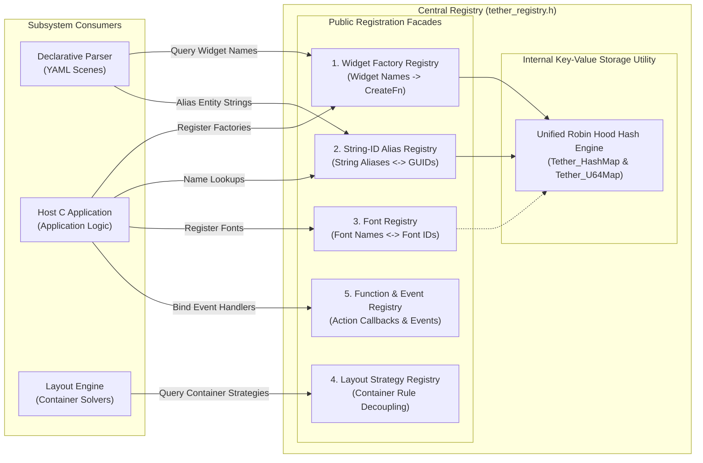
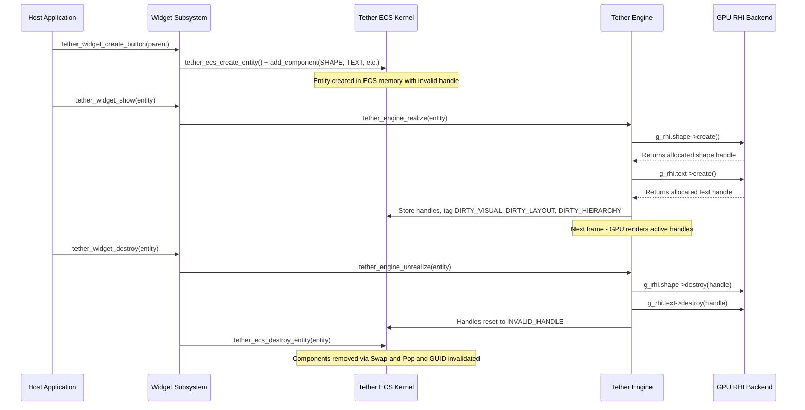

# Chapter 05: UI Framework, Widget Registry, and Extensibility

[<- Previous: Chapter 04 - Components, State, Invalidation, and Updates](04_components_and_invalidation.md) | [Documentation Master Index](../index.md) | [Next: Chapter 06 - Vinyasa Layout System ->](06_vinyasa_layout.md)

---

## 1. Executive Summary

While the Tether ECS kernel provides raw data arrays (`SlotTransform`, `Hierarchy`, `Shape`, `Text`, `Interactable`), developing user interfaces directly against raw component IDs requires verbose boilerplate. 

The **UI Framework** and **Central Registry** subsystems provide the foundational composition layer that bridges low-level data-oriented ECS storage with high-level developer ergonomics:
1. **The Native Widget Layer (`include/tether/ui/tether_widgets.h`)**: Fundamental widget creation primitives (`Panel`, `Text`, `Button`) that instantiate, configure, and assemble base component suites onto entity GUIDs.
2. **The Fluent UI Layer (`include/tether/ui/tether_ui.h`)**: High-level declarative C helpers (`tether_ui_row`, `tether_ui_column`, `tether_ui_button`, `tether_ui_set_flex`) enabling concise, readable UI construction.
3. **The Central Registry (`include/tether/core/tether_registry.h`)**: The global coordination hub managing widget factories, human-readable string aliases, font tables, layout strategies, and function bindings.
4. **Extensibility & Dynamic Composition**: How host applications, games, and plugins register custom widget types and custom components without modifying the core engine.

---

## 2. Architecture of the UI Framework

Tether divides UI construction into two complementary abstraction tiers:



---

## 3. The Native Widget Layer (`tether_widgets.h`)

Native widgets in Tether are not C++ classes with virtual function tables. Instead, they are pure C factory functions that instantiate a new entity GUID, attach a tailored collection of native components, and set safe architectural defaults.

### 1. Base Element Construction (`tether_widget_create_base`)
Every widget in Tether begins its existence by calling the internal helper `tether_widget_create_base(parent)`. This guarantees that all UI elements satisfy the core engine contract:

```c
static Tether_GUID tether_widget_create_base(Tether_GUID parent) {
    Tether_GUID entity = tether_ecs_create_entity();
    
    /* 1. Spatial bounds */
    Tether_SlotTransform* st = tether_ecs_add_component(entity, TETHER_COMPONENT_SLOT_TRANSFORM);
    st->x = 0; st->y = 0; st->width = 100; st->height = 100;
    
    /* 2. Container rules (Default: shrink/fill auto) */
    Tether_Layout* node = tether_ecs_add_component(entity, TETHER_COMPONENT_LAYOUT);
    node->flow = TETHER_FLOW_NONE;
    node->content_align_x = TETHER_ALIGN_FILL;
    node->content_align_y = TETHER_ALIGN_FILL;
        
    /* 3. Pointer hit testing */
    Tether_Interactable* i = tether_ecs_add_component(entity, TETHER_COMPONENT_INTERACTABLE);
    i->hit_behavior = TETHER_HIT_BLOCK;
    
    /* 4. Visibility state */
    Tether_Visibility* vis = tether_ecs_add_component(entity, TETHER_COMPONENT_VISIBILITY);
    vis->local_state = TETHER_VISIBLE;
    vis->computed_state = TETHER_VISIBLE;

    /* 5. Slot constraints */
    tether_ecs_add_component(entity, TETHER_COMPONENT_ANCHOR_SLOT);
    tether_ecs_add_component(entity, TETHER_COMPONENT_FLEX_SLOT);
    
    /* 6. Visual presentation transform */
    Tether_RenderTransform* rt = tether_ecs_add_component(entity, TETHER_COMPONENT_RENDER_TRANSFORM);
    rt->scale_x = 1.0f; rt->scale_y = 1.0f;
    rt->render_pivot = (Tether_Vec2){0.5f, 0.5f};
    rt->opacity = 1.0f;

    /* 7. Mount into scene tree */
    tether_widget_add_to_parent(entity, parent);
    tether_widget_set_visibility(entity, TETHER_VISIBLE);

    return entity;
}
```

### 2. Panel Widget (`tether_widget_create_panel`)
A Panel represents a styled visual container:
- Attaches `Tether_Shape` with handle initialized to `TETHER_INVALID_HANDLE` (allocated during realization).
- Attaches `Tether_Overflow` with `TETHER_OVERFLOW_CLIP` on both axes, ensuring child elements are clipped to the panel inner boundaries.
- Serves as the standard background surface, card, or modal backdrop.

### 3. Text Widget (`tether_widget_create_text`)
A Text widget displays typographical content:
- Attaches `Tether_Text` with default font size ($24\text{px}$), font ID $0$, and black color.
- Sets `Tether_FlexSlot.fill_ratio = 0.0f` so the text defaults to shrink-wrap sizing rather than expanding greedily.
- Sets `Tether_Interactable.hit_behavior = TETHER_HIT_IGNORE`, ensuring that non-interactive label text does not intercept pointer clicks meant for underlying buttons or cards.

### 4. Button Widget (`tether_widget_create_button`)
A Button is a compound native widget demonstrating the power of entity composition:
- Creates a base panel element with interactive background coloring.
- Sets `hit_behavior = TETHER_HIT_BLOCK` and `hover_color_mode = TETHER_COLOR_MODE_AUTO`, automatically adjusting luminance on hover and press.
- Programmatically creates a child `Text` widget displaying the button label.
- Returns the parent entity GUID. Modifying the button's layout or moving it automatically moves its child text label.

---

## 4. The Fluent UI Layer (`tether_ui.h`)

For application developers building interfaces in C, Tether provides a fluent API inspired by modern declarative UI architectures.

### Container Helpers
```c
/* Create a styled container panel */
Tether_GUID tether_ui_panel(Tether_GUID parent, Tether_Color bg_color, float radius);

/* Create a horizontal flex row container */
Tether_GUID tether_ui_row(Tether_GUID parent, float gap_x);

/* Create a vertical flex column container */
Tether_GUID tether_ui_column(Tether_GUID parent, float gap_y);
```

### Content and Control Helpers
```c
/* Create a styled text label */
Tether_GUID tether_ui_text(Tether_GUID parent, const char* string, float font_size, Tether_Color color);

/* Update text content (automatically traverses to text child if passed a button) */
bool tether_ui_set_text(Tether_GUID entity, const char* string);

/* Create an interactive button with click callback */
Tether_GUID tether_ui_button(Tether_GUID parent, const char* caption, float font_size,
                             Tether_Color bg_color, Tether_EventCallback callback, void* user_data);
```

### Fluent Layout and Style Modifiers
Modifiers operate on entity GUIDs and return `void`, enabling clean linear chaining in application code:
- `tether_ui_set_size(entity, width, height)`: Sets explicit dimensions on `Tether_Layout.size_box`. A dimension of `0` denotes auto/intrinsic sizing.
- `tether_ui_set_padding(entity, top, right, bottom, left)`: Adjusts container inner padding.
- `tether_ui_set_gap(entity, gap_x, gap_y)`: Configures spacing between consecutive children in row or column flow containers.
- `tether_ui_set_flex(entity, fill_ratio)`: Specifies flex weight along the primary layout axis.
- `tether_ui_set_color(entity, bg_color)`: Sets background fill color on `Tether_Shape`.
- `tether_ui_set_border(entity, width, color, radius)`: Sets shape border width, border color, and corner radius.
- `tether_ui_set_text_align(entity, align_x, align_y)`: Configures horizontal and vertical text alignment.

### Practical C Composition Example
```c
/* Build a responsive profile card in pure C */
Tether_GUID card = tether_ui_column(tether_ecs_get_main_root(), 12.0f);
tether_ui_set_padding(card, 20.0f, 20.0f, 20.0f, 20.0f);
tether_ui_set_color(card, (Tether_Color){35, 39, 46, 255});
tether_ui_set_border(card, 1.0f, (Tether_Color){60, 64, 72, 255}, 8.0f);
tether_ui_set_size(card, 320.0f, 0.0f); /* Fixed 320px width, auto height */

/* Add title and subtitle */
tether_ui_text(card, "User Profile", 22.0f, (Tether_Color){255, 255, 255, 255});
tether_ui_text(card, "Systems Engineer", 14.0f, (Tether_Color){170, 178, 190, 255});

/* Add horizontal button row */
Tether_GUID actions = tether_ui_row(card, 8.0f);
Tether_GUID save_btn = tether_ui_button(actions, "Save Changes", 14.0f,
                                        (Tether_Color){97, 175, 239, 255}, on_save_clicked, NULL);
tether_ui_set_flex(save_btn, 1.0f); /* Button fills remaining row width */

/* Display the hierarchy on GPU */
tether_widget_show(card);
```

---

## 5. The Central Registry (`tether_registry.h`)

The Central Registry acts as the universal coordination hub of the engine. It decouples high-level authoring, parsing, and application code from concrete memory addresses and internal implementation details.



### The Unified Hashmap Utility (`include/tether/utils/tether_hashmap.h`)
Rather than maintaining disjointed hash tables or relying on external libraries, Tether provides a standardized, high-performance Robin Hood hash table utility that powers all internal registries:

```c
/* String -> uint64_t Map (Robin Hood) */
typedef struct {
    char* key;
    uint64_t value;
    uint32_t psl;        /* Probe Sequence Length */
    bool occupied;
} Tether_HashEntry;

typedef struct {
    Tether_HashEntry* entries;
    uint32_t count;
    uint32_t capacity;
} Tether_HashMap;

/* uint64_t -> String Map (Robin Hood) */
typedef struct {
    uint64_t key;
    char* value;
    uint32_t psl;
    bool occupied;
} Tether_U64MapEntry;

typedef struct {
    Tether_U64MapEntry* entries;
    uint32_t count;
    uint32_t capacity;
} Tether_U64Map;
```

#### Why Robin Hood Hashing?
1. **Low Variance in Probe Lengths**: During collision resolution, incoming elements with longer probe distances "steal from the rich" (displacing elements with shorter probe sequences). This bounds maximum search lengths and prevents pathological search clustering.
2. **Zero Pointer Chasing**: Entries reside in flat, contiguous memory buffers. Lookups exhibit exceptional CPU cache line locality compared to separate chaining linked lists.
3. **Unified Engine Infrastructure**:
   - Widget Factory Registry: Resolves widget name strings to creation function pointers (`const char* -> (uint64_t)Tether_WidgetCreateFn`).
   - String-ID Forward Map: Resolves alias strings to entity GUIDs (`const char* -> (uint64_t)Tether_GUID`).
   - String-ID Reverse Map: Resolves entity GUIDs back to alias strings (`uint64_t -> const char*`).
   - Font paths and action dispatch tables leverage this same zero-fragmentation infrastructure.

### 1. Widget Factory Registry
Maps human-readable widget type names to C creation function pointers:

```c
typedef Tether_GUID (*Tether_WidgetCreateFn)(Tether_GUID parent);

void tether_register_widget(const char* name, Tether_WidgetCreateFn create_fn);
Tether_GUID tether_create_widget(const char* name, Tether_GUID parent);
```

During engine startup (`src/tether.c`), the native widget suite is registered automatically:
```c
tether_register_widget("Panel", tether_widget_create_panel);
tether_register_widget("Text", tether_widget_create_text);
tether_register_widget("Button", tether_widget_create_button);
```

When the Declarative YAML parser encounters `- Button:`, it does not contain a hardcoded `switch` statement. It simply queries the registry:
```c
Tether_GUID entity = tether_create_widget("Button", parent);
```
If an application or plugin has registered custom widgets (e.g., `"Slider"`, `"ColorPicker"`, `"DataGrid"`), the parser instantiates them transparently without engine modifications.

### 2. String-ID Alias Registry
ECS entity GUIDs are generational 64-bit integers (`Version | Index`). While optimal for memory lookups and cache locality, integer IDs are hostile to human developers and declarative markup.

The String-ID Alias Registry maintains a high-speed, bi-directional mapping between human-readable strings and live ECS GUIDs:

```c
void tether_registry_alias_entity(Tether_GUID entity, const char* alias);
const char* tether_registry_get_alias(Tether_GUID entity);
Tether_GUID tether_registry_find_entity(const char* alias);
void tether_registry_remove_alias(Tether_GUID entity);
```

#### Dual-Map Architecture (`src/core/tether_registry.c`)
- **Forward Lookup (`g_alias_to_entity`)**: A string hash map (`Tether_HashMap`) resolving alias strings to entity GUIDs in $O(1)$ average time.
- **Reverse Lookup (`g_entity_to_alias`)**: A 64-bit integer map (`Tether_U64Map`) resolving entity GUIDs back to alias strings.

#### Automatic Alias Invalidation
When an alias is assigned to an entity via `tether_registry_alias_entity(entity, "main_header")`:
1. If the entity previously held a different alias, the old alias is removed.
2. If another entity previously held the alias `"main_header"`, its mapping is cleanly unlinked.
3. When entities are destroyed, aliases are released to prevent stale string lookups.

The global root nodes are automatically aliased during kernel initialization:
```c
tether_registry_alias_entity(g_registry.main_root, "main_root");
tether_registry_alias_entity(g_registry.overlay_root, "overlay_root");
```

### 3. Font Registry
Typography rendering requires rasterizing font glyphs from TrueType or OpenType files. Tether decouples font file system paths from UI components using 0-based font integer identifiers:

```c
#define TETHER_INVALID_FONT_ID 0xFFFFFFFFU

uint32_t tether_font_register(const char* name, const char* path);
const char* tether_font_get_path(uint32_t font_id);
const char* tether_font_get_name(uint32_t font_id);
```

- **ID 0**: The universal fallback default font, registered during engine initialization.
- **Font IDs**: Directly align with the underlying Chitra and Fontstash rasterization indices, eliminating translation overhead during text layout and rendering.

### 4. Layout Strategy Registry
In traditional UI toolkits, layout solvers hardcode conditional branches for every supported container type (`if (is_flex) ... else if (is_grid) ...`). 

Tether's architecture decouples container math into the **Layout Strategy Registry**:
- Each container type provides two standardized function pointers:
  1. `MeasureFn`: Bottom-up pass determining intrinsic size based on content and constraints.
  2. `ArrangeFn`: Top-down pass assigning final spatial bounding coordinates to child slots.
- Custom container strategies (e.g., Radial menus, Docking layouts, Masonry grids) can register directly into the layout pipeline without altering `tether_layout.c`.

### 5. Event & Function Binding Registry
User interaction callbacks are linked to entity GUIDs via `src/core/tether_events.c`:

```c
typedef void (*Tether_EventCallback)(Tether_GUID entity, Tether_EventType type, void* user_data);

void tether_bind_event(Tether_GUID entity, Tether_EventType type, Tether_EventCallback callback, void* user_data);
void tether_unbind_event(Tether_GUID entity, Tether_EventType type);
void tether_dispatch_event(Tether_GUID entity, Tether_EventType type);
```

- **Compact Storage**: Event bindings are maintained in a flat array (`Tether_EventBinding`) operating with Swap-and-Pop deallocation.
- **Decoupled Execution**: During pointer input processing, `tether_input_process_event()` identifies hit targets and calls `tether_dispatch_event(hit_entity, TETHER_EVENT_CLICK)`. The engine dispatches callbacks immediately without traversing deep OOP event listener chains.

---

## 6. Extending Tether with Custom Widgets

Tether's modular architecture allows host applications to define rich custom controls that integrate seamlessly into both the C API and declarative YAML markup.

### Step-by-Step Custom Widget Implementation

```mermaid
sequenceDiagram
    participant Dev as Application Code
    participant Reg as Widget Registry
    participant ECS as ECS Kernel
    participant Parser as YAML Parser

    Dev->>Reg: tether_register_widget("Checkbox", create_checkbox_fn)
    Note over Reg: Checkbox factory mapped to create_checkbox_fn

    rect rgb(28, 36, 43)
        Note over Reg: Dual authoring - Instantiated via YAML or C
        Parser->>Reg: tether_create_widget("Checkbox", parent)
        Reg->>Dev: create_checkbox_fn(parent)
        Dev->>ECS: tether_widget_create_base(parent)
        Dev->>ECS: Attach Custom Components and Child Nodes
        Dev-->>Parser: Returns Tether_GUID
    end
```



#### 1. Define Custom Component Data
```c
typedef struct {
    bool is_checked;
    Tether_Color check_color;
} Custom_CheckboxData;

static uint32_t COMPONENT_CHECKBOX = 0;

void app_register_components(void) {
    /* Register dynamic component type starting above TETHER_COMPONENT_MAX */
    COMPONENT_CHECKBOX = tether_ecs_register_component_dynamic(sizeof(Custom_CheckboxData));
}
```

#### 2. Implement the Widget Factory Function
```c
static void on_checkbox_clicked(Tether_GUID entity, Tether_EventType type, void* user_data) {
    (void)type; (void)user_data;
    Custom_CheckboxData* cb = tether_ecs_get_component(entity, COMPONENT_CHECKBOX);
    if (!cb) return;

    cb->is_checked = !cb->is_checked;

    /* Update child visual text checkmark */
    Tether_Hierarchy* h = tether_ecs_get_component(entity, TETHER_COMPONENT_HIERARCHY);
    if (h && h->first_child != TETHER_INVALID_GUID) {
        tether_ui_set_text(h->first_child, cb->is_checked ? "[X]" : "[ ]");
    }
}

Tether_GUID create_custom_checkbox(Tether_GUID parent) {
    /* 1. Create base container row */
    Tether_GUID root = tether_ui_row(parent, 8.0f);
    tether_ui_set_padding(root, 4.0f, 4.0f, 4.0f, 4.0f);

    /* 2. Attach custom component payload */
    Custom_CheckboxData* data = tether_ecs_add_component(root, COMPONENT_CHECKBOX);
    data->is_checked = false;
    data->check_color = (Tether_Color){97, 175, 239, 255};

    /* 3. Add visual indicator child */
    Tether_GUID indicator = tether_ui_text(root, "[ ]", 16.0f, data->check_color);
    (void)indicator;

    /* 4. Add label text child */
    Tether_GUID label = tether_ui_text(root, "Checkbox Option", 16.0f, (Tether_Color){255, 255, 255, 255});
    (void)label;

    /* 5. Bind click handler */
    tether_bind_event(root, TETHER_EVENT_CLICK, on_checkbox_clicked, NULL);

    return root;
}
```

#### 3. Register the Widget with the Central Registry
```c
void app_init_ui(void) {
    app_register_components();
    
    /* Register factory into the Central Registry */
    tether_register_widget("Checkbox", create_custom_checkbox);
}
```

#### 4. Instantiate from C or Declarative YAML
Once registered, the new widget can be instantiated via C:
```c
Tether_GUID my_check = tether_create_widget("Checkbox", panel);
```
Or declared directly within YAML markup:
```yaml
- Panel:
    padding: [10, 10, 10, 10]
    children:
      - Checkbox:
          id: terms_agreement
```
The parser encounters `- Checkbox:`, queries the Central Registry, executes `create_custom_checkbox()`, aliases the resulting GUID to `"terms_agreement"`, and mounts it into the scene tree with zero custom parser modifications.

---

## 7. Widget Realization and Unrealization Lifecycle

Tether maintains an explicit architectural boundary between ECS state data and hardware GPU graphics resources. Widgets can be composed, reordered, or parsed from declarative files before any graphics window exists.



### Realization (`tether_widget_show` / `tether_engine_realize`)
To present a widget on screen, its visual components must receive concrete hardware backend handles:
1. `tether_widget_show(entity)` forwards the target GUID to `tether_engine_realize(entity)`.
2. The engine traverses the entity and all descendants recursively.
3. If an entity contains `Tether_Shape` with an invalid handle, it calls `g_rhi.shape->create()`.
4. If an entity contains `Tether_Text` with an invalid handle, it calls `g_rhi.text->create()` and tags `DIRTY_TEXT_CONTENT`.
5. Tags `DIRTY_VISUAL` and `DIRTY_LAYOUT` on all realized elements.
6. Flags the parent entity with `DIRTY_HIERARCHY` so the newly mounted subtree is integrated into Z-ordering and scissor clipping.

### Unrealization (`tether_widget_destroy` / `tether_engine_unrealize`)
When a widget is removed, destroyed, or when the engine shuts down (`tether_engine_term()`):
1. `tether_widget_destroy(entity)` calls `tether_engine_unrealize(entity)`.
2. GPU resources are freed recursively while backend contexts remain valid:
   - `g_rhi.shape->destroy(shape->handle)`
   - `g_rhi.text->destroy(text->handle)`
3. Handles reset to `TETHER_INVALID_HANDLE`.
4. Following unrealization, `tether_ecs_destroy_entity(entity)` removes the underlying ECS state without GPU resource leaks.

---

[<- Previous: Chapter 04 - Components, State, Invalidation, and Updates](04_components_and_invalidation.md) | [Documentation Master Index](../index.md) | [Next: Chapter 06 - Vinyasa Layout System ->](06_vinyasa_layout.md)
