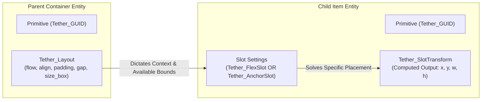
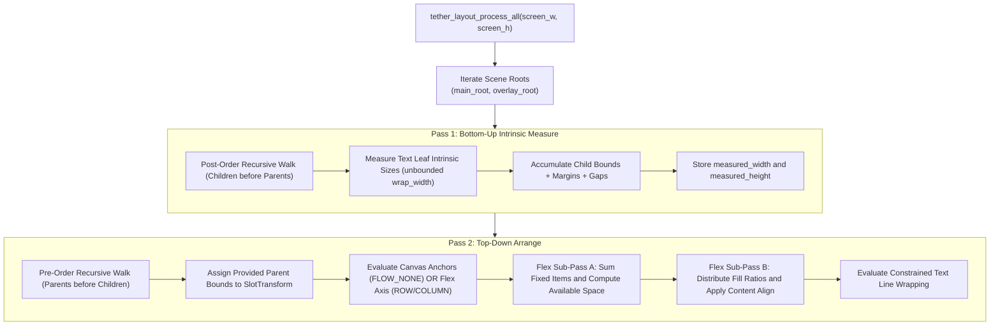
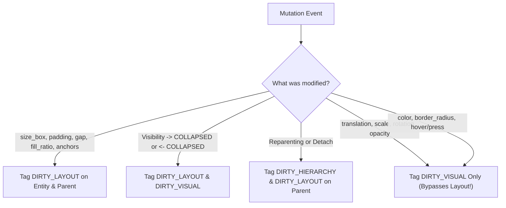
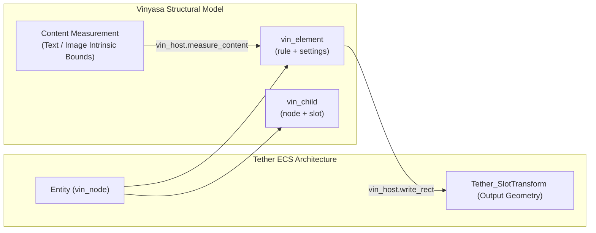

# Chapter 06: Vinyasa Layout System

[<- Previous: Chapter 05 - UI Framework, Widget Registry, and Extensibility](05_ui_framework_and_widgets.md) | [Documentation Master Index](../index.md) | [Next: Chapter 07 - Backend Interfaces ->](07_backend_interfaces.md)

---

## 1. Executive Summary

Layout is the mathematical core of any graphical user interface engine. Its responsibility is to resolve high-level developer declarations (docking anchors, flex weights, flow directions, padding, gaps, and auto-wrapped text) into deterministic pixel coordinates written to `Tether_SlotTransform` ($x, y, \text{width}, \text{height}$).

Tether's layout architecture is designed around two primary requirements:
1. **Immediate-Mode Performance**: Layout calculations must be fast enough to run in $\le 0.1\text{ ms}$ across thousands of elements without caching bugs or stale layout frames.
2. **Retained-Mode Expressiveness**: Complete support for Flexbox flow semantics (`ROW`, `COLUMN`, `gap`, `fill_ratio`, `content_align`), responsive Canvas anchors, and non-linear dynamic text wrapping.

This chapter details the **Layout Triad** (Primitive, Container, Slot), the active two-pass tree solver implemented in `src/engine/tether_layout.c`, layout invalidation rules, the Layout Strategy Registry, and the future architecture of the standalone **Vinyasa** layout engine.

---

## 2. The Layout Triad: Primitive, Container, and Slot

Tether models spatial geometry through three strictly decoupled concepts:



### 1. Primitive
A Primitive is an individual UI entity represented by a generational `Tether_GUID`. It can be a container, a child, or both simultaneously. The primitive owns the output `Tether_SlotTransform` struct containing its resolved physical screen boundaries.

### 2. Container Rules (`Tether_Layout`)
Attached to an entity when it acts as a parent managing children:

```c
typedef struct {
    Tether_Flow flow;             /* COLUMN, ROW, or NONE (Canvas) */
    Tether_PositionMode position; /* RELATIVE, ABSOLUTE, or FIXED */
    Tether_Align content_align_x;
    Tether_Align content_align_y;
    Tether_Edges padding;         /* Top, Right, Bottom, Left */
    Tether_Vec2 gap;              /* Inter-child spacing */
    Tether_Vec2 size_box;         /* Explicit bounds; (0,0) denotes auto/shrink-wrap */
    uint8_t wrap;                 /* Automatic content wrapping */
    float measured_width;         /* Output from Pass 1 (Measure) */
    float measured_height;        /* Output from Pass 1 (Measure) */
} Tether_Layout;
```

- **`TETHER_FLOW_NONE` (Canvas Mode)**: Children are positioned independently using absolute or anchored coordinates.
- **`TETHER_FLOW_ROW` (Flex Row)**: Children are placed sequentially along the horizontal X axis.
- **`TETHER_FLOW_COLUMN` (Flex Column)**: Children are stacked sequentially along the vertical Y axis.
- **`Tether_PositionMode` (`RELATIVE`, `ABSOLUTE`, `FIXED`)**: Configures overlay stacking and parent scissor clip escaping during hierarchy sync (`sync_hierarchy_recursive`). While `RELATIVE` widgets participate normally in parent flow and inherit parent clipping, `ABSOLUTE` and `FIXED` subtrees advance into a separate upper Z-band (`abs_z`) and clear `clip = 0` so popups and floating menus render cleanly over surrounding cards without reordering the hierarchy.

### 3. Slot Settings
Slot components are attached to child entities to configure how they behave relative to their parent container's layout mode:

#### A. Flex Slot (`Tether_FlexSlot`)
Consumed when the parent container has `flow` set to `TETHER_FLOW_ROW` or `TETHER_FLOW_COLUMN`:

```c
typedef struct Tether_FlexSlot {
    Tether_Edges margin;       /* Outer spacing around this child */
    float fill_ratio;          /* Proportional stretch weight (0.0 = intrinsic) */
    Tether_Align align_self_x; /* Cross-axis alignment override */
    Tether_Align align_self_y; /* Cross-axis alignment override */
} Tether_FlexSlot;
```

- **`fill_ratio = 0.0f`**: The element shrink-wraps its own intrinsic content size (e.g., text width or explicit `size_box`).
- **`fill_ratio > 0.0f`**: The element greedily consumes available space along the container's primary axis proportionally relative to sibling fill weights.

#### B. Anchor Slot (`Tether_AnchorSlot`)
Consumed when the parent container has `flow` set to `TETHER_FLOW_NONE` (Canvas Mode):

```c
typedef struct Tether_AnchorSlot {
    Tether_Vec2 anchor_min;    /* Normalized top-left anchor point (0.0 to 1.0) */
    Tether_Vec2 anchor_max;    /* Normalized bottom-right anchor point (0.0 to 1.0) */
    Tether_Edges offset;       /* Pixel offsets from anchors */
    Tether_Vec2 pivot;         /* Transform origin (default 0.0, 0.0) */
} Tether_AnchorSlot;
```

- **Anchored Docking**: Setting `anchor_min = anchor_max = {0.5, 0.5}` anchors the element to the exact center of the parent canvas.
- **Stretch Anchoring**: Setting `anchor_min = {0, 0}` and `anchor_max = {1, 1}` stretches the element across the entire parent area, with `offset` functioning as margin insets.

---

## 3. The Active Two-Pass Tree Solver (`src/engine/tether_layout.c`)

Tether executes layout tree resolution through two ordered recursive passes:



### Pass 1: Bottom-Up Intrinsic Measure (`tether_layout_measure_bottom_up`)
The measure pass traverses the scene graph in **post-order** (visiting all children before computing the parent's size).

1. **Collapsed Node Culling**: If an entity's `Tether_Visibility.computed_state` is `TETHER_COLLAPSED`, its `measured_width` and `measured_height` are set to `0.0f` and iteration halts.
2. **Text Leaf Measurement**:
   - For text entities, the solver calls `g_rhi.text->measure_text()` with `wrap_width = 0.0f` (unbounded single-line measurement).
   - This determines the natural single-line width and height of the text glyph run and caches it in `text->intrinsic_size`.
3. **Container Content Accumulation**:
   - **`TETHER_FLOW_NONE`**: Content dimensions equal the maximum bounding box across all active children:
     $$\text{content\_w} = \max(\text{child}_i.\text{width}), \quad \text{content\_h} = \max(\text{child}_i.\text{height})$$
   - **`TETHER_FLOW_ROW`**: Children are placed horizontally. Widths, horizontal margins, and inter-child gaps are summed along the X axis; height takes the maximum child height:
     $$\text{content\_w} = \sum (\text{item\_w}_i + \text{margin.left}_i + \text{margin.right}_i) + \text{gap.x} \times (N - 1)$$
     $$\text{content\_h} = \max(\text{item\_h}_i + \text{margin.top}_i + \text{margin.bottom}_i)$$
   - **`TETHER_FLOW_COLUMN`**: Children are stacked vertically. Heights, vertical margins, and gaps are summed along the Y axis; width takes the maximum child width:
     $$\text{content\_h} = \sum (\text{item\_h}_i + \text{margin.top}_i + \text{margin.bottom}_i) + \text{gap.y} \times (N - 1)$$
     $$\text{content\_w} = \max(\text{item\_w}_i + \text{margin.left}_i + \text{margin.right}_i)$$
4. **Padding Addition**:
   The container's inner padding is added to produce final intrinsic measurements:
   $$\text{measured\_width} = \text{content\_w} + \text{padding.left} + \text{padding.right}$$
   $$\text{measured\_height} = \text{content\_h} + \text{padding.top} + \text{padding.bottom}$$

### Pass 2: Top-Down Arrange (`tether_layout_arrange_top_down`)
The arrange pass traverses the scene graph in **pre-order**, propagating concrete spatial boundaries downward and calculating final coordinates for `Tether_SlotTransform`:

1. **Root Placement**:
   Root containers receive the viewport dimensions ($[0, 0, \text{screen\_w}, \text{screen\_h}]$).
2. **Auto-Height Resolution**:
   If an element has `flex->fill_ratio == 0.0f` and no explicit `size_box.y`, it is flagged for auto-height shrink-wrapping. However, if its parent is a Flex Row and instructs children to stretch vertically (`content_align_y == TETHER_ALIGN_FILL`), the child obeys the parent and stretches rather than shrink-wrapping.
3. **Leaf Text Wrapping**:
   If a text element's assigned width $W$ is smaller than its unbounded single-line measurement (`node->measured_width`), text wrapping activates (`node->wrap = 1`). The text string is re-measured against the constrained width $W$ to compute its actual wrapped multi-line height.
4. **Canvas Mode Placement (`TETHER_FLOW_NONE`)**:
   For each child, the anchor box is evaluated relative to the inner container rectangle:
   $$\text{min\_x} = \text{inner\_x} + (\text{inner\_w} \times \text{anchor\_min.x}) + \text{offset.left}$$
   $$\text{min\_y} = \text{inner\_y} + (\text{inner\_h} \times \text{anchor\_min.y}) + \text{offset.top}$$
   $$\text{max\_x} = \text{inner\_x} + (\text{inner\_w} \times \text{anchor\_max.x}) - \text{offset.right}$$
   $$\text{max\_y} = \text{inner\_y} + (\text{inner\_h} \times \text{anchor\_max.y}) - \text{offset.bottom}$$
   The resulting rectangle $[ \text{min\_x}, \text{min\_y}, \text{max\_x} - \text{min\_x}, \text{max\_y} - \text{min\_y} ]$ is passed recursively to `tether_layout_arrange_top_down(child, ...)`.
5. **Flex Mode Placement (`TETHER_FLOW_ROW` / `TETHER_FLOW_COLUMN`)**:
   Flex distribution executes in two sub-passes:
   - **Counting Pass**:
     Iterates through children to calculate the total fixed space consumed by items with `fill_ratio == 0.0f`, child margins, and container gaps:
     $$\text{fixed\_space} = \sum \text{fixed\_item\_size}_i + \sum \text{margins}_i + \text{gap} \times (N - 1)$$
     $$\text{available\_space} = \max(0, \text{inner\_axis\_size} - \text{fixed\_space})$$
     $$\text{total\_fill\_ratio} = \sum \text{child}_i.\text{fill\_ratio}$$
   - **Placement Pass**:
     If `total_fill_ratio == 0.0f`, any remaining available space is used to shift starting coordinates according to `content_align` (`CENTER` shifts by $\frac{\text{available\_space}}{2}$; `END` shifts by $\text{available\_space}$).
     For each child:
     - If `fill_ratio > 0.0f`, its allocated dimension is:
       $$\text{item\_size} = \text{available\_space} \times \left( \frac{\text{fill\_ratio}}{\text{total\_fill\_ratio}} \right)$$
     - Cross-axis alignment (`align_self` or container `content_align`) positions the child along the secondary axis (`START`, `CENTER`, `END`, or `FILL`).
     - Coordinates advance along the primary axis by $\text{item\_size} + \text{margin} + \text{gap}$.

---

## 4. Layout Invalidation Triggers

Layout recalculation is strictly reactive. The solver is invoked inside `tether_engine_frame()` only if the viewport resized or if the `TETHER_COMPONENT_DIRTY_LAYOUT` pool contains entities:



### Complete Separation of Render Transforms
Visual changes can use `Tether_RenderTransform` and visual invalidation. Direct changes to text rotation, scale, or pivot also require `DIRTY_TEXT_CONTENT` so glyph geometry can be rebuilt.

A visual-only change need not alter layout geometry. Text transforms are applied to CPU-side glyph vertices; they are not exclusively GPU operations.

---

## 5. Proposed Layout Strategy Registry

To prevent `src/engine/tether_layout.c` from accumulating monolithic conditional statements as new container types are added, a future design could decouple container mathematics into a **Layout Strategy Registry**. The current solver handles its flow modes directly:

```c
typedef void (*Tether_LayoutMeasureFn)(Tether_GUID entity, void* layout_data);
typedef float (*Tether_LayoutArrangeFn)(Tether_GUID entity, void* layout_data,
                                        float x, float y, float w, float h);

typedef struct {
    uint32_t component_id;
    Tether_LayoutMeasureFn measure;
    Tether_LayoutArrangeFn arrange;
} Tether_LayoutStrategy;
```

### Decoupled Execution Model
A proposed registry could dispatch measurement and arrangement as follows:
1. When traversing an entity during Pass 1, the solver would identify its container component ID and delegate to its registered `measure` function pointer.
2. During Pass 2, the solver would delegate to its registered `arrange` function pointer.
3. This proposed architecture could enable third-party developers, plugins, and game engines to implement custom container types (such as Docking grids, Radial menus, Splitters, and Masonry flows) without modifying core engine source files.

---

## 6. The Vinyasa Layout Engine (Roadmap Integration)

The future of Tether's layout pipeline centers on the integration of **Vinyasa** (`third_party/vinyasa`), an embeddable, low-overhead layout engine designed to calculate 2D element geometry with minimal CPU and memory footprints.

### 1. On-Demand Calculation Model
In layout engine design, debates between "immediate-mode" and "retained-mode" often confuse application presentation with mathematical resolution:
- **Layout is On-Demand**: Layout does not need to run continuously every frame, nor does it require permanent caching. It is a pure mathematical calculation that executes **only when needed** (e.g., when `DIRTY_LAYOUT` tags indicate mutations or when display boundaries change).
- **Engineered for High-Frequency Frame Execution**: Because layout is on-demand, interactive interfaces (such as live window resizing, splitter dragging, or animated layout reflows) may trigger layout resolution every single frame. Vinyasa is optimized specifically for this scenario: zero heap allocations during calculation, linear traversal over contiguous memory, and execution time that must be measured for each workload.
- **Stateless Operation**: Vinyasa does **not store persistent data**. It maintains no internal persistent tree, no retain cache, and no dirty change trackers.
- **Host Ownership**: Tether retains complete ownership of entity identity (`Tether_GUID`), scene graph hierarchy, component storage, input handling, and rendering.
- **Root-Independent Calculation**: Any supplied node is treated as the calculation root for that pass. Vinyasa does not need to know whether ancestors exist elsewhere in the host hierarchy, enabling localized sub-tree layout recalculations.

### 2. Temporary Working Memory (`vin_context`)
Vinyasa enforces strict memory discipline by using temporary scratch memory for active calculations:

```c
struct vin_context {
    vin_host host;
    void* user;
    unsigned char* scratch;
    size_t scratch_capacity;
    size_t scratch_used;
    unsigned depth;
};
```

- When `vin_arrange()` or `vin_measure()` executes, temporary allocations are served from a flat pre-allocated scratch arena (`vin_scratch_alloc`).
- **Zero Retained Footprint**: All scratch allocations expire immediately when the top-level calculation returns. No engine state or heap nodes are retained between calls.

### 3. The `vin_host` Integration Contract
Tether bridges its ECS kernel to Vinyasa through four standardized host callbacks:

```c
typedef struct vin_host {
    int (*element)(void* user, vin_node node, vin_element* out_elem);
    int (*child)(void* user, vin_node node, size_t index, vin_child* out_child);
    int (*measure_content)(void* user, vin_node node, vin_size available, vin_size* out_size);
    int (*write_rect)(void* user, vin_node node, vin_rect rect);
} vin_host;
```

1. **`element()`**: Queries the element's layout rule (`vin_rule`), rule settings (e.g., Row, Column, Grid), and child count from Tether's components.
2. **`child()`**: Resolves the child node identity (`vin_node`, mapping directly to `Tether_GUID`) and its slot settings (e.g., grow weight, alignment).
3. **`measure_content()`**: Invokes Tether's font or image subsystem to measure intrinsic content size under supplied available constraints.
4. **`write_rect()`**: Vinyasa writes the final parent-relative geometry (`vin_rect { x, y, width, height }`) directly into Tether's `Tether_SlotTransform` component.

### 4. Tether Component Adaptation for Vinyasa
To support Vinyasa natively, Tether's layout components will adapt to match Vinyasa's structural model:



- **Content and Container Coexistence**: In Vinyasa, an element can have both measurable content (e.g., a text label or button background) and container children. These are not mutually exclusive categories. Content measurement is handled independently, and the element's container rule dictates how content and child slots interact.
- **Pluggable Rules (`vin_rule`)**: Built-in rules (such as `row.h`) and custom layout rules use identical facilities. Adding a new layout algorithm (e.g., a multi-column masonry grid) requires defining a `vin_rule` with `measure` and `arrange` callbacks, with zero modifications to the core engine.

### 5. Multi-Reference Relative Positioning
In modern UI design, positioning requirements extend beyond simple hierarchical stacking. Vinyasa is designed to support multi-reference coordinate resolution:
- **Relative to Parent Allocated Slot**: Standard layout flow where child positions derive from the slot calculated by the parent container rule.
- **Relative to Parent Self Geometry**: Anchoring or offsetting directly relative to the parent's outer bounding box.
- **Relative to Calculation Root / Screen**: Positioning elements relative to the calculation root or global viewport space, enabling CSS-like fixed/absolute positioning (such as floating HUDs, sticky headers, and modal overlays) directly within Vinyasa's coordinate resolution.

---

[<- Previous: Chapter 05 - UI Framework, Widget Registry, and Extensibility](05_ui_framework_and_widgets.md) | [Documentation Master Index](../index.md) | [Next: Chapter 07 - Backend Interfaces ->](07_backend_interfaces.md)
