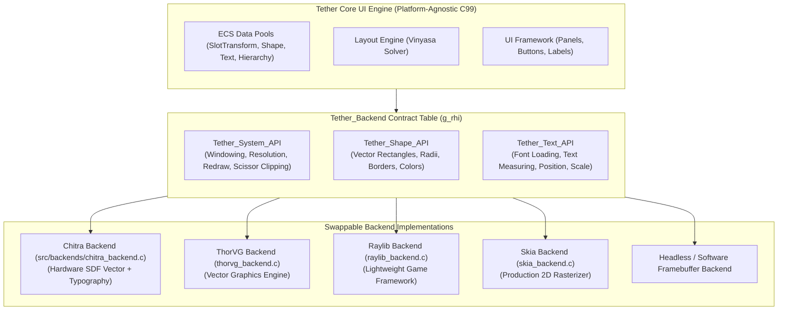
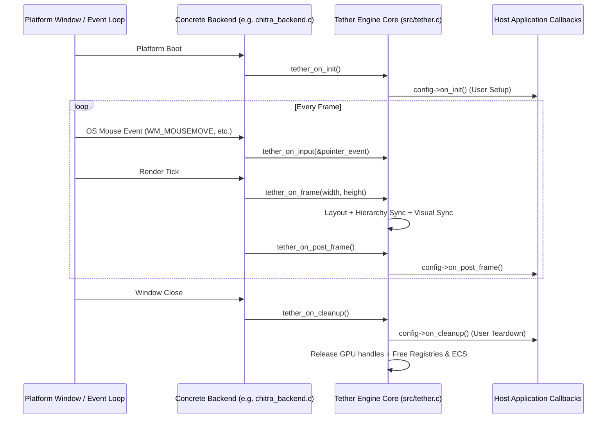
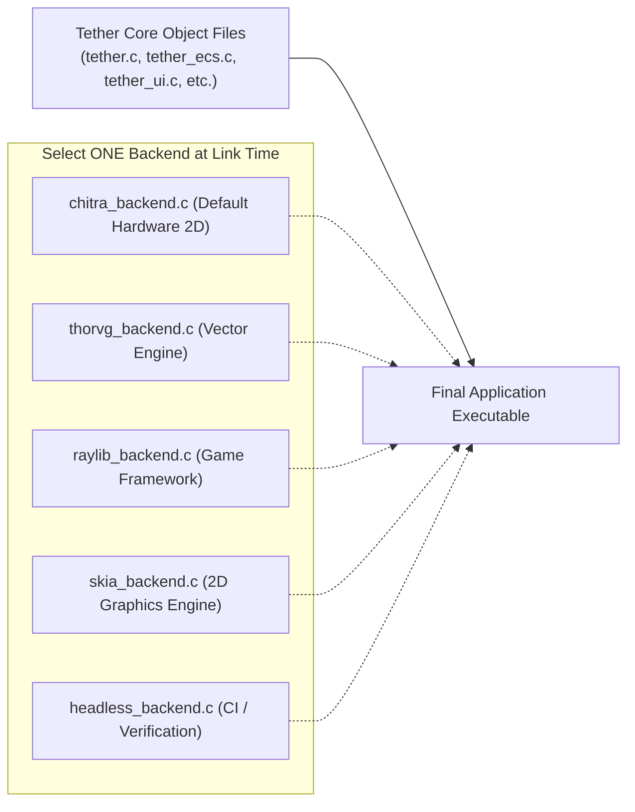

# Chapter 07: Backend Interfaces

[<- Previous: Chapter 06 - Vinyasa Layout System](06_vinyasa_layout.md) | [Documentation Master Index](../index.md) | [Next: Chapter 08 - Chitra Rendering System ->](08_chitra_rendering.md)

---

## 1. Executive Summary

Tether is architected as an embeddable, universal UI engine. The core engine (`src/core/`, `src/engine/`, `src/ui/`) contains zero references to platform-specific windowing headers (`<windows.h>`, `<X11/Xlib.h>`, `<emscripten.h>`) and zero direct dependencies on concrete graphics libraries or GPU APIs.

Instead, Tether defines an abstract **Backend Interface** contract in `include/tether/backends/tether_backend.h`. 

Any rendering engine and windowing toolkit can serve as a Tether backend:
- **Rendering Engines**: Chitra (`chitra_backend.c`), ThorVG (`thorvg_backend.c`), Raylib (`raylib_backend.c`), Skia (`skia_backend.c`), or a custom software rasterizer.
- **Windowing & Platform Frameworks**: SDL3, Sokol, GLFW, WebAssembly (Emscripten Canvas), or bare-metal embedded framebuffers.

This chapter details the `Tether_Backend` interface table (`g_rhi`), its three subsystem APIs (`system`, `shape`, `text`), the engine lifecycle execution hooks, and the step-by-step process of implementing and linking custom backends.

---

## 2. The Master Backend Contract (`tether_backend.h`)

All communication between the Tether core engine and external hardware passes through a single unified struct:

```c
typedef struct {
    Tether_System_API* system;
    Tether_Shape_API*  shape;
    Tether_Text_API*   text;
} Tether_Backend;

extern Tether_Backend g_backend;
#define g_rhi g_backend
```



---

## 3. The System API Table (`Tether_System_API`)

The `Tether_System_API` manages application execution, display geometry, redraw signaling, and compositing:

```c
typedef struct {
    void (*run)(Tether_Config* config);

    /* Physical window dimensions in pixels (w, h) */
    void (*get_size)(uint32_t* out_w, uint32_t* out_h);

    /* Resolution control (0, 0 matches window size) */
    void (*set_resolution)(uint32_t res_x, uint32_t res_y);
    void (*get_resolution)(uint32_t* out_x, uint32_t* out_y);

    /* Signals the backend that retained state changed and must be presented */
    void (*mark_dirty)(void);

    /* Scissor clip region management */
    uint16_t (*register_clip)(int x, int y, int w, int h);
    void     (*update_clip)(uint32_t handle, int x, int y, int w, int h);
    uint16_t (*clip_intersect)(uint16_t parent_clip, int x, int y, int w, int h);
    uint16_t (*clip_intersect_to)(uint16_t existing_clip_id, uint16_t parent_clip, int x, int y, int w, int h);

    /* Element compositing properties */
    void     (*set_draw_order)(uint32_t handle, uint32_t draw_order);
    void     (*set_clip)(uint32_t handle, uint16_t clip_id);
    uint16_t (*get_clip_id)(uint32_t handle);
    void     (*release_clip)(uint32_t handle);

    bool (*is_alive)(uint32_t handle);
    void (*set_alive)(uint32_t handle, bool alive);
} Tether_System_API;
```

### Key Responsibilities
- **`run(Tether_Config* config)`**: Enters the platform-specific event loop, opens the native OS window (via SDL3, GLFW, Sokol, or native Win32/X11), initializes graphics contexts, and drives frame ticks.
- **`mark_dirty()`**: Notifies the hardware presenter that visual properties changed, scheduling a frame presentation. If not marked dirty, the backend can sleep to save power.
- **`clip_intersect_to()`**: Intersects a parent scissor region with a child rectangle in-place, updating hardware scissor registers without heap allocations.
- **`set_draw_order()`**: Binds a monotonic integer Z-index to a shape or text handle, ensuring deterministic rendering order.

---

## 4. The Shape API Table (`Tether_Shape_API`)

The `Tether_Shape_API` manages vector geometry primitives:

```c
typedef struct {
    uint32_t (*create)(void);
    void     (*destroy)(uint32_t handle);
    bool     (*is_alive)(uint32_t handle);

    bool     (*set_bounds)(uint32_t handle, float x, float y, float w, float h);
    bool     (*set_radius)(uint32_t handle, float radius);
    bool     (*set_border)(uint32_t handle, float border_width);
    bool     (*set_color)(uint32_t handle, uint32_t fill_color, uint32_t border_color);
    bool     (*set_fill_color)(uint32_t handle, uint32_t fill_color);
    bool     (*set_border_color)(uint32_t handle, uint32_t border_color);
    bool     (*set_opacity)(uint32_t handle, float opacity);
    bool     (*set_rotation)(uint32_t handle, float origin_x, float origin_y, float angle_rad);
} Tether_Shape_API;
```

### Key Responsibilities
- **Handle Lifecycle**: Handles are lightweight 32-bit integer keys. Calling `create()` allocates a visual element in the backend; calling `destroy()` marks it for recycling.
- **Fine-Grained Property Mutators**: Tether avoids regenerating geometry meshes when styles update. Changing a corner radius or fill color modifies uniform parameters or instance buffers directly via `set_radius` or `set_color`.
- **GPU-Side Rotation**: `set_rotation` takes an explicit rotation center (`origin_x, origin_y`) calculated from `SlotTransform` and `RenderTransform.render_pivot`, rotating shapes around their center without CPU vertex mathematics.

---

## 5. The Text API Table (`Tether_Text_API`)

The `Tether_Text_API` manages typography, font metrics, and text presentation:

```c
typedef struct {
    int      (*load_font)(const char* name, const char* path);
    void     (*unload_font)(int font_id);
    void     (*measure_text)(const char* text, uint32_t font_id, float size,
                             float wrap_width, float* out_w, float* out_h);

    uint32_t (*create)(void);
    void     (*destroy)(uint32_t handle);
    bool     (*is_alive)(uint32_t handle);

    bool     (*set_text)(uint32_t handle, uint32_t font_id, float size,
                         const char* text, float wrap_width, float x, float y);
    bool     (*set_color)(uint32_t handle, uint32_t color);
    bool     (*set_pos)(uint32_t handle, float x, float y);
    bool     (*set_opacity)(uint32_t handle, float opacity);
    bool     (*set_rotation)(uint32_t handle, float origin_x, float origin_y, float angle_rad);
    bool     (*set_scale)(uint32_t handle, float origin_x, float origin_y, float scale_x, float scale_y);
    bool     (*get_bounds)(uint32_t handle, float* out_w, float* out_h);
} Tether_Text_API;
```

### Key Responsibilities
- **Decoupled Measurement**: `measure_text()` allows the layout engine to calculate exact string bounds before deciding element positioning.
- **In-Place Position Translation**: When an element translates during layout reflow without modifying its text string, calling `set_pos()` updates the screen offset in $O(1)$ time without re-rasterizing glyphs.

---

## 6. Engine Lifecycle Hooks and Execution Flow

Tether exports five standardized hook functions in `include/tether/tether.h` that concrete platform backends invoke to drive the engine:

```c
void  tether_on_init(void);
void* tether_on_frame(int width, int height);
void  tether_on_post_frame(void);
void  tether_on_cleanup(void);
void  tether_on_input(const Tether_Pointer_Event* event);
```



### Hook Responsibilities

1. **`tether_on_init()`**:
   Initializes the ECS kernel, dual roots (`main_root`, `overlay_root`), the Central Registry, and registers built-in widgets (`Panel`, `Text`, `Button`). Finally, it invokes the user's `config->on_init` callback.
2. **`tether_on_frame(width, height)`**:
   The primary engine frame loop. Evaluates layout reflows, recomputes global Z-indices and scissor clipping slots, synchronizes dirty visual handles with `g_rhi`, flushes dirty tags, and marks the frame dirty if rendering is required.
3. **`tether_on_post_frame()`**:
   Invoked immediately after rendering synchronization completes, giving host applications a deterministic hook to update animations, query layout results, or poll network states.
4. **`tether_on_input(event)`**:
   Receives normalized pointer down, up, and move events from the host window, executing spatial hit testing and dispatching registered click callbacks.
5. **`tether_on_cleanup()`**:
   Executes clean shutdown in reverse order: user `config->on_cleanup` runs, GPU handles are unrealized, and the ECS memory pools are freed.

---

## 7. Swapping Backends at Compile/Link Time

Because Tether interacts with graphics hardware exclusively through `g_rhi`, replacing Chitra with another backend (such as ThorVG, Raylib, Skia, an SDL3 GPU renderer, or a headless testing stub) requires zero modifications to Tether core source files.



### Implementing a Custom Backend

To implement a new backend:
1. Provide a single C translation unit (e.g., `thorvg_backend.c` or `raylib_backend.c`).
2. Implement the function pointers for `Tether_System_API`, `Tether_Shape_API`, and `Tether_Text_API`.
3. Export the global `Tether_Backend g_backend` symbol:

```c
#include "tether/backends/tether_backend.h"

static Tether_System_API my_sys = { ... };
static Tether_Shape_API  my_shape = { ... };
static Tether_Text_API   my_text = { ... };

Tether_Backend g_backend = {
    .system = &my_sys,
    .shape  = &my_shape,
    .text   = &my_text,
};
```

4. In your CMake build definition, link your custom backend file instead of `src/backends/chitra_backend.c`:

```cmake
# Building Tether with ThorVG backend
add_library(tether_thorvg STATIC
    src/tether.c
    src/core/tether_ecs.c
    src/core/tether_registry.c
    src/engine/tether_engine.c
    src/engine/tether_layout.c
    src/ui/tether_ui.c
    src/ui/tether_widgets.c
    src/backends/thorvg_backend.c # Replaces chitra_backend.c
)
```

The resulting binary runs with 100% feature parity, running identical layout algorithms, widget factories, and input event dispatchers across any hardware platform.

---

[<- Previous: Chapter 06 - Vinyasa Layout System](06_vinyasa_layout.md) | [Documentation Master Index](../index.md) | [Next: Chapter 08 - Chitra Rendering System ->](08_chitra_rendering.md)
