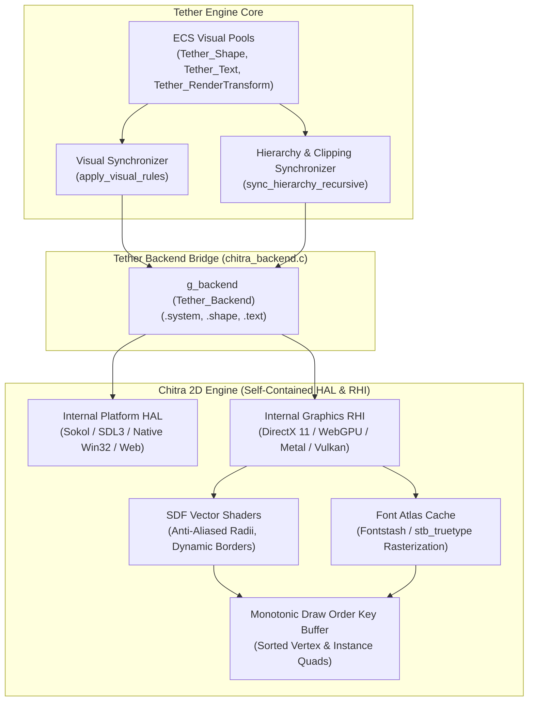
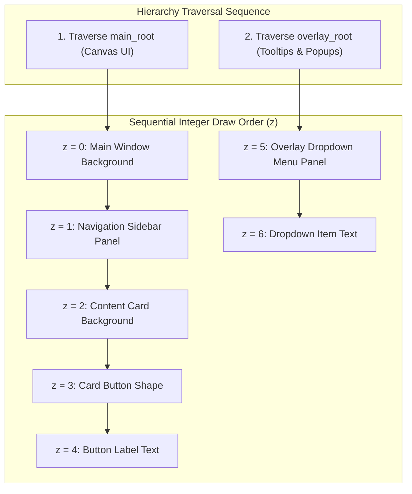
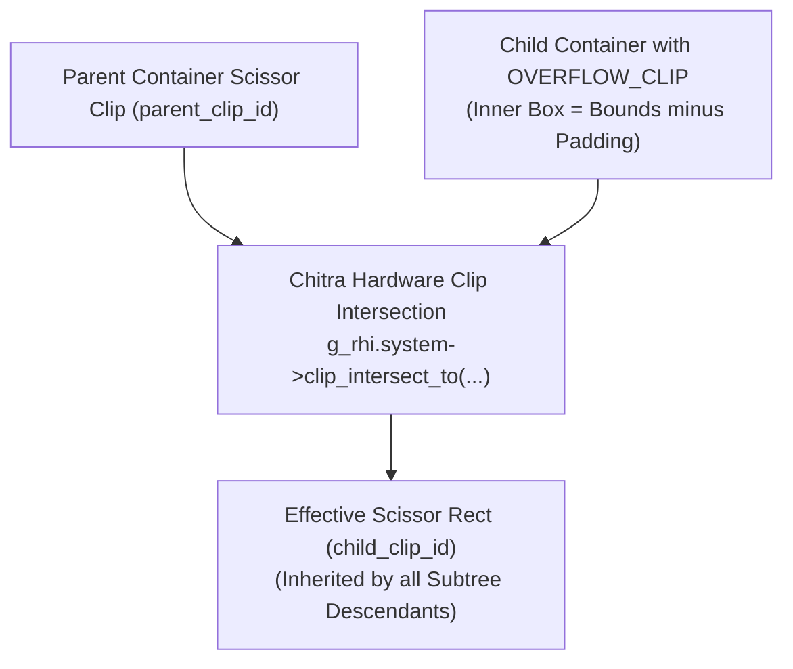
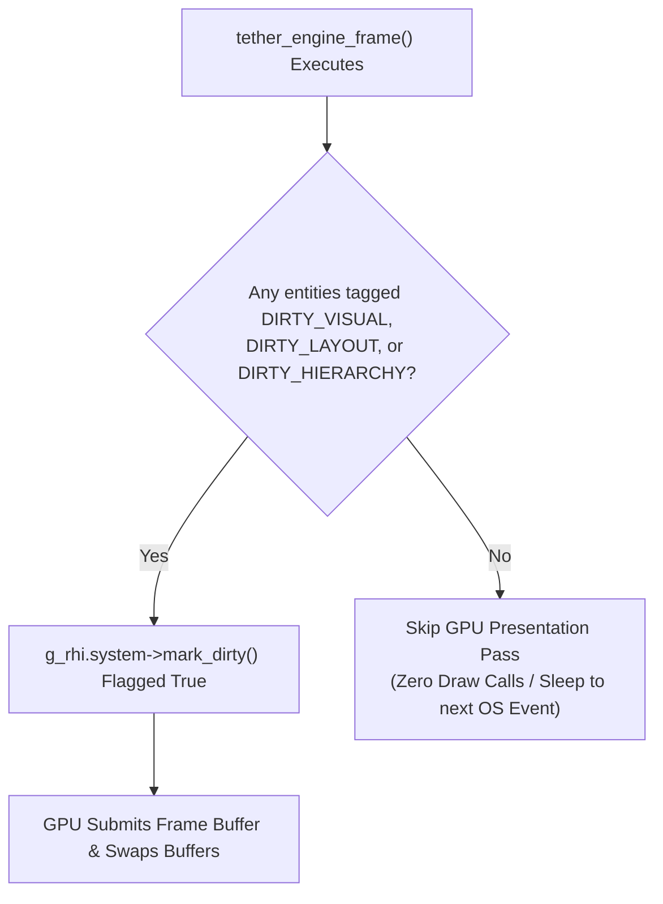

# Chapter 08: Chitra Rendering System

[<- Previous: Chapter 07 - Backend Interfaces](07_backend_interfaces.md) | [Documentation Master Index](../index.md) | [Next: Chapter 09 - Input and Event System ->](09_input_and_events.md)

---

## 1. Executive Summary

While Tether's abstract backend contract allows swapping in renderers like ThorVG, Raylib, or Skia, Tether's primary and default production backend is **Chitra** (`src/backends/chitra_backend.c`).

Chitra is a lightweight, hardware-accelerated 2D GPU rendering engine. Internally, Chitra encapsulates its own Hardware Abstraction Layer (HAL) and Rendering Hardware Interface (RHI):
- **Windowing & Platform Integration**: Chitra can bind to Sokol, SDL3, or native platform windowing contexts.
- **GPU API-Agnostic Rasterization**: Chitra drives modern graphics APIs directly, including DirectX 11, WebGPU, Metal, and Vulkan.

This chapter details the internal graphics architecture of the Chitra backend:
1. **Retained GPU Primitives**: Signed Distance Field (SDF) vector rasterization for rounded rectangles and borders.
2. **Typography Pipeline**: Dynamic glyph atlas caching, font metrics, and text wrapping.
3. **Visual State Synchronization (`apply_visual_rules`)**: Pushing layout bounds, presentation transforms, and state-based auto-luminance colors into backend handles.
4. **Deterministic Compositing & Global Z-Order**: Monotonic Z-order keys generated by traversing `main_root` followed by `overlay_root`.
5. **Hierarchical Scissor Clipping**: $O(1)$ in-place clipping intersection rectangles (`clip_intersect_to`).
6. **Redraw Throttling**: Zero-power idling when interfaces are static.

---

## 2. Architectural Overview of the Chitra Backend



---

## 3. Retained GPU Primitives and SDF Vector Shading

Unlike immediate-mode graphics toolkits that rebuild vertex buffers from scratch every frame, Chitra operates on **retained GPU handles**:

```c
typedef struct Tether_Shape {
    uint32_t handle;           /* Allocated GPU shape handle */
    Tether_Color bg_color;     /* Background fill color */
    Tether_Color border_color; /* Outer border color */
    float border_width;        /* Border stroke thickness */
    Tether_Edges border_radius;/* Per-corner radii */
} Tether_Shape;

typedef struct {
    uint32_t handle;           /* Allocated GPU text handle */
    float font_size;           /* Typography scale */
    uint32_t font_id;          /* 0-based font index */
    Tether_FontStyle font_style;
    Tether_Align align_x;
    Tether_Align align_y;
    float wrap_width;          /* Line wrap threshold */
    Tether_Color color;        /* Text fill color */
    Tether_Vec2 intrinsic_size;/* Cached layout bounds */
} Tether_Text;
```

### 1. Shape Pipeline (Signed Distance Fields)
Chitra renders panels, buttons, cards, and input backgrounds using hardware Signed Distance Field (SDF) shaders:
- **Sub-Pixel Smoothness**: Rectangles with rounded corners (`border_radius`) maintain mathematically perfect, anti-aliased edges regardless of display scaling or viewport resolution.
- **Dynamic Corner Radii & Borders**: Modifying corner radius or border thickness is a lightweight uniform update (`set_radius`, `set_border`) rather than a costly CPU re-tessellation of triangle fans.
- **In-Place Transformation**: Translating, scaling, or rotating a shape updates its transformation matrix or instance data directly on the GPU.

### 2. Typography and Glyph Atlas Pipeline
Text rendering in Chitra leverages dynamic glyph atlas caching:
- **Font Rasterization**: TTF/OTF fonts are loaded once via `g_rhi.text->load_font()` and mapped to 0-based integer IDs.
- **Sub-String Re-measurement Avoidance**: Text strings with static content update position via `g_rhi.text->set_pos(handle, x, y)` without re-evaluating glyph layout or re-uploading texture data.
- **Text Wrapping**: If an assigned bounding box constrains the text, Chitra calculates multi-line glyph offsets in a single pass.

---

## 4. Visual Synchronization (`apply_visual_rules`)

During the visual update stage of `tether_engine_frame()`, the engine iterates through all entities tagged with `TETHER_COMPONENT_DIRTY_VISUAL` and executes `apply_visual_rules(entity)`:

```c
static void apply_visual_rules(Tether_GUID id) {
    Tether_SlotTransform* st = tether_ecs_get_component(id, TETHER_COMPONENT_SLOT_TRANSFORM);
    Tether_RenderTransform* rt = tether_ecs_get_component(id, TETHER_COMPONENT_RENDER_TRANSFORM);
    Tether_Visibility* vis = tether_ecs_get_component(id, TETHER_COMPONENT_VISIBILITY);
    Tether_Shape* shape = tether_ecs_get_component(id, TETHER_COMPONENT_SHAPE);
    Tether_Text* text = tether_ecs_get_component(id, TETHER_COMPONENT_TEXT);

    int is_hidden = vis && (vis->computed_state == TETHER_HIDDEN || vis->computed_state == TETHER_COLLAPSED);
    float opacity = rt ? rt->opacity : 1.0f;

    /* --- SHAPE COMPONENT SYNCHRONIZATION --- */
    if (shape && g_rhi.shape->is_alive(shape->handle)) {
        if (is_hidden) {
            g_rhi.shape->set_opacity(shape->handle, 0.0f);
        } else {
            float x = st ? st->x : 0.0f;
            float y = st ? st->y : 0.0f;
            float w = st ? st->width : 0.0f;
            float h = st ? st->height : 0.0f;

            /* Apply GPU Presentation Transforms without altering layout SlotTransform */
            if (rt) {
                x += rt->translation_x;
                y += rt->translation_y;
                w *= rt->scale_x;
                h *= rt->scale_y;
            }

            Tether_Color bg = resolve_color(id, shape->bg_color);
            Tether_Color bc = resolve_color(id, shape->border_color);

            g_rhi.shape->set_bounds(shape->handle, x, y, w, h);
            g_rhi.shape->set_radius(shape->handle, shape->border_radius.top);
            g_rhi.shape->set_border(shape->handle, shape->border_width);
            g_rhi.shape->set_color(shape->handle, pack_color(bg, opacity), pack_color(bc, opacity));

            if (rt && rt->rotation_deg != 0.0f) {
                float origin_x = x + w * rt->render_pivot.x;
                float origin_y = y + h * rt->render_pivot.y;
                float angle_rad = rt->rotation_deg * (3.14159265f / 180.0f);
                g_rhi.shape->set_rotation(shape->handle, origin_x, origin_y, angle_rad);
            }
        }
    }
}
```

### Color Packing and Luminance Resolution
Colors in Tether are packed into standard 32-bit integer formats (`0xAABBGGRR`) scaled by effective opacity:

```c
static inline uint32_t pack_color(Tether_Color c, float opacity) {
    uint8_t a = (uint8_t)(c.a * opacity);
    return ((uint32_t)c.r) | (((uint32_t)c.g) << 8) | (((uint32_t)c.b) << 16) | (((uint32_t)a) << 24);
}
```

When interactive buttons transition states, `resolve_color()` dynamically modifies the background fill:
- **`TETHER_COLOR_MODE_AUTO`**:
  - Hover: Increases RGB channels by $+30$ (clamped to $255$).
  - Press: Decreases RGB channels by $-30$ (clamped to $0$).
- **`TETHER_COLOR_MODE_MANUAL`**: Emits explicitly designated `hover_color` or `press_color`.

---

## 5. Compositing and Global Draw Order (Z-Indexing)

In traditional UI frameworks, determining draw order requires sorting deep hierarchical node arrays or managing manual Z-index integer layers that inevitably conflict. 

Tether eliminates sorting overhead by generating **monotonic sequential draw order keys** during tree synchronization (`sync_hierarchy_recursive`):



### Structural Overlay Layering
Because `sync_hierarchy_recursive()` traverses `main_root` completely before visiting `overlay_root`:
1. The integer draw order counter `current_z` advances monotonically through all standard UI widgets.
2. When traversal reaches `overlay_root`, `current_z` continues from the exact number where the main scene finished.
3. Every element in the overlay tree is structurally guaranteed to render on top of the main UI, eliminating Z-fighting and dropdown clipping bugs without artificial Z-index layers.

---

## 6. Hierarchical Scissor Clipping

Nested UI containers frequently require clipping their content (e.g., scrollable lists, modal dialogue bounds, or masked card views).

Tether coordinates hardware scissor clipping via the `Tether_Overflow` component and `g_rhi.system->clip_intersect_to()`:



### $O(1)$ In-Place Scissor Updates
When a container with `TETHER_OVERFLOW_CLIP` updates its geometry during layout:
1. **Inner Content Box**: The engine computes the inner clipping bounds by subtracting container padding from `SlotTransform`.
2. **Handle Sort Key Inspection**: Rather than allocating a new clipping slot every frame, the engine queries the existing clip ID from the first child's sort key in $O(1)$ time (`g_rhi.system->get_clip_id(first_child_handle)`).
3. **In-Place Intersection**: `clip_intersect_to()` recalculates the intersected bounding rectangle in-place within Chitra's GPU clip table.
4. All descendant draw calls reference the intersected clip ID, guaranteeing pixel-perfect nested clipping with zero allocation overhead.

---

## 7. Performance and Redraw Throttling

User interfaces spend the vast majority of their operational lifetime idling (waiting for user input or background asynchronous data). Continuous 60+ FPS rendering of static interfaces wastes GPU power and drains battery life on mobile or embedded devices.

Chitra coordinates with Tether's invalidation system to achieve **zero-power idling**:



- When the UI is static and pointer events produce no hover transitions, `tether_engine_frame()` flushes zero draw calls and returns `false`.
- The host window adapter sleeps or throttles its render loop until a hardware input interrupt or application data notification arrives.
- When animations or interactions occur, Tether marks `mark_dirty()`, and Chitra presents updated vertex buffers with sub-millisecond latency.

---

[<- Previous: Chapter 07 - Backend Interfaces](07_backend_interfaces.md) | [Documentation Master Index](../index.md) | [Next: Chapter 09 - Input and Event System ->](09_input_and_events.md)
