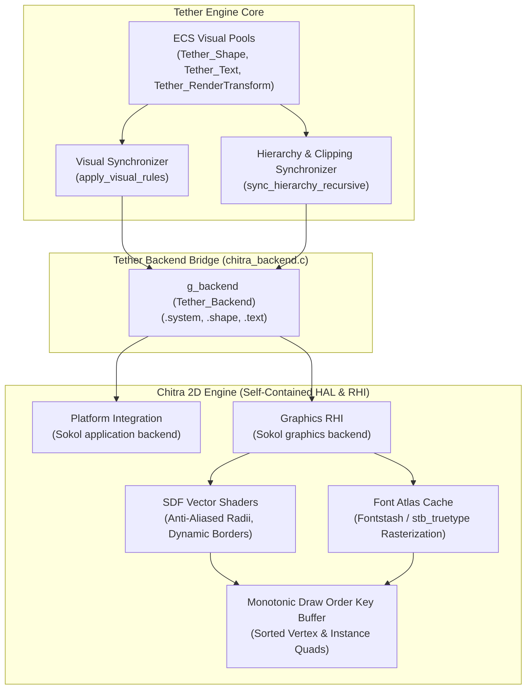
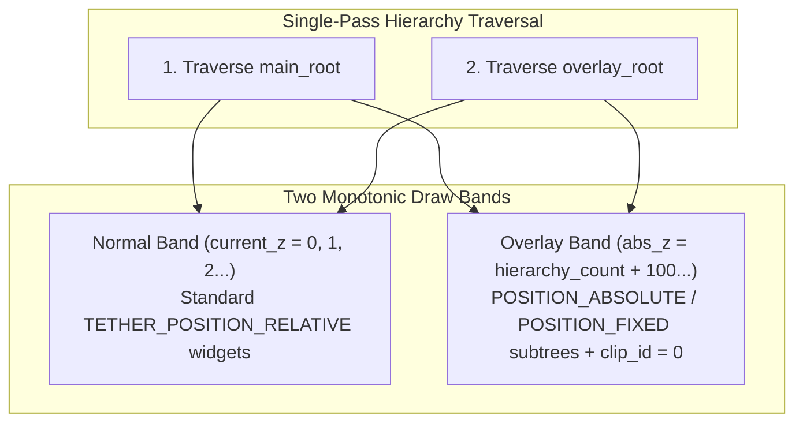
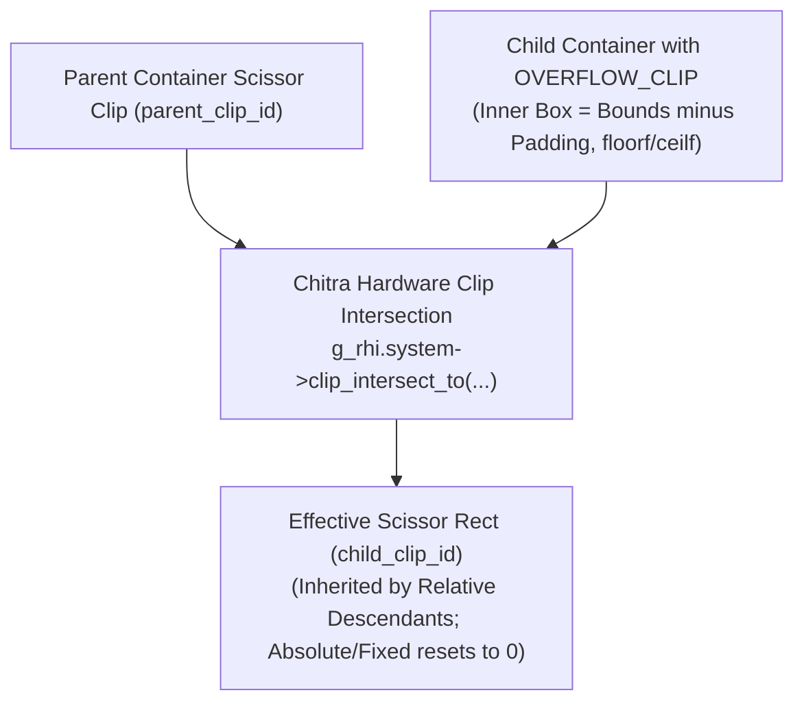
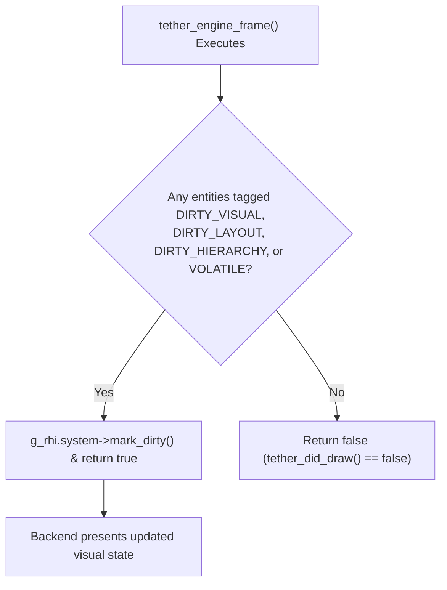

# Chapter 08: Chitra Rendering System

[<- Previous: Chapter 07 - Backend Interfaces](07_backend_interfaces.md) | [Documentation Master Index](../index.md) | [Next: Chapter 09 - Input and Event System ->](09_input_and_events.md)

---

## 1. Executive Summary

Tether's backend contract can support additional adapters. The current default adapter uses **Chitra** (`src/backends/chitra_backend.c`); other adapters require implementation and validation.

Chitra is a lightweight, hardware-accelerated 2D GPU rendering engine. Internally, Chitra encapsulates its own Hardware Abstraction Layer (HAL) and Rendering Hardware Interface (RHI):
- **Windowing & Platform Integration**: The bundled backend uses Sokol for its application loop and graphics integration.
- **Graphics APIs**: The selected Sokol backend depends on the build and platform; the preview CI currently validates Windows.

This chapter details the internal graphics architecture of the Chitra backend:
1. **Retained GPU Primitives**: Signed Distance Field (SDF) vector rasterization for rounded rectangles and borders.
2. **Typography Pipeline**: Dynamic glyph atlas caching, font metrics, and text wrapping.
3. **Visual State Synchronization (`apply_visual_rules`)**: Pushing layout bounds, presentation transforms, and widget-driven `active_bg`/`active_border` state colors into backend handles.
4. **Compositing & Single-Pass Z-Ordering**: Monotonic Z-order keys (`current_z`) with an upper overlay band (`abs_z`) for `ABSOLUTE`/`FIXED` subtrees and `overlay_root`.
5. **Hierarchical Scissor Clipping**: $O(1)$ in-place clipping intersection rectangles (`clip_intersect_to`) with pixel-aligned `floorf`/`ceilf` bounds and automatic `clip = 0` escape for overlay/absolute subtrees.
6. **Redraw Decisions**: Tether can skip requesting a redraw when no redraw is needed. Idle power depends on the host and backend.

---

## 2. Architectural Overview of the Chitra Backend



---

## 3. Retained GPU Primitives and SDF Vector Shading

Unlike immediate-mode graphics toolkits that rebuild vertex buffers from scratch every frame, Chitra operates on **retained GPU handles**:

```c
typedef struct Tether_Shape {
    uint32_t handle;           /* Allocated GPU shape handle */
    Tether_Color bg_color;     /* Base background fill color */
    Tether_Color border_color; /* Base outer border color */
    Tether_Color active_bg;    /* Transient hover/press fill override */
    Tether_Color active_border;/* Transient hover/press border override */
    float border_width;        /* Border stroke thickness */
    Tether_Edges border_radius;/* Per-corner radii */
} Tether_Shape;

typedef struct {
    uint32_t handle;           /* Allocated GPU text handle */
    float font_size;           /* Typography scale */
    uint32_t font_id;          /* 0-based font index */
    Tether_FontStyle font_style;
    Tether_Align align_x;
    Tether_Align align_y;
    float wrap_width;          /* Line wrap threshold */
    Tether_Color color;        /* Text fill color */
    Tether_Vec2 intrinsic_size;/* Cached layout bounds */
} Tether_Text;
```

### 1. Shape Pipeline (Signed Distance Fields)
Chitra renders panels, buttons, cards, and input backgrounds using hardware Signed Distance Field (SDF) shaders:
- **Rounded Shapes**: The shader evaluates rounded rectangles and borders, including edge smoothing.
- **Dynamic Corner Radii & Borders**: `set_radius` and `set_border` update values in the shape's CPU-side vertices.
- **Transforms**: Bounds and rotation setters update CPU-side vertex positions; the resulting geometry is submitted to the renderer.

### 2. Typography and Glyph Atlas Pipeline
Text rendering in Chitra leverages dynamic glyph atlas caching:
- **Font Rasterization**: TTF/OTF fonts are loaded once via `g_rhi.text->load_font()` and mapped to 0-based integer IDs.
- **Sub-String Re-measurement Avoidance**: Text strings with static content update position via `g_rhi.text->set_pos(handle, x, y)` without re-evaluating glyph layout or re-uploading texture data.
- **Text Wrapping**: If an assigned bounding box constrains the text, Chitra calculates multi-line glyph offsets in a single pass.

---

## 4. Visual Synchronization (`apply_visual_rules`)

During the visual update stage of `tether_engine_frame()`, the engine iterates through all entities tagged with `TETHER_COMPONENT_DIRTY_VISUAL` and executes `apply_visual_rules(entity)`:

```c
static void apply_visual_rules(Tether_GUID id) {
    Tether_SlotTransform* st = tether_ecs_get_component(id, TETHER_COMPONENT_SLOT_TRANSFORM);
    Tether_RenderTransform* rt = tether_ecs_get_component(id, TETHER_COMPONENT_RENDER_TRANSFORM);
    Tether_Visibility* vis = tether_ecs_get_component(id, TETHER_COMPONENT_VISIBILITY);
    Tether_Shape* shape = tether_ecs_get_component(id, TETHER_COMPONENT_SHAPE);
    Tether_Text* text = tether_ecs_get_component(id, TETHER_COMPONENT_TEXT);

    int is_hidden = vis && (vis->computed_state == TETHER_HIDDEN || vis->computed_state == TETHER_COLLAPSED);
    float opacity = rt ? rt->opacity : 1.0f;

    /* --- SHAPE COMPONENT SYNCHRONIZATION --- */
    if (shape && g_rhi.shape->is_alive(shape->handle)) {
        if (is_hidden) {
            g_rhi.shape->set_opacity(shape->handle, 0.0f);
        } else {
            float x = st ? st->x : 0.0f;
            float y = st ? st->y : 0.0f;
            float w = st ? st->width : 0.0f;
            float h = st ? st->height : 0.0f;

            /* Apply GPU Presentation Transforms without altering layout SlotTransform */
            if (rt) {
                x += rt->translation_x;
                y += rt->translation_y;
                w *= rt->scale_x;
                h *= rt->scale_y;
            }

            Tether_Color fill_c   = (shape->active_bg.a != 0)     ? shape->active_bg     : shape->bg_color;
            Tether_Color border_c = (shape->active_border.a != 0) ? shape->active_border : shape->border_color;

            g_rhi.shape->set_bounds(shape->handle, x, y, w, h);
            g_rhi.shape->set_radius(shape->handle, shape->border_radius.top);
            g_rhi.shape->set_border(shape->handle, shape->border_width);
            g_rhi.shape->set_color(shape->handle, pack_color(fill_c, opacity), pack_color(border_c, opacity));

            if (rt) {
                float origin_x = x + w * rt->render_pivot.x;
                float origin_y = y + h * rt->render_pivot.y;
                float angle_rad = rt->rotation_deg * (3.14159265358979323846f / 180.0f);
                g_rhi.shape->set_rotation(shape->handle, origin_x, origin_y, angle_rad);
            }
        }
    }
}
```

### Color Packing and Widget-Driven Active Overrides
Colors in Tether are packed into standard 32-bit integer formats (`0xAABBGGRR`) scaled by effective opacity:

```c
static inline uint32_t pack_color(Tether_Color c, float opacity) {
    uint8_t a = (uint8_t)(c.a * opacity);
    return ((uint32_t)c.r) | (((uint32_t)c.g) << 8) | (((uint32_t)c.b) << 16) | (((uint32_t)a) << 24);
}
```

Rather than hardcoding color rules inside `tether_engine.c`, interactive widgets respond to `TETHER_EVENT_HOVER_*` and `TETHER_EVENT_PRESS`/`RELEASE` events using helpers (`tether_ui_interaction_offset()`, `tether_ui_adjust_color()`, `tether_ui_set_active_color()`, `tether_ui_reset_active_color()`) to set or clear `shape->active_bg` / `shape->active_border`. When `active_bg.a != 0` (or `active_border.a != 0`), `apply_visual_rules()` submits the active color override; otherwise it falls back to `bg_color` / `border_color`.

---

## 5. Compositing and Single-Pass Z-Ordering

In traditional UI frameworks, determining draw order requires sorting deep hierarchical node arrays or managing error-prone manual Z-index integer layers.

Tether assigns **monotonic sequential draw order keys in a single tree pass** during hierarchy synchronization (`sync_hierarchy_recursive`):



### Single-Pass Overlay Banding (`current_z` and `abs_z`)
`sync_hierarchy_recursive()` maintains two monotonic counters while walking `main_root` and `overlay_root`:
1. **`current_z` (starting at `0`)**: Advances sequentially across standard `TETHER_POSITION_RELATIVE` entities.
2. **`abs_z` (starting at `hierarchies->count + 100`)**: Whenever an entity (or ancestor) uses `TETHER_POSITION_ABSOLUTE` or `TETHER_POSITION_FIXED`, the traversal switches that entire subtree to `abs_z++` and resets `parent_clip_id = 0`.
3. Because `abs_z` starts safely above the maximum number of normal hierarchy nodes, popups, dropdown menus, and floating badges always composite on top of all normal UI cards and escape parent scissor clipping in a **single tree pass**, without reparenting or manually tuning Z-index constants.

---

## 6. Hierarchical Scissor Clipping

Nested UI containers frequently require clipping their content (e.g., dropdown lists, scrollable containers, or masked card views).

Tether coordinates hardware scissor clipping via the `Tether_Overflow` component and `g_rhi.system->clip_intersect_to()`:



### $O(1)$ In-Place Scissor Updates
When a container with `TETHER_OVERFLOW_CLIP` updates its geometry during layout:
1. **Pixel-Aligned Inner Content Box**: The engine subtracts container padding from `SlotTransform` and converts edges with `floorf` (top/left) and `ceilf` (right/bottom) to prevent sub-pixel clipping artifacts on fractional DPI scales.
2. **Handle Sort Key Inspection**: Rather than allocating a new clipping slot every frame, the engine reads the existing clip ID from the first child's handle sort key in $O(1)$ time (`g_rhi.system->get_clip_id(first_child_handle)`).
3. **In-Place Intersection**: `clip_intersect_to()` recalculates the intersected bounding rectangle in-place within Chitra's GPU clip table.
4. Relative descendant draw calls reference the intersected clip ID, while `TETHER_POSITION_ABSOLUTE` / `TETHER_POSITION_FIXED` subtrees reset `parent_clip_id = 0` to escape parent bounds cleanly.

---

## 7. Performance and Redraw Throttling

Tether avoids redundant engine draw work on static UI frames through `DIRTY_*` invalidation tracking:



- When the UI is static (no `VOLATILE` entities and no dirty tags from layout, hierarchy, visuals, or pointer feedback), `tether_engine_frame()` skips redundant sync and returns `false` (`tether_did_draw() == false`).
- Whether the process sleeps or keeps pumping frames depends on how the host window/backend loop acts on `tether_did_draw()` and `mark_dirty()`.
- When animations or interactions occur, Tether marks `mark_dirty()` so Chitra presents updated buffers.

---

[<- Previous: Chapter 07 - Backend Interfaces](07_backend_interfaces.md) | [Documentation Master Index](../index.md) | [Next: Chapter 09 - Input and Event System ->](09_input_and_events.md)
