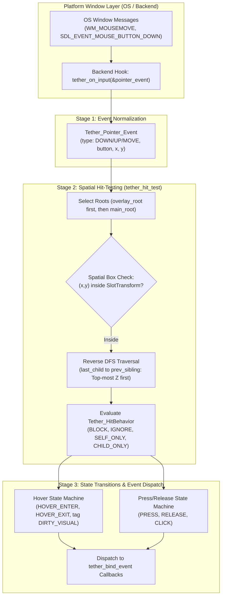
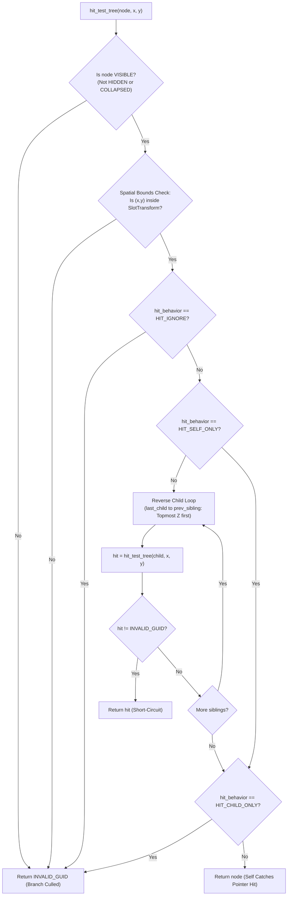

# Chapter 09: Input and Event System

[<- Previous: Chapter 08 - Chitra Rendering System](08_chitra_rendering.md) | [Documentation Master Index](../index.md) | [Next: Chapter 10 - UI Definitions, Parsing, and Compilation ->](10_ui_definitions_and_parsing.md)

---

## 1. Executive Summary

User interfaces are fundamentally reactive. When a user clicks a button, drags a slider, or hovers over a menu, raw platform events must be translated into spatial queries, state machine transitions, visual updates, and application callbacks.

Tether decouples input processing from OS-specific windowing loops through a three-stage pipeline:
1. **Event Normalization**: Native platform window messages (Win32, SDL3, WebAssembly) are converted into normalized `Tether_Pointer_Event` structures.
2. **Hierarchical Spatial Query (`tether_hit_test`)**: A reverse depth-first search (DFS) with $O(1)$ bounding box culling traverses the scene tree, respecting hit behaviors and Z-index stacking order.
3. **State Transition & Event Dispatch (`tether_input_process_event`)**: The engine tracks active hover and press states, auto-flags visual dirty tags for luminance transitions, and dispatches registered event callbacks.

This chapter details the input data structures, the spatial culling algorithm, interaction components (`Tether_Interactable`), event callback bindings (`tether_bind_event`), and future focus/keyboard architecture.

---

## 2. Input Architecture Pipeline



---

## 3. Normalized Input Events (`include/tether/core/tether_input.h`)

Tether shields application logic from platform-dependent event structures by defining a clean, normalized pointer model:

```c
typedef enum {
    TETHER_POINTER_DOWN = 0,
    TETHER_POINTER_UP,
    TETHER_POINTER_MOVE
} Tether_Pointer_EventType;

typedef enum {
    TETHER_MOUSE_BUTTON_LEFT = 0,
    TETHER_MOUSE_BUTTON_RIGHT,
    TETHER_MOUSE_BUTTON_MIDDLE,
    TETHER_MOUSE_BUTTON_NONE
} Tether_MouseButton;

typedef struct Tether_Pointer_Event {
    Tether_Pointer_EventType type;
    Tether_MouseButton button;
    float x;
    float y;
} Tether_Pointer_Event;
```

### Feeding Events into the Engine
Concrete platform backends forward input events directly into Tether via the hook function:

```c
void tether_on_input(const Tether_Pointer_Event* event);
```

For example, in `src/backends/chitra_backend.c`, native Chitra window events are mapped cleanly into `Tether_Pointer_Event`:
```c
static void on_event(const Chitra_InputEvent* e) {
    if (e->type == CHITRA_EVENT_MOUSE_DOWN ||
        e->type == CHITRA_EVENT_MOUSE_UP   ||
        e->type == CHITRA_EVENT_MOUSE_MOVE) {

        Tether_Pointer_Event pe = {0};
        if      (e->type == CHITRA_EVENT_MOUSE_DOWN) pe.type = TETHER_POINTER_DOWN;
        else if (e->type == CHITRA_EVENT_MOUSE_UP)   pe.type = TETHER_POINTER_UP;
        else                                          pe.type = TETHER_POINTER_MOVE;

        pe.x = e->mouse_x;
        pe.y = e->mouse_y;
        pe.button = (e->button == 0) ? TETHER_MOUSE_BUTTON_LEFT :
                    (e->button == 1) ? TETHER_MOUSE_BUTTON_RIGHT :
                    (e->button == 2) ? TETHER_MOUSE_BUTTON_MIDDLE : TETHER_MOUSE_BUTTON_NONE;

        tether_on_input(&pe);
    }
}
```

---

## 4. Hierarchical Spatial Query (`tether_hit_test`)

Given arbitrary screen coordinates $(x, y)$, the engine must identify the exact topmost entity located under the cursor. 

Rather than iterating linearly through dense component arrays, Tether executes an optimized **hierarchical tree traversal** (`src/core/tether_input.c`):



### Algorithmic Steps

1. **Reverse Root-Level Iteration**:
   `tether_hit_test(x, y)` queries root entities from the `TETHER_COMPONENT_HIERARCHY` dense pool in reverse order (`overlay_root` first, then `main_root`). This guarantees that floating dropdowns, popups, and tooltips intercept clicks before the underlying canvas.
2. **Early Visibility Pruning**:
   If an entity possesses `Tether_Visibility` with `computed_state` equal to `TETHER_HIDDEN` or `TETHER_COLLAPSED`, the function returns `TETHER_INVALID_GUID` immediately, pruning its entire subtree from evaluation.
3. **$O(1)$ Spatial Bounding Box Culling**:
   The cursor position is tested against `Tether_SlotTransform`:
   ```c
   if (x < st->x || x > st->x + st->width || y < st->y || y > st->y + st->height) {
       return TETHER_INVALID_GUID;
   }
   ```
   If the cursor is outside the node's layout rectangle, the entire subtree is rejected in a single comparison.
4. **Reverse DFS Traversal (Topmost Z-Order First)**:
   Because siblings are drawn in chronological order (first child to last child), the last child has the highest Z-index. The hit tester walks backwards from `h->last_child` along `prev_sibling`, evaluating topmost elements first.
5. **Hit-Behavior Resolution**:
   - `TETHER_HIT_BLOCK` (Default): The element intercepts the pointer event if children did not capture it, stopping propagation to elements behind.
   - `TETHER_HIT_IGNORE`: Transparent pass-through. Pointer clicks pass directly through the element and all of its descendants (used for decorative icons, background panels, or non-interactive text labels).
   - `TETHER_HIT_CHILD_ONLY`: Structural layout containers (such as transparent rows or columns) allow their interactive children to be clicked, but ignore clicks on their empty internal space.
   - `TETHER_HIT_SELF_ONLY`: Captures clicks on the container background, skipping child evaluation.

---

## 5. Interaction State Machine (`Tether_Interactable`)

The interactive lifecycle of widgets is tracked by `Tether_Interactable`:

```c
typedef enum {
    TETHER_HIT_BLOCK = 0,
    TETHER_HIT_IGNORE = 1,
    TETHER_HIT_SELF_ONLY = 2,
    TETHER_HIT_CHILD_ONLY = 3
} Tether_HitBehavior;

typedef enum {
    TETHER_COLOR_MODE_NONE = 0,
    TETHER_COLOR_MODE_AUTO = 1,
    TETHER_COLOR_MODE_MANUAL = 2
} Tether_ColorMode;

typedef struct Tether_Interactable {
    uint8_t is_hovered;
    uint8_t is_pressed;
    uint8_t has_focus;
    
    Tether_HitBehavior hit_behavior;
    
    Tether_ColorMode hover_color_mode;
    Tether_Color hover_color;
    Tether_ColorMode press_color_mode;
    Tether_Color press_color;
} Tether_Interactable;
```

### State Transitions inside `tether_input_process_event`

When pointer events are processed:

#### 1. Hover State Transitions
The engine maintains a static tracker `g_hovered`:
- If the current hit target differs from `g_hovered`:
  - On the previous entity: `old_i->is_hovered = 0`, tags `TETHER_COMPONENT_DIRTY_VISUAL`, and dispatches `TETHER_EVENT_HOVER_EXIT`.
  - On the new entity: `new_i->is_hovered = 1`, tags `TETHER_COMPONENT_DIRTY_VISUAL`, and dispatches `TETHER_EVENT_HOVER_ENTER`.
  - Updates `g_hovered = hit`.

#### 2. Press and Release Transitions
The engine maintains a static tracker `g_pressed`:
- **Pointer Down (Left Button)**:
  - If a valid interactive target is hit, `p->is_pressed = 1`, tags `TETHER_COMPONENT_DIRTY_VISUAL`, and dispatches `TETHER_EVENT_PRESS`.
  - Records `g_pressed = hit`.
- **Pointer Up (Left Button)**:
  - If an entity was pressed, `p->is_pressed = 0`, tags `TETHER_COMPONENT_DIRTY_VISUAL`, and dispatches `TETHER_EVENT_RELEASE`.
  - **Click Resolution**: If the cursor is released over the **exact same entity** that received the pointer down (`g_pressed == hit`), the engine dispatches `TETHER_EVENT_CLICK`.
  - Resets `g_pressed = TETHER_INVALID_GUID`.

---

## 6. Event Binding and Callback Dispatch (`tether_events.h`)

Applications connect business logic to UI events using C function pointers:

```c
typedef enum {
    TETHER_EVENT_HOVER_ENTER,
    TETHER_EVENT_HOVER_EXIT,
    TETHER_EVENT_PRESS,
    TETHER_EVENT_RELEASE,
    TETHER_EVENT_CLICK
} Tether_EventType;

typedef void (*Tether_EventCallback)(Tether_GUID entity, Tether_EventType type, void* user_data);

void tether_bind_event(Tether_GUID entity, Tether_EventType type,
                       Tether_EventCallback callback, void* user_data);
void tether_unbind_event(Tether_GUID entity, Tether_EventType type);
void tether_dispatch_event(Tether_GUID entity, Tether_EventType type);
```

### High-Performance Storage
Event bindings are stored in a compact flat array (`src/core/tether_events.c`):
- **Memory Packing**: Multiple bindings exist contiguously without linked list overhead.
- **Constant-Time Removal**: Unbinding an event utilizes Swap-and-Pop ($O(1)$) deallocation.
- **Direct Dispatch**: When an event fires, `tether_dispatch_event()` iterates the flat array and invokes matching callbacks directly, bypassing deep object-oriented inheritance listener chains.

---

## 7. Future Input Roadmap

Tether's active implementation covers complete pointer interactions. On the active roadmap:
- **Focus Management (`has_focus`)**: Tab-navigation order, directional navigation for game controllers/TV interfaces, and focus trap rings for modal dialogs.
- **Keyboard Text Buffers**: Receiving UTF-8 character input events (`WM_CHAR`, SDL text input), cursor placement, text selection bounds, and clipboard integration.
- **Declarative Function Bindings**: Connecting YAML button markup (`on_click: "submit_form"`) to registered C function pointers via the Central Action Registry.

---

[<- Previous: Chapter 08 - Chitra Rendering System](08_chitra_rendering.md) | [Documentation Master Index](../index.md) | [Next: Chapter 10 - UI Definitions, Parsing, and Compilation ->](10_ui_definitions_and_parsing.md)
