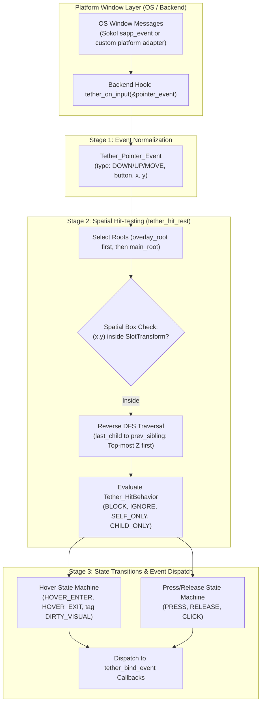
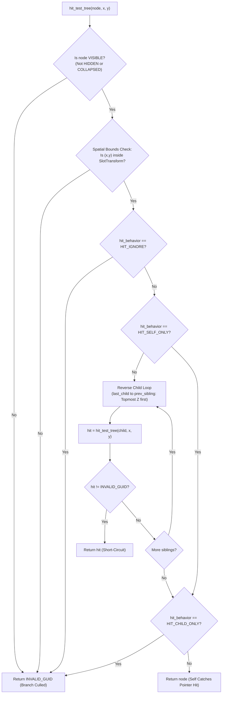

# Chapter 09: Input and Event System

[<- Previous: Chapter 08 - Chitra Rendering System](08_chitra_rendering.md) | [Documentation Master Index](../index.md) | [Next: Chapter 10 - UI Definitions, Parsing, and Compilation ->](10_ui_definitions_and_parsing.md)

---

## 1. Executive Summary

User interfaces are fundamentally reactive. When a user clicks a button, drags a slider, or hovers over a menu, raw platform events must be translated into spatial queries, state machine transitions, visual updates, and application callbacks.

Tether decouples input processing from OS-specific windowing loops through a three-stage pipeline:
1. **Event Normalization**: Native platform window messages (via Sokol `sokol_app` in the bundled Chitra backend, or custom platform adapters) are converted into normalized `Tether_Pointer_Event` structures.
2. **Hierarchical Spatial Query (`tether_hit_test`)**: A reverse depth-first search (DFS) with priority routing (`tether_input_set_route`), disabled-subtree culling (`is_enabled`), bounding-box culling that still descends into `ABSOLUTE`/`FIXED` overlay children, and hit-behavior policies.
3. **State Transition & Event Dispatch (`tether_input_process_event`)**: Tracks hover, press, drag, click, and right-click parent bubbling, and dispatches `Tether_Event` payloads through a reentrant-safe event registry (`tether_bind_event`, `tether_bind_pointer_event`).

This chapter details the input data structures, spatial hit-testing, `Tether_Interactable`, temporary input routing, and event callback bindings.

---

## 2. Input Architecture Pipeline



---

## 3. Normalized Input Events (`include/tether/core/tether_input.h`)

Tether shields application logic from platform-dependent event structures by defining a clean, normalized pointer model:

```c
typedef enum {
    TETHER_POINTER_DOWN = 0,
    TETHER_POINTER_UP,
    TETHER_POINTER_MOVE
} Tether_Pointer_EventType;

typedef enum {
    TETHER_MOUSE_BUTTON_LEFT = 0,
    TETHER_MOUSE_BUTTON_RIGHT,
    TETHER_MOUSE_BUTTON_MIDDLE,
    TETHER_MOUSE_BUTTON_NONE
} Tether_MouseButton;

typedef struct Tether_Pointer_Event {
    Tether_Pointer_EventType type;
    Tether_MouseButton button;
    float x;
    float y;
} Tether_Pointer_Event;
```

### Feeding Events into the Engine
Concrete platform backends forward input events directly into Tether via the hook function:

```c
void tether_on_input(const Tether_Pointer_Event* event);
```

For example, in `src/backends/chitra_backend.c`, native Chitra window events are mapped cleanly into `Tether_Pointer_Event`:
```c
static void on_event(const Chitra_InputEvent* e) {
    if (e->type == CHITRA_EVENT_MOUSE_DOWN ||
        e->type == CHITRA_EVENT_MOUSE_UP   ||
        e->type == CHITRA_EVENT_MOUSE_MOVE) {

        Tether_Pointer_Event pe = {0};
        if      (e->type == CHITRA_EVENT_MOUSE_DOWN) pe.type = TETHER_POINTER_DOWN;
        else if (e->type == CHITRA_EVENT_MOUSE_UP)   pe.type = TETHER_POINTER_UP;
        else                                          pe.type = TETHER_POINTER_MOVE;

        pe.x = e->mouse_x;
        pe.y = e->mouse_y;
        pe.button = (e->button == 0) ? TETHER_MOUSE_BUTTON_LEFT :
                    (e->button == 1) ? TETHER_MOUSE_BUTTON_RIGHT :
                    (e->button == 2) ? TETHER_MOUSE_BUTTON_MIDDLE : TETHER_MOUSE_BUTTON_NONE;

        tether_on_input(&pe);
    }
}
```

---

## 4. Hierarchical Spatial Query (`tether_hit_test`)

Given arbitrary screen coordinates $(x, y)$, the engine must identify the exact topmost entity located under the cursor. 

Rather than iterating linearly through dense component arrays, Tether executes an optimized **hierarchical tree traversal** (`src/core/tether_input.c`):



### Algorithmic Steps

1. **Priority Route & Reverse Root-Level Iteration**:
   If a temporary input route (`tether_input_set_route()`) is active (used by popups, dropdowns, and context menus), `tether_hit_test(x, y)` evaluates `g_route` first. Otherwise it queries root entities in `TETHER_COMPONENT_HIERARCHY` in reverse order (`overlay_root` before `main_root`).
2. **Enabled & Visibility Pruning**:
   If an entity has `Interactable.is_enabled == false`, or `Visibility.computed_state` equals `TETHER_HIDDEN` or `TETHER_COLLAPSED`, `hit_test_tree()` returns `TETHER_INVALID_GUID` immediately and prunes the entire subtree.
3. **$O(1)$ Spatial Bounding Box Culling with Overlay Child Descent**:
   The cursor position is tested against `Tether_SlotTransform`:
   ```c
   bool inside_self = (x >= st->x && x <= st->x + st->width && y >= st->y && y <= st->y + st->height);
   ```
   If the cursor is outside the container rectangle, normal relative children are culled immediately, while any child using `TETHER_POSITION_ABSOLUTE` or `TETHER_POSITION_FIXED` is still tested so floating popups can catch hits outside their parent card bounds.
4. **Reverse DFS Traversal (Topmost Z-Order First)**:
   Because siblings are drawn from `first_child` to `last_child`, the hit tester walks backwards from `h->last_child` along `prev_sibling`, evaluating topmost elements first.
5. **Hit-Behavior Resolution**:
   Entities without a `Tether_Interactable` component default to `TETHER_HIT_CHILD_ONLY`.
   - `TETHER_HIT_BLOCK`: Intercepts the pointer event if children did not capture it, stopping propagation behind.
   - `TETHER_HIT_IGNORE`: Transparent pass-through for the element and all descendants.
   - `TETHER_HIT_CHILD_ONLY`: Containers let interactive children receive hits without catching empty background space.
   - `TETHER_HIT_SELF_ONLY`: Captures hits on itself and skips evaluating children.

---

## 5. Interaction State Machine & Input Routing

The interactive lifecycle of widgets is tracked by `Tether_Interactable`:

```c
typedef enum {
    TETHER_HIT_BLOCK = 0,
    TETHER_HIT_IGNORE = 1,
    TETHER_HIT_SELF_ONLY = 2,
    TETHER_HIT_CHILD_ONLY = 3
} Tether_HitBehavior;

typedef struct Tether_Interactable {
    bool is_enabled;
    bool is_hovered;
    bool is_pressed;
    bool has_focus;
    Tether_HitBehavior hit_behavior;
} Tether_Interactable;
```

### Priority Input Routing (`tether_input_set_route` / `tether_input_clear_route`)
Transient overlays such as open dropdowns and context menus register a single priority route target and observer callback:
```c
typedef void (*Tether_InputRouteCallback)(Tether_GUID entity, const Tether_Pointer_Event *event,
                                         Tether_GUID hit, Tether_GUID pressed);
void tether_input_set_route(Tether_GUID entity, Tether_InputRouteCallback callback);
void tether_input_clear_route(Tether_GUID entity);
```
During `tether_input_process_event()`, the router receives the resolved `hit` and `g_pressed` entities so an open menu or dropdown can close cleanly on an outside click or escape interaction. Destroying a routed entity clears `g_route` automatically.

### State Transitions inside `tether_input_process_event`

When pointer events are processed:

#### 1. Drag & Hover Transitions
- **Drag (`TETHER_POINTER_MOVE`)**: If `g_pressed` is valid, the engine dispatches `TETHER_EVENT_DRAG` with `TETHER_MOUSE_BUTTON_LEFT` to `g_pressed` before hover transition checks (powering sliders and continuous drag controls).
- **Hover (`hit != g_hovered`)**: Clears `is_hovered` and dispatches `TETHER_EVENT_HOVER_EXIT` on the previous target, sets `is_hovered = 1` and dispatches `TETHER_EVENT_HOVER_ENTER` on the new hit target, and tags `TETHER_COMPONENT_DIRTY_VISUAL`.

#### 2. Press, Release, Click & Right-Click Bubbling
- **Left Button (`TETHER_MOUSE_BUTTON_LEFT`)**:
  - Down: Sets `p->is_pressed = 1`, records `g_pressed = hit`, tags `DIRTY_VISUAL`, and dispatches `TETHER_EVENT_PRESS`.
  - Up: Clears `p->is_pressed = 0`, dispatches `TETHER_EVENT_RELEASE`, and if `g_pressed == hit`, dispatches `TETHER_EVENT_CLICK`.
- **Right Button (`TETHER_MOUSE_BUTTON_RIGHT`)**:
  - Down: Tracks `g_right_pressed` (falling back to `main_root` if empty canvas was clicked) and dispatches `TETHER_EVENT_PRESS`.
  - Up: Dispatches `TETHER_EVENT_RELEASE`. If released over the pressed target, dispatches `TETHER_EVENT_CLICK` and **bubbles upward through `Hierarchy.parent` links** until reaching the root, allowing parent panels or workspaces to open context menus cleanly.

---

## 6. Event Binding and Callback Dispatch (`tether_events.h`)

Applications connect business logic to UI events using normalized `Tether_Event` payloads:

```c
typedef enum {
    TETHER_EVENT_HOVER_ENTER,
    TETHER_EVENT_HOVER_EXIT,
    TETHER_EVENT_PRESS,
    TETHER_EVENT_RELEASE,
    TETHER_EVENT_CLICK,
    TETHER_EVENT_DRAG,
    TETHER_EVENT_CHANGE
} Tether_EventType;

typedef struct {
    Tether_EventType type;
    Tether_MouseButton button;
    float x, y;
} Tether_Event;

typedef void (*Tether_EventCallback)(Tether_GUID entity, const Tether_Event *event, void* user_data);

void tether_bind_event(Tether_GUID entity, Tether_EventType type,
                       Tether_EventCallback callback, void* user_data);
void tether_bind_pointer_event(Tether_GUID entity, Tether_EventType type, Tether_MouseButton button,
                               Tether_EventCallback callback, void* user_data);
void tether_unbind_event(Tether_GUID entity, Tether_EventType type);
void tether_unbind_callback(Tether_GUID entity, Tether_EventType type, Tether_EventCallback callback);
void tether_dispatch_event(Tether_GUID entity, Tether_EventType type);
void tether_dispatch_event_data(Tether_GUID entity, const Tether_Event *event);
```

- **`tether_bind_event` vs `tether_bind_pointer_event`**: `tether_bind_event()` binds left-button pointer actions (or unfiltered hover/`TETHER_EVENT_CHANGE` events). `tether_bind_pointer_event()` lets callers bind specific mouse buttons such as `TETHER_MOUSE_BUTTON_RIGHT`.
- **Reentrant-Safe Storage (`src/core/tether_events.c`)**: Bindings live in a flat contiguous array (`Tether_EventBinding`). Outside dispatch, removals use $O(1)$ Swap-and-Pop; during nested dispatch (`g_dispatch_depth > 0`), removed entries are nulled and compacted once the outermost dispatch finishes, while newly added bindings take effect on the next dispatch. Destroying the target entity halts further delivery to it immediately.

---

## 7. Future Input Roadmap

Tether's active implementation covers complete pointer interactions. On the active roadmap:
- **Focus Management (`has_focus`)**: Tab-navigation order, directional navigation for game controllers/TV interfaces, and focus trap rings for modal dialogs.
- **Keyboard Text Buffers**: Receiving UTF-8 character input events (`WM_CHAR`, SDL text input), cursor placement, text selection bounds, and clipboard integration.
- **Declarative Function Bindings**: Connecting YAML button markup (`on_click: "submit_form"`) to registered C function pointers via the Central Action Registry.

---

[<- Previous: Chapter 08 - Chitra Rendering System](08_chitra_rendering.md) | [Documentation Master Index](../index.md) | [Next: Chapter 10 - UI Definitions, Parsing, and Compilation ->](10_ui_definitions_and_parsing.md)
