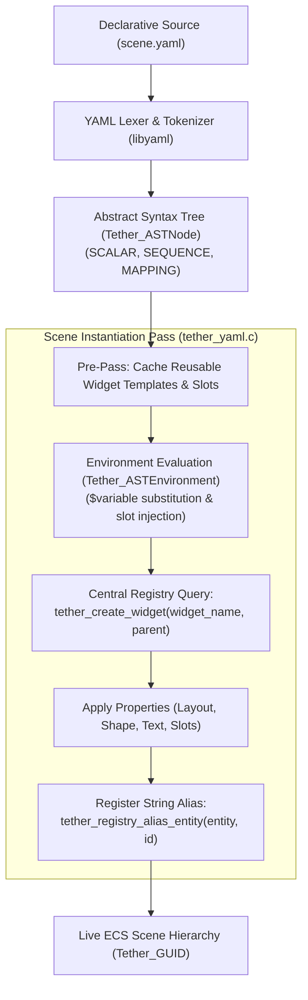
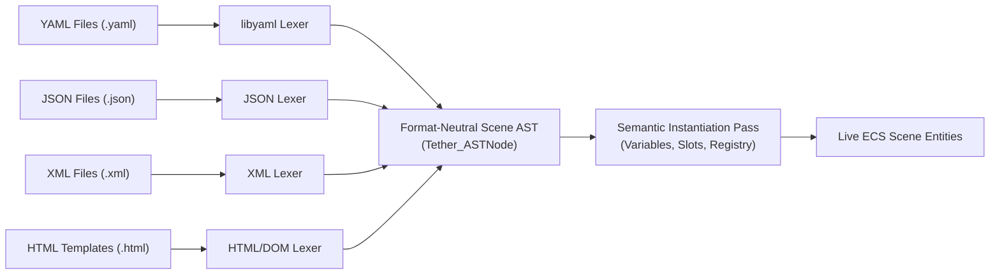
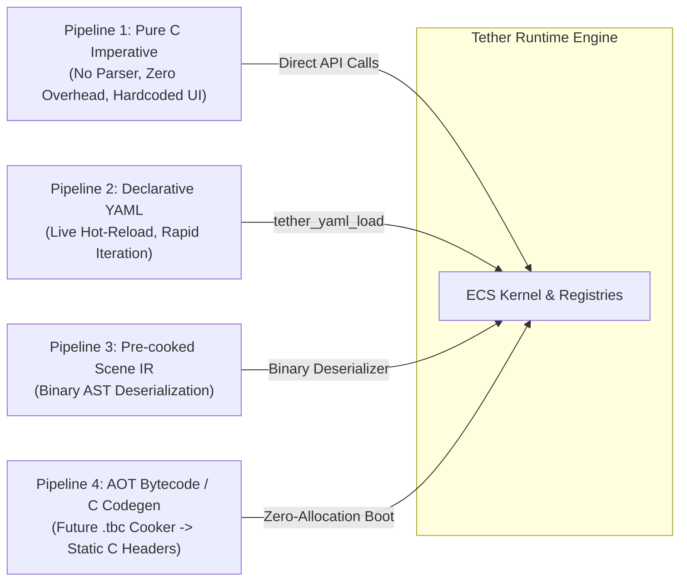

# Chapter 10: UI Definitions, Parsing, and Compilation

[<- Previous: Chapter 09 - Input and Event System](09_input_and_events.md) | [Documentation Master Index](../index.md) | [Next: Chapter 11 - Language Bindings and Scripting ->](11_language_bindings.md)

---

## 1. Executive Summary

A core design principle of Tether is **Dual Authoring and Limitless Bidirectional Interoperability**: user interfaces can be constructed imperatively in standard C99, declared in markup files, driven dynamically by scripting languages, or composed through an arbitrary hybrid of all of them.

There are no artificial barriers between declarative files, host programming languages, and embedded scripts:
- **Unified Entity Identity**: A button created via `tether_ui_button()` in C, a button declared via `- Button:` in YAML, and a button spawned dynamically via a Python or Lua script instantiate the **exact same ECS entity and contiguous components**.
- **Bidirectional Access**: An entity declared in YAML can be retrieved, animated, or restructured in C via its string alias (`tether_registry_find_entity("my_button")`). Conversely, an entity created in C can be freely inspected, restyled, or reparented by scripts at runtime.
- **Polyglot Fluidity**: Developers can declare structural layout in markup, attach rapid iteration event handlers in Python or Lua, and execute compute-heavy rendering or layout routines in native C or C++ without abstraction penalties.
- **Format-Neutral Foundation**: While YAML is Tether's default bundled format due to its clean indentation syntax, the parsing engine is decoupled: HTML, XML, or JSON parsers can feed the same AST and Scene IR.

This chapter details Tether's declarative scene schema, format-agnostic AST pipeline, template slots and variable injection, and the **4-Pipeline Deployment System** spanning from live hot-reloading to Ahead-of-Time (AOT) bytecode compilation.

---

## 2. Declarative Scene Architecture



---

## 3. Declarative YAML Syntax and Schema

Tether uses a clean, indentation-based YAML format that eliminates XML tag noise while providing full structural expressiveness:

```yaml
- Panel:
    id: main_dashboard
    size_box: [400, 300]
    flow: COLUMN
    padding: [16, 16, 16, 16]
    gap: [0, 12]
    color: [35, 39, 46, 255]
    border_width: 1.0
    border_color: [60, 64, 72, 255]
    border_radius: [8, 8, 8, 8]
    overflow: CLIP
    children:
      - Text:
          string: "System Status"
          font_size: 20.0
          color: [255, 255, 255, 255]
      
      - Panel:
          flow: ROW
          gap: [8, 0]
          content_align_y: CENTER
          children:
            - Button:
                id: refresh_button
                string: "Refresh Diagnostics"
                color: [97, 175, 239, 255]
                flex: 1.0
            
            - Button:
                id: shutdown_button
                string: "Halt"
                color: [224, 108, 117, 255]
                flex: 0.0
```

### Core Schema Properties

| Property Key | Expected Type | Description |
| :--- | :--- | :--- |
| `id` | String | Assigns a human-readable alias in the Central Registry (`tether_registry_alias_entity`). |
| `flow` | String | Container rule: `NONE` (Canvas), `ROW` (Flex Row), or `COLUMN` (Flex Column). |
| `size_box` | Float / `[w, h]` | Explicit layout bounds. `0` denotes auto/shrink-wrap. |
| `padding` | Float / `[t, r, b, l]` | Inner container padding in pixels. |
| `gap` | Float / `[gap_x, gap_y]` | Spacing between consecutive children along the flow axis. |
| `color` | String / `[r, g, b, a]` | Background fill color for shapes, or text color for typography. |
| `border_color` | String / `[r, g, b, a]` | Outer boundary stroke color. |
| `border_width` | Float | Border stroke thickness in pixels. |
| `border_radius` | Float / `[t, r, b, l]` | Rounded corner radii. |
| `flex` | Float | Proportional flex weight along parent flow axis. |
| `overflow` | String | Scissor clipping: `CLIP`, `VISIBLE`, `WRAP`, or `SCROLL`. |
| `visibility` | String | Visibility state: `visible`, `hidden`, or `collapsed`. |
| `hit_behavior` | String | Pointer collision policy: `BLOCK`, `IGNORE`, `SELF_ONLY`, or `CHILD_ONLY`. |
| `opacity` | Float | Multiplicative visual opacity ($0.0$ to $1.0$). |
| `rotation` | Float | GPU visual rotation in degrees around render pivot. |

---

## 4. Reusable Templates, Slots, and Variables

Tether supports componentization directly within declarative markup without external preprocessors:

### 1. Template Definition (`Widget`)
```yaml
- Widget: MetricCard
  Panel:
    flow: COLUMN
    padding: [12, 12, 12, 12]
    color: [40, 44, 52, 255]
    border_radius: [6, 6, 6, 6]
    children:
      - Text:
          string: $title
          font_size: 14.0
          color: [170, 178, 190, 255]
      - Slot: content
```

### 2. Template Instantiation and Parameter Injection
```yaml
- MetricCard:
    title: "CPU Temperature"
    content:
      - Text:
          string: "48.2 C"
          font_size: 24.0
          color: [152, 195, 121, 255]
```

- **Variables (`$var`)**: Scalar properties prefixed with `$` are dynamically substituted from the caller's property environment (`Tether_ASTEnvironment`).
- **Slots (`Slot: name`)**: Structural injection points where child trees provided by the caller are mounted into the template.
- **Nested Scenes (`Scene: "path.yaml"`)**: External scene files can be included dynamically, mounting sub-views modularly.

---

## 5. Parser Architecture and AST (`tether_yaml_ast.h`)

Parsing executes in two decoupled stages:
1. **Syntactic Analysis (`tether_yaml_ast.c`)**: Converts raw text into a format-neutral tree of `Tether_ASTNode` records using an embedded libyaml scanner.
2. **Semantic Instantiation (`tether_yaml.c`)**: Evaluates environments and instantiates live ECS entities through the Central Registry.

```c
typedef enum {
    TETHER_AST_SCALAR,
    TETHER_AST_SEQUENCE,
    TETHER_AST_MAPPING
} Tether_ASTNodeType;

struct Tether_ASTNode {
    Tether_ASTNodeType type;
    char* scalar_value;          /* SCALAR payload */
    Tether_ASTNode** children;   /* Array of child nodes */
    uint32_t child_count;
    uint32_t child_capacity;
    Tether_ASTNode** keys;       /* MAPPING keys (1:1 with children) */
};
```

### Zero Hardcoded Widget Logic
The parser does **not contain switch statements for specific widgets**. When it encounters a node key (e.g., `- Slider:`), it simply asks the Central Registry:

```c
Tether_GUID new_ent = tether_create_widget(key_str, parent);
```

If an application has registered a custom widget factory via `tether_register_widget("Slider", create_slider)`, the YAML parser instantiates it immediately without engine modifications.

### Format-Agnostic Frontend Design (YAML, JSON, XML, HTML)

While YAML is bundled as Tether's default markup language because of its clean, low-punctuation readability, the internal parser architecture is fundamentally **format-agnostic**:



The intermediate representation `Tether_ASTNode` requires only three primitive construct types:
- `TETHER_AST_SCALAR`: String or numeric values (attributes, text contents, variable tags).
- `TETHER_AST_SEQUENCE`: Ordered lists (child widgets, vector arrays like `[400, 300]`).
- `TETHER_AST_MAPPING`: Key-value dictionaries (widget property definitions, template parameters).

Because any structured document format (JSON, XML, HTML, or custom domain-specific languages) maps directly onto scalars, sequences, and mappings, developers can integrate alternative parsers with zero changes to the underlying widget creation, layout solver, or rendering pipelines.

### Bidirectional Script and Program Parity

Tether makes no architectural distinction between entities spawned by declarative parsers, scripting environments, or compiled host code:
1. **Creation Symmetry**: An entity can be spawned from YAML, configured by a Lua script, and animated inside a native C frame loop.
2. **Transparent Querying**: `tether_registry_find_entity("header_title")` resolves the exact same 64-bit `Tether_GUID` regardless of where the entity was declared.
3. **Cross-Language Mutation**: High-level scripts can mutate component data directly through the C FFI, and native C systems immediately observe the changes on the subsequent frame.
4. **Dynamic Reparenting**: Entities constructed in C can be attached as children to containers loaded from YAML or script templates at runtime without restrictions.

---

## 6. The 4-Pipeline Deployment System

To serve use cases ranging from resource-constrained microcontrollers to rapid desktop prototyping, Tether defines a **4-Pipeline Deployment System**:



### Pipeline Comparison Matrix

| Pipeline | Source Format | Parser Overhead | Memory Allocation | Best Use Case |
| :--- | :--- | :---: | :---: | :--- |
| **1. Pure C Code** | C Source Code | None ($0\text{ bytes}$) | Contiguous ECS dense arrays only | Embedded systems, microcontrollers, maximum runtime performance. |
| **2. Declarative YAML** | UTF-8 `.yaml` | Lexer + AST pass | Dynamic during load pass | Desktop tooling, rapid UI iteration, live hot-reloading during development. |
| **3. Pre-cooked Scene IR** | Pre-parsed AST | Binary unpack pass | Reduced heap churn | Mobile apps, faster cold-boot loading times. |
| **4. AOT Bytecode (`.tbc`)** | Compiled Bytecode / C | None ($0\text{ bytes}$) | Pre-sized static memory | Production shipping games, zero-parser runtime deployments. |

---

## 7. Error Recovery and Robustness

User interface parsers must be resilient against syntax errors, incomplete files during live editing, and missing assets:
- **Missing Keys & Bad Conversions**: Unknown properties produce non-fatal diagnostic warnings without halting tree instantiation.
- **Malformed Markup Recovery**: If a child block fails parsing, the parent container preserves valid siblings and completes layout.
- **Safe Fallback**: Any parse failure returns `TETHER_INVALID_GUID`, allowing host applications to display error placeholders or preserve previous stable scene states.

---

[<- Previous: Chapter 09 - Input and Event System](09_input_and_events.md) | [Documentation Master Index](../index.md) | [Next: Chapter 11 - Language Bindings and Scripting ->](11_language_bindings.md)
