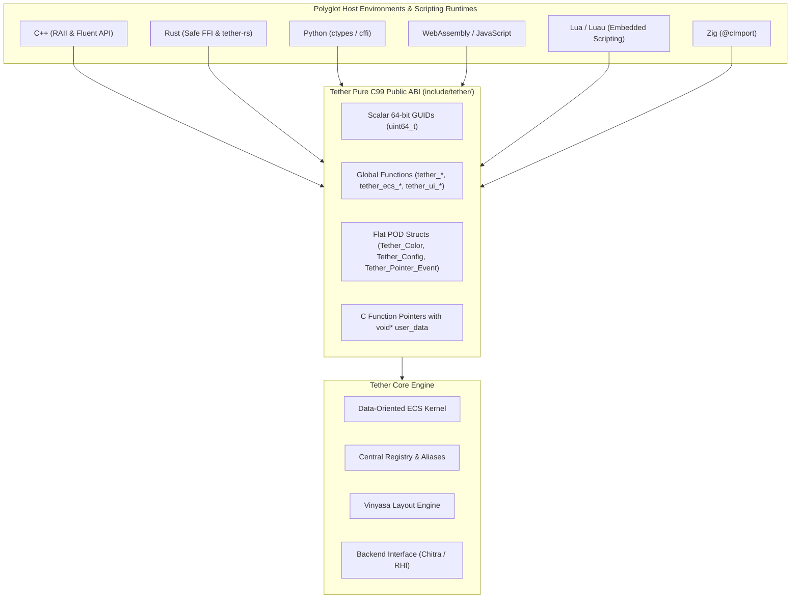
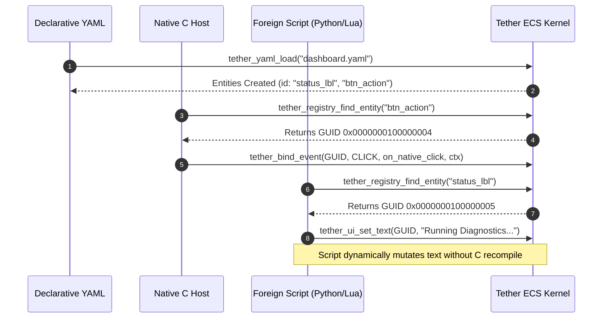

# Chapter 11: Language Bindings and Scripting

[<- Previous: Chapter 10 - UI Definitions, Parsing, and Compilation](10_ui_definitions_and_parsing.md) | [Documentation Master Index](../index.md) | [Next: Chapter 12 - API Reference and Integration Guides ->](12_api_reference.md)

---

## 1. Executive Summary

Tether is designed from the ground up as a universal, lightweight UI kernel capable of powering user interfaces across any host programming language or runtime environment. Rather than forcing applications into complex object-oriented class hierarchies or language-specific runtimes, Tether exposes a pure **ISO C99 Application Binary Interface (ABI)**.

Key architectural properties enabling universal foreign language interop:
- **Standard C ABI Invariants**: Un-mangled symbol names, standard calling conventions (`cdecl` / standard platform ABI), explicit struct alignments, and zero C++ vtables or RTTI.
- **64-Bit Scalar GUID Currency**: Entities are passed as simple 64-bit integer values (`uint64_t` / `Tether_GUID`). Foreign languages never hold raw, unsafe heap pointers to internal engine nodes.
- **Generational Safety**: Generational indexing embedded in the upper 32 bits of each GUID ensures that stale references held by foreign garbage collectors or asynchronous tasks fail safely via `tether_ecs_is_valid()` without memory corruption.
- **Dual Script and Program Parity**: There are no functional limits separating compiled C code from dynamic scripting environments. An entity created in C can be animated by Python, restyled by Lua, or queried by Rust; an entity declared in YAML can be wired directly to native C callbacks.



---

## 2. C99 Foreign Function Interface (FFI) Architecture

The Foreign Function Interface (FFI) contract in Tether adheres to strict systems-level guarantees:

### 1. Scalar Handles vs. Pointer Encapsulation
In traditional UI toolkits (e.g., Qt, GTK, wxWidgets), UI elements are heap-allocated objects whose pointers are exposed directly to foreign bindings. If the host language garbage collector fails to sync with the C++ lifecycle, use-after-free segfaults and memory leaks occur.

Tether eliminates this entire class of vulnerabilities by treating entities strictly as scalar 64-bit handles:

```c
typedef uint64_t Tether_GUID;

#define TETHER_INVALID_GUID 0
```

- **Lower 32 bits**: Entity index into sparse maps and generational arrays.
- **Upper 32 bits**: Generation counter incremented upon every deletion.

When a foreign language wrapper invokes an engine operation:
```c
tether_ui_set_size(entity, 400.0f, 250.0f);
```
The engine evaluates `tether_ecs_is_valid(entity)` in $O(1)$ time. If the entity was destroyed earlier by another subsystem, the function silently rejects the operation or returns false without dereferencing invalid memory.

### 2. ABI Compatibility Matrix

| Property | Implementation Guarantee | Interoperability Benefit |
| :--- | :--- | :--- |
| **Language Standard** | Pure ISO C99 (`stdbool.h`, `stdint.h`, `stddef.h`) | Universal support across every modern compiler and linker. |
| **Name Mangling** | None (`extern "C"` on all public headers) | Direct symbol binding without bridge wrappers or symbol mapping tables. |
| **Calling Convention** | Default platform C calling convention | Native zero-overhead dispatch in Rust, Zig, Python ctypes, and WASM. |
| **Memory Allocation** | Controlled entirely by Tether internal pools | Foreign runtimes never allocate or free internal engine memory. |
| **Data Alignment** | Natural 32-bit and 64-bit primitive alignment | Memory layout matches struct definitions across different language compilers. |

---

## 3. Limitless Bidirectional Script and Program Parity

Tether enforces complete symmetry between declarative definitions, native compiled code, and dynamic scripting runtimes:



### Core Interoperability Guarantees

1. **Format-Agnostic Entity Tree**:
   Whether an element is spawned from a YAML file, an imperative C call (`tether_ui_button`), or an embedded Lua script, it exists identically in the ECS dense pools.
2. **Central Registry Querying Across Language Boundaries**:
   String IDs declared in markup (e.g., `id: user_avatar`) are registered in the Central Registry. Any language can query the handle:
   - C: `Tether_GUID avatar = tether_registry_find_entity("user_avatar");`
   - Python: `avatar = tether.find_entity("user_avatar")`
   - Rust: `let avatar = tether.find_entity("user_avatar");`
3. **Flexible Event Dispatching**:
   Events triggered by user interactions (clicks, hover, pointer motion) can be dispatched to native C functions, C++ member closures, Rust closures, or script interpreters via `tether_bind_event(entity, type, callback, user_data)`.

---

## 4. Language Integration Strategies

### Modern C++ (C++17 / C++20)

The following illustrative C++ wrapper is a starting point, not a shipped or tested binding. It does not own entities or callbacks:

```cpp
#pragma once
#include <tether/tether.h>
#include <tether/ui/tether_ui.h>
#include <tether/ui/widgets/tether_button.h>
#include <tether/ui/widgets/tether_text.h>
#include <tether/core/tether_registry.h>
#include <string>
#include <functional>

namespace tether {

class Entity {
public:
    Tether_GUID handle{TETHER_INVALID_GUID};

    Entity() = default;
    explicit Entity(Tether_GUID id) : handle(id) {}

    static Entity find(const std::string& alias) {
        return Entity(tether_registry_find_entity(alias.c_str()));
    }

    bool is_valid() const {
        return tether_ecs_is_valid(handle);
    }

    Entity& size(float width, float height) {
        tether_ui_set_size(handle, width, height);
        return *this;
    }

    Entity& background(Tether_Color color) {
        tether_ui_set_color(handle, color);
        return *this;
    }

    Entity& text(const std::string& content) {
        tether_ui_set_text(handle, content.c_str());
        return *this;
    }

};

// Callback userdata must remain valid until its binding is removed.
class UI {
public:
    static Entity panel(Entity parent, Tether_Color bg) {
        Tether_GUID p = tether_ui_panel(parent.handle);
        tether_ui_set_color(p, bg);
        return Entity(p);
    }

    static Entity button(Entity parent, const std::string& caption, Tether_Color bg) {
        Tether_GUID b = tether_ui_button(parent.handle);
        tether_ui_set_button_label(b, caption.c_str());
        tether_ui_set_color(b, bg);
        return Entity(b);
    }

    static Entity text(Entity parent, const std::string& string, Tether_Color color) {
        Tether_GUID t = tether_ui_text(parent.handle);
        tether_ui_set_text(t, string.c_str());
        tether_ui_set_text_color(t, color);
        return Entity(t);
    }
};

} // namespace tether
```

---

### Rust (`tether-rs`)

In Rust, Tether entities map cleanly to `Copy` tuple structs, and C callbacks are safely bridged to Rust closures:

```rust
use std::os::raw::{c_char, c_void};
use std::ffi::CString;

#[repr(transparent)]
#[derive(Copy, Clone, Debug, PartialEq, Eq, Hash)]
pub struct Entity(pub u64);

impl Entity {
    pub const INVALID: Entity = Entity(0);

    pub fn is_valid(&self) -> bool {
        unsafe { tether_ecs_is_valid(self.0) }
    }

    pub fn set_size(&self, width: f32, height: f32) {
        unsafe { tether_ui_set_size(self.0, width, height) };
    }

    pub fn set_text(&self, text: &str) -> bool {
        let c_str = CString::new(text).expect("CString conversion failed");
        unsafe { tether_ui_set_text(self.0, c_str.as_ptr()) }
    }

    pub fn on_click<F>(&self, callback: F)
    where
        F: Fn(Entity) + 'static,
    {
        let boxed: Box<F> = Box::new(callback);
        let user_data = Box::into_raw(boxed) as *mut c_void;

        unsafe {
            tether_bind_event(
                self.0,
                TetherEventType::Click,
                Some(rust_click_trampoline::<F>),
                user_data,
            );
        }
    }
}

extern "C" fn rust_click_trampoline<F>(entity: u64, _event: *const TetherEvent, user_data: *mut c_void)
where
    F: Fn(Entity),
{
    unsafe {
        let closure = &*(user_data as *const F);
        closure(Entity(entity));
    }
}
```

---

### Python (`ctypes` / `cffi`)

Python enables rapid interactive prototyping and dynamic tooling. Because Tether uses a pure C ABI, bindings can be established using standard library `ctypes` without compiling third-party binary wheels:

```python
import ctypes
from ctypes import c_uint64, c_float, c_char_p, c_void_p, Structure

# Load shared Tether runtime
libtether = ctypes.CDLL("./libtether.so") # or tether.dll on Windows

class Color(Structure):
    _fields_ = [("r", ctypes.c_uint8),
                ("g", ctypes.c_uint8),
                ("b", ctypes.c_uint8),
                ("a", ctypes.c_uint8)]

libtether.tether_ecs_is_valid.argtypes = [c_uint64]
libtether.tether_ecs_is_valid.restype = ctypes.c_bool

libtether.tether_registry_find_entity.argtypes = [c_char_p]
libtether.tether_registry_find_entity.restype = c_uint64

libtether.tether_ui_set_text.argtypes = [c_uint64, c_char_p]
libtether.tether_ui_set_text.restype = ctypes.c_bool

class TetherApp:
    @staticmethod
    def find_entity(alias: str) -> int:
        return libtether.tether_registry_find_entity(alias.encode("utf-8"))

    @staticmethod
    def set_text(entity: int, text: str) -> bool:
        return libtether.tether_ui_set_text(entity, text.encode("utf-8"))

# Usage: Locate widget loaded from YAML and update live telemetry
metric_label = TetherApp.find_entity("cpu_metric")
if metric_label != 0:
    TetherApp.set_text(metric_label, "CPU Usage: 42.8%")
```

---

### Embedded Scripting: Lua / Luau

Game engines and real-time simulations frequently embed Lua for UI logic. Tether provides an ideal match for Lua's lightweight C stack:

```lua
-- Lua UI Controller Script
function on_scene_loaded()
    -- Look up buttons loaded from declarative YAML
    local start_btn = tether.find_entity("start_button")
    local title_lbl = tether.find_entity("game_title")

    if tether.is_valid(start_btn) then
        tether.bind_click(start_btn, function()
            tether.set_text(title_lbl, "Loading World...")
            game.begin_match()
        end)
    end
end
```

The C host binds this effortlessly by pushing `Tether_GUID` as a 64-bit integer or light userdata onto the Lua stack, giving scripts complete control over scene elements with zero garbage collector overhead on the C memory pools.

---

### WebAssembly & JavaScript (Emscripten)

Tether compiles cleanly to WebAssembly using Emscripten:
```bash
emcc -O3 -Iinclude src/core/*.c src/engine/*.c src/backends/chitra_backend.c \
     -s WASM=1 -s EXPORTED_FUNCTIONS="['_tether_init', '_tether_on_frame', '_tether_on_input']" \
     -o tether_wasm.js
```

In the browser, JavaScript forwards DOM input events directly to `tether_on_input()` and triggers `tether_on_frame(canvas.width, canvas.height)` inside `requestAnimationFrame`. Rendering is executed directly via WebGPU or WebGL2 through the Chitra backend.

---

### Zig First-Class Interoperability

Zig requires no external binding layers or wrappers:

```zig
const tether = @cImport({
    @cInclude("tether/tether.h");
    @cInclude("tether/ui/tether_ui.h");
    @cInclude("tether/core/tether_registry.h");
});

pub fn setup_ui() void {
    const parent = tether.tether_ecs_get_main_root();
    const btn = tether.tether_ui_button(parent);
    tether.tether_ui_set_button_label(btn, "Compile Zig");
    tether.tether_ui_set_color(btn, tether.Tether_Color{ .r = 247, .g = 164, .b = 29, .a = 255 });
}
```

---

## 5. Memory Safety and Cross-Boundary Lifecycle Rules

When interacting across foreign language boundaries, developers must adhere to four essential lifecycle rules:

### Rule 1: The ECS Kernel Owns Entity Lifetime
Foreign language objects (such as C++ wrapper classes, Python wrapper objects, or Lua tables) must **never attempt to manage entity lifetime through their own garbage collectors or destructors**.
- Destroying an entity must always occur via `tether_widget_destroy(guid)` or `tether_ecs_destroy_entity(guid)`.
- Foreign wrapper classes should store only the scalar `Tether_GUID`. If the entity is destroyed, subsequent calls gracefully no-op when `tether_ecs_is_valid()` returns `false`.

### Rule 2: Strings Must Be Valid UTF-8 Null-Terminated Buffers
- All string parameters passed to Tether APIs (`tether_ui_set_text`, `tether_registry_alias_entity`, `tether_yaml_load`) must be null-terminated UTF-8 byte arrays.
- Tether copies strings into its internal Small String Optimization (SSO) storage tiers immediately. The caller retains ownership of the input buffer and may free or overwrite it immediately after the function returns.

### Rule 3: Callback Userdata Lifetime
When registering callbacks via `tether_bind_event(entity, type, callback, user_data)`:
- The `user_data` pointer is stored verbatim by Tether's event registry.
- If `user_data` references heap memory allocated by a foreign language (e.g., a boxed Rust closure or C++ `std::function`), the caller is responsible for maintaining that pointer's lifetime until the entity is destroyed or unbound via `tether_unbind_event()`.

### Rule 4: Single-Threaded Execution Model
Tether's core ECS and rendering pipelines are strictly single-threaded:
- All Tether API calls must be issued from the primary UI thread.
- If worker threads in Python, Rust, or C++ need to update UI elements, they must enqueue state payloads onto a thread-safe message queue and apply the changes during the `on_frame` lifecycle hook on the main thread.

---

## 6. Future Language Ecosystem Roadmap

| Language Target | Target Status | Delivery Mechanism | Primary Objective |
| :--- | :---: | :--- | :--- |
| **C++20 Wrapper** | Roadmap | Header-only wrapper (`tether.hpp`, planned) | Modern fluent C++ development with RAII and lambdas. |
| **Rust (`tether-rs`)** | Roadmap | Official Cargo Crate | Memory-safe systems programming and game UI. |
| **Python (`pytether`)** | Roadmap | PyPI Binary Wheel (`ctypes`/C-extension) | Rapid data visualization, AI toolkits, desktop utilities. |
| **WASM / NPM** | Roadmap | WebAssembly npm package | High-performance canvas-based web applications. |
| **Lua Bindings** | Roadmap | Single-file C module (`lua_tether.c`) | Game engine UI scripting and live-reloadable tooling. |

---

[<- Previous: Chapter 10 - UI Definitions, Parsing, and Compilation](10_ui_definitions_and_parsing.md) | [Documentation Master Index](../index.md) | [Next: Chapter 12 - API Reference and Integration Guides ->](12_api_reference.md)
