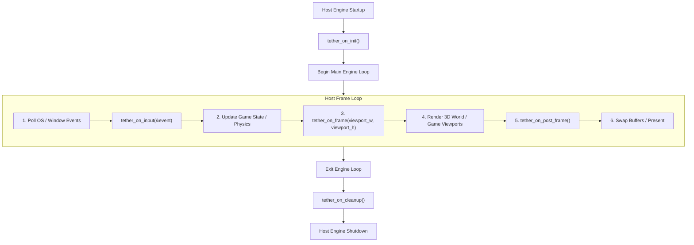

# Chapter 12: API Reference and Integration Guides

[<- Previous: Chapter 11 - Language Bindings and Scripting](11_language_bindings.md) | [Documentation Master Index](../index.md) | [Next: Chapter 13 - Testing, Benchmarks, and Profiling ->](13_testing_and_benchmarks.md)

---

## 1. Executive Summary & Header Organization

Tether provides a clean, modular C99 public API organized across focused header files located in `include/tether/`:

```
include/tether/
  ├── tether.h                     # Primary engine entry points, configuration, lifecycle hooks
  ├── backends/
  │   └── tether_backend.h         # Pluggable backend interface (System, Shape, Text APIs)
  ├── core/
  │   ├── tether_ecs.h             # Data-oriented ECS kernel, entity GUIDs, sparse/dense pools
  │   ├── tether_components.h      # Component data structs (Layout, Render, Shape, Text, Hierarchy)
  │   ├── tether_registry.h        # Central Registry (Widgets, Aliases, Font table)
  │   ├── tether_events.h          # Event binding and dispatching pipeline
  │   └── tether_input.h           # Pointer events and spatial hit-testing queries
  ├── engine/
  │   ├── tether_engine.h          # Engine frame synchronization and redraw scheduling
  │   ├── tether_layout.h          # Layout solver execution
  │   └── parser/
  │       ├── tether_yaml.h        # Declarative YAML scene file loader
  │       └── tether_yaml_ast.h    # Format-agnostic Abstract Syntax Tree model
  ├── ui/
  │   ├── tether_ui.h              # Fluent UI convenience builder and property setters
  │   └── tether_widgets.h         # Built-in widget factories and visibility management
  └── utils/
      └── tether_hashmap.h         # High-performance Robin Hood hash table utility
```

To include all fundamental UI and engine APIs in standard host code, applications typically include:
```c
#include <tether/tether.h>
#include <tether/ui/tether_ui.h>
#include <tether/core/tether_registry.h>
```

---

## 2. Engine Lifecycle and Configuration API (`tether.h`)

### `Tether_Config`
Defines the initialization parameters and application lifecycle callbacks.

```c
typedef struct Tether_Config {
    int width;                  /* Initial window viewport width in pixels */
    int height;                 /* Initial window viewport height in pixels */
    const char* title;          /* Window title string */
    const char* initial_yaml;   /* Optional initial declarative scene path to auto-load */
    int target_fps;             /* Target frame rate (0 = sync with VSync) */
    
    /* Application Lifecycle Callbacks */
    void (*on_init)(void);       /* Invoked once after engine subsystems are ready */
    void (*on_frame)(void);      /* Invoked every frame prior to layout/render passes */
    void (*on_post_frame)(void); /* Invoked immediately following frame render completion */
    void (*on_term)(void);       /* Invoked prior to engine subsystem shutdown */
} Tether_Config;
```

---

### Core Execution Functions

#### `tether_init`
```c
void tether_init(Tether_Config* config);
```
Initializes core engine memory, registers built-in components and widgets, and prepares the backend driver without starting the blocking main loop.

#### `tether_run`
```c
void tether_run(Tether_Config* config);
```
The primary entry point for standalone applications. Initializes the engine (if not previously initialized) and transfers control to the backend's blocking event and render loop.

#### `tether_queue_redraw`
```c
void tether_queue_redraw(void);
```
Explicitly requests a screen redraw on the subsequent frame. Used to wake the zero-power throttling loop when asynchronous tasks or worker threads mutate UI state.

#### `tether_did_draw`
```c
bool tether_did_draw(void);
```
Returns `true` if the engine actually performed draw calls during the most recently completed frame, or `false` if the frame was throttled due to clean invalidation tags.

---

### Backend Integration Hooks (`tether.h`)

These functions are invoked by platform backend drivers (e.g., Chitra, SDL3, GLFW, or custom host engines) to drive Tether:

```c
void  tether_on_init(void);
void* tether_on_frame(int width, int height);
void  tether_on_post_frame(void);
void  tether_on_cleanup(void);
void  tether_on_input(const Tether_Pointer_Event* event);
```

| Hook Function | Calling Context | Description |
| :--- | :--- | :--- |
| `tether_on_init` | Platform Startup | Prepares layout trees, registers default fonts, and mounts the initial YAML scene. |
| `tether_on_frame` | Display Refresh | Ticks the engine frame loop for viewport `(width, height)`. Executes layout reflow, visual sync, and render dispatch. |
| `tether_on_post_frame` | Swap Buffers | Invoked after the backend presents the backbuffer to clear per-frame volatile flags. |
| `tether_on_cleanup` | Platform Teardown | Destroys scene trees, frees font caches, and releases ECS dense array memory. |
| `tether_on_input` | OS Event Loop | Feeds a normalized pointer event into Tether's spatial hit-testing and event dispatcher. |

---

## 3. ECS Kernel and Entity Management API (`tether_ecs.h`)

### Entity GUID Type and Inlines

```c
typedef uint64_t Tether_GUID;
#define TETHER_INVALID_GUID 0

static inline uint32_t    tether_ecs_get_index(Tether_GUID guid);
static inline uint32_t    tether_ecs_get_generation(Tether_GUID guid);
static inline Tether_GUID tether_ecs_make_guid(uint32_t index, uint32_t generation);
```

- `tether_ecs_get_index`: Extracts the lower 32-bit entity slot index.
- `tether_ecs_get_generation`: Extracts the upper 32-bit generation version counter.
- `tether_ecs_make_guid`: Constructs a composite 64-bit GUID from index and generation values.

---

### Entity Lifecycle

#### `tether_ecs_create_entity`
```c
Tether_GUID tether_ecs_create_entity(void);
```
Allocates a new entity handle with an incremented generation version. Returns the 64-bit `Tether_GUID`.

#### `tether_ecs_destroy_entity`
```c
void tether_ecs_destroy_entity(Tether_GUID entity);
```
Recursively unlinks and destroys `entity` and all of its descendant children. Deallocates attached components across all dense arrays using $O(1)$ Swap-and-Pop, increments the generational counter, and recycles the slot index.

#### `tether_ecs_is_valid`
```c
bool tether_ecs_is_valid(Tether_GUID entity);
```
Returns `true` if `entity` is currently allocated and alive. Performs an $O(1)$ generation check against the internal generation table.

---

### Scene Graph Hierarchy

#### `tether_ecs_get_main_root`
```c
Tether_GUID tether_ecs_get_main_root(void);
```
Retrieves the root entity for the primary scene canvas.

#### `tether_ecs_get_overlay_root`
```c
Tether_GUID tether_ecs_get_overlay_root(void);
```
Retrieves the overlay root entity used for floating popups, tooltips, and modal dropdowns drawn on top of the main scene.

#### `tether_ecs_attach_entity`
```c
void tether_ecs_attach_entity(Tether_GUID parent, Tether_GUID entity);
```
Attaches `entity` as the last child of `parent`. Verifies that `parent` does not possess the `TETHER_COMPONENT_IS_LEAF` tag. Tags `parent` with `DIRTY_HIERARCHY`.

#### `tether_ecs_detach_entity`
```c
void tether_ecs_detach_entity(Tether_GUID entity);
```
Unlinks `entity` from its current parent and sibling chain, cleanly stitching surrounding siblings.

#### `tether_ecs_bring_to_front`
```c
void tether_ecs_bring_to_front(Tether_GUID entity);
```
Moves `entity` to the tail of its parent's child chain, guaranteeing highest local draw order (Z-index).

---

### Component Management

#### `tether_ecs_add_component`
```c
void* tether_ecs_add_component(Tether_GUID entity, int component_id);
```
Attaches a component to `entity`. Allocates memory at the tail of the dense array and updates the sparse map in $O(1)$ time. Returns a pointer to the uninitialized memory block.

#### `tether_ecs_get_component`
```c
void* tether_ecs_get_component(Tether_GUID entity, int component_id);
```
Returns a direct pointer to the entity's component data in the dense array, or `NULL` if not attached.

#### `tether_ecs_remove_component`
```c
void tether_ecs_remove_component(Tether_GUID entity, int component_id);
```
Removes the component from `entity` using $O(1)$ Swap-and-Pop.

#### `tether_ecs_register_component_static`
```c
void tether_ecs_register_component_static(uint32_t component_id, size_t element_size);
```
Initializes a dense array pool for a fixed compile-time component ID.

#### `tether_ecs_register_component_dynamic`
```c
uint32_t tether_ecs_register_component_dynamic(size_t element_size);
```
Dynamically registers a custom component type for plugins or third-party extensions. Returns the newly assigned component ID.

---

## 4. Central Registry API (`tether_registry.h`)

### Widget Factory Registration

```c
typedef Tether_GUID (*Tether_WidgetCreateFn)(Tether_GUID parent);

void        tether_register_widget(const char* name, Tether_WidgetCreateFn create_fn);
Tether_GUID tether_create_widget(const char* name, Tether_GUID parent);
```
- `tether_register_widget`: Associates a string name (e.g., `"Slider"`) with a constructor function pointer.
- `tether_create_widget`: Instantiates the named widget under `parent`. Used by declarative markup parsers to instantiate widgets without hardcoded switch tables.

---

### String-ID Aliases

```c
void        tether_registry_alias_entity(Tether_GUID entity, const char* alias);
const char* tether_registry_get_alias(Tether_GUID entity);
Tether_GUID tether_registry_find_entity(const char* alias);
void        tether_registry_remove_alias(Tether_GUID entity);
```
- `tether_registry_alias_entity`: Associates a human-readable alias (e.g., `"submit_btn"`) with an entity GUID.
- `tether_registry_find_entity`: Resolves an alias string to its live `Tether_GUID` in $O(1)$ time using the internal Robin Hood hashmap. Returns `TETHER_INVALID_GUID` if not found.

---

### Font Registry

```c
uint32_t    tether_font_register(const char* name, const char* path);
const char* tether_font_get_path(uint32_t font_id);
const char* tether_font_get_name(uint32_t font_id);
```
- `tether_font_register`: Registers a TrueType font file path with a logical name and assigns a 0-based integer font ID. Font ID `0` is the default font.
- `tether_font_get_path`: Retrieves the file path for a registered font ID.

---

## 5. UI Convenience and Widget APIs (`tether_ui.h`, `tether_widgets.h`)

### Fluent UI Builders (`tether_ui.h`)

```c
Tether_GUID tether_ui_panel(Tether_GUID parent, Tether_Color bg_color, float radius);
Tether_GUID tether_ui_row(Tether_GUID parent, float gap_x);
Tether_GUID tether_ui_column(Tether_GUID parent, float gap_y);
Tether_GUID tether_ui_text(Tether_GUID parent, const char* string, float font_size, Tether_Color color);
Tether_GUID tether_ui_button(Tether_GUID parent, const char* caption, float font_size,
                             Tether_Color bg_color, Tether_EventCallback callback, void* user_data);
```

### Property Setters

| Function Signature | Description |
| :--- | :--- |
| `void tether_ui_set_size(Tether_GUID entity, float width, float height)` | Sets explicit layout dimensions. `0` indicates auto shrink-wrap. |
| `void tether_ui_set_padding(Tether_GUID entity, float top, float right, float bottom, float left)` | Sets container inner padding in pixels. |
| `void tether_ui_set_gap(Tether_GUID entity, float gap_x, float gap_y)` | Sets spacing between sequential child elements. |
| `void tether_ui_set_flex(Tether_GUID entity, float fill_ratio)` | Sets flex expansion ratio along parent layout flow axis. |
| `void tether_ui_set_color(Tether_GUID entity, Tether_Color bg_color)` | Sets background shape fill color. |
| `void tether_ui_set_border(Tether_GUID entity, float width, Tether_Color color, float radius)` | Configures border stroke thickness, color, and corner radius. |
| `bool tether_ui_set_text(Tether_GUID entity, const char* string)` | Updates text string content, automatically invalidating layout and visual tags. |
| `const char* tether_ui_get_text(Tether_GUID entity)` | Reads the text string attached to an entity or its primary text child. |
| `void tether_ui_set_text_color(Tether_GUID entity, Tether_Color color)` | Updates font render color. |

---

### Visibility Controls (`tether_widgets.h`)

```c
void tether_widget_set_visibility(Tether_GUID entity, Tether_VisibilityState state);
bool tether_widget_is_visible(Tether_GUID entity);
bool tether_widget_is_collapsed(Tether_GUID entity);
void tether_widget_destroy(Tether_GUID entity);
```

- `TETHER_VISIBLE`: Rendered, receives input, occupies layout space.
- `TETHER_HIDDEN`: Invisible, receives no input, preserves layout bounds.
- `TETHER_COLLAPSED`: Completely removed from layout (zero size), invisible, receives no input.

---

## 6. Input, Events, and Declarative Parser APIs

### Event Binding API (`tether_events.h`)

```c
typedef enum {
    TETHER_EVENT_HOVER_ENTER,
    TETHER_EVENT_HOVER_EXIT,
    TETHER_EVENT_PRESS,
    TETHER_EVENT_RELEASE,
    TETHER_EVENT_CLICK
} Tether_EventType;

typedef void (*Tether_EventCallback)(Tether_GUID entity, Tether_EventType type, void* user_data);

void tether_bind_event(Tether_GUID entity, Tether_EventType type, Tether_EventCallback callback, void* user_data);
void tether_unbind_event(Tether_GUID entity, Tether_EventType type);
void tether_dispatch_event(Tether_GUID entity, Tether_EventType type);
```

---

### Pointer Input Processing (`tether_input.h`)

```c
typedef enum {
    TETHER_POINTER_DOWN,
    TETHER_POINTER_UP,
    TETHER_POINTER_MOVE
} Tether_Pointer_Type;

typedef enum {
    TETHER_MOUSE_BUTTON_NONE = 0,
    TETHER_MOUSE_BUTTON_LEFT,
    TETHER_MOUSE_BUTTON_RIGHT,
    TETHER_MOUSE_BUTTON_MIDDLE
} Tether_Mouse_Button;

typedef struct Tether_Pointer_Event {
    Tether_Pointer_Type type;
    Tether_Mouse_Button button;
    float x;
    float y;
} Tether_Pointer_Event;

void        tether_input_process_event(const Tether_Pointer_Event* event);
Tether_GUID tether_hit_test(float x, float y);
```

---

### Declarative Scene Loader (`tether_yaml.h`)

```c
Tether_GUID tether_yaml_load(const char* filepath, Tether_GUID parent);
```
Parses a declarative YAML scene file and attaches the resulting entity hierarchy to `parent`. If `parent` is `TETHER_INVALID_GUID`, the scene is attached directly to the main root. Returns the root entity of the loaded scene, or `TETHER_INVALID_GUID` on syntax failure.

---

## 7. Host Integration Guides

### Pattern 1: CMake Subdirectory Integration

The most common integration pattern embeds Tether directly inside a host application repository:

```cmake
cmake_minimum_required(VERSION 3.20)
project(MyHostApplication C)

# Add Tether repository as a subdirectory
add_subdirectory(third_party/tether)

# Define host application executable
add_executable(my_app src/main.c)

# Link against Tether core library
target_link_libraries(my_app PRIVATE tether)

# Include paths are automatically exported by the tether target
```

In `src/main.c`:
```c
#include <tether/tether.h>
#include <tether/ui/tether_ui.h>

static void on_init(void) {
    Tether_GUID root = tether_ecs_get_main_root();
    tether_ui_panel(root, (Tether_Color){40, 44, 52, 255}, 0.0f);
}

int main(void) {
    Tether_Config config = {
        .width = 800,
        .height = 600,
        .title = "Host Application",
        .on_init = on_init
    };
    tether_run(&config);
    return 0;
}
```

---

### Pattern 2: Embedding Tether into a Custom Host Loop (Game Engines)

When integrating into an existing game engine (e.g., Unreal Engine, Raylib, or a custom game engine loop), do **not** invoke `tether_run()`, as it owns the blocking loop. Instead, invoke the lifecycle hooks manually:



```c
// 1. During host engine initialization:
tether_on_init();

// 2. In host OS event handler:
Tether_Pointer_Event pe = {
    .type = TETHER_POINTER_DOWN,
    .button = TETHER_MOUSE_BUTTON_LEFT,
    .x = mouse_x,
    .y = mouse_y
};
tether_on_input(&pe);

// 3. Every frame in the host rendering loop:
tether_on_frame(window_width, window_height);

// 4. Immediately after presenting/swapping the backbuffer:
tether_on_post_frame();

// 5. On host engine shutdown:
tether_on_cleanup();
```

---

### Pattern 3: Custom Backend Driver Implementation

To run Tether on a custom rendering and windowing stack (e.g., ThorVG, Raylib, Skia, or bare-metal embedded framebuffers), implement the `Tether_Backend` interface and expose the global symbol `g_backend`:

```c
#include <tether/backends/tether_backend.h>

static void custom_init(int w, int h, const char* title) { /* Initialize window/device */ }
static void custom_begin_frame(void)                     { /* Prepare render target */ }
static void custom_end_frame(void)                       { /* Present backbuffer */ }
static void custom_draw_rect(float x, float y, float w, float h, Tether_Color color, float radius) {
    /* Issue rectangle draw call to custom graphics pipeline */
}

static Tether_System_API custom_system_api = {
    .init = custom_init,
    .begin_frame = custom_begin_frame,
    .end_frame = custom_end_frame,
    /* Populate remaining system callbacks */
};

static Tether_Shape_API custom_shape_api = {
    .draw_rect = custom_draw_rect,
    /* Populate remaining shape callbacks */
};

static Tether_Text_API custom_text_api = {
    /* Populate text rendering and measurement callbacks */
};

Tether_Backend g_backend = {
    .system = &custom_system_api,
    .shape  = &custom_shape_api,
    .text   = &custom_text_api
};
```

Link this implementation into your application; Tether will communicate directly with your custom driver with zero overhead.

---

[<- Previous: Chapter 11 - Language Bindings and Scripting](11_language_bindings.md) | [Documentation Master Index](../index.md) | [Next: Chapter 13 - Testing, Benchmarks, and Profiling ->](13_testing_and_benchmarks.md)
