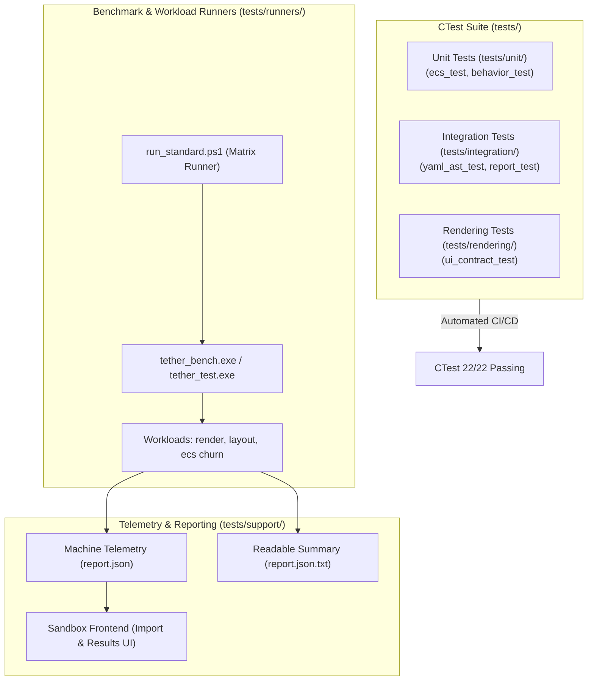
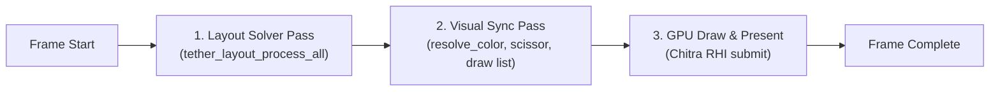

# Chapter 13: Testing, Benchmarks, and Profiling

[<- Previous: Chapter 12 - API Reference and Integration Guides](12_api_reference.md) | [Documentation Master Index](../index.md) | [Next: Chapter 14 - Portability Contracts, Limitations, and Architectural Decisions ->](14_portability_and_decisions.md)

---

## 1. Executive Summary

Tether maintains an automated test, benchmarking, and validation suite located in `tests/`. The testing architecture adheres to strict engineering invariants:
- **Zero Workload Execution During Builds**: Compilation produces standalone test runners and benchmark harnesses without executing workloads during build steps.
- **Strict Separation of Concerns**:
  - **Correctness Tests**: Automated regression tests executed via CTest that verify explicit assertions and fail with non-zero exit codes upon contract violations.
  - **Controlled Workloads**: Configurable test scenarios that exercise layout, rendering, and ECS churn across scale boundaries (1K to 100K+ entities).
  - **Benchmarks**: High-precision timing runs generating structured JSON telemetry and human-readable summaries without polluting unit test assertions.
- **Detached Execution Model**: Workload harnesses (`tether_bench.exe`, `tether_test.exe`) own their engine and graphics contexts. The interactive Sandbox showcase serves as an independent frontend that launches runners and visualizes imported reports.



---

## 2. Test Suite Architecture

The test suite is organized into modular layers reflecting system boundaries:

| Directory | Scope & Responsibility | Execution Environment | Primary Target |
| :--- | :--- | :---: | :--- |
| `tests/unit/` | Pure CPU logic, ECS memory pools, generational indices, swap-and-pop, base component contracts. | Headless (CI / Console) | `tether_ecs_test`, `tether_behavior_test` |
| `tests/integration/` | Declarative YAML lexer, AST parsing, environment substitution, template slots, report serialization. | Headless (CI / Console) | `yaml_ast_test`, `report_test` |
| `tests/rendering/` | GPU backbuffer presentation, retained vs. volatile dirty flags, hierarchical clipping, color states. | Interactive Desktop / GPU | `ui_contract_test` |
| `tests/support/` | Shared harness utilities: high-resolution timers, process management, JSON reporting, platform bridges. | Shared Static Library | `tether_test_support` |
| `tests/runners/` | Standalone CLI binaries that run parameterized workloads and produce performance reports. | CLI / Script Automation | `tether_test.exe`, `tether_bench.exe` |

---

## 3. Unit and Behavioral Testing

### 1. ECS Kernel Correctness (`tests/unit/ecs_test.c`)
Validates fundamental ECS guarantees under stress:
- **Generation Increment**: Verifies that destroying an entity increments its upper 32-bit generation and invalidates cached GUIDs.
- **Dense Array Contiguity**: Confirms that adding and removing components via Swap-and-Pop preserves a contiguous memory block without gaps.
- **Sparse-Dense Bi-directional Mapping**: Tests that sparse array lookups accurately resolve dense indices, and `entity_map` points back to valid GUIDs.
- **Cascading Destruction**: Asserts that deleting a parent entity recursively destroys its full subtree, freeing all attached components and recycling slot indices.

### 2. Behavioral Contract Scenarios (`tests/unit/behavior_test.c`)
Tests discrete engine subsystems across five isolated scenarios:

```powershell
# Run individual behavior scenarios via CLI
./build/Release/tether_behavior_test layout
./build/Release/tether_behavior_test visibility
./build/Release/tether_behavior_test input
./build/Release/tether_behavior_test lifetime
./build/Release/tether_behavior_test text
```

- **`layout`**: Verifies that flex column and row containers calculate slot bounds correctly according to inner padding, gap, and child dimensions.
- **`visibility`**: Verifies the three visibility states:
  - `TETHER_VISIBLE`: Layout space allocated, visual render active.
  - `TETHER_HIDDEN`: Layout space preserved, visual render skipped.
  - `TETHER_COLLAPSED`: Layout space zeroed, visual render skipped, siblings reflowed.
- **`input`**: Simulates pointer move, down, and up events; validates hover and press state transitions and verifies bounding box hit culling.
- **`lifetime`**: Tests allocation limits, entity recycling from `free_indices`, and double-free rejection.
- **`text`**: Validates the 4-tier Small String Optimization (SSO) storage, asserting that strings $\le 63$ bytes remain inline without heap allocations.

---

## 4. Integration and Parser Testing

### Declarative AST Recovery (`tests/integration/yaml_ast_test.c`)
Ensures that declarative scene definitions parse reliably and fail gracefully:
- **Syntax Error Recovery**: Feeds malformed YAML inputs (unclosed quotes, invalid indentation, illegal characters) and verifies that the engine returns `TETHER_INVALID_GUID` without crashing or leaking memory.
- **Template Slot Injection**: Asserts that caller-provided children are mounted cleanly into template `Slot:` nodes.
- **Dynamic Property Substitution**: Validates that `$variable` tokens in YAML are correctly resolved from property dictionaries at instantiation time.

### Report Integrity (`tests/integration/report_test.c`)
Verifies that benchmark telemetry structures serialize to valid JSON conforming to the Tether report schema, ensuring compatibility with the Sandbox Lab importer.

---

## 5. Rendering and Contract Validation

### Retained vs. Volatile Modes (`tests/rendering/ui_contract_test.c`)
Validates the reactive invalidation pipeline against a live graphics backend:
- **Retained Invalidation**: Tests that an unchanged scene issues zero draw calls on subsequent frames (`tether_did_draw() == false`).
- **Dirty Flag Triggering**: Mutating an element's size or color marks `DIRTY_LAYOUT` or `DIRTY_VISUAL`, ensuring the subsequent frame executes redraw (`tether_did_draw() == true`).
- **Volatile Continuous Mode**: When the root container is tagged with `TETHER_COMPONENT_VOLATILE`, the engine bypasses dirty caching and renders continuously every frame.

---

## 6. Controlled Benchmarks and Workloads

The standalone runner `tether_bench.exe` executes controlled stress workloads to measure frame stability, memory footprint, and CPU/GPU scaling:

```powershell
# Run a 10,000-entity retained render workload for 120 frames
./build/Release/tether_bench.exe --scenario render --mode retained --count 10000 --spawn 32 --delete 32 --mutate 100 --frames 120 --warmup 30 --fps 60 --seed 1 --memory-mib 1024
```

### CLI Configuration Parameters

| Parameter | Type | Default | Description |
| :--- | :--- | :---: | :--- |
| `--scenario` | String | `render` | Workload target: `render`, `layout`, or `ecs`. |
| `--mode` | String | `retained` | Render pipeline mode: `retained` (reactive dirty flagging) or `volatile` (continuous per-frame render). |
| `--count` | Integer | `1000` | Baseline active entity count maintained in the scene. |
| `--spawn` | Integer | `0` | Number of new entities created per frame. |
| `--delete` | Integer | `0` | Number of entities destroyed per frame (exercising Swap-and-Pop churn). |
| `--mutate` | Integer | `0` | Number of entities modified per frame (triggering invalidation tags). |
| `--frames` | Integer | `120` | Number of measured sample frames. |
| `--warmup` | Integer | `30` | Number of unmeasured initial warmup frames to stabilize GPU pipeline caches. |
| `--fps` | Integer | `0` | Target frame cap (0 = unconstrained). |
| `--seed` | Integer | `1` | Deterministic random seed for reproducible churn profiles. |
| `--memory-mib` | Integer | `512` | Maximum allocated memory ceiling in megabytes. |
| `--output` | String | `report` | Target directory or file path for JSON telemetry. |

---

### Automated Standard Benchmark Matrix (`run_standard.ps1`)

To obtain reproducible performance comparisons across engine versions, Tether provides an automated PowerShell test harness:

```powershell
# Execute the standard matrix across ECS churn, mutation profiles, and render loads
./tests/benchmarks/run_standard.ps1 -BinaryDirectory build/Release -IncludeRendering
```

The standard matrix executes:
1. **ECS Fixed-Count Mutation**: Evaluates raw linear iteration across dense pools at 1K, 10K, and 100K entities.
2. **High-Churn Lifecycle**: Measures throughput under simultaneous rapid creation and deletion ($32\text{ spawn} / 32\text{ delete}$ per frame).
3. **25% Population Churn**: Mutates a quarter of the scene tree each frame to measure partial dirty-tree reflow performance.
4. **GPU Rendering Stress**: Measures frame time percentiles (p50, p95, p99) in both retained and volatile modes.

---

## 7. Performance Profiling and Methodology

### 1. Frame Time Dissection
Tether benchmarks split execution time into three discrete instrumentation phases:

$$\text{Total Frame Time} = t_{\text{layout}} + t_{\text{visual\_sync}} + t_{\text{gpu\_present}}$$



- **$t_{\text{layout}}$**: Evaluates container sizing and slot offsets. Skipped entirely when `DIRTY_LAYOUT` is absent.
- **$t_{\text{visual\_sync}}$**: Synchronizes interaction states and builds draw command lists. Skipped when `DIRTY_VISUAL` is absent.
- **$t_{\text{gpu\_present}}$**: Submits GPU commands and presents the swapchain backbuffer.

### 2. Zero-Power Verification
To verify that Tether achieves zero idle CPU usage in steady state, the test suite asserts:
1. When no input events occur and no animation components are active, `tether_did_draw()` returns `false`.
2. The engine frame loop sleeps on OS wait primitives without busy-waiting.

### 3. Memory Tracking and Leak Prevention
The test harness tracks memory allocations using high-water mark counters:
- **Baseline Allocation**: Measures baseline heap memory following `tether_ecs_init()`.
- **Stress Allocation**: Measures peak memory under peak entity population ($N = 100,000$).
- **Steady-State Reclamation**: Confirms that destroying the entities restores memory to baseline capacity without fragmentation leaks.

---

## 8. Continuous Integration (CI) and CTest Execution

Tether uses CMake's standard test driver `ctest`. To execute the registered test suite across all configurations:

```powershell
# 1. Configure with test targets enabled
cmake -S . -B build -DTETHER_BUILD_TESTS=ON -DTETHER_BUILD_RUNNERS=ON

# 2. Build Release binaries
cmake --build build --config Release --parallel 8

# 3. Run all registered correctness tests
ctest --test-dir build -C Release -L correctness --output-on-failure --no-tests=error

# 4. Run the complete suite (Correctness + Rendering)
ctest --test-dir build -C Release -L "correctness|rendering" --output-on-failure
```

---

[<- Previous: Chapter 12 - API Reference and Integration Guides](12_api_reference.md) | [Documentation Master Index](../index.md) | [Next: Chapter 14 - Portability Contracts, Limitations, and Architectural Decisions ->](14_portability_and_decisions.md)
