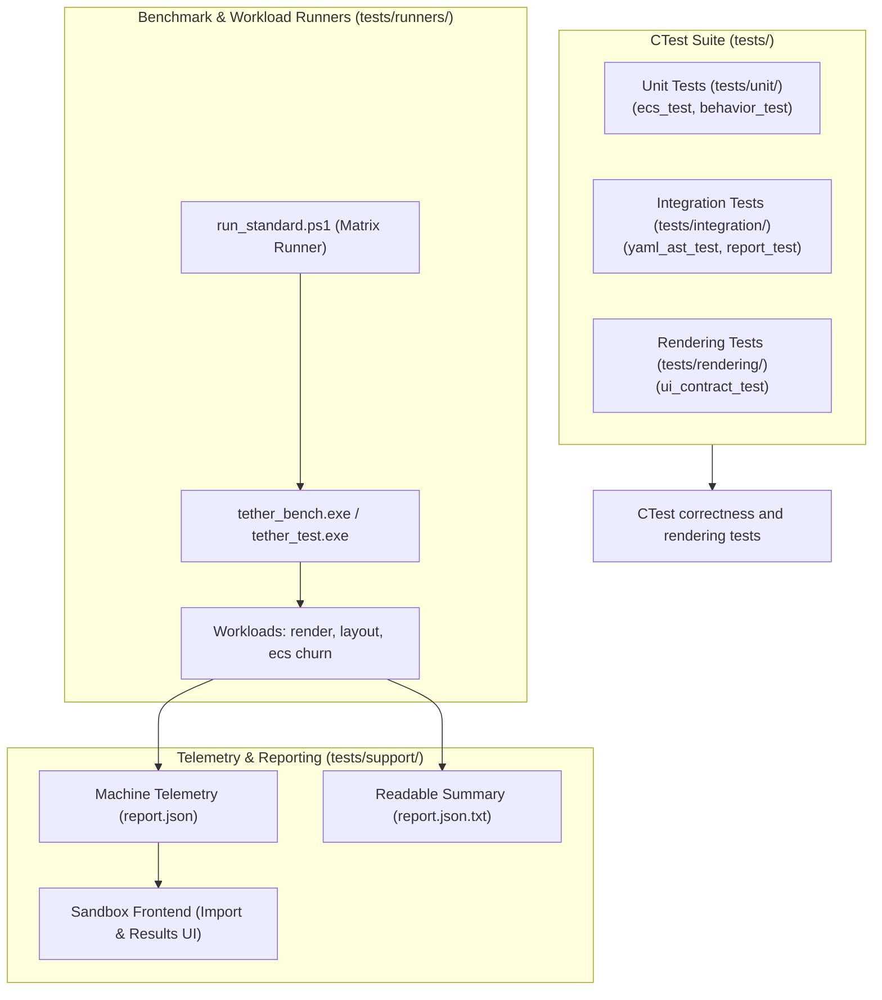

# Chapter 13: Testing, Benchmarks, and Profiling

[<- Previous: Chapter 12 - API Reference and Integration Guides](12_api_reference.md) | [Documentation Master Index](../index.md) | [Next: Chapter 14 - Portability Contracts, Limitations, and Architectural Decisions ->](14_portability_and_decisions.md)

---

## 1. Executive Summary

Tether maintains an automated test, benchmarking, and validation suite located in `tests/`. The testing architecture adheres to strict engineering invariants:
- **Zero Workload Execution During Builds**: Compilation produces standalone test runners and benchmark harnesses without executing workloads during build steps.
- **Strict Separation of Concerns**:
  - **Correctness Tests**: Automated regression tests executed via CTest that verify explicit assertions and fail with non-zero exit codes upon contract violations.
  - **Controlled Workloads**: Configurable test scenarios that exercise layout, rendering, and ECS churn across scale boundaries (1K to 100K+ entities).
  - **Benchmarks**: High-precision timing runs generating structured JSON telemetry and human-readable summaries without polluting unit test assertions.
- **Detached Execution Model**: Workload harnesses (`tether_bench.exe`, `tether_test.exe`) own their engine and graphics contexts. The interactive Sandbox showcase serves as an independent frontend that launches runners and visualizes imported reports.



---

## 2. Test Suite Architecture

The test suite is organized into modular layers reflecting system boundaries:

| Directory | Scope & Responsibility | Execution Environment | Primary Target |
| :--- | :--- | :---: | :--- |
| `tests/unit/` | Pure CPU logic, ECS memory pools, generational indices, swap-and-pop, base component contracts. | Headless (CI / Console) | `tether_ecs_test`, `tether_behavior_test` |
| `tests/integration/` | Declarative YAML lexer, AST parsing, widget construction/rollback (`yaml_load_test`), template slots, report serialization. | Headless (CI / Console) | `yaml_ast_test`, `yaml_load_test`, `report_test` |
| `tests/rendering/` | GPU backbuffer presentation, retained vs. volatile dirty flags, hierarchical clipping, color states. | Interactive Desktop / GPU | `ui_contract_test` |
| `tests/support/` | Shared harness utilities: high-resolution timers, process management, JSON reporting, platform bridges. | Shared Static Library | `tether_test_support` |
| `tests/runners/` | Standalone CLI binaries that run parameterized workloads and produce performance reports. | CLI / Script Automation | `tether_test.exe`, `tether_bench.exe` |

---

## 3. Unit and Behavioral Testing

### 1. ECS Kernel Correctness (`tests/unit/ecs_test.c`)
Validates fundamental ECS guarantees under stress:
- **Generation Increment**: Verifies that destroying an entity increments its upper 32-bit generation and invalidates cached GUIDs.
- **Dense Array Contiguity**: Confirms that adding and removing components via Swap-and-Pop preserves a contiguous memory block without gaps.
- **Sparse-Dense Bi-directional Mapping**: Tests that sparse array lookups accurately resolve dense indices, and `entity_map` points back to valid GUIDs.
- **Cascading Destruction**: Asserts that deleting a parent entity recursively destroys its full subtree, freeing all attached components and recycling slot indices.

### 2. Behavioral Contract Scenarios (`tests/unit/behavior_test.c`)
Tests discrete engine subsystems across isolated scenarios:

```powershell
# Run individual behavior scenarios via CLI
./build/Release/tether_behavior_test layout
./build/Release/tether_behavior_test visibility
./build/Release/tether_behavior_test input
./build/Release/tether_behavior_test lifetime
./build/Release/tether_behavior_test text
./build/Release/tether_behavior_test widgets
./build/Release/tether_behavior_test menu_interaction
./build/Release/tether_behavior_test event_contract
./build/Release/tether_behavior_test disabled
```

- **`layout`**: Verifies that flex column and row containers calculate slot bounds correctly according to inner padding, gap, and child dimensions.
- **`visibility`**: Verifies `TETHER_VISIBLE`, `TETHER_HIDDEN`, and `TETHER_COLLAPSED` layout and rendering propagation.
- **`input`**: Simulates pointer move, down, and up events; validates hover/press transitions and bounding box hit culling.
- **`lifetime`**: Tests allocation limits, entity recycling from `free_indices`, and double-free rejection.
- **`text`**: Validates the 4-tier Small String Optimization (SSO) storage and dynamic buffer cleanup.
- **`widgets`**: Validates built-in widget state components (`Slider`, `Toggle`, `Checkbox`, `Radio`, `SegmentedBar`, `Dropdown`, `Collapsible`, `Switcher`).
- **`menu_interaction`**: Verifies priority input routing (`tether_input_set_route`), `POSITION_ABSOLUTE` Z-order/clip escape, and menu selection/dismissal.
- **`event_contract`**: Verifies right-click bubbling, `Tether_Event` payloads, and reentrant callback unbinding (`g_dispatch_depth`).
- **`disabled`**: Verifies `tether_widget_set_enabled()` dims compound subtrees and blocks hit-testing cleanly.

---

## 4. Integration and Parser Testing

### Declarative AST & Widget Construction (`tests/integration/yaml_ast_test.c`, `yaml_load_test.c`)
Ensures that declarative scene definitions parse reliably, construct built-in widgets accurately, and roll back cleanly on errors:
- **Syntax Error Recovery (`yaml_parse_recovery`)**: Exercises malformed YAML inputs and parser recovery.
- **Widget Construction & Rollback (`yaml_construction`)**: Exercises built-in YAML widget properties, `$variable` / template slot substitution, recursion limits, and transactional cleanup on invalid definitions.

### Report Integrity (`tests/integration/report_test.c`)
Verifies that benchmark telemetry structures serialize to valid JSON conforming to the Tether report schema, ensuring compatibility with the Sandbox Lab importer.

---

## 5. Rendering and Contract Validation

### Retained vs. Volatile Modes (`tests/rendering/ui_contract_test.c`)
Exercises retained and volatile scenes against a live Chitra backend. Checks cover text updates and transforms, wrapping and layout on resize, nested clips, and YAML loading and failure recovery. A volatile entity retains its dirty layout and visual tags; tagging a root alone does not make every descendant volatile.

---

## 6. Controlled Benchmarks and Workloads

The standalone runner `tether_bench.exe` executes controlled ECS, layout, and rendering workloads. Render runs measure CPU-side work and submission counters, not GPU execution time:

```powershell
# Run a 10,000-entity retained render workload for 120 frames
./build/Release/tether_bench.exe --scenario render --mode retained --count 10000 --spawn 32 --delete 32 --mutate 100 --frames 120 --warmup 30 --fps 60 --seed 1 --memory-mib 1024
```

### CLI Configuration Parameters

| Parameter | Type | Default | Description |
| :--- | :--- | :---: | :--- |
| `--scenario` | String | Required | Workload target: `render`, `layout`, or `ecs`. |
| `--mode` | String | `retained` | Render pipeline mode: `retained` (reactive dirty flagging) or `volatile` (continuous per-frame render). |
| `--count` | Integer | `1000` | Requested initial workload population; actual active counts are recorded. |
| `--spawn` | Integer | `0` | Number of new entities created per frame. |
| `--delete` | Integer | `0` | Number of entities destroyed per frame (exercising Swap-and-Pop churn). |
| `--mutate` | Integer | `0` | Number of entities modified per frame (triggering invalidation tags). |
| `--frames` | Integer | `120` | Number of measured sample frames. |
| `--warmup` | Integer | `30` | Requested render warm-up frames; actual warm-up is recorded. |
| `--fps` | Integer | `60` | Render pacing: `0` requests VSync; positive values set a manual cap. |
| `--seed` | Integer | `1` | Seed for deterministic colors; operation order is not randomized. |
| `--memory-mib` | Integer | `1024` | Conservative preflight workload budget in MiB, not a hard process-memory limit. |
| `--output` | String | Automatic | JSON file path; the default is under the executable's `report` directory. |

---

### Automated Standard Benchmark Matrix (`run_standard.ps1`)

To obtain reproducible performance comparisons across engine versions, Tether provides an automated PowerShell test harness:

```powershell
# Execute the standard matrix across ECS churn, mutation profiles, and render loads
./tests/benchmarks/run_standard.ps1 -BinaryDirectory build/Release -IncludeRendering
```

The standard matrix executes:
1. **ECS Fixed-Count Mutation**: Evaluates raw linear iteration across dense pools at 1K, 10K, and 100K entities.
2. **High-Churn Lifecycle**: Measures throughput under simultaneous rapid creation and deletion ($32\text{ spawn} / 32\text{ delete}$ per frame).
3. **25% Population Mutation**: Mutates a quarter of the requested ECS population per step without spawning or deleting.
4. **Rendering Stress**: Optionally records work times, frame intervals, and submission counters in retained and volatile modes.

---

## 7. Performance Profiling and Methodology

### 1. Timing Boundaries
`work_ms` covers each update through the post-frame callback, including mutations, engine work, and graphics submission where applicable; it excludes the following pacing interval. Rendered frame intervals measure spacing between update starts and include intervening pacing. The layout workload separately records time inside `tether_layout_process_all`; other workloads do not isolate layout or visual synchronization. GPU execution time is not measured.

### 2. Idle Behavior
The rendering benchmark forces presentation and is not an idle-power test. Neither the benchmark nor its redraw status establishes zero process CPU usage or an operating-system sleep guarantee.

### 3. Memory Measurements
Reports record process resident memory at sampled boundaries, including a sampled peak when available. These readings are not allocator ownership, VRAM, an OS high-water mark, or proof that destroying objects returns pool capacity to its starting value. Query failures are reported as unavailable.

See [Measurement methodology](../../tests/docs/methodology.md) for exact boundaries, report fields, failure states, and reproducibility guidance.

---

## 8. Continuous Integration (CI) and CTest Execution

Tether uses CMake's standard test driver `ctest`. To execute the registered test suite across all configurations:

```powershell
# 1. Configure with test targets enabled
cmake -S . -B build -DTETHER_BUILD_TESTS=ON -DTETHER_BUILD_RUNNERS=ON

# 2. Build Release binaries
cmake --build build --config Release --parallel 8

# 3. Run all registered correctness tests
ctest --test-dir build -C Release -L correctness --output-on-failure --no-tests=error

# 4. Run the complete suite (Correctness + Rendering)
ctest --test-dir build -C Release -L "correctness|rendering" --output-on-failure
```

---

[<- Previous: Chapter 12 - API Reference and Integration Guides](12_api_reference.md) | [Documentation Master Index](../index.md) | [Next: Chapter 14 - Portability Contracts, Limitations, and Architectural Decisions ->](14_portability_and_decisions.md)
