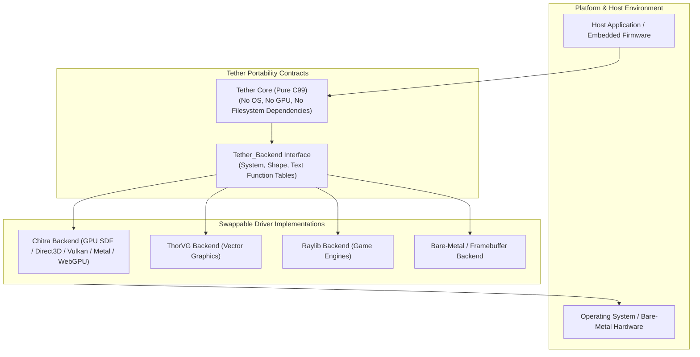
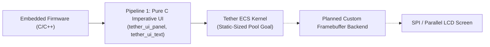

# Chapter 14: Portability Contracts, Limitations, and Architectural Decisions

[<- Previous: Chapter 13 - Testing, Benchmarks, and Profiling](13_testing_and_benchmarks.md) | [Documentation Master Index](../index.md)

---

## 1. Executive Summary

Tether is engineered to provide a predictable, portable, and high-performance user interface kernel. Achieving these goals requires deliberate systems-level trade-offs: prioritizing memory predictability over opaque automations, cache locality over deep object-oriented abstractions, and strict hardware decoupling over platform-specific optimizations.

This chapter documents Tether's formal **portability contracts**, embedded and bare-metal execution pathways, core **Architectural Decision Records (ADRs)**, and active technical limitations and engineering trade-offs.



---

## 2. Portability Contracts & Hardware Abstraction

Tether enforces strict isolation between its core UI state logic and the underlying hardware:

### 1. Link-Time Driver Decoupling
The core Tether engine (`src/core/`, `src/engine/`, `src/ui/`) contains zero direct calls to operating system APIs, window managers, or graphics hardware interfaces (such as DirectX, Metal, Vulkan, OpenGL, or WebGPU).

All platform and rendering operations are routed exclusively through the `Tether_Backend` contract table:
```c
typedef struct Tether_Backend {
    const Tether_System_API* system; /* Windowing, frame timing, input forwarding, lifecycle */
    const Tether_Shape_API*  shape;  /* Rectangles, rounded corners, borders, scissor clipping */
    const Tether_Text_API*   text;   /* Font metrics, glyph measurement, string rendering */
} Tether_Backend;

extern Tether_Backend g_backend;
```

By compiling against a concrete backend file (e.g., `src/backends/chitra_backend.c`), Tether binds to the target platform at link time with minimal indirection. Replacing the backend requires swapping `src/backends/chitra_backend.c` in `TETHER_SOURCES` inside [CMakeLists.txt](../../CMakeLists.txt) and linking required dependencies.

---

### 2. Future Embedded & Bare-Metal Targets (Roadmap)

Tether's architecture avoids direct OS or GPU calls in `src/core/`, `src/engine/`, and `src/ui/` so embedded deployments can be pursued in future milestones:



#### Planned Embedded Targets (Not Yet Validated)
1. **Steady-State Allocation Tuning**:
   Constructing UI via C APIs (`Pipeline 1`) avoids YAML/libyaml dependencies, while reducing runtime pool/text allocations for hard embedded budgets remains future work.
2. **Portable C Dependencies**:
   Core ECS and layout modules rely primarily on standard C headers (`stdint.h`, `stdbool.h`, `stddef.h`, `math.h`, `stdlib.h`, `string.h`); non-Windows and bare-metal targets are not yet validated in CI.
3. **SRAM Budget Measurement**:
   Compact sub-$64\text{ KB}$ SRAM operation on microcontrollers is a design goal and has not yet been measured in `v0.0.3-preview`.

---

## 3. Architectural Decision Records (ADRs)

### ADR-01: Data-Oriented ECS over C++ OOP Class Hierarchy
- **Status**: Adopted in `v0.0.3-preview`.
- **Context**: Traditional UI frameworks (Qt, wxWidgets, DOM) model UI elements as deep inheritance trees (`Widget -> Frame -> Container -> Button`), spreading objects across the heap and coupling state to base classes.
- **Decision**: Tether uses a data-oriented Entity Component System (ECS) where entities are 64-bit integer GUIDs and component data is stored in contiguous dense arrays indexed via sparse sets.
- **Consequences**:
  - Sequential array iteration improves CPU cache locality and avoids vtable indirection.
  - Component pointers returned by lookup APIs can move during pool growth or swap-and-pop deletion and must be re-queried after structural mutations.

---

### ADR-02: Retained-Mode ECS with Dirty-Flag Sync over Pure Immediate Mode
- **Status**: Adopted in `v0.0.3-preview`.
- **Context**: Immediate-mode UI reconstructs UI state every frame. Retaining state allows static scenes to skip redundant engine passes while still offering `VOLATILE` mode for continuous updates.
- **Decision**: Tether combines retained ECS state storage with dirty flags (`DIRTY_LAYOUT`, `DIRTY_VISUAL`, `DIRTY_HIERARCHY`, `VOLATILE`).
- **Consequences**:
  - When no dirty flags or `VOLATILE` entities are active, `tether_engine_frame()` skips sync work (`tether_did_draw() == false`).
  - Overall process sleep/idle CPU depends on the host loop and backend; retained component storage consumes baseline memory between frames.

---

### ADR-03: Separation of Layout Space from Render Space
- **Status**: Adopted in `v0.0.3-preview` (GPU-only text transforms remain future work).
- **Context**: Coupling layout geometry with visual offsets can cause layout invalidation whenever visual transforms change.
- **Decision**: Separate layout slot geometry (`Tether_SlotTransform`) from presentation offsets (`Tether_RenderTransform`).
- **Consequences**:
  - Non-text visual changes (`RenderTransform`, shape colors) mark `DIRTY_VISUAL` without triggering layout reflow.
  - Text rotation, scale, and pivot updates also flag `DIRTY_TEXT_CONTENT` and rebuild glyph geometry on the CPU.

---

### ADR-04: Stateless Layout Solver Architecture (Vinyasa Design)
- **Status**: Proposed / Roadmap (`src/engine/tether_layout.c` currently runs the built-in two-pass solver).
- **Context**: Decoupling persistent ECS storage from transient layout calculation allows layout rules to evolve independently.
- **Decision**: Integrate the standalone Vinyasa solver through `vin_host` and transient scratch memory (`vin_context.scratch`) in a future milestone.
- **Consequences**:
  - Keeps layout calculation separated from persistent ECS ownership; not yet wired into `v0.0.3-preview`.

---

### ADR-05: 64-Bit Scalar GUIDs over Raw Entity Pointers
- **Status**: Adopted in `v0.0.3-preview`.
- **Context**: Storing raw entity object pointers across callbacks or external handles risks use-after-free bugs when elements are destroyed.
- **Decision**: Represent entities as scalar 64-bit integer GUIDs composed of a 32-bit slot index and a 32-bit generational version counter.
- **Consequences**:
  - Stale handles fail safely in $O(1)$ time via `tether_ecs_is_valid()`.
  - Component lookups still go through the sparse-set index, and component data pointers must be re-queried after structural ECS mutations.

---

### ADR-06: Format-Agnostic Scene AST with Bundled YAML Frontend
- **Status**: Adopted in `v0.0.3-preview`.
- **Context**: Parsing directly into widgets couples file syntax tightly to UI instantiation.
- **Decision**: Parse YAML into `Tether_ASTNode` trees (supporting `$var`, `$slot`, template caching, recursion limit `64`, and entity cleanup on load failure) before widget instantiation (`tether_yaml_widgets.c`).
- **Consequences**:
  - Enables future non-YAML parsers or AOT bytecode tools to target the same instantiation model, while YAML currently exposes a subset of the C APIs.

---

## 4. Current Limitations & Engineering Trade-offs

| Design Aspect | Current Architecture | Strategic Rationale | Trade-off / Limitation |
| :--- | :--- | :--- | :--- |
| **Threading Model** | Single-threaded UI main loop | Avoids mutex contention on ECS dense arrays and simplifies C ergonomics. | Worker threads must marshal UI updates onto the UI thread (`on_frame`). |
| **Memory Model** | Retained ECS dense pools | Preserves scene state across frames and skips unchanged sync passes (`tether_did_draw() == false`). | Retains component memory between frames; pool growth and `TextDynamic` allocate dynamically. |
| **Text Rasterization** | Backend-driven glyph cache | Keeps core engine independent of rasterizers. | Complex bidirectional/ligature shaping awaits external shaping integration (e.g., HarfBuzz). |
| **Dynamic Components** | Runtime slot registration (`tether_ecs_register_component_dynamic`) | Lets applications register custom component structs cleanly. | Bounds capped by `TETHER_MAX_REGISTERED_COMPONENTS`. |

---

## 5. Architectural Comparison Summary

| Architectural Property | Tether Design (`v0.0.3-preview`) | Traditional OOP (Qt / wxWidgets) | Immediate Mode (Dear ImGui) | Web DOM / Electron |
| :--- | :---: | :---: | :---: | :---: |
| **Data Architecture** | Contiguous ECS Dense Arrays | Scattered Heap Node Graphs | Transient Stack Buffers | Heap Node Tree with V8 Objects |
| **Update Model** | Retained Dirty Flags (`tether_did_draw` skips unchanged frames) | Event-driven | Continuous per-frame submission | DOM / Chromium event loops |
| **Memory Strategy** | Compact ECS structs + Chitra backend resources | $15 - 50\text{ MB}$ | $< 5\text{ MB}$ | $150 - 500+\text{ MB}$ |
| **Foreign Language Interop** | C99 Scalar GUID ABI (bindings on roadmap) | Complex C++ Wrappers / SIP | C++ Wrappers (`cimgui`) | Node.js IPC / WebSockets |
| **Layout Separation** | Separated `SlotTransform` vs `RenderTransform` (text rebuilds glyphs) | Combined widget layout | Immediate per-frame cursor | CSS box layout coupling |

---

[<- Previous: Chapter 13 - Testing, Benchmarks, and Profiling](13_testing_and_benchmarks.md) | [Documentation Master Index](../index.md)
