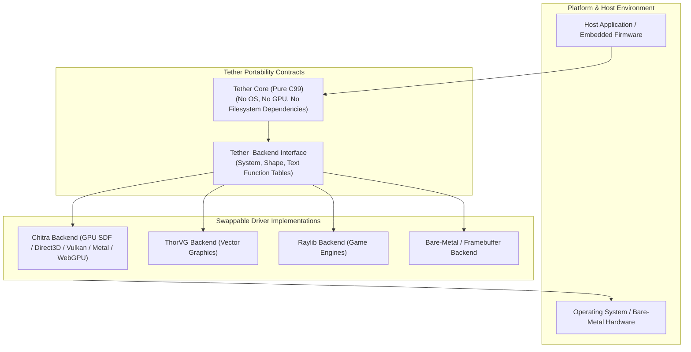
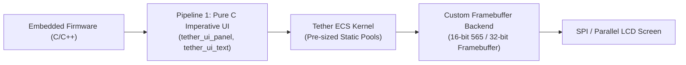

# Chapter 14: Portability Contracts, Limitations, and Architectural Decisions

[<- Previous: Chapter 13 - Testing, Benchmarks, and Profiling](13_testing_and_benchmarks.md) | [Documentation Master Index](../index.md)

---

## 1. Executive Summary

Tether is engineered to provide a predictable, portable, and high-performance user interface kernel. Achieving these goals requires deliberate systems-level trade-offs: prioritizing memory predictability over opaque automations, cache locality over deep object-oriented abstractions, and strict hardware decoupling over platform-specific optimizations.

This chapter documents Tether's formal **portability contracts**, embedded and bare-metal execution pathways, core **Architectural Decision Records (ADRs)**, and active technical limitations and engineering trade-offs.



---

## 2. Portability Contracts & Hardware Abstraction

Tether enforces strict isolation between its core UI state logic and the underlying hardware:

### 1. Link-Time Driver Decoupling
The core Tether engine (`src/core/`, `src/engine/`, `src/ui/`) contains zero direct calls to operating system APIs, window managers, or graphics hardware interfaces (such as DirectX, Metal, Vulkan, OpenGL, or WebGPU).

All platform and rendering operations are routed exclusively through the `Tether_Backend` contract table:
```c
typedef struct Tether_Backend {
    const Tether_System_API* system; /* Windowing, frame timing, input forwarding, lifecycle */
    const Tether_Shape_API*  shape;  /* Rectangles, rounded corners, borders, scissor clipping */
    const Tether_Text_API*   text;   /* Font metrics, glyph measurement, string rendering */
} Tether_Backend;

extern Tether_Backend g_backend;
```

By compiling against a concrete backend file (e.g., `src/backends/chitra_backend.c`), Tether binds to the target platform at link time with zero dynamic dispatch overhead. Replacing the backend requires only swapping the backend source file in the CMake build configuration.

---

### 2. Embedded and Bare-Metal Execution Pathways

Tether is explicitly architected to support resource-constrained microcontrollers and bare-metal displays (e.g., STM32, ESP32, NXP i.MX, Raspberry Pi RP2040):



#### Embedded Operating Invariants
1. **Zero Dynamic Allocation in Steady State**:
   Using **Pipeline 1 (Pure C Imperative UI)**, Tether bypasses the YAML parser entirely. The ECS dense arrays are pre-sized during initialization using fixed capacities. Once initialized, the engine executes zero heap allocations (`malloc`, `free`) during steady-state frame execution.
2. **Standard C99 Dependencies Only**:
   The core ECS kernel and layout solver depend only on standard ISO C99 headers (`stdint.h`, `stdbool.h`, `stddef.h`, `math.h`). They do not require a POSIX environment, C runtime filesystem, or threading libraries.
3. **SRAM Budget Predictability**:
   A complete Tether UI hierarchy of 200 interactive widgets requires less than $64\text{ KB}$ of contiguous memory for all component arrays, fitting comfortably within microcontroller internal SRAM.

---

## 3. Architectural Decision Records (ADRs)

### ADR-01: Data-Oriented ECS over C++ OOP Class Hierarchy
- **Status**: Accepted and Verified.
- **Context**: Traditional UI frameworks (Qt, wxWidgets, DOM) model UI elements as deep inheritance trees (`Widget -> Frame -> Container -> Button`). This model incurs scattered heap allocations, cache-miss pointer chasing, large per-object overhead, and fragile base class coupling.
- **Decision**: Tether adopts a data-oriented Entity Component System (ECS) where entities are simple 64-bit integer GUIDs and component data is stored in contiguous dense arrays indexed via sparse sets.
- **Consequences**:
  - Linear iteration over components achieves maximum hardware CPU cache locality.
  - Zero vtable indirection overhead.
  - New properties or third-party behaviors can be attached to entities dynamically without modifying base engine structs.

---

### ADR-02: Retained-Mode ECS with Reactive Invalidation over Pure Immediate Mode
- **Status**: Accepted and Verified.
- **Context**: Pure immediate-mode UI (Dear ImGui) constructs and renders UI elements unconditionally every frame. While ergonomically simple, it results in continuous CPU/GPU utilization, preventing host devices from entering low-power idle states. Conversely, Web Virtual DOM frameworks incur heavy garbage-collection overhead diffing trees in high-level runtimes.
- **Decision**: Tether combines retained ECS state storage with reactive invalidation tags (`DIRTY_LAYOUT`, `DIRTY_VISUAL`, `VOLATILE`).
- **Consequences**:
  - When the UI is static, the engine skips layout computation and GPU draw submission entirely (`tether_did_draw() == false`), achieving zero-power steady state.
  - Retains the performance benefits of cached spatial scene graphs for fast hit-testing without paying the power penalty of unconstrained continuous rendering.

---

### ADR-03: Separation of Layout Space from Render Space
- **Status**: Accepted and Verified.
- **Context**: In traditional DOM and mobile UI engines, mutating visual properties (such as hover scale, continuous animations, or visual rotations) invalidates container layout, triggering costly reflow passes across parent and sibling containers.
- **Decision**: Decouple layout slot geometry (`Tether_SlotTransform`) from visual GPU rendering transformations (`Tether_RenderTransform`).
- **Consequences**:
  - High-frequency visual animations (translation offsets, scale factors, rotation angles, opacity fading) execute purely on the GPU during visual synchronization without touching layout geometry.
  - Layout reflow passes occur strictly when structural container dimensions, padding, or flex weights change.

---

### ADR-04: Stateless Layout Solver Architecture (Vinyasa Design)
- **Status**: Accepted and Verified.
- **Context**: Coupling persistent layout state directly inside scene graph nodes increases memory footprint per node and leads to complex state synchronization bugs during incremental reflow.
- **Decision**: Decouple persistent scene definitions in the ECS from the layout calculation engine. The layout solver executes on-demand against calculation roots, allocating temporary scratch memory from a transient arena (`vin_context.scratch`) and communicating with the host through `vin_host` bridge hooks.
- **Consequences**:
  - Persistent UI nodes remain compact and cache-efficient.
  - Layout calculations are completely stateless: scratch arenas are reset at the conclusion of the layout pass, eliminating intermediate memory fragmentation.

---

### ADR-05: 64-Bit Scalar GUIDs over Raw Pointers for Foreign FFI Interop
- **Status**: Accepted and Verified.
- **Context**: Exposing raw memory pointers to foreign language bindings (Rust, Python, Lua, WebAssembly) leads to severe use-after-free crashes when an entity is destroyed on the C side while foreign handles remain alive.
- **Decision**: Represent entities exclusively as scalar 64-bit integer GUIDs composed of a 32-bit slot index and a 32-bit generational version counter.
- **Consequences**:
  - Stale references held by foreign garbage collectors or asynchronous threads fail safely in $O(1)$ time via `tether_ecs_is_valid()` without dereferencing freed memory.
  - Handles can be passed across language boundaries by value with zero marshaling cost.

---

### ADR-06: Format-Agnostic Scene IR with Bundled YAML Frontend
- **Status**: Accepted and Verified.
- **Context**: Hardcoding the engine to a single declarative file format limits integration flexibility in environments that already standardize on JSON, XML, or custom domain-specific formats.
- **Decision**: Decouple syntactic parsing from semantic tree instantiation. The parser produces a format-neutral tree of `Tether_ASTNode` records (scalars, sequences, mappings), with YAML serving as the default bundled frontend.
- **Consequences**:
  - Alternative parsers (JSON, XML, HTML) can target the same intermediate representation with zero modifications to engine internals.
  - Enables seamless bidirectional interoperability between declarative files and compiled host code.

---

## 4. Current Limitations & Engineering Trade-offs

| Design Aspect | Current Architecture | Strategic Rationale | Trade-off / Limitation |
| :--- | :--- | :--- | :--- |
| **Threading Model** | Single-threaded UI main loop | Eliminates mutex contention on ECS dense arrays; maximizes single-core L1/L2 cache locality. | Worker threads must marshal UI mutations to the main thread via message queues or `on_frame` callbacks. |
| **Memory Model** | Retained ECS dense pools | Enables instant spatial hit testing and zero-power reactive rendering without recomputing scene trees each frame. | Consumes slightly more baseline RAM than pure immediate-mode toolkits (which discard state each frame). |
| **Text Rasterization** | Backend-driven glyph cache | Keeps core engine lightweight and avoids linking large typography engines directly into the kernel. | Advanced OpenType complex script shaping (e.g. Arabic, Devanagari) requires backend HarfBuzz integration. |
| **Dynamic Components** | Dynamic ID allocation pool | Permits runtime component registration by plugins without recompiling core engine headers. | Dynamic component IDs require dynamic lookup versus fixed compile-time enum constants. |

---

## 5. Architectural Comparison Summary

| Architectural Property | Tether Design | Traditional OOP (Qt / wxWidgets) | Immediate Mode (Dear ImGui) | Web DOM / Electron |
| :--- | :---: | :---: | :---: | :---: |
| **Data Architecture** | Contiguous ECS Dense Arrays | Scattered Heap Node Graphs | Transient Stack Buffers | Heap Node Tree with V8 Objects |
| **Steady-State Power** | **Zero Idle CPU** (Reactive) | Partial Idle (Event-driven) | Continuous 100% GPU/CPU polling | High idle power (Chromium loop) |
| **Memory Footprint** | $< 1\text{ MB}$ (Bare-metal capable) | $15 - 50\text{ MB}$ | $< 5\text{ MB}$ | $150 - 500+\text{ MB}$ |
| **Foreign Language Interop** | Pure C99 Scalar ABI | Complex C++ Wrappers / SIP | C++ Wrappers (cimgui) | Node.js IPC / WebSockets |
| **Animation Impact on Layout** | **Zero reflow** (RenderTransform) | Triggers parent reflow | Reconstructs full UI each frame | Triggers CSS layout reflow |

---

[<- Previous: Chapter 13 - Testing, Benchmarks, and Profiling](13_testing_and_benchmarks.md) | [Documentation Master Index](../index.md)
